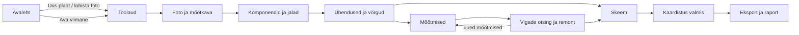

# 02 · Kasutaja teekond: äpi avamisest valmis skeemini

See dokument kirjeldab kogu töövoo ekraan ekraani haaval. Igas osas on kirjas, **mida kasutaja teeb**, **mida äpp näitab** ja **reeglid**. Paigutuse, värvide ja klahvide detailid on failis [06-kasutajaliides.md](06-kasutajaliides.md), andmete väljad ja hindamisreeglid failis [04-andmemudel.md](04-andmemudel.md).

## Ülevaade



Sammud ei ole väravad. Iga tööriist on igal ajal kasutatav ja järjekord on ainult soovitus. Parandaja võib näiteks kohe alguses ühe kahtlase jala ära mõõta.

---

## 1. Äpi avamine: Avaleht

**Kasutaja näeb:**
- suurt ala **„Lohista plaadi foto siia“**, mille all on nupp „Uus plaat“;
- **viimaste projektide** ruudustikku: pisipilt, nimi, seade, viimati muudetud ja edenemise riba;
- nuppe „Ava fail…“ ja „Näidisprojekt“.

**Kasutaja teeb ja äpp vastab:**
| Tegevus | Tulemus |
|---|---|
| lohistab foto avalehele või kleebib `Ctrl+V` | luuakse kohe uus projekt (nimi tuleb failinimest) ja avaneb töölaud koos fotoga; dialoogi ei tule |
| klõpsab „Uus plaat“ | avaneb väike dialoog (osa 2) |
| klõpsab viimast projekti | töölaud avaneb samas seisus nagu sulgemisel: suum, kihid ja aktiivne tööriist |
| „Ava fail…“ | failidialoog: `.pcbk` (projekt) või `.pcbmap.json` (prototüübi import) |
| „Näidisprojekt“ | avaneb kirjutuskaitstud koopia näidisplaadist; esimene muudatus pakub „Salvesta oma koopiana“ |

**Reeglid:**
- Esmakäivitusel on viimaste projektide asemel lühike kolmerealine selgitus („1. Lohista foto · 2. Paiguta komponendid · 3. Ühenda ja mõõda“) ning näidisprojekti nupp.
- Kui viimane projekt on puudu (fail kustutatud või liigutatud), on kaart hall ja tekstiga „Faili ei leitud“. Valikud on „Otsi üles…“ ja „Eemalda nimekirjast“.

## 2. Uus plaat

Üks dialoog, kõik väljad valikulised, nupp **„Alusta“** on kohe aktiivne.

| Väli | Vaikimisi | Märkus |
|---|---|---|
| Nimi | „Plaat 2026-11-07“ või foto failinimi | |
| Seade / mudel | tühi | nt „Pelle PV20 kontroller“ |
| Mis on viga? | tühi | üks rida, nt „ei lülitu sisse“ |
| Foto | tühi | lohistusala; võib lisada ka hiljem |
| Asukoht | `Dokumendid\PCB Kaardistaja\<nimi>.pcbk` | „Muuda…“ |

**Reeglid:** pärast „Alusta“ on fail kohe kettal olemas (salvestus algab esimesest sekundist). Fotota projekt avaneb tühja lõuendiga, millel on lohistusala ja ruudustik. Fotota saab tööd teha ka siis, kui joonistad ainult skeemi ja märgid mõõtmisi.

## 3. Töölaud

```
┌──────────────────────────────────────────────────────────────────────────────┐
│ ☰ Plaadi nimi  ▸  ●●●○○○ edenemine     [Plaat | Skeem]    ↶ ↷  ⌘K  Ekspordi │  ülariba
├───────────────┬───────────────────────────────────────────┬──────────────────┤
│ Teek          │ ┌─┐                                         │ KONTEKST         │
│ Plaadil       │ │⬚│   plaadi foto + komponendid + rajad     │ (valitud objekt) │
│ Võrgud        │ │╱│                                         │  või             │
│ Mõõtmised     │ │◎│                                         │ „Järgmine samm“  │
│ Logi          │ └─┘ tööriistariba                           │                  │
│ (navigaator)  │                                             │                  │
├───────────────┴───────────────────────────────────────────┴──────────────────┤
│ Foto nähtavus ━━━━●━━ 85%  ◐ Kontrast  ⟳ ⇋  Pealmine|Alumine  Kihid ▾   − 100% + ⤢  14,00 px/mm  X 12,3 Y 4,5 mm │
└──────────────────────────────────────────────────────────────────────────────┘
```

- **Vasakul navigaator:** vahekaardid *Teek* (korpused), *Plaadil* (kõik paigutatud asjad rühmades), *Võrgud*, *Mõõtmised* ja *Logi* (muudatuste ning remondi ajalugu). Siit valitakse paigutatud komponente, jalgu ja võrke.
- **Keskel lõuend:** foto ja kogu kaardistus. Vasakus servas on tööriistariba.
- **Paremal kontekstipaneel:** valitud objekti andmed, muutmine ja mõõtmine. Kui midagi pole valitud, on seal **„Järgmine samm“** (osa 3.1).
- **All mõõteriba:** foto nähtavuse liugur (kohe foto all), kontrast, pööra, peegelda, poole valik, kihid, suum, mõõtkava ja kursori koordinaadid millimeetrites.
- **Ülariba:** projekti nimi, edenemine (osa 13), vaate lüliti **Plaat | Skeem**, tagasi/uuesti, käsupalett `Ctrl+K` ja Ekspordi.

### 3.1 „Järgmine samm“ (juhend)

Kontrollnimekiri. Iga rida on klõpsatav ja aktiveerib vastava tööriista; tehtud read on linnukesega. Järjekord:

1. Lisa plaadi foto *(või „Jätan vahele“)*
2. Kalibreeri mõõtkava
3. Paiguta komponendid: *12 paigutatud*
4. Ühenda jalad: *48 % jalgadest võrgus või märgitud ühendamata*
5. Määra toide ja maandus: *GND ✓, 5V ✓, 12V –*
6. Mõõda toiteliinid: *2 / 3 toitevõrku mõõdetud*
7. Vaata skeem üle
8. Märgi kaardistus valmis

Juhend ei peata kasutajat kunagi. Rida „Jätan vahele“ (nt fotota töö) märgib selle punkti vahelejäetuks.

---

## 4. Foto ettevalmistus

**Kasutaja teeb:** lohistab foto lõuendile või klõpsab „Lisa foto“. Seejärel reguleerib nähtavust ja kontrasti; vajadusel pöörab 90° või peegeldab (alumise poole foto).

**Äpp:**
- sobitab vaate fotoga ja salvestab foto projekti faili (originaal jääb muutmata);
- **pööramine ja peegeldamine teisendavad ka kogu olemasoleva kaardistuse**, nii et kõik jääb fotol õigele kohale;
- „Hall“ teeb foto halliks, et värvilised rajad ja rollid paistaksid paremini välja.

**Reeglid:** foto nähtavus on vaikimisi 85 %. Liugur on alati nähtav, `0` peidab foto ja `100` näitab täielikult. Nähtavus on vaate seadistus, mitte projekti andmed, ja tagasivõtmine seda ei puuduta.

## 5. Mõõtkava

**Kasutaja teeb:** tööriist **Kalibreeri** (`K`), seejärel klõpsab kaks punkti, mille vahekaugust ta teab (Shift = rangelt horisontaalne või vertikaalne). Avaneb väike aken „Kui pikk see lõik on?“, kus on suur numbriväli (mm) ja kiirvalikud 2,54 · 10,16 (4 sammu) · 25,4 (1″) · 10 · 50 · 100.

**Teine võimalus:** paiguta korpus, mille mõõdud on standardsed (nt pinnirida või SOIC), ja joonda see kahe jalaga (osa 6.2). Kui mõõtkava pole veel kalibreeritud, küsib äpp: **„Kas kasutada seda korpust mõõtkava aluseks?“**

**Äpp:** näitab tulemust kohe (`= 14,05 px/mm · 1 px = 71 µm`). Pärast rakendamist muudavad kõik korpused suurust millimeetrite järgi ja keskpunktid jäävad paigale. Alumise riba kiip muutub roheliseks („14,05 px/mm“).

**Reeglid:** kuni kalibreerimiseni hinnatakse mõõtkava foto laiuse järgi (laius = 100 mm) ja kiip on kollane („Kalibreerimata“). Millimeetrid on siis hinnangulised ja ekspordis on vastav märge.

## 6. Komponendid

### 6.1 Paigutamine

**Kasutaja teeb:**
- *Teek* vahekaardil otsib („soic“, „led“, „usb“) või kirjutab `Ctrl+K` → „SOIC“;
- klõpsab korpust (tööriist läheb paigutusrežiimi ja kursori all liigub poolläbipaistev eelvaade) või lohistab selle lõuendile;
- klõpsab fotol sinna, kus komponent on. Paigutusrežiim jääb aktiivseks järgmise sama korpuse jaoks; `R` pöörab eelvaadet 90°, `Esc` lõpetab.

**Äpp:** annab tähise automaatselt (R1, R2 …, prefiks tuleb korpusest) ja vaikeväärtuse (nt „10k“). Uus komponent jääb valituks ja kontekstipaneel näitab selle andmeid.

### 6.2 Õige asend ja suurus

| Viis | Kuidas | Millal |
|---|---|---|
| **Lohistamine** | haara komponendist ja vii paika; nooled nihutavad 1 px, Shift+nool 10 px | alati |
| **Pööramine** | `R` = 90°, `Q`/`E` = ±1°, Shift+`Q`/`E` = ±15°, kontekstipaneelis täpne kraad | foto pole ideaalselt sirge |
| **Suuruse muutmine** | valitud komponendil on 8 käepidet; Shift hoiab proportsiooni; paneelis laius ja kõrgus % | foto on moonutatud või korpus erineb |
| **Parameetrid** | paneelis jalgade arv, samm, kere laius (nt SOIC-8 → SOIC-14) | teine variant samast perest |
| **Kahe jala joondus** | tööriist *Joonda* (`A`): klõpsa jalg 1 → klõpsa see koht fotol → klõpsa teine jalg → klõpsa see koht fotol | kiireim viis panna IC täpselt paika |

Kahe jala joondus arvutab korraga asukoha, pöörde ja ühtlase mõõtkava. Kui mõõtkava pole kalibreeritud, pakub äpp kasutada joonduse tulemust kalibreerimiseks (osa 5).

### 6.3 Identiteet

Kontekstipaneelis on komponendi kohta:
- **Tähis** (R1), **Väärtus** (10k, ATtiny85), **Tüüp** (takisti, kondensaator … mikroskeem; määrab sümboli skeemil), **Korpus**;
- **Olek:** *Tuvastatud* või *Tuvastamata* (vaikimisi tuvastamata, kui väärtus on tühi);
- **Pool:** pealmine või alumine (`F`; alumise poole komponendid on katkendjoonega);
- **Paigaldamata (DNP):** tühi koht plaadil; jalad on olemas, kuid skeemil kuvatakse see hallina;
- **Märkused** ja **võrdluspilt** (nt andmelehe jalgade joonis, mis kuvatakse paneelis).

Tundmatu komponent: korpus „Kohandatud“ (vabalt valitud mõõdud, jalad lisatakse ise), tüüp „Muu“, olek „Tuvastamata“.

## 7. Jalad

**Kuidas jalad välja näevad** (detailid failis [06](06-kasutajaliides.md#jalad)):
- igal jalal on number ja **jalg 1 on ruudukujuline**;
- ekraanil on jalg **alati vähemalt 10 px**, ka siis, kui vaade on kaugele suumitud;
- olek on näha värvi ja kujuga: **ühendamata** (kontuur), **ühendatud** (võrgu rolli värv), **mõõdetud OK** (roheline rõngas), **kahtlane** (punane paks rõngas), **NC** (rist);
- hiir jala kohal näitab vihjet: `U1.4 · GND · võrk GND · 5 ühendust · viimati 0,02 V ✓`.

**Kasutaja teeb:**
- klõpsab jalal: jalg valitakse, kontekstipaneel näitab **jala vaadet** (nimi, võrk, ühendused, mõõtmised) ja kogu võrk tõstetakse lõuendil esile;
- annab jalale nime: paneelis või topeltklõpsuga jala sildil (VCC, PB1, SDA);
- lisab jala: tööriist *Lisa jalg* (`J`) ja klõps komponendil. Jalg saab järgmise numbri; suurus on vaikimisi sama mis teistel jalgadel;
- märgib jala ühendamata kohaks: paneelis „Ühendamata (NC)“. Seda arvestatakse valmiduse juures tehtuna.

## 8. Ühendused

Ühenduse loomiseks on kolm viisi, sest remondis selgub ühendus eri moel.

### 8.1 Rada (nähtud)
Tööriist **Rada** (`T`). Klõpsa jalal → klõpsa käänupunktid mööda fotol nähtavat rada → lõpeta jalal, teisel rajal (T-hargnemine) või topeltklõpsuga.
- `Shift` = 45° nurgad, `Backspace` = samm tagasi, `Esc` = katkesta, `L` = kiht (pealmine/alumine/juhe).
- Lõpetamata lõigu kohal on pikkus millimeetrites.
- Rada ei jookse linnulennult: see on joonistatud mööda tegelikku teed. Linnulennul ühendus on *kiirühendus* (8.2).

### 8.2 Kiirühendus (oletatud)
Vali kaks või enam jalga (klõps ja Shift+klõps) ning vajuta `C`. Tekib õhuke katkendjoon, olekuga *oletatud*. See sobib siis, kui on teada, et jalad on ühenduses, aga rada pole nähtav (näiteks plaadi all).

### 8.3 Piiksumisrežiim (mõõdetud), kõige kiirem kaardistus
Tööriist **Piiks** (`B`):
1. Klõpsa jalal, mille juures hoiad musta sondi. See muutub **ankruks** (sinine rõngas ja silt „Must sond: U1.4“).
2. Klõpsa järgmisel jalal, mida punase sondiga puudutad. Kursori juurde ilmub küsimus **„Piiksub?“**: `Enter` / `J` = jah, `Esc` / `E` = ei.
3. **Jah** salvestab ühe tagasivõetava sammuna läbivuse mõõtmise ja ühenduse: olemasolev otseühendus samade jalgade vahel saab ✓-märgi; kui jalad on juba muu tee kaudu samas võrgus, lisatakse ainult mõõtmine; muidu tekib uus *mõõdetud* link. Ühendus on mõõdetud ainult seni, kuni see mõõtmine on olemas ja kehtiv: kustutamise või remondi järel kaob ✓ ja ühenduse juures on „Mõõda uuesti“. **Ei** salvestab negatiivse tulemuse. Kui need jalad hiljem ühendatakse, hoiatab äpp: „Läbivustest ütles, et ühendust pole.“
4. Jätka järgmiste jalgadega samast ankrust. `Shift`+klõps teeb uue ankru, `Esc` lõpetab režiimi.

Nii saab näiteks kogu GND-võrgu kaardistada minutiga: ankur GND-l, siis klõps igal kahtlustatud jalal.

## 9. Võrgud ja rollid

**Äpp:** ühendustest tekivad võrgud ise. Kõik omavahel ühendatud jalad on üks võrk. Nimeta võrk saab automaatse nime N1, N2 …

**Kasutaja teeb:**
- *Võrgud* vahekaardil või jala/raja kontekstipaneelis valib **rolli** kiipidest: **GND · 3V3 · 5V · 12V · Signaal · Teadmata · + Uus roll**;
- annab võrgule nime (nt `VBUS`, `SDA`);
- uus roll: nimi, tüüp (maandus/toide/signaal), nimipinge (nt 24) ja värv.

**Rollide vaikevärvid** (muudetavad seadetes): GND **must/tumehall**, 5V **punane**, 12V **sinine**, 3V3 **oranž**, Signaal **lilla**, Teadmata **hall**. Rajad ja ühendatud jalad joonistatakse rolli värviga, nii et toiteliinid paistavad plaadil kohe välja.

**Rollikonflikt:** kui ühendus liidab kaks eri rolliga võrku (nt GND ja 5V), ei kirjutata kumbagi üle. Võrk muutub punase äärisega võrguks ja paneelis on hoiatus **„Võimalik lühis või vale ühendus: GND + 5V“** koos nuppudega „Näita ühendust“ ja „Vali õige roll“. Remondis on see sageli just see viga, mida otsitakse.

**Võrgu vaade** (klõps võrgul): kõik jalad nimekirjana (klõps viib jalale), rajade kogupikkus, mõõtmised selles võrgus ja nende hinnangud.

## 10. Mõõtmine

Põhiteekond on **Koht → Väärtus → Ühik → Salvesta**, kus ühik tuleb režiimist ise.

**Kasutaja teeb:**
1. Klõpsab jalal (koht). Kontekstipaneeli ülaosas on alati **„Mõõda“** plokk:
   - **Koht:** `U1.8` (kiip) · **Vastaspunkt:** `GND` (vaikimisi esimene GND-rolliga jalg, „muuda“);
   - **Režiim:** `V` · `Ω` · `Diood` · `Piiks` (`Alt+1`…`Alt+4`, sest väärtuse väli on fookuses);
   - **Väärtus:** väli on kohe fookuses. Lubatud on koma ja sufiksid (`4,98`, `4k7`, `1,2M`, `680m`);
   - **Toide:** *Toitega* / *Toiteta* (`Alt+P`, jääb meelde järgmiseks mõõtmiseks).
2. Vajutab `Enter`.

**Äpp:**
- salvestab mõõtmise ja näitab selle kohe ploki all reana `4,98 V · toitega · OK ✓ · 14:32`;
- arvutab **hinnangu** mõlema sondi võrgu rolli põhjal ([04 › Hindamisreeglid](04-andmemudel.md#mõõtmiste-hindamine)): **OK** (roheline), **madal** või **kõrge** (punane), **lühise kahtlus** (punane), **—** (pole millega võrrelda, neutraalne);
- värvib jala rõnga hinnangu järgi ja kuvab väärtuse väikese sildina jala kõrval;
- jätab fookuse väärtuse väljale. `Tab` viib sama komponendi järgmisele jalale, `Shift+Tab` eelmisele. Teisel jalal klõpsamine vahetab koha.

**Reeglid:**
- **Koht ei vahetu kunagi iseenesest.** Tööriista või filtri vahetus ega tühjale alale klõpsamine ei muuda mõõdetavat jalga (BenchBeepi viga BB-01).
- **Sisestatud väärtus kuulub sellele jalale, millele see kirjutati.** Kui vahetad Kohta enne `Enter`-it (`Tab`, klõps teisel jalal), ei liigu väärtus kaasa: uus jalg avaneb oma mustandiga või tühja väljaga ja tagasi tulles on eelmise jala sisestus alles. `Esc` tühjendab mustandi. Salvestamata mustand projekti faili ei lähe.
- **Pinge hinnang arvestab mõlemat sondi:** oodatav väärtus on Koha nimipinge miinus vastaspunkti nimipinge. Kui vastaspunkt pole GND, näitab plokk oodatavat väärtust (punane 5V, must 12V → „oodatav −7,0 V“).
- Kui vastaspunkti pole (GND-rolliga võrku pole veel), on vastaspunkt „määramata“ ja pinge salvestatakse ikkagi, aga hinnang on „—“. Äpp ei oleta tagantjärele, kus must sond oli: vastaspunkti saab hiljem mõõtmise real määrata ja siis arvutatakse hinnang.
- Takistus ja läbivus vajavad vastaspunkti; ilma selleta on „Salvesta“ keelatud ja näidatakse vihjet „Vali vastaspunkt“.
- Valesti sisestatud väärtus (`abc`) hoiab nupu keelatuna ja välja punasena. Andmeid ei kao.
- *Mõõtmised* vahekaart näitab kõiki mõõtmisi koos filtritega: kõik, kahtlased, toitega, toiteta, enne remonti. Klõps viib jalale.

## 11. Vigade otsing ja remont

**Kahtlaste vaade:** ülaribal või mõõteribal nupp **„Näita kahtlaseid“** tuhmistab kõik peale kahtlaste jalgade, rollikonfliktide ja ühendamata toitejalgade.

**Kahjustatud ala:** tööriist *Märgi ala* (`X`). Lohista ristkülik või ring fotol (põlenud koht, korrosioon, katkine rada) ja lisa lühike kirjeldus. Alad on oranžid ja kuvatakse raportis.

**Remonditoiming:** komponendi kontekstipaneelis nupp „Remont…“. Valikud: vahetatud / eemaldatud / joodetud üle / rada parandatud / muu, lisaks kirjeldus ja kuupäev (vaikimisi praegu).
- Pärast toimingut märgitakse **selle komponendi jalgade ja nende võrkude varasemad mõõtmised olekuga „enne remonti“**. Need jäävad ajalukku halli kirjana, aga ei mõjuta enam jalgade värve.
- Äpp pakub: **„Mõõda uuesti: 4 jalga“**. Klõps avab mõõtmise esimesel neist.

**Logi** vahekaart näitab ajajoont: remonditoimingud, olulised mõõtmised ja märkused. Muudatuste ajalugu (paigutused jne) on seal kokkuvõtlikult ja peidetav.

## 12. Mõõtjooned ja plaadi kontuur

- **Mõõtjoon** (`D`): klõps alguses, klõps lõpus (haakub jalgade ja rajapunktidega; Shift = horisontaalne/vertikaalne), seejärel vii hiir küljele ja klõpsa. Silt näitab millimeetreid.
- **Kontuur** (`O`): lohista ristkülik ümber plaadi. Laius × kõrgus kuvatakse automaatselt. Kontuuri vasak ülanurk on koordinaatide nullpunkt (X paremale, Y alla), mida kasutavad paneelid, BOM ja eksport.

## 13. Skeem ja kaardistuse valmimine

### 13.1 Skeemivaade
Ülariba lüliti **Plaat | Skeem** (`Ctrl+Tab`).

**Äpp:** genereerib kaardistusest loogilise skeemi:
- iga komponent on sümbol vastavalt tüübile (takisti, kondensaator, elektrolüüt, induktiivsus, diood, LED, NPN/PNP, N/P-MOSFET; IC, regulaator ja konnektor on kastina, mille jalad on nime ja numbriga);
- võrgud on **võrgusiltidega**. Toiterollidega võrkudel on toitesümbol (nool ja silt „5V“) ja GND-l maandussümbol. Kahejalgsed lokaalsed võrgud joonistatakse lühikese juhtmena, kui sümbolid on kõrvuti;
- esmane paigutus on automaatne: konnektorid servades, toiteosa vasakul, IC-d keskel, passiivkomponendid nende jalgade juures, millega nad ühenduses on;
- kasutaja saab sümboleid lohistada, pöörata (`R`) ja peegeldada. Paigutus salvestub;
- **valik on ühine:** U1 valimine skeemil valib U1 ka plaadil ja vastupidi. Topeltklõps sümbolil viib plaadivaatesse sama komponendi juurde;
- tuvastamata komponendid on küsimärgiga, DNP hallina, oletatud ühendused katkendjoonega võrgusildina.

### 13.2 Valmidus
Ülariba edenemisriba ja paneel **„Kaardistuse seis“**:

| Näitaja | Arvutus |
|---|---|
| Komponendid tuvastatud | tuvastatud / kõik (DNP ei loe) |
| Jalad kaardistatud | võrgus või NC / kõik jalad |
| Toide ja maandus | GND-roll olemas ja iga toiterolliga võrk vähemalt kahe jalaga |
| Oletatud ühendusi | arv; soovitus „Kinnita piiksumisrežiimiga“ |
| Rollikonflikte | arv; peab olema 0 |
| Kahtlasi mõõtmisi | kehtivad, hinnanguga madal/kõrge/lühis |

Nupp **„Märgi kaardistus valmis“** salvestab kuupäeva ja hetkeseisu numbrid. Projekti avalehe kaardil kuvatakse „Valmis“. Midagi ei lukustata: tööd saab jätkata ja märke eemaldada.

## 14. Eksport ja raport

**Ekspordi** (ülariba) avab akna, kus on projekti nimi (failinimeks) ja valik **„Lisa foto taustaks“**.

| Valik | Sisu |
|---|---|
| **Remondiraport** (HTML, prinditav PDF-iks) | seade, viga, plaadi kaart, skeem, kahtlased mõõtmised, remonditoimingud, märkused, kuupäev |
| **Plaadi joonis** SVG 1:1 mm | prinditav õiges suuruses, avaneb Inkscape'is ja CAD-is |
| **Skeem** SVG / PNG | skeemivaade |
| **Pilt** PNG | plaadi kaart kõrge eraldusvõimega |
| **Võrguloend** CSV | võrk, roll, tähis, jalg, jala nimi |
| **Komponendid (BOM)** CSV | tähis, väärtus, tüüp, korpus, pool, X/Y mm, pööre, olek, DNP |
| **Mõõtmised** CSV | aeg, koht, vastaspunkt, režiim, väärtus, ühik, toide, hinnang, enne remonti, märkus |
| **Projekt** JSON | kogu kaardistus koos fotodega (Base64) vahetuseks |

CSV formaat: eraldaja `;`, kümnendkoma, UTF-8 BOM (avaneb eestikeelses Excelis otse).

## 15. Sulgemine, uuesti avamine ja taastamine

- Salvestamine toimub automaatselt: muudatus läheb kettale hiljemalt 2 s jooksul. Ülaribal on olek „Salvestatud · 14:32“ või „Salvestan…“. Kui kirjutamine ebaõnnestub, tuleb punane riba „Salvestamine ebaõnnestus: <põhjus>. [Proovi uuesti] [Salvesta mujale…]“. Töö jätkub ja iga järgmine muudatus proovib uuesti. „Salvesta mujale…“ teeb tervikliku koopia koos fotodega ja töö jätkub uues failis.
- Akna sulgemisel salvestatakse lõpuni ja kui see õnnestub, suletakse ilma küsimata. Kui viimane salvestus ebaõnnestub, akent ei suleta: dialoog pakub **Proovi uuesti**, **Salvesta mujale…** või **Sulge salvestamata**, ja viimane ütleb selgelt, et muudatused kaovad. Sama kehtib avalehele minekul ja teise projekti avamisel ([03 § 9](03-arhitektuur.md#salvestuse-vastutaja-savecoordinator-moodul-project)).
- Uuesti avamisel on töölaud samas seisus: vaade, kihid, aktiivne tööriist ja vahekaart.
- Kokkujooksmise järel on alles viimane automaatsalvestus. Projekti fail on SQLite ja kirjutatakse tehingutena, nii et pooleli jäänud kirjutus faili ei riku.
- Tagasivõtmise ajalugu kehtib seansi jooksul (200 sammu); projekti avamisel algab see uuesti. Logi vahekaardil on kogu ajalugu ka hiljem nähtav.

---

## 16. Vastuvõtustsenaarium (e2e-test „Plaat algusest lõpuni“)

V1 on valmis siis, kui see stsenaarium läheb päris äpis läbi ilma terminali, käsitsi failide muutmise ja AI-ta. Sama stsenaarium on automaatne Playwrighti test (`tests/e2e/full-flow.spec.ts`), mis kasutab näidisplaadi fotot.

1. Ava äpp, lohista foto avalehele → töölaud avaneb, fotoga.
2. Kalibreeri plaadi laiusega 76 mm → kiip näitab ±0,5 % täpsusega õiget px/mm väärtust.
3. Paiguta SOIC-8, joonda kahe jalaga, muuda suurust käepidemega, pööra `Q`/`E`-ga.
4. Paiguta 2× 0805, USB-C ja pinnirida 1×4; anna U1-le väärtus „ATtiny85“ ja jalale 8 nimi „VCC“.
5. Lisa U1-le oma jalg 9.
6. Joonista rada J1 VBUS → C1.1 → U2.3 kahe käänupunktiga.
7. Piiksumisrežiimis: ankur C1.2, jah U1.4, jah J2.4, ei U1.8.
8. Määra võrkudele rollid GND ja 5V; ühenda need kiirühendusega → näed konflikti hoiatust → `Ctrl+Z`.
9. Mõõda U1.8 toitega 4,98 V → OK (roheline); mõõda U2.3 toitega 4,2 V → madal (punane).
10. Märgi C1-le remonditoiming „vahetatud“ → C1 võrgu mõõtmised on „enne remonti“ ja pakutakse uut mõõtmist.
11. Lisa mõõtjoon ja kontuur; kontuur näitab 76 × 50 mm.
12. Ava skeemivaade: sümbolid on olemas, GND-l on maandussümbol, U1 valik on ühine mõlemas vaates.
13. „Märgi kaardistus valmis“.
14. Ekspordi raport, SVG ja kolm CSV-d → failid on olemas ja CSV päised on nagu osas 14.
15. Sulge äpp, ava uuesti viimastest projektidest → kõik ülaltoodu on alles, vaade on sama.
