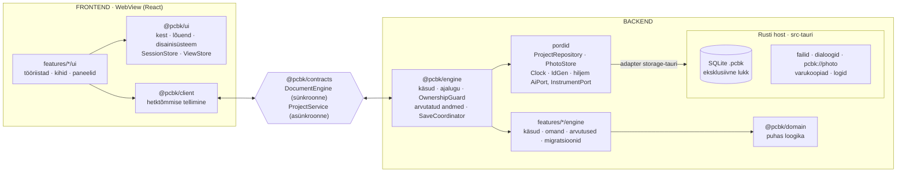

# 03 · Arhitektuur

Otsused: [ADR-002](adr/ADR-002-typescript-tauri.md) (tehnoloogia) ja [ADR-003](adr/ADR-003-frontend-backend.md) (frontend ja backend eraldi). See dokument kirjeldab, kuidas äpp on üles ehitatud nii, et iga võimalus on eraldi moodul, kasutajaliides ei saa andmeid otse muuta ja ükski fail ei kasva hiiglaslikuks.

## 1. Tehnoloogiad

| Kiht | Valik | Miks |
|---|---|---|
| Keel | TypeScript 5.x, `strict: true`, `noUncheckedIndexedAccess` | tüübid püüavad vead enne käivitamist |
| UI | React 18 + Vite | suurim ökosüsteem; AI-assistendid kirjutavad seda kõige paremini |
| Dokument | Immer mootoris (külmutatud dokument, paigad ajaloo jaoks) | tagasivõtmine ja omandikontroll paikade järgi |
| UI olek | Zustand (`SessionStore`, `ViewStore`) | väike ja selge |
| Skeemid ja valideerimine | zod | käskude parameetrid, failivorming, import; hiljem AI tööriistade skeemid |
| Joonistus | SVG (React), foto `<image>` | ekraan ja SVG-eksport sama koodiga |
| Kest | Tauri 2 (Rust) | väike `.msi`; failid, SQLite, dialoogid; hiljem seriaalport ja AI võtmed |
| Projekti fail | SQLite (`rusqlite`, bundled), `journal_mode=DELETE`, eksklusiivne lukk | üks terviklik fail, tehingud, kokkujooksmisel kindel |
| Testid | Vitest, Testing Library, Playwright, `cargo test` | loogika, mootor ilma DOM-ita, komponendid, terve töövoog |
| Kvaliteet | ESLint, Prettier, dependency-cruiser | kihtide reeglid on masinaga kontrollitud |
| Fondid | Archivo + Martian Mono, **kaasa pakitud** (`@fontsource`) | töö käib võrguühenduseta |

Täpsed versioonid lukustatakse M0-s (`pnpm-lock.yaml`, `Cargo.lock`). Paketihaldur on `pnpm`.

## 2. Kihid

Äpp jaguneb **frontendiks**, **lepinguks** ja **backendiks** (TypeScripti mootor + Rusti host). Eraldus on pakettides ja sõltuvusreeglites, mitte protsessis: kõik jookseb ühes WebView lõimes. Äpp on kohalik ennekõike: mootor jääb alati kasutaja arvutisse. Põhjendus ja kaalutud variandid on [ADR-003](adr/ADR-003-frontend-backend.md)-s.



| Osa | Vastutab | Ei tee kunagi |
|---|---|---|
| **Frontend** | joonistus, sisend, tööriistad, valik, eelvaade, mõõtmise mustandid, vaade, tekstid | ei muuda dokumenti, ei impordi mootorit, ei arvuta võrke ega hinnanguid, ei räägi Rustiga otse |
| **Leping** | käskude skeemid, hetktõmmise ja sündmuste kuju, veakoodid, moodulite avalikud selektorid | ei hoia olekut |
| **Mootor** | autoriteetne dokument, käsud, tagasivõtmine, omandikontroll, arvutatud andmed, logi, salvestuse vastutaja, migratsioonid, seansid | ei impordi Reacti, DOM-i ega Tauri API-t |
| **Rusti host** | SQLite tehingud ja lukk, koopiad ja varukoopiad, fotode import ja `pcbk://photo`, dialoogid, logid | ei sisalda domeeniloogikat |

### Sõltuvusreeglid (dependency-cruiser ja eslint, CI-s kohustuslik)

| Kiht | Tohib importida | Ei tohi importida |
|---|---|---|
| `domain` | `zod` | kõike muud |
| `contracts` | `domain` (tüübid) | `engine`, `client`, `ui`, React |
| `engine` | `domain`, `contracts` | React, DOM, Tauri, `client`, `ui`, `features/*/ui` |
| `features/X/contract` | `contracts`, `domain` | `engine`, `ui`, `client` |
| `features/X/engine` | `engine` avalik API, `domain`, `X/contract`, `Y/contract` (kui `dependsOn`) | `ui`, `client`, `features/*/ui`, React, DOM, Tauri |
| `features/X/ui` | `ui`, `client`, `contracts`, `X/contract`, `Y/contract`, `Y/ui` avalik API | **`engine`, `features/*/engine`**, Tauri |
| `ui`, `client` | `contracts`, `domain` (tüübid ja geomeetria) | `engine`, `features` |
| `adapters` | `engine` pordid, Tauri ja IndexedDB API | `ui`, `client`, `features` |
| `apps/*` | kõike (ainus kokkupanemise koht) | — |

Paksus kirjas keeld on frontendi ja backendi vaheline sein. Moodul impordib teist moodulit ainult selle avaliku sissepääsu kaudu (`contract.ts`, `ui/index.ts`) ja ainult siis, kui see on `dependsOn` loendis. Faili pikkuse piir on 400 rida: üle 400 rea annab CI hoiatuse, üle 600 rea vea (erand ainult genereeritud failidele).

## 3. Kaustastruktuur

Kerge pnpm monorepo. Paketid on sisemised lähtekoodi paketid (`exports` viitab `.ts` failile), eraldi ehitussammu pole.

```
pcb-kaardistaja/
  apps/
    desktop/                 # kompositsioonijuur: ainus koht, kus mootor ja UI kokku pannakse
      src/main.tsx
      src/engine.features.ts # mootori moodulid (rida mooduli kohta)
      src/ui.features.ts     # UI moodulid (rida mooduli kohta)
      src-tauri/
        src/ipc/             # Tauri käsud (tüübid genereeritakse TS-i)
        src/storage/         # project_db.rs: lukk, CAS-salvestus, koopia, varukoopia, migratsiooni eelne koopia
        src/photos/          # import failist või baitidest, EXIF, eelvaate variant, pcbk:// protokoll
        src/ files.rs dialogs.rs recent.rs logging.rs
        capabilities/        # failisüsteemi ulatus; võrguõigust v1 ei ole
    web/                     # sama UI brauseris (storage-web): arendus ja Playwright
  packages/
    domain/                  # puhas: mudel + zod, geomeetria, korpused, võrgud, hindamine, skeem, valmidus, migratsioonid, import
    contracts/               # DocumentEngine, ProjectService, Snapshot, käsud, sündmused, vead
    engine/                  # CommandBus, History, OwnershipGuard, Derived, ProjectService, SaveCoordinator, Journal,
                             # ModuleRegistry, üldkäsud (items.translate, items.delete), pordid
    client/                  # hetktõmmise tellimine Reactile (useSnapshot, useDerived), sessionId filter
    ui/
      kit/                   # Button, Field, Segmented, Chip, Panel, Dialog, Toast, Slider, Tooltip
      canvas/                # BoardCanvas, ViewTransform, LayerHost, ToolMachine, HitIndex, valik ja raamvalik
      shell/                 # AppShell, StartScreen, UiRegistry, SessionStore, ViewStore, keymap, i18n/et.ts, ErrorBoundary
    adapters/                # storage-tauri · storage-memory · storage-web
    features/                # 11 moodulit, igaühel contract.ts · engine/ · ui/ (vt 05)
      project/ photo/ components/ connections/ nets/ measurements/
      repair/ dimensions/ schematic/ guide/ export/
  tests/e2e/                 # Playwright (apps/web) + Tauri suitsutestid
  tooling/                   # dependency-cruiser, eslint, tsconfig.base
  docs/
```

## 4. Moodulisüsteem

Iga võimalus on kaust `packages/features/<nimi>/`. Selles on kolm osa: `contract.ts` (avalik leping), `engine/` (backendi pool) ja `ui/` (frontendi pool). Mõlemad pooled kannavad sama `id`-d. Moodul ei muuda kesta ega mootori koodi: ta annab kaastöid, mille registrid kokku koguvad.

```ts
// packages/engine — backendi pool
export interface EngineModule {
  id: string;                          // 'measurements'
  dependsOn?: string[];                // ['nets']
  owns?: DocKey[];                     // BoardDoc väljad, mille omanik see moodul on
  commands?: CommandSpec<any>[];       // tagasivõetavad muudatused
  derive?: DeriveSpec[];               // arvutatud andmed, mida moodul lisab hetktõmmisesse (nt hinnangud)
  importers?: ImporterSpec[];          // failitüübid, mida „Ava“ tunneb (parsimine + kontroll)
  migrations?: Migration[];
  onEvent?: EventHandlerSpec[];        // kõrvalmõjud; dokumenti muudab ainult käsk
}

// packages/ui — frontendi pool
export interface UiModule {
  id: string;
  title: string;                       // 'Mõõtmised'
  tools?: ToolSpec[];                  // lõuendi tööriistad
  layers?: LayerSpec[];                // lõuendi kihid, z-järjekord
  schematicLayers?: LayerSpec[];
  navigatorTabs?: PanelSpec[];
  contextSections?: ContextSectionSpec[];
  bottomBar?: SlotSpec[];
  topBar?: SlotSpec[];
  exporters?: ExporterSpec[];          // ekspordi akna valikud
  guideSteps?: GuideStepSpec[];        // „Järgmine samm“ read
  progressMetrics?: ProgressMetricSpec[];
  settings?: SettingSpec[];
  keymap?: KeyBinding[];
}

export interface ContextSectionSpec {
  id: string; order: number;
  appliesTo: SelectionKind[];          // 'component' | 'pin' | 'connection' | 'net' | 'measurement' | 'none'
  render: (props: { selection: Selection }) => JSX.Element | null;
}
export interface ToolSpec {
  id: string; label: string; icon: IconName; key?: string; group: 'select' | 'draw' | 'measure' | 'mechanical';
  create: () => CanvasTool;            // olekumasin, vt § 7.2
}
export interface LayerSpec {
  id: string; z: number;               // 0 foto … 100 ülekate
  render: (ctx: LayerContext) => JSX.Element | null;
}
```

**Registreerimine:** mootori moodulid on loetletud failis `apps/desktop/src/engine.features.ts` ja UI moodulid failis `apps/desktop/src/ui.features.ts`, kumbki rida mooduli kohta. Registrid kontrollivad käivitusel järgmist:
- id-d on unikaalsed;
- `dependsOn` on olemas ja tsükleid pole;
- käskude, tööriistade, klahvide ja paneelide id-d ei kattu;
- igal UI moodulil on samanimeline mootori moodul (erandid on ainult UI moodulid `guide` ja `export`);
- igal `BoardDoc` väljal on täpselt üks omanik.

Vea korral käivitub äpp veateatega, mitte vaikselt pooliku kujuga.

**Moodulitevaheline suhtlus:**
- **Muutmine:** `engine.execute('connections.add', {...})`. Ükski UI osa ei muuda dokumenti.
- **Lugemine:** hetktõmmisest (`doc`, `derived`) mooduli avalike selektorite kaudu (`selectMeasurements(snapshot)` failis `measurements/contract.ts`).
- **Sündmused:** `engine.events(fn)` kõrvalmõjude jaoks (nt remont pakub „Mõõda uuesti“). Sündmus ei muuda dokumenti.

**Andmete omanik.** Käsk saab Immeri mustandina terve dokumendi, seepärast on kirjutamine piiratud reegliga:
- Igal `BoardDoc` tipptaseme väljal (`DocKey`) on üks omanik-moodul (`owns`). `rev` ja `format_version` kuuluvad tuumale. Tabel on failis [05 › Andmete omanikud](05-moodulid.md#andmete-omanikud).
- Käsk muudab ainult oma mooduli välju ja neid, mis on tema `alsoWrites` loendis. Erandid on käsupõhised ja põhjendatud.
- Mootor kontrollib käsu paiku **enne** muudatuse avaldamist (paiga tee esimene osa). Lubamatu käsk lükatakse tagasi veaga `ownership` **ka väljalaskes**: dokument, ajalugu ja salvestusjärjekord jäävad muutmata, viga läheb logisse.
- Kui peaaegu igal käsul tekib pikk erandite loend, vaadatakse moodulite vastutused uuesti üle.

Uue mooduli mall ja moodulite kirjeldused on failis [05-moodulid.md](05-moodulid.md).

## 5. Olek: kolm eraldi hoidlat

| Hoidla | Kus | Sisu | Tagasivõetav | Salvestub |
|---|---|---|---|---|
| **Dokument** | mootor | `BoardDoc` (külmutatud), `rev`, ajalugu | jah | `document` tabel |
| **SessionStore** | frontend | valik, hover, aktiivne tööriist, **eelvaade** (lohistamine, suurus, pööre, pooleli rada, raamvalik), mõõtmise mustandid jala kaupa, piiksu ankur | ei | ei |
| **ViewStore** | frontend | suum ja nihe (eraldi plaadi- ja skeemivaatele), kihid, foto nähtavus, kontrast, aktiivne vahekaart, paneelid | ei | `view` tabel (`ProjectService.saveView`) |

**Hetktõmmis.** Frontend loeb dokumenti ainult hetktõmmisest `Snapshot { sessionId, rev, doc, derived }`, mille mootor avaldab pärast iga käsku. Samas lõimes on see sama sügavalt külmutatud viide, mis mootoris; koopiaid ega paiku ei saadeta. Klient eirab hetktõmmist ja sündmust, mille `sessionId` pole aktiivne, ning sama või väiksema `rev`-iga hetktõmmist.

**Valik** on ainult `SessionStore`'is. Tööriista, vahekaardi või filtri vahetus ei muuda valikut; valikut muudab ainult kasutaja klõps (põhimõte 5 failis [01](01-pohimotted.md)).

**Eelvaade ei ole dokument.** Lohistamise, suuruse muutmise, pööramise ja raja joonistamise ajal hoiab tööriist ajutist teisendust `SessionStore`'is. Lõuendi kihid joonistavad valitud objektid koos sellega, ka nende külge kinnitatud rajad. Hiire vabastamisel läheb mootorisse üks käsk (nt `items.translate`) ja see on üks samm ajaloos. `Esc` või tööriista vahetus kustutab eelvaate ja dokument jääb muutmata. Salvestus ja logi eelvaadet ei näe. Võrgud lohistamise ajal ei muutu, sest ühenduste otsad on jalgade küljes.

**Mõõtmise mustand kuulub jalale.** Salvestamata mõõtmised on kujul `measureDrafts: Map<PinKey, { mode, text, ref?, power }>`. Mõõda-plokk loeb ja kirjutab alati selle jala mustandit, mis on Koha real.
- Koha vahetus (`Tab`, `Shift+Tab`, `N`, klõps teisel jalal) ei vii väärtust kaasa: uus jalg saab oma mustandi, mille režiim ja toide tulevad viimati kasutatust.
- Tööriista, filtri või vahekaardi vahetus ei muuda ei Kohta ega mustandit.
- `measurements.add` saab Koha ja väärtuse samast mustandist.
- Mustand kustub salvestamisel, `Esc`-iga ja siis, kui selle jalg kustutatakse; projekti faili see ei lähe.

## 6. Käsud, tagasivõtmine ja logi

```ts
export interface CommandSpec<P> {
  id: `${string}.${string}`;          // 'components.add'
  title: string;                      // 'Lisa komponent' (käsupalett, logi)
  params: z.ZodType<P>;               // valideeritakse enne käivitamist
  run(draft: Draft<BoardDoc>, params: P, ctx: CommandCtx): void; // Immeri mustand, sünkroonne, puhas
  alsoWrites?: DocKey[];              // teise mooduli väljad, mida käsk teadlikult muudab (§ 4)
  summary?(params: P, doc: BoardDoc): string; // logi rida: 'Lisatud U1 (SOIC-8)'
  palette?: boolean; key?: string;
}

export interface DocumentEngine {     // @pcbk/contracts, sünkroonne
  execute<C extends CommandId>(id: C, params: ParamsOf<C>, opts?: { requestId?: string }): Result<CommandOk, EngineError>;
  undo(): Result<CommandOk, EngineError>;          // max 200 sammu
  redo(): Result<CommandOk, EngineError>;
  snapshot(): Snapshot;
  subscribe(fn: (s: Snapshot) => void): Unsubscribe;
  events(fn: (e: DomainEvent) => void): Unsubscribe;
}
```

`execute` teeb järgmist:
1. kontrollib parameetrid zod-skeemiga (viga `validation`) ja kirjutuskaitse (viga `read_only`);
2. käivitab `produceWithPatches` külmutatud dokumendi peal;
3. kontrollib paikade järgi omandi (§ 4). Rikkumisel ei muutu midagi ja tagastatakse viga `ownership`;
4. avaldab uue dokumendi;
5. lisab ajalukku `{patches, inversePatches, label}`;
6. paneb logirea (aeg, käsu id, `requestId`, allikas, kokkuvõte) salvestusjärjekorda;
7. suurendab `rev`-i;
8. teavitab tellijaid uue hetktõmmisega, mille arvutatud andmed on § 7.4 järgi värsked;
9. avaldab sündmused.

Reeglid:
- Käsk on **puhas ja sünkroonne**. Failid, dialoogid ja võrk käivad `ProjectService`'i ja portide kaudu, tulemus antakse käsule parameetrina.
- **Uue objekti id loob kutsuja** (`newId('msr')`), et käsk oleks deterministlik.
- Iga kasutaja tegevus, mis muudab dokumenti, on käsk. Mitut objekti puudutav tegevus on **üks** käsk (nt `beep.record`, korpuse vahetus, kustutamine), et `Ctrl+Z` võtaks selle tervikuna tagasi.
- Logi on ajalugu, mitte tõe allikas. Logisse lähevad kinnitatud käsud, mitte iga hiireliigutus.
- Tagasivõtmise ajalugu kehtib seansi jooksul ja algab projekti avamisel uuesti.

## 7. Lõuend

### 7.1 Koordinaadid
- **Foto pikslid** (`Vec2`) on **originaalfoto pikslites**: komponentide keskpunktid, rajad, mõõtjooned ja alad. Kui fotot pole, on virtuaalne lõuend 2000×1400 px ja mõõtkava 10 px/mm.
- **Foto pööramine ja peegeldamine** (sh EXIF-orientatsioon) on `PhotoRef.transform`. Lõuend rakendab selle **kogu stseenile** (foto koos kaardistusega). Kaardistuse koordinaate ümber ei arvutata, nii et jalad ei saa foto suhtes valeks minna.
- **Komponendi millimeetrid**: korpuse geomeetria ja oma jalad. Teisendus: `(x·scaleX, y·scaleY)` → peegeldus, kui pool on alumine → pööre → `·pxPerMm` → `+center`.
- **Ekraan**: `ViewTransform { zoom, pan }` rakendatakse ühele `<g transform>`-ile imperatiivselt (ref), mitte Reacti renderdusega.

### 7.2 Tööriistad
Iga tööriist on väike olekumasin, mis saab normaliseeritud sündmused ja hoiab eelvaadet `SessionStore`'is (§ 5):

```ts
interface CanvasTool {
  cursor: CssCursor;
  onPointerDown(e: CanvasPointer, api: ToolApi): void;   // e.photo, e.screen, e.hit (tabamus), e.snap, modifikaatorid
  onPointerMove(e: CanvasPointer, api: ToolApi): void;   // uuendab ainult eelvaadet
  onPointerUp(e: CanvasPointer, api: ToolApi): void;     // saadab ühe käsu mootorisse
  onKey?(e: KeyboardEvent, api: ToolApi): boolean;       // true = käsitletud
  overlay?(api: ToolApi): JSX.Element | null;            // pooleli rada, paigutuse eelvaade, raam
  onCancel?(api: ToolApi): void;                         // Esc / tööriista vahetus: eelvaade kustub
}
```

Pan (keskmine nupp, tühik + lohistamine), suum (rullik kursori ümber), kahe sõrmega suum ja kontekstimenüü käsitleb lõuend ise, enne tööriista. Topeltklõps tuvastatakse aja ja kauguse järgi (380 ms, 7 px), mitte DOM-i `dblclick` sündmusega.

### 7.3 Kihid ja jõudlus
- Kihid renderdatakse `z` järjekorras: foto (0) → alad (10) → kontuur (15) → alumised rajad (20) → komponentide kered (30) → pealmised rajad (40) → jalad (50) → juhtmed ja lingid (55) → sildid (60) → mõõtjooned (70) → hinnangute märgid (80) → valik ja käepidemed (90) → tööriista ülekate (100).
- Iga komponent ja rada on `React.memo` komponent, mis renderdub uuesti ainult siis, kui tema andmed muutuvad.
- **Pan ja suum** muudavad ainult ühe ümbrise teisendust ega renderda Reacti uuesti.
- **Tabamuse test:** jalgadel ega radadel pole eraldi sündmusekuulareid. Lõuendi juurel on üks kuular ja ruumiindeks (`HitIndex`, ruudustik 32 px), mis leiab kursori alt jala, raja või komponendi. Sama indeksit kasutab haakumine. Indeks ehitatakse uuesti `rev`-i muutudes.
- **Detailsus suumi järgi (LOD):** jalgade numbrid ja nimed renderdatakse [06 › Jalad](06-kasutajaliides.md#jalad) lävede järgi (number alates raadiusest 7 px, nimi alates 14 px). Komponentide tähised ja mõõteväärtuste sildid renderdatakse alles siis, kui tekst on ekraanil vähemalt 8 px. Kaugelt on näha ainult jala kuju ja olek. Läved arvutatakse uuesti suumi lõppedes (`requestAnimationFrame` + 120 ms).
- **Jõudluseelarve** (keskmine sülearvuti, kuni 12 MP kuvatav foto): 300 komponenti, 3000 jalga ja 1000 rada; pan ja suum 60 fps; lohistamine ≥ 45 fps; projekti avamine < 1,5 s. Seda kontrollitakse kahel viisil:
  - **varajane proov päris Tauri aknas** tiheda sünteetilise plaadiga (siltide, valiku ja fotoga) M1.2-s;
  - e2e jõudlustest `tests/e2e/perf.spec.ts`.

  Kui eelarve ei pea, viiakse jalgade kiht Canvas-elemendile (otsus M1.4 lõpus).

### 7.4 Arvutatud andmed
Arvutatud andmed arvutab **mootor**: võrgud (`resolveNets`), hinnangud (`latestVerdicts`), ühenduse tasemed (`connectionLevels`), läbivuse vastuolud, lühistatud kahejalgsed komponendid, valmidus (`computeProgress`) ja skeemi automaatne paigutus.
- Need on `@pcbk/domain` puhtad funktsioonid. Mootor jätab tulemuse meelde dokumendi viite järgi ja annab selle hetktõmmises (`derived`) koos sama `rev`-iga. Mootori enda käsud kasutavad sama tulemust (nt `repair.add` vajab võrke).
- Frontend arvutab ainult joonistusgeomeetriat (jala asukoht ekraanil, eelvaade) ja vormindab tekste.
- Kui kasutajale nähtav viivitus (käsk → uus pilt) ületab 100 ms või lohistamine langeb alla 45 fps, viiakse rasked arvutused Web Workerisse. Dokumendimootor jääb siis sünkroonseks.

## 8. Skeemivaade

Skeemivaade on teine lõuend: sama `BoardCanvas`, aga eraldi `ViewTransform` ja `schematicLayers`. Sümbolid ja automaatne paigutus on `@pcbk/domain`-is. Paigutus salvestub dokumenti (`schematic.placements[componentId] = {x, y, rot, mirror}`). Kui kasutaja sümbolit pole liigutanud, arvutatakse asukoht automaatselt. Valik on mõlema vaate vahel ühine (`SessionStore`).

## 9. Salvestus ja projekti fail

**Üks fail `<nimi>.pcbk` = SQLite andmebaas:**

```sql
CREATE TABLE meta      (key TEXT PRIMARY KEY, value TEXT NOT NULL);   -- format_version, app_version, created_at, project_id, copied_from_project_id
CREATE TABLE document  (id INTEGER PRIMARY KEY CHECK (id = 1), json TEXT NOT NULL, rev INTEGER NOT NULL, updated_at TEXT NOT NULL);
CREATE TABLE view      (id INTEGER PRIMARY KEY CHECK (id = 1), json TEXT NOT NULL);
CREATE TABLE photos    (id TEXT NOT NULL, variant TEXT NOT NULL CHECK (variant IN ('original', 'display')),
                        mime TEXT NOT NULL, width INTEGER NOT NULL, height INTEGER NOT NULL, bytes BLOB NOT NULL,
                        created_at TEXT NOT NULL, PRIMARY KEY (id, variant));
CREATE TABLE attachments (id TEXT PRIMARY KEY, name TEXT NOT NULL, mime TEXT NOT NULL, bytes BLOB NOT NULL);
CREATE TABLE journal   (seq INTEGER PRIMARY KEY AUTOINCREMENT, at TEXT NOT NULL, kind TEXT NOT NULL, command_id TEXT,
                        request_id TEXT, source TEXT NOT NULL DEFAULT 'user', summary TEXT NOT NULL, data TEXT);
CREATE TABLE thumbnail (id INTEGER PRIMARY KEY CHECK (id = 1), png BLOB NOT NULL);   -- avalehe pisipilt
```

- **Režiim:**
  - `journal_mode=DELETE` ja `synchronous=FULL`: pärast iga tehingut on fail kettal iseseisvalt terviklik, ilma `-wal` failita, ja seda saab ohutult kopeerida;
  - `locking_mode=EXCLUSIVE` kogu seansi ajaks: teine protsess ega teine arvuti ei saa faili samal ajal muuta.
- **Üks kirjutav seanss:** `tauri-plugin-single-instance` suunab teise käivituse ja `.pcbk` topeltklõpsu juba töötavasse äppi.
  - Kui sama fail on juba avatud, tuuakse aken ette.
  - Kui avatakse teine fail, toimub tavaline projekti vahetus (`flush()`).
  - Kui lukku ei saa (fail on avatud teises programmis või arvutis), avaneb fail kirjutuskaitstuna teatega „Fail on avatud mujal, avasin kirjutuskaitstuna“.
- **Dokumendi JSON** valideeritakse zod-skeemiga `BoardDocSchema`.
  - Avamisel käivitatakse vajadusel järjestikused migratsioonid. Enne migratsiooni tehakse varukoopia (vt allpool).
  - Fail, mis on uuem kui äpp, avatakse kirjutuskaitstuna koos teatega.
  - Viitamata fotod kustutatakse failist projekti avamisel, sest tagasivõtmise ajalugu algab siis uuesti.
- **Fotod:**
  - Rust impordib foto otse failist (dialoogist või lohistamisel saadud tee) või toorbaitidena (kleepimine, Tauri toor-IPC). Fotobaite ei saadeta kunagi JSON-ina.
  - Originaal salvestatakse muutmata (`variant = 'original'`). EXIF-orientatsioon loetakse algseks `PhotoRef.transform`-iks ja WebView ise pilti ei pööra (`image-orientation: none`).
  - Kui originaal on üle 12 MP, teeb Rust kuvamiseks väiksema variandi (`display`, ≤ 12 MP). Lõuend joonistab selle originaali mõõtudes, nii et koordinaadid jäävad originaali pikslitesse.
  - Fotosid serveeritakse WebView-le oma protokolliga `pcbk://photo/<id>?v=display`. Fotobaidid ei ole kunagi hetktõmmises.
- **Rusti käsud** (Tauri `invoke`):
  - `project_create(path, doc) → session`;
  - `project_open(path) → {session, project_id, doc, view, photos_meta, format_version, read_only}`;
  - `project_save(session, base_rev, rev, doc_json, journal[])`;
  - `project_save_view(session, view_json)`;
  - `project_copy(session, dest, identity, doc_json, rev, view_json, journal[])`;
  - `project_backups(project_id)`, `project_restore(backup, dest)`;
  - `photo_import_path(session, path)`, `photo_import_bytes(session, bytes)`;
  - `attachment_put/get`, `recent_list/add/remove`, `thumbnail_put`, `export_write(path, bytes)`, `log_export(dest)`.

  Dialoogid käivad `tauri-plugin-dialog` kaudu.
- **Turvalisus:** Tauri capabilities lubavad failisüsteemis ainult kasutaja valitud failid ja äpi andmekausta; CSP keelab välised skriptid; võrguõigust v1 ei ole.

### Salvestuse vastutaja (`SaveCoordinator`, moodul `project`)

Projekti faili kirjutab ainult `SaveCoordinator`, mis on mootoris `ProjectService`'i osa. Teised osad salvestamist ise ei käivita.

- **Ajastus:** dokument kirjutatakse 1,5 s pärast viimast käsku, aga **kõige rohkem 10 s** pärast esimest salvestamata käsku, nii et pidev töö ei lükka salvestamist lõputult edasi.
- **Üks järjekord.** Korraga on käimas kõige rohkem üks kirjutus. Kui kirjutuse ajal tuleb uus käsk, kirjutatakse pärast selle lõppu kohe uusim olek.
- **Revisjoni võrdlus tehingu sees:** `project_save` uuendab dokumenti ainult siis, kui failis on täpselt `base_rev` (`UPDATE … WHERE rev = base_rev`). Muidu tuleb viga `stale_rev` ja midagi ei kirjutata. Luku tõttu ei tohiks see kunagi juhtuda, aga see on teine kaitsekiht.
- **Vaade eraldi:** `saveView` märgib vaate muutunuks ja kirjutab ainult `view` tabeli, ilma `rev`-i ja ajaloosammuta. Ka see käib samas järjekorras ja `flush()` hõlmab seda.
- **Logi read** jäävad järjekorda seni, kuni tehing on õnnestunud. Ebaõnnestumisel ei kao ükski rida.
- **Nähtav olek:** `saved(rev, aeg)` → „Salvestatud · 14:32“; `pending` ja `saving` → „Salvestan…“; `error(põhjus)` → punane riba „Salvestamine ebaõnnestus: <põhjus>. [Proovi uuesti] [Salvesta mujale…]“. Vea ajal töö jätkub mälus, iga uus käsk proovib uuesti ja olek jääb punaseks, kuni kirjutus õnnestub. Olekuteated kannavad `sessionId`-d.
- **Sulgemine ja projekti vahetus** (akna sulgemine, avalehele minek, teise projekti avamine) kutsub kõigepealt `flush()`: oodatakse käimasolev kirjutus ära ja kirjutatakse uusim dokument ning vaade.
  - Õnnestumisel suletakse ilma küsimata.
  - Ebaõnnestumisel akent ei suleta. Avaneb dialoog „Viimaseid muudatusi ei õnnestunud salvestada: <põhjus>“ nuppudega **Proovi uuesti**, **Salvesta mujale…** ja **Sulge salvestamata**. Ainult viimane kaotab muudatused ja ütleb seda nupu all otse.
- **Koopia:** `project_copy` teeb `VACUUM INTO <dest>.tmp` (terviklik koopia koos fotode, manuste, logi ja pisipildiga), kirjutab sinna uusima oleku ühe tehinguna ja **alles seejärel** nimetab faili ümber lõplikuks. Pooleli jäänud koopiat lõpliku nime all ei teki.
  - „Salvesta mujale…“ (`identity: 'same'`) jätkab sama projektiga uues failis.
  - „Salvesta oma koopiana“ (näidisprojekt) ja „Tee koopia“ (`identity: 'new'`) annavad uue `project_id` ja salvestavad `copied_from_project_id`.
  - Pärast õnnestumist jätkab äpp uues failis ja see lisatakse viimaste projektide hulka.
  - Kui algne fail pole loetav (nt mälupulk eemaldati), luuakse uus fail mälus olevast dokumendist, vaatest ja logist ning äpp ütleb selgelt, et fotod jäid algsesse faili.
- **Varukoopiad:**
  - Rust teeb automaatse koopia kausta `%APPDATA%\PCB Kaardistaja\backups\<project_id>\` (`<kuupäev>-v<format_version>.pcbk`, sama ajutise faili ja ümbernimetamise võttega) **enne iga migratsiooni** ja **iga päeva esimesel avamisel**.
  - Alles hoitakse 5 viimast koopiat projekti kohta.
  - Avalehel on projekti kaardil „Taasta varukoopiast…“, mis salvestab valitud koopia kasutaja valitud kohta. Taastatud fail kannab sama `project_id`-d.

## 10. Pordid ja adapterid

Mootor räägib välismaailmaga ainult portide kaudu. Iga port on liides paketis `@pcbk/engine`, teostus on paketis `@pcbk/adapters`.

```ts
export interface ProjectRepository {
  create(req: CreateReq): Promise<OpenedProject>;
  open(path: string): Promise<OpenedProject>;            // session, projectId, doc, view, photosMeta, formatVersion, readOnly
  save(req: SaveReq): Promise<void>;                     // base_rev võrdlusega
  saveView(session: string, view: ViewState): Promise<void>;
  copy(req: CopyReq): Promise<OpenedProject>;
  backups(projectId: string): Promise<BackupInfo[]>;
  restore(req: RestoreReq): Promise<OpenedProject>;
  close(session: string): Promise<void>;
}
export interface PhotoStore {
  importPath(session: string, path: string): Promise<PhotoRef>;
  importBytes(session: string, bytes: ArrayBuffer): Promise<PhotoRef>;
  url(id: string, variant: 'display' | 'original'): string;   // pcbk://photo/…
}
export interface Clock { now(): string }
export interface IdGen { newId(prefix: string): string }
```

| Adapter | Kasutus |
|---|---|
| `storage-tauri` | päris äpp: Rusti käsud § 9 |
| `storage-memory` | mootori ja moodulite testid; kordamiseks sobivad näidisprojektid |
| `storage-web` | brauseris arendamine ja Playwright: minimaalne IndexedDB, üks kirje projekti kohta (dokument, vaade, fotod). Koopiat ja varukoopiaid ei toeta |

`ProjectService` (leping, asünkroonne) kasutab neid porte ja haldab seansse: `create`, `open`, `close`, `flush`, `saveView`, `copy`, `backups`, `restore` ja olekuteateid. Tauri-spetsiifikat väljaspool `storage-tauri`-t ja `apps/desktop`-i ei ole.

## 11. Vead, logimine, keel

- **Kasutajale näidatav viga** on alati eestikeelne lause koos järgmise sammuga („Salvestamine ebaõnnestus: ketas täis. [Salvesta mujale…]“). Mootor tagastab ainult veakoodi, teksti teeb frontend (`i18n/et.ts`). Tehniline detail läheb logifaili (`%APPDATA%\PCB Kaardistaja\logs\`, roteeruv, 5 × 1 MB).
- **`ErrorBoundary` on kahel tasemel:**
  - iga paneeli ja kihi ümber: „Selle osa kuvamisel tekkis viga. [Proovi uuesti]“;
  - kogu äpi juures: „Midagi läks valesti. [Salvesta koopia ja lae uuesti] [Salvesta diagnostika…]“. Esimene teeb `ProjectService.copy` ja laeb vaate uuesti.
- **Diagnostika** (`log_export`) salvestab logid ja äpi versiooni kasutaja valitud faili. Midagi ei saadeta automaatselt.
- Kõik tekstid on failis `packages/ui/shell/i18n/et.ts` (võtmed mooduli kaupa), nii et inglise keele saab hiljem lisada.

## 12. Testimine ja kvaliteediväravad

| Tase | Tööriist | Mida | Nõue |
|---|---|---|---|
| Domeen | Vitest | kogu `@pcbk/domain` | rea katvus ≥ 90 % |
| Mootor | Vitest (Node, `storage-memory`) | käsud, ajalugu, omandi tagasilükkamine, hetktõmmis ja `sessionId`, arvutatud andmed, `SaveCoordinator` (ajastus ja maksimaalne ooteaeg, järjekord, viga, `flush`, vaade eraldi) | kõik rohelised, ilma DOM-ita |
| Moodulid | Vitest + Testing Library | mootori pool ühiktestidega; UI pool võltsmootoriga (`FakeDocumentEngine`) | iga mooduli põhitegevus |
| Töövoog | Playwright (`apps/web`) | [02 § 16](02-kasutaja-teekond.md#16-vastuvõtustsenaarium-e2e-test-plaat-algusest-lõpuni); klaviatuur, fookus ja dialoogid; jõudlustest | kõik rohelised |
| Töölaud | Tauri suitsutestid | lukk ja teine avamine, sulgemise voog, foto import, varukoopia taastamine | kõik rohelised |
| Rust | `cargo test` | `project_db`: loomine, salvestus, `base_rev` võrdlus, lukk, migratsioon koos varukoopiaga, katkenud kirjutus, koopia ajutise faili kaudu, taastamine, EXIF ja kuvamisvariant | kõik rohelised |
| Staatika | `tsc --noEmit`, ESLint, dependency-cruiser, failipikkuse kontroll | sh reegel „`features/*/ui` ei impordi `engine`-it“ | 0 viga |

CI (GitHub Actions, `windows-latest`) jooksutab kõik tasemed iga push'i peale. Väljalaske silt `v*` ehitab `.msi` paigaldaja ja lisab selle GitHubi Release'i.

## 13. AI liides (hilisem)

AI-d v1-s ei ole, kuid arhitektuur jätab selle jaoks valmis pistikud. Põhimõte: **AI pakub, inimene otsustab** ning äpp töötab ilma AI-ta täielikult.

- **`AiPort`** (mootori port): `complete({messages, tools, images?}) → AiResult`. Võrgupäring ja API võti on Rustis. V1-s on ainult `NullAiPort`.
- **Lugemine:** AI näeb projekti ainult kirjutuskaitstud päringute kaudu (komponendid, võrgud, mõõtmised, hinnangud, logi). Otse dokumendile AI ligi ei pääse.
- **Kirjutamine ainult ettepanekuna:** AI vastus on `Proposal { projectId, baseRev, title, rationale, confidence, commands: {id, params}[] }`. Mootor kontrollib selle enne näitamist:
  - **lubatud käskude loend**: AI ei tohi kasutada `measurements.*` ega `beep.record` käske;
  - sama projekt;
  - kõik skeemid.

  Kasutaja näeb kogu ettepaneku eelvaadet lõuendil eraldi kihis ja vajutab **Rakenda** või **Loobu**. Kui dokument on vahepeal muutunud (`rev ≠ baseRev`), kontrollitakse ettepanek uuesti ja vajadusel märgitakse see aegunuks. Rakendamine on **üks** tagasivõetav samm (kõik käsud ühel mustandil) ja logis on allikas `ai` ning märge „kinnitas kasutaja“.
- **Keelatud:** AI ei loo mõõtmisi, ei kuuluta ühendusi mõõdetuks ega kirjuta dokumenti ilma kasutaja klõpsuta.
- **Privaatsus:** midagi ei saadeta automaatselt. Esimesel kasutusel küsitakse nõusolekut ja näidatakse, mis andmed lähevad välja. API võtmed hoitakse OS-i võtmehoidlas (Rusti `keyring`), mitte projekti failis.
- **Tulevased moodulid:** `ai-assistant` (järgmise sammu soovitus, küsimused), `ai-photo` (komponendikandidaadid fotolt eraldi kihina, kinnitamine klõpsuga) ja `ai-report` (remondikokkuvõte). Igaüks on tavaline kolmeosaline moodul.

## 14. Paigaldus ja väljalase

- **Toetatud:** Windows 10 ja 11 (x64). Paigaldaja on `.msi`, mis sisaldab WebView2 võrguühenduseta paigaldajat, nii et paigaldus töötab ka ilma internetita.
- **Failiseos:** `.pcbk` avaneb topeltklõpsuga selles äpis (Tauri `fileAssociations`). Korraga töötab üks äpi eksemplar (§ 9).
- **Uuendamine v1-s on käsitsi:** uus `.msi` paigaldatakse vana peale. Projektifailid on kasutaja kaustades ja varukoopiad äpi andmekaustas, nii et uuendus neid ei puuduta. Uuem äpp migreerib faili avamisel ja teeb enne varukoopia.
- **Allkirjastamine:** koodi allkirjastamise sertifikaat lisatakse enne avalikku väljalaset (M4). Automaatne uuendaja (`tauri-plugin-updater`) ja vearaportite automaatne saatmine tulevad hiljem eraldi otsusega.
