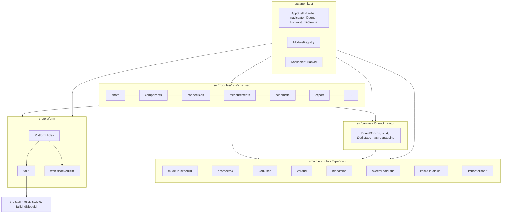

# 03 · Arhitektuur

Otsus: [ADR-002](adr/ADR-002-typescript-tauri.md). See dokument kirjeldab, kuidas äpp on üles ehitatud nii, et iga võimalus on eraldi moodul ja ükski fail ei kasva hiiglaslikuks.

## 1. Tehnoloogiad

| Kiht | Valik | Miks |
|---|---|---|
| Keel | TypeScript 5.x, `strict: true`, `noUncheckedIndexedAccess` | tüübid püüavad vead enne käivitamist |
| UI | React 18 + Vite | suurim ökosüsteem; AI-assistendid kirjutavad seda kõige paremini |
| Olek | Zustand + Immer (patches) | väike ja selge; Immeri paigad annavad tagasivõtmise ja logi |
| Skeemid ja valideerimine | zod | käskude parameetrid ja failivorming; hiljem otse AI tööriistade skeemideks |
| Joonistus | SVG (React), foto `<image>`/`` | ekraan ja SVG-eksport sama koodiga; DOM annab tabamuse testi |
| Kest | Tauri 2 (Rust) | väike `.msi`; failisüsteem, SQLite, dialoogid; hiljem seriaalport ja AI võtmed |
| Projekti fail | SQLite (`rusqlite`, bundled) | üks fail, tehingud, kokkujooksmisel kindel; fotod blob'idena |
| Testid | Vitest, Testing Library, Playwright, `cargo test` | loogika, komponendid, terve töövoog |
| Kvaliteet | ESLint, Prettier, dependency-cruiser | kihtide reeglid on masinaga kontrollitud |
| Fondid | Archivo + Martian Mono, **kaasa pakitud** (`@fontsource`) | töö käib võrguühenduseta |

Täpsed versioonid lukustatakse M0-s (`pnpm-lock.yaml`, `Cargo.lock`). Paketihaldur on `pnpm`.

## 2. Kihid



### Sõltuvusreeglid (dependency-cruiser kontrollib CI-s)

1. `src/core/**` ei impordi Reacti, DOM-i, `src/app`, `src/canvas`, `src/modules` ega `src/platform`. See on puhas TypeScript, mida saab testida Node'is.
2. `src/canvas/**` võib importida ainult `core`-i ja `ui`-d.
3. Moodul impordib teist moodulit **ainult selle avaliku sissepääsu kaudu** (`src/modules/<x>/index.ts`) ja ainult siis, kui see on märgitud `dependsOn` loendisse.
4. `src/platform/**` ei impordi mooduleid ega UI-d.
5. Faili pikkuse piir on 400 rida. Üle 400 rea annab CI hoiatuse, üle 600 rea vea. Erandid on lubatud ainult genereeritud failidele.

## 3. Kaustastruktuur

```
pcb-kaardistaja/
  src/
    core/
      model/          # tüübid + zod-skeemid: Board, Component, Connection, Net, Measurement, …
      geometry/       # Vec2, ComponentTransform, twoPinAlign, Bounds, polüjooned
      footprints/     # FootprintGenerator + generaatorid (porditud prototüübist)
      nets/           # resolveNets (union-find), rollid, konfliktid
      measure/        # parseReading, evaluate, latestVerdicts, staleness
      schematic/      # sümbolite määramine, automaatne paigutus
      progress/       # valmiduse näitajad
      commands/       # CommandSpec, History (Immeri paigad), Transaction
      io/             # failivormingu versioonid, migratsioonid, JSON eksport/import, prototüübi import
    canvas/           # BoardCanvas, ViewTransform, LayerHost, ToolMachine, SnapIndex
    ui/               # disainisüsteem: Button, Field, Segmented, Chip, Panel, Dialog, Toast, Slider, Tooltip
    app/              # main.tsx, AppShell, StartScreen, ModuleRegistry, stores, keymap, i18n/et.ts
    modules/
      project/ photo/ calibration/ selection/ components/ pins/ connections/ nets/
      measurements/ beep/ repair/ dimensions/ schematic/ guide/ export/ journal/
    platform/         # Platform liides, tauri/, web/
  src-tauri/
    src/ main.rs, project_db.rs, files.rs, recent.rs
    capabilities/     # Tauri õigused (failisüsteemi ulatus)
  tests/e2e/          # Playwright
  docs/               # need dokumendid
```

## 4. Moodulisüsteem

Iga võimalus on kaust `src/modules/<nimi>/`, mille `index.ts` ekspordib ühe `AppModule` objekti. Moodul **ei muuda kesta koodi**: ta annab kaastöid (contributions), mille kest ja lõuend koguvad registrist kokku.

```ts
// src/app/module.ts
export interface AppModule {
  id: string;                          // 'measurements' (unikaalne)
  title: string;                       // 'Mõõtmised'
  dependsOn?: string[];                // ['nets']
  commands?: CommandSpec<any>[];       // tagasivõetavad muudatused (ka käsupaletis)
  tools?: ToolSpec[];                  // lõuendi tööriistad (tööriistaribal)
  layers?: LayerSpec[];                // lõuendi kihid, z-järjekord
  schematicLayers?: LayerSpec[];       // skeemivaate kihid
  navigatorTabs?: PanelSpec[];         // vasaku navigaatori vahekaardid
  contextSections?: ContextSectionSpec[]; // parema paneeli sektsioonid valitud objekti tüübi järgi
  bottomBar?: SlotSpec[];              // mõõteriba elemendid
  topBar?: SlotSpec[];                 // ülariba elemendid
  exporters?: ExporterSpec[];          // ekspordi aknas olevad valikud
  importers?: ImporterSpec[];          // failitüübid, mida „Ava“ tunneb
  guideSteps?: GuideStepSpec[];        // „Järgmine samm“ read koos done() predikaadiga
  progressMetrics?: ProgressMetricSpec[];
  settings?: SettingSpec[];            // seadete akna väljad
  keymap?: KeyBinding[];
  onActivate?(ctx: ModuleContext): void | (() => void); // tellimused; tagastab koristaja
}

export interface ContextSectionSpec {
  id: string;
  order: number;                                   // väiksem on üleval
  appliesTo: SelectionKind[];                      // 'component' | 'pin' | 'connection' | 'net' | 'measurement' | 'none'
  render: (props: { selection: Selection }) => JSX.Element | null;
}
export interface ToolSpec {
  id: string; label: string; icon: IconName; key?: string; group: 'select' | 'draw' | 'measure' | 'mechanical';
  create: () => CanvasTool;                       // olekumasin, vt §7
}
export interface LayerSpec {
  id: string; z: number;                           // 0 foto … 100 ülekate
  render: (ctx: LayerContext) => JSX.Element | null; // memoiseeritud, vt §7.3
}
```

**Registreerimine on ühes kohas:**

```ts
// src/app/modules.ts — AINUS koht, kus moodulid loetletakse
export const modules: AppModule[] = [
  projectModule, photoModule, calibrationModule, selectionModule, componentsModule, pinsModule,
  connectionsModule, netsModule, measurementsModule, beepModule, repairModule, dimensionsModule,
  schematicModule, guideModule, exportModule, journalModule,
];
```

`ModuleRegistry` kontrollib käivitusel järgmist: id-d on unikaalsed, `dependsOn` moodulid on olemas ja tsükleid pole, ning käskude, tööriistade, klahvide ja paneelide id-d ei kattu. Vea korral käivitub äpp veateatega, mitte vaikselt pooliku kujuga.

**Moodulitevaheline suhtlus:**
- **Käsud:** `dispatch('connections.add', {...})`. Teine moodul ei muuda dokumenti otse.
- **Päringud:** puhtad funktsioonid `core`-ist (`resolveNets(doc)`) või mooduli avalikud selektorid (`import { useNets } from '@/modules/nets'`).
- **Sündmused:** `bus.on('measurement.added', fn)` kõrvalmõjude jaoks (nt remondimoodul pakub uut mõõtmist). Sündmus ei muuda dokumenti; muudatus käib alati käsu kaudu.

Uue mooduli mall ja iga mooduli kirjeldus on failis [05-moodulid.md](05-moodulid.md).

## 5. Olek: kolm eraldi hoidlat

| Hoidla | Sisu | Tagasivõetav | Salvestub |
|---|---|---|---|
| **ProjectStore** | dokument `BoardDoc` (komponendid, ühendused, rollid, mõõtmised, remondid, skeemi paigutus …) | jah | projekti faili (`document` tabel) |
| **SessionStore** | valik, hover, aktiivne tööriist, tööriista mustand (pooleli rada), piiksu ankur | ei | ei |
| **ViewStore** | suum ja nihe (eraldi plaadi- ja skeemivaatele), kihid, foto nähtavus, kontrast, aktiivne vahekaart | ei | projekti faili (`view` tabel) |

Valik on **ainult SessionStore'is**. Tööriista, vahekaardi või filtri vahetus ei muuda valikut; valikut muudab ainult kasutaja klõps või käsk `selection.set` (põhimõte 5 failis [01](01-pohimotted.md)).

## 6. Käsud, tagasivõtmine ja logi

```ts
export interface CommandSpec<P> {
  id: `${string}.${string}`;          // 'components.add'
  title: string;                      // 'Lisa komponent' (käsupalett, logi)
  params: z.ZodType<P>;               // valideeritakse enne käivitamist
  run(draft: Draft<BoardDoc>, params: P, ctx: CommandCtx): void; // Immeri mustand, sünkroonne, puhas
  summary?(params: P, doc: BoardDoc): string; // logi rida: 'Lisatud U1 (SOIC-8)'
  palette?: boolean; key?: string;
}

dispatch(id, params)            // üks samm ajaloos
beginTransaction(label)         // lohistamine, suuruse muutmine, raja joonistus
  update(id, params)            //   ajutised muudatused (renderdatakse kohe, ajalukku ei lähe)
commit() | cancel()             //   commit = üks samm ajaloos; cancel taastab algse
undo() / redo()                 // Immeri pöördpaigad, max 200 sammu
```

- `dispatch` kutsub välja `produceWithPatches`, lisab `{patches, inversePatches, label}` ajalukku, kirjutab logi rea (`journal` tabel: aeg, käsu id, kokkuvõte) ja käivitab automaatsalvestuse.
- Käsk on **puhas ja sünkroonne**. Failid, dialoogid ja võrk käivad väljaspool käsku (platvormikihis) ning tulemus antakse käsule parameetrina.
- Iga kasutaja tegevus, mis muudab dokumenti, on käsk. Seetõttu toimib tagasivõtmine kõikjal ja AI saab hiljem pakkuda samu käske (§13).

## 7. Lõuend

### 7.1 Koordinaadid
- **Foto pikslid** (`Vec2`): komponentide keskpunktid, rajad, mõõtjooned ja alad. Kui fotot pole, on virtuaalne lõuend 2000×1400 px ja mõõtkava 10 px/mm.
- **Komponendi millimeetrid**: korpuse geomeetria ja oma jalad. Teisendus: `(x·scaleX, y·scaleY)` → peegeldus, kui pool on alumine → pööre → `·pxPerMm` → `+center`.
- **Ekraan**: `ViewTransform { zoom, pan }`. Rakendatakse ühele `<g transform>`-ile imperatiivselt (ref), mitte Reacti renderdusega.

### 7.2 Tööriistad
Iga tööriist on väike olekumasin, mis saab normaliseeritud sündmused:

```ts
interface CanvasTool {
  cursor: CssCursor;
  onPointerDown(e: CanvasPointer, api: ToolApi): void;   // e.photo, e.screen, e.hit (tabamus), e.snap, modifikaatorid
  onPointerMove(e: CanvasPointer, api: ToolApi): void;
  onPointerUp(e: CanvasPointer, api: ToolApi): void;
  onKey?(e: KeyboardEvent, api: ToolApi): boolean;       // true = käsitletud
  overlay?(api: ToolApi): JSX.Element | null;            // eelvaade (pooleli rada, eelvaade, kast)
  onCancel?(api: ToolApi): void;                         // Esc / tööriista vahetus
}
```

Pan (keskmine nupp, tühik + lohistamine), suum (rullik kursori ümber), kahe sõrmega suum ja kontekstimenüü käsitleb lõuend ise, enne tööriista. Topeltklõps tuvastatakse aja ja kauguse järgi (380 ms, 7 px), mitte DOM-i `dblclick` sündmusega.

### 7.3 Kihid ja jõudlus
- Kihid renderdatakse `z` järjekorras: foto (0) → alad (10) → kontuur (15) → alumised rajad (20) → komponentide kered (30) → pealmised rajad (40) → jalad (50) → juhtmed ja lingid (55) → sildid (60) → mõõtjooned (70) → hinnangute märgid (80) → valik ja käepidemed (90) → tööriista ülekate (100).
- Iga komponent ja rada on `React.memo` komponent, mis renderdub uuesti ainult siis, kui tema andmed muutuvad.
- Pan ja suum ei renderda Reacti uuesti. Siltide ja jalgade minimaalne ekraanisuurus arvutatakse uuesti suumi lõppedes (`requestAnimationFrame` + 120 ms debounce) või CSS-muutujaga `--zoom`.
- Haakumine (snapping) kasutab ruudustikuindeksit (`SnapIndex`, lahtri suurus 32 px), mis ehitatakse uuesti dokumendi versiooni muutudes.
- **Jõudluseelarve** (keskmine sülearvuti, 12 MP foto): 300 komponenti, 3000 jalga ja 1000 rada; pan ja suum 60 fps; komponendi lohistamine ≥ 45 fps; projekti avamine < 1,5 s. Seda mõõdab e2e jõudlustest `tests/e2e/perf.spec.ts` sünteetilise plaadiga. Kui eelarve ei pea, viiakse jalgade kiht Canvas-elemendile (otsus jääb M1 lõppu).

### 7.4 Arvutatud andmed
Võrgud (`resolveNets`), hinnangud (`latestVerdicts`), valmidus (`computeProgress`) ja skeemi automaatne paigutus on `core`-i puhtad funktsioonid, mille tulemus jäetakse meelde dokumendi versiooni järgi (`doc.rev`). Kui `resolveNets` võtab 3000 jala juures üle 8 ms, viiakse see Web Workerisse; liides jääb samaks.

## 8. Skeemivaade

Skeemivaade on teine lõuend (sama `BoardCanvas`, eraldi `ViewTransform` ja `schematicLayers`). Sümbolid ja automaatne paigutus on `core/schematic`-is. Paigutus salvestub dokumenti (`schematic.placements[componentId] = {x, y, rot, mirror}`). Kui kasutaja sümbolit pole liigutanud, arvutatakse asukoht automaatselt. Valik on mõlema vaate vahel ühine (SessionStore).

## 9. Salvestus ja projekti fail

**Üks fail `<nimi>.pcbk` = SQLite andmebaas:**

```sql
CREATE TABLE meta      (key TEXT PRIMARY KEY, value TEXT NOT NULL);            -- format_version, app_version, created_at
CREATE TABLE document  (id INTEGER PRIMARY KEY CHECK (id = 1), json TEXT NOT NULL, rev INTEGER NOT NULL, updated_at TEXT NOT NULL);
CREATE TABLE view      (id INTEGER PRIMARY KEY CHECK (id = 1), json TEXT NOT NULL);
CREATE TABLE photos    (id TEXT PRIMARY KEY, mime TEXT NOT NULL, width INTEGER NOT NULL, height INTEGER NOT NULL, bytes BLOB NOT NULL, created_at TEXT NOT NULL);
CREATE TABLE attachments (id TEXT PRIMARY KEY, name TEXT NOT NULL, mime TEXT NOT NULL, bytes BLOB NOT NULL);
CREATE TABLE journal   (seq INTEGER PRIMARY KEY AUTOINCREMENT, at TEXT NOT NULL, kind TEXT NOT NULL, command_id TEXT, summary TEXT NOT NULL, data TEXT);
CREATE TABLE thumbnail (id INTEGER PRIMARY KEY CHECK (id = 1), png BLOB NOT NULL); -- avalehe pisipilt
```

- **Automaatsalvestus:** 1,5 s pärast viimast käsku (debounce) kirjutatakse üks tehing: `document` (terve JSON), uued `journal` read ja `view`. Fotod kirjutatakse ainult lisamisel. Režiim on `PRAGMA journal_mode=WAL`.
- **Dokumendi JSON** on valideeritud zod-skeemiga `BoardDocSchema` ja sisaldab välja `format_version`. Avamisel käivitatakse vajadusel järjestikused migratsioonid (`core/io/migrations/0001_*.ts` …). Fail, mis on uuem kui äpp, avatakse kirjutuskaitstuna koos teatega.
- **Rusti käsud** (Tauri `invoke`): `project_create(path, doc)`, `project_open(path) → {doc, view, photos_meta, format_version}`, `project_save(path, doc_json, rev, view_json, journal[])`, `photo_put(path, bytes, mime, w, h) → id`, `photo_url(id)` (asset-protokoll, ilma Base64-ta), `attachment_put/get`, `recent_list/add/remove`, `thumbnail_put`, `export_write(path, bytes)`. Dialoogid käivad `tauri-plugin-dialog` kaudu.
- **Turvalisus:** Tauri capabilities lubavad failisüsteemis ainult kasutaja valitud failid ja äpi andmekausta; CSP keelab välised skriptid; võrguõigust v1 ei ole.

## 10. Platvormikiht

```ts
export interface Platform {
  kind: 'tauri' | 'web';
  createProject(suggestedName: string): Promise<ProjectHandle | null>;   // dialoog + fail
  openProject(handle?: ProjectHandle): Promise<OpenedProject | null>;
  saveProject(h: ProjectHandle, payload: SavePayload): Promise<void>;
  putPhoto(h: ProjectHandle, file: Blob): Promise<PhotoRef>;
  photoUrl(h: ProjectHandle, id: string): string;
  recent(): Promise<RecentEntry[]>;
  pickFile(filters: FileFilter[]): Promise<File | null>;
  saveFile(suggestedName: string, data: Blob | string, filters: FileFilter[]): Promise<boolean>;
}
```

`web` teostus (IndexedDB ja allalaadimine) võimaldab sama UI-d arendada brauseris (`pnpm dev`) ja käivitada Playwrighti teste ilma Tauri-aknata. Tauri-spetsiifikat (Rust, failiteed) väljaspool `src/platform/tauri` ei ole.

## 11. Vead, logimine, keel

- Kasutajale näidatav viga on alati eestikeelne lause koos järgmise sammuga („Salvestamine ebaõnnestus: ketas täis. [Salvesta mujale…]“). Tehniline detail läheb logifaili (`%APPDATA%\PCB Kaardistaja\logs\`, roteeruv, 5 × 1 MB).
- `ErrorBoundary` on iga paneeli ja kihi ümber: ühe mooduli viga ei too alla tervet äppi, vaid näitab selle sektsiooni asemel „Selle osa kuvamisel tekkis viga. [Proovi uuesti]“.
- Kõik tekstid on failis `src/app/i18n/et.ts` (võtmed mooduli kaupa), nii et inglise keele saab hiljem lisada.

## 12. Testimine ja kvaliteediväravad

| Tase | Tööriist | Mida | Nõue |
|---|---|---|---|
| Loogika | Vitest | kogu `src/core` | rea katvus ≥ 90 % |
| Moodulid | Vitest + Testing Library | paneelid, sektsioonid, tööriistade olekumasinad | iga mooduli põhitegevus |
| Töövoog | Playwright (web-platvorm) | [02 § 16](02-kasutaja-teekond.md#16-vastuvõtustsenaarium-e2e-test-plaat-algusest-lõpuni) ja jõudlustest | kõik rohelised |
| Rust | `cargo test` | `project_db`: loomine, salvestus, migratsioon, katkenud kirjutus | kõik rohelised |
| Staatika | `tsc --noEmit`, ESLint, dependency-cruiser, failipikkuse kontroll | | 0 viga |

CI (GitHub Actions, `windows-latest`) jooksutab kõik tasemed iga push'i peale. Väljalaske silt `v*` ehitab `.msi` paigaldaja ja lisab selle GitHubi Release'i.

## 13. AI liides (hilisem)

AI-d v1-s ei ole, kuid arhitektuur jätab selle jaoks valmis pistikud. Põhimõte: **AI pakub, inimene otsustab** ning äpp töötab ilma AI-ta täielikult.

- **`AiProvider` liides** (`src/platform/ai.ts`): `complete({messages, tools, images?}) → AiResult`. Teostused tulevad hiljem (Claude API, kohalik mudel). V1-s on ainult `NullAiProvider`.
- **Lugemine:** `ProjectQuery` on kirjutuskaitstud API (komponendid, võrgud, mõõtmised, hinnangud, logi), mille kaudu AI näeb projekti. Otse dokumendile AI ligi ei pääse.
- **Kirjutamine ainult ettepanekuna:** AI vastus on `Proposal { title, rationale, confidence, commands: {id, params}[] }`. Käskude zod-skeemidest tehakse automaatselt AI tööriistade JSON-skeemid. Ettepanek ilmub paneeli „Ettepanekud“, kus kasutaja näeb eelvaadet lõuendil ja klõpsab **Rakenda** või **Loobu**. Rakendamine on tavaline tagasivõetav käsk ja logis on märge „AI ettepanek, kinnitas kasutaja“.
- **Keelatud:** AI ei loo mõõtmisi, ei märgi ühendusi mõõdetuks ega kirjuta dokumenti ilma kasutaja klõpsuta.
- **Privaatsus:** midagi ei saadeta automaatselt. Esimesel kasutusel küsitakse nõusolekut ja näidatakse, mis andmed lähevad välja. API võtmed hoitakse OS-i võtmehoidlas (Rusti `keyring`), mitte projekti failis.
- **Tulevased moodulid:** `ai-assistant` (vestlus ja järgmise sammu soovitus), `ai-photo` (komponendikandidaadid fotolt eraldi kihina, kinnitamine klõpsuga), `ai-report` (remondikokkuvõte). Igaüks on tavaline `AppModule`; kest ei muutu.
