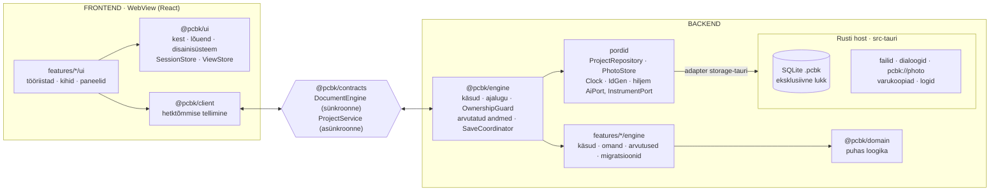

# 03 · Arhitektuur

Otsused: [ADR-002](adr/ADR-002-typescript-tauri.md) (tehnoloogia), [ADR-003](adr/ADR-003-frontend-backend.md) (frontend ja backend eraldi) ja [ADR-004](adr/ADR-004-kaks-vaadet-ja-uhendused.md) (Plaat ja Skeem ühel mudelil, teadlikud ühendused). See dokument kirjeldab, kuidas äpp on üles ehitatud nii, et iga võimalus on eraldi moodul, kasutajaliides ei saa andmeid otse muuta ja ükski fail ei kasva hiiglaslikuks.

## 1. Tehnoloogiad

| Kiht | Valik | Miks |
|---|---|---|
| Keel | TypeScript 5.x, `strict: true`, `noUncheckedIndexedAccess` | tüübid püüavad vead enne käivitamist |
| UI | React 18 + Vite | suurim ökosüsteem; AI-assistendid kirjutavad seda kõige paremini |
| Dokument | Immer mootoris (külmutatud dokument, paigad ajaloo jaoks) | tagasivõtmine ja omandikontroll paikade järgi |
| UI olek | Zustand (`SessionStore`, `ViewStore`) | väike ja selge |
| Skeemid ja valideerimine | zod | käskude parameetrid, failivorming, import; hiljem AI tööriistade skeemid |
| Joonistus | SVG (React), foto `<image>` | ekraan ja SVG-eksport sama koodiga |
| Kest | Tauri 2 (Rust) | väike `.msi`; failid, SQLite, dialoogid; hiljem seriaalport ja AI võtmed |
| Projekti fail | SQLite (`rusqlite`, bundled), `journal_mode=DELETE`, eksklusiivne lukk | üks terviklik fail, tehingud, kokkujooksmisel kindel |
| Testid | Vitest, Testing Library, Playwright, `cargo test` | loogika, mootor ilma DOM-ita, komponendid, terve töövoog |
| Kvaliteet | ESLint, Prettier, dependency-cruiser | kihtide reeglid on masinaga kontrollitud |
| Fondid | Archivo + Martian Mono, **kaasa pakitud** (`@fontsource`) | töö käib võrguühenduseta |

Täpsed versioonid lukustatakse M0-s (`pnpm-lock.yaml`, `Cargo.lock`). Paketihaldur on `pnpm`.

## 2. Kihid

Äpp jaguneb **frontendiks**, **lepinguks** ja **backendiks** (TypeScripti mootor + Rusti host). Eraldus on pakettides ja sõltuvusreeglites, mitte protsessis: kõik jookseb ühes WebView lõimes. Äpp on kohalik ennekõike: mootor jääb alati kasutaja arvutisse. Põhjendus ja kaalutud variandid on [ADR-003](adr/ADR-003-frontend-backend.md)-s.



| Osa | Vastutab | Ei tee kunagi |
|---|---|---|
| **Frontend** | joonistus, sisend, tööriistad, valik, eelvaade, mõõtmise mustandid, vaade, tekstid | ei muuda dokumenti, ei impordi mootorit, ei arvuta võrke ega hinnanguid, ei räägi Rustiga otse |
| **Leping** | käskude skeemid, hetktõmmise ja sündmuste kuju, veakoodid, moodulite avalikud selektorid | ei hoia olekut |
| **Mootor** | autoriteetne dokument, käsud, tagasivõtmine, omandikontroll, arvutatud andmed, logi, salvestuse vastutaja, migratsioonid, seansid | ei impordi Reacti, DOM-i ega Tauri API-t |
| **Rusti host** | SQLite tehingud ja lukk, koopiad ja varukoopiad, fotode import ja `pcbk://photo`, dialoogid, logid | ei sisalda domeeniloogikat |

### Sõltuvusreeglid (dependency-cruiser ja eslint, CI-s kohustuslik)

| Kiht | Tohib importida | Ei tohi importida |
|---|---|---|
| `domain` | `zod`, `nanoid` | kõike muud |
| `contracts` | `domain` (tüübid) | `engine`, `client`, `ui`, React |
| `engine` | `domain`, `contracts` | React, DOM, Tauri, `client`, `ui`, `features/*/ui` |
| `features/X/contract` | `contracts`, `domain` | `engine`, `ui`, `client` |
| `features/X/engine` | `engine` avalik API, `domain`, `X/contract`, `Y/contract` (kui `dependsOn`) | `ui`, `client`, `features/*/ui`, React, DOM, Tauri |
| `features/X/ui` | `ui`, `client`, `contracts`, `X/contract`, `Y/contract`, `Y/ui` avalik API | **`engine`, `features/*/engine`**, Tauri |
| `ui`, `client` | `contracts`, `domain` (tüübid ja geomeetria) | `engine`, `features` |
| `adapters` | `engine` pordid, Tauri ja IndexedDB API | `ui`, `client`, `features` |
| `apps/*` | kõike (ainus kokkupanemise koht) | — |

Paksus kirjas keeld on frontendi ja backendi vaheline sein. Moodul impordib teist moodulit ainult selle avaliku sissepääsu kaudu (`contract.ts`, `ui/index.ts`) ja ainult siis, kui see on `dependsOn` loendis. Faili pikkuse piir on 400 rida: üle 400 rea annab CI hoiatuse, üle 600 rea vea (erand ainult genereeritud failidele).

## 3. Kaustastruktuur

Kerge pnpm monorepo. Paketid on sisemised lähtekoodi paketid (`exports` viitab `.ts` failile), eraldi ehitussammu pole.

```
pcb-kaardistaja/
  apps/
    desktop/                 # kompositsioonijuur: ainus koht, kus mootor ja UI kokku pannakse
      src/main.tsx  src/runtime.ts  src/desktop-host.ts
      src-tauri/
        src/ipc.rs           # Tauri käsud (õhuke kiht); DTO-de TS tüübid genereeritakse (ts-rs)
        src/storage/         # projektifail: lukk, CAS-salvestus, koopia, varukoopiad, taastamine, viimased
        src/logging.rs  src/main.rs
        tests/               # Rusti integratsioonitestid (päris protsessid ja failid)
        capabilities/        # failisüsteemi ulatus; võrguõigust v1 ei ole
    web/                     # sama UI brauseris (storage-web): arendus ja Playwright (e2e/)
  packages/
    domain/                  # puhas: mudel + zod, geomeetria, korpused, mõõtmise lugemine, migratsioonid (hiljem võrgud, hindamine, skeem)
    contracts/               # DocumentEngine, ProjectService, AppHost, Snapshot, laiendatavad CommandMap ja Derived, vead
    engine/                  # mootor, ajalugu, omand, invariandid, tuletised, register, üldkäsud (items.*), ProjectService, SaveCoordinator, pordid
    client/                  # hetktõmmise tellimine Reactile (useSnapshot), sessionId filter
    ui/
      kit/                   # Button, Field, Panel, Dialog, Toast …
      canvas/                # lõuend, vaate teisendus, tööriistad, üldine tabamus (M1.1)
      shell/                 # AppShell, StartScreen, UiRegistry, SessionStore, ViewStore, keymap, i18n/et.ts, ErrorBoundary
      app/                   # jagatud Workbench (AppHost kaudu nii veebis kui töölaual)
    adapters/                # storage-tauri · storage-memory · storage-web; bindings/ (Rustist genereeritud)
    features/                # moodulid, igaühel contract.ts · engine/ · ui/ (vt 05); kaust luuakse, kui moodulit ehitatakse
      engine.ts  ui.ts       # moodulite register mõlemale rakendusele (rida mooduli kohta)
      project/ components/ measurements/ …
  tooling/                   # failipikkus, API kokkuvõte, sõltuvus- ja tüübikontrolli testid + testandmed
  docs/
```

## 4. Moodulisüsteem

Iga võimalus on kaust `packages/features/<nimi>/`. Selles on kolm osa: `contract.ts` (avalik leping), `engine/` (backendi pool) ja `ui/` (frontendi pool). Mõlemad pooled kannavad sama `id`-d. Moodul ei muuda kesta ega mootori koodi: ta annab kaastöid, mille registrid kokku koguvad.

```ts
// packages/engine — backendi pool
export interface EngineModule {
  id: string;                          // 'measurements'
  dependsOn?: string[];                // ['nets']
  owns?: DocKey[];                     // BoardDoc väljad, mille omanik see moodul on
  commands?: CommandSpec<any>[];       // tagasivõetavad muudatused
  derive?: DeriveSpec[];               // arvutatud andmed, mida moodul lisab hetktõmmisesse (nt hinnangud)
  importers?: ImporterSpec[];          // failitüübid, mida „Ava“ tunneb (parsimine + kontroll)
  migrations?: Migration[];
  onEvent?: EventHandlerSpec[];        // kõrvalmõjud; dokumenti muudab ainult käsk
}

// packages/ui — frontendi pool
export interface UiModule {
  id: string;
  title: string;                       // 'Mõõtmised'
  tools?: ToolSpec[];                  // lõuendi tööriistad
  canvasLayers?: LayerSpec[];          // lõuendi kihid, z-järjekord
  onSessionReset?(): void;             // mooduli seansi oleku lähtestamine
  schematicLayers?: LayerSpec[];
  navigatorTabs?: PanelSpec[];
  contextSections?: ContextSectionSpec[];
  contextPinned?: PinnedSpec[];
  bottomBar?: SlotSpec[];
  topBar?: SlotSpec[];
  exporters?: ExporterSpec[];          // ekspordi akna valikud
  guideSteps?: GuideStepSpec[];        // „Järgmine samm“ read
  progressMetrics?: ProgressMetricSpec[];
  settings?: SettingSpec[];
  keymap?: KeyBinding[];
}

export interface ContextSectionSpec {
  id: string; order: number;
  appliesTo: string[];                 // kõik valitud elemendid peavad sobima
  render: (props: { selection: Selection }) => JSX.Element | null;
}
export interface PinnedSpec {
  id: string; order: number;
  useVisible(): boolean;
  render(): ReactNode;
}
export interface ToolSpec {
  id: string; label: string; icon: string; key?: string; group: 'select' | 'draw' | 'measure' | 'mechanical';
  create: () => CanvasTool;            // olekumasin, vt § 7.2
}
export interface LayerSpec {
  id: string; z: number;               // 0 foto … 100 ülekate
  render(props: { snapshot: Snapshot; preview: Preview | null; zoom: number }): ReactNode;
  hits?(snapshot: Snapshot): HitItem[];
}
```

**Registreerimine:** mootori moodulid on loetletud failis `apps/desktop/src/engine.features.ts` ja UI moodulid failis `apps/desktop/src/ui.features.ts`, kumbki rida mooduli kohta. Registrid kontrollivad käivitusel järgmist:
- id-d on unikaalsed;
- `dependsOn` on olemas ja tsükleid pole;
- käskude, tööriistade, klahvide ja paneelide id-d ei kattu;
- igal UI moodulil on samanimeline mootori moodul (erandid on ainult UI moodulid `guide` ja `export`);
- igal `BoardDoc` väljal on täpselt üks omanik.

Vea korral käivitub äpp veateatega. UI register sorteerib `canvasLayers` kihid `z` järgi ning kontrollib kihtide ja tööriistade ID-sid. Lõuend kasutab kihtide üldisi punkt-, lõigu- ja alakuju tabamusi. Valik ja vaate nihutamine kuuluvad lõuendi baasi.

Kest joonistab nähtavad `contextPinned` sektsioonid kontekstipaneeli ülaossa `order` järjekorras. Iga sektsiooni `useVisible` loeb mooduli enda olekut. Valiku tühjendamisel jääb nähtav sektsioon alles. Kui kitsal ekraanil muutub sektsioon nähtavaks, avab kest kontekstipaneeli. Mõõda-plokk kasutab seda ühendust pärast mõõtmiskoha valimist.

**Moodulitevaheline suhtlus:**
- **Muutmine:** `engine.execute('connections.add', {...})`. Ükski UI osa ei muuda dokumenti.
- **Lugemine:** hetktõmmisest (`doc`, `derived`) mooduli avalike selektorite kaudu (`selectMeasurements(snapshot)` failis `measurements/contract.ts`).
- **Sündmused:** `engine.events(fn)` kõrvalmõjude jaoks (nt remont pakub „Mõõda uuesti“). Sündmus ei muuda dokumenti.

**Andmete omanik.** Käsk saab Immeri mustandina terve dokumendi, seepärast on kirjutamine piiratud reegliga:
- Igal `BoardDoc` tipptaseme väljal (`DocKey`) on üks omanik-moodul (`owns`). `rev` ja `format_version` kuuluvad tuumale. Tabel on failis [05 › Andmete omanikud](05-moodulid.md#andmete-omanikud).
- Käsk muudab ainult oma mooduli välju ja neid, mis on tema `alsoWrites` loendis. Erandid on käsupõhised ja põhjendatud.
- Mootor kontrollib käsu paiku **enne** muudatuse avaldamist (paiga tee esimene osa). Lubamatu käsk lükatakse tagasi veaga `ownership` **ka väljalaskes**: dokument, ajalugu ja salvestusjärjekord jäävad muutmata, viga läheb logisse.
- Kui peaaegu igal käsul tekib pikk erandite loend, vaadatakse moodulite vastutused uuesti üle.

Uue mooduli mall ja moodulite kirjeldused on failis [05-moodulid.md](05-moodulid.md).

## 5. Olek: kolm eraldi hoidlat

| Hoidla | Kus | Sisu | Tagasivõetav | Salvestub |
|---|---|---|---|---|
| **Dokument** | mootor | `BoardDoc` (külmutatud), `rev`, ajalugu | jah | `document` tabel |
| **SessionStore** | frontend | valik, aktiivse tööriista `toolId` ja üks üldine `preview` pesa | ei | ei |
| **ViewStore** | frontend | suum ja nihe (eraldi plaadi- ja skeemivaatele), kihid, foto nähtavus, kontrast, aktiivne vahekaart, paneelid | ei | `view` tabel (`ProjectService.saveView`) |

**Hetktõmmis.** Frontend loeb dokumenti ainult hetktõmmisest `Snapshot { sessionId, rev, doc, derived, history }`, mille mootor avaldab pärast iga dokumenti muutvat käsku.
- Samas lõimes on see sama viide, mis mootoris; koopiaid ega paiku ei saadeta.
- Kaitse on kahekordne: tüüp on sügavalt kirjutuskaitstud (`DeepReadonly`, mitte ainult pealmine `Readonly`) ja objektid on käitusajal külmutatud (Immeri automaatne külmutamine kogu sügavuses).
- React tellib hetktõmmist `useSyncExternalStore` kaudu ning viide muutub ainult käsu järel.
- Klient eirab hetktõmmist ja sündmust, mille `sessionId` pole aktiivne, ning sama või väiksema `rev`-iga hetktõmmist.

**Valik** on `SessionStore`-is kujul `{ items: SelectionItem[] }`. Igal elemendil on `kind` ja `id`. Jala puhul on `id` jala kohalik ID ning `componentId` määrab komponendi. M1.1 valib korraga ühe elemendi. Kontekstisektsioon sobib mittetühjale valikule, mille iga element on sektsiooni `appliesTo` loendis. Tühi klõps ja `Esc` tühjendavad valiku. Kadunud element eemaldatakse valikust.

**Mooduli seansi olek** kuulub mooduli enda hoidlasse. Projekti vahetusel lähtestab kest üldoleku ning kutsub iga registreeritud mooduli `onSessionReset` konksu.

**Plaadivaade** salvestub `ViewState.boardView` väljal kujul `{ zoom, pan }`. Puuduv või vigane plaadivaade saab suumi 1 ja nihke `{ x: 0, y: 0 }`, kehtivad paneeliseaded säilivad. Vaate salvestus jätab dokumendi revisjoni ja ajaloo samaks.

**Eelvaade ei ole dokument.** Tööriist hoiab oma ajutist olekut `SessionStore.preview` väljal kujul `{ owner: string; data: unknown } | null`. Liigutamisel on omanik `select` ja andmed `{ items, dx, dy }`. Sama pesa töötab plaadil ja skeemil.
- Lõuendi kihid joonistavad valitud objektid koos teisendusega, ka nende külge kinnitatud joonistused.
- Hiire vabastamisel läheb mootorisse üks käsk (nt `items.translate`) ja see on üks samm ajaloos.
- `Esc`, `pointercancel`, tööriista vahetus ja projekti vahetus kustutavad eelvaate; dokument jääb muutmata.
- Salvestus ja logi eelvaadet ei näe.
- Võrgud lohistamise ajal ei muutu, sest topoloogia on ühendustes, mitte geomeetrias.

**Mõõtmise mustand kuulub sondipaarile.** Salvestamata mõõtmised on kujul `measureDrafts: Map<PairKey, { mode, text, power }>`, kus võti on **punase ja musta sondi paar** (`"<punase jala uid>|<musta jala uid või ->"`). Mõõda-plokk loeb ja kirjutab alati selle paari mustandit, mis on ploki Koha ja Vastaspunkti real. Kumma sondi muutmine tahes avab teise paari mustandi ega kanna vana väärtust kaasa.
- Koha vahetus (`Alt+↓` / `Alt+↑`, nupud „Eelmine/Järgmine jalg“, klõps teisel jalal) ei vii väärtust kaasa. Uus jalg saab oma mustandi; selle režiim ja toide tulevad viimati kasutatust ning musta sondi valik jääb mõõtmisjada ajaks lukku.
- `Tab` liigub vormiväljade vahel ega muuda Kohta.
- Tööriista, filtri, vahekaardi ega Plaat/Skeem vahetus ei muuda ei Kohta ega mustandit.
- `measurements.add` saab mõlemad sondid, režiimi, toite ja väärtuse samast mustandist.
- Mustand kustub salvestamisel ja `Esc`-iga. Kui selle jalg kustutatakse, jääb mustand alles koos selgitusega, aga seda ei saa salvestada enne, kui kasutaja valib uue Koha. Projekti faili mustand ei lähe.

## 6. Käsud, tagasivõtmine ja logi

**Täpsustus 2026-11-08:** ajaloo saadavuse omanik on mootor. Iga hetktõmmise `history` annab `canUndo` ja `canRedo` pärast käsku, undo/redo-d, laadimist ja mahalaadimist. UI loeb seda otse hetktõmmisest ega pea teist ajalooloendurit. Laadimisel ja mahalaadimisel on mõlemad `false`. Tühi käsk ei avalda uut hetktõmmist ega muuda ajaloo olekut.

```ts
export interface CommandSpec<P> {
  id: `${string}.${string}`;          // 'components.add'
  title: string;                      // 'Lisa komponent' (käsupalett, logi)
  params: z.ZodType<P>;               // valideeritakse enne käivitamist
  run(draft: Draft<BoardDoc>, params: P, ctx: CommandCtx): void; // Immeri mustand, sünkroonne, puhas
  alsoWrites?: DocKey[];              // teise mooduli väljad, mida käsk teadlikult muudab (§ 4)
  summary?(params: P, doc: BoardDoc): string; // logi rida: 'Lisatud U1 (SOIC-8)'
  palette?: boolean; key?: string;
}

export interface DocumentEngine {     // @pcbk/contracts, sünkroonne
  execute<C extends CommandId>(id: C, params: ParamsOf<C>, opts?: { requestId?: string }): Result<CommandOk, EngineError>;
  undo(): Result<CommandOk, EngineError>;          // max 200 sammu
  redo(): Result<CommandOk, EngineError>;
  snapshot(): Snapshot;
  subscribe(fn: (s: Snapshot) => void): Unsubscribe;
  events(fn: (e: DomainEvent) => void): Unsubscribe;
}

export interface Snapshot {
  readonly sessionId: string;
  readonly rev: number;
  readonly doc: DeepReadonly<BoardDoc>;
  readonly derived: DeepReadonly<Derived>;
  readonly history: DeepReadonly<{ canUndo: boolean; canRedo: boolean }>;
}
```

`execute` teeb järgmist:
1. kontrollib parameetrid zod-skeemiga (viga `validation`) ja kirjutuskaitse (viga `read_only`);
2. käivitab `produceWithPatches` külmutatud dokumendi peal;
3. kontrollib paikade järgi omandi (§ 4). Rikkumisel ei muutu midagi ja tagastatakse viga `ownership`;
4. kontrollib tulemuse invariante: ühenduste otsad ja sildi ankrud viitavad olemasolevale jalale või liitepunktile, ühenduseta liitepunkte ei jää ja tähised on unikaalsed. Rikkumisel ei avaldata midagi ja tagastatakse viga `validation`;
5. avaldab uue dokumendi;
6. lisab ajalukku `{patches, inversePatches, label}`;
7. paneb logirea (aeg, käsu id, `requestId`, allikas, kokkuvõte) salvestusjärjekorda;
8. suurendab `rev`-i;
9. teavitab tellijaid uue hetktõmmisega, mille arvutatud andmed on § 7.4 järgi värsked;
10. avaldab sündmused.

**Tühi käsk ei loo versiooni.** Kui õnnestunud käsu Immeri paigad on tühjad, tagastatakse `ok({ rev: senine })`. Ajalukku ega päevikusse sammu ei lisata, tellijaid ei teavitata ja redo-haru säilib. Puhverdatud sündmused visatakse ära.

`undo` ja `redo` taastavad sisu pöördpaikadega. **`rev` kasvab iga dokumenti muutva käsuga, ka tagasivõtmisel**. `rev` on dokumendi versioon salvestuse jaoks, mitte ajaloo kursor.

Reeglid:
- Käsk on **puhas ja sünkroonne**. Failid, dialoogid ja võrk käivad `ProjectService`'i ja portide kaudu, tulemus antakse käsule parameetrina.
- **Uue objekti id loob kutsuja** (`newId('msr')`), et käsk oleks deterministlik.
- Iga kasutaja tegevus, mis muudab dokumenti, on käsk. Mitut objekti puudutav tegevus on **üks** käsk (nt `beep.record`, korpuse vahetus, kustutamine), et `Ctrl+Z` võtaks selle tervikuna tagasi.
- Logi on ajalugu, mitte tõe allikas. Logisse lähevad kinnitatud käsud, mitte iga hiireliigutus.
- Tagasivõtmise ajalugu kehtib seansi jooksul ja algab projekti avamisel uuesti.

## 7. Lõuend

### 7.1 Koordinaadid
- **Plaadi tööpind** (`Vec2`): komponentide keskpunktid, rajad, liitepunktid, mõõtjooned ja alad. V1-s on see esimese foto originaalpikslites.
  - Igal fotol on teisendus tööpinnale (`PhotoRef.toBoard`); esimesel on see ühikteisendus.
  - Teise foto lisamine või foto asendamine teise kadreeringuga nõuab joondust ega kirjuta kaardistuse koordinaate ümber.
  - Kui fotot pole, on virtuaalne tööpind 2000×1400 px ja mõõtkava 10 px/mm. Hilisem foto ei skaleeri olemasolevaid komponente vaikimisi.
- **Foto pööramine ja peegeldamine** (sh EXIF-orientatsioon) on `PhotoRef.transform`. Lõuend rakendab selle **kogu stseenile** (foto koos kaardistusega). Kaardistuse koordinaate ümber ei arvutata, nii et jalad ei saa foto suhtes valeks minna. Korpuste geomeetria peegeldub koos fotoga, sest padjandid peavad foto peal oma kohale jääma. **Tekstid** (tähised, jalanumbrid, väärtused, sildid) liiguvad koos stseeniga, aga joonistatakse alati loetavalt, ilma peegelduse ja pöördeta (vastuteisendus tekstielemendil).
- **Komponendi millimeetrid**: korpuse geomeetria ja padjandid. Teisendus: `(x·scaleX, y·scaleY)` → peegeldus, kui pool on alumine → pööre → `·pxPerMm` → `+center`.
- **Skeemi ruudustik**: sümbolite, liitepunktide ja skeemijoonte asukohad on skeemi ruudustiku ühikutes. Need on eri tüübid ja teisendatakse ainult selgete funktsioonidega.
- **Ekraan**: `ViewTransform { zoom, pan }` rakendatakse ühele `<g transform>`-ile imperatiivselt (ref), mitte Reacti renderdusega.
- **Ekraanipunkti teisendamiseks maailma** kasutatakse stseeni maatriksi pöördteisendust (`getScreenCTM().inverse()`), mitte lihtsalt `x / zoom`. Lohistamise ajal hoitakse osutit `setPointerCapture`-iga ja `pointercancel` katkestab eelvaate.
- **Haakumise läved** on ekraani pikslites. Haakumine aitab valida olemasolevat jalga või liitepunkti, aga elektriline topoloogia ei sõltu suumist, mõõtkavast ega joone paksusest.

### 7.2 Tööriistad
Iga tööriist on väike olekumasin, mis saab normaliseeritud sündmused ja hoiab eelvaadet `SessionStore`'is (§ 5):

```ts
interface CanvasTool {
  cursor: CssCursor;
  onPointerDown(e: CanvasPointer, api: ToolApi): void;   // e.photo, e.screen, e.hit (tabamus), e.snap, modifikaatorid
  onPointerMove(e: CanvasPointer, api: ToolApi): void;   // uuendab ainult eelvaadet
  onPointerUp(e: CanvasPointer, api: ToolApi): void;     // saadab ühe käsu mootorisse
  onKey?(e: KeyboardEvent, api: ToolApi): boolean;       // true = käsitletud
  overlay?(api: ToolApi): JSX.Element | null;            // pooleli rada, paigutuse eelvaade, raam
  onCancel?(api: ToolApi): void;                         // Esc / tööriista vahetus: eelvaade kustub
}
```

Pan (keskmine nupp, tühik + lohistamine), suum (rullik kursori ümber), kahe sõrmega suum ja kontekstimenüü käsitleb lõuend ise, enne tööriista. Topeltklõps tuvastatakse aja ja kauguse järgi (380 ms, 7 px), mitte DOM-i `dblclick` sündmusega.

`UiModule.keys` lisab mooduli klahvid. `UiRegistry.keys()` koondab need ning register lükkab korduva klahvikombinatsiooni või tööriista kiirklahviga kattuva kirje tagasi. Lõuend proovib esmalt aktiivse tööriista `onKey`-d ja seejärel sobivat mooduli klahvi. Kui sobiva mooduli klahvi puhul pole määratud `repeat: true`, tõkestab lõuend korduvate `keydown`-sündmuste vaikekäitumise ja jätab käsu käivitamata. Sisestusväljad, dialoogid ning `Ctrl`- ja `Meta`-kombinatsioonid säilitavad oma käitumise. `R` ja `Shift+R` pööravad paigutatud valikut 90° võrra ning `F` viib teisele poolele.

Komponentide moodul hoiab paigutuse režiimi oma seansihoidlas. Paigutustööriist näitab korpuse eelvaadet kursori all ja saadab klõpsul ühe `components.add` või `components.placeOnBoard` käsu. Õnnestumisel valib tööriist komponendi ja naaseb valikutööriista juurde. `Esc`, tööriista vahetus ja projekti vahetus lõpetavad paigutuse ning eemaldavad eelvaate.

### 7.3 Kihid ja jõudlus
- Kihid renderdatakse `z` järjekorras: foto (0) → alad (10) → kontuur (15) → alumised rajad (20) → komponentide kered (30) → pealmised rajad (40) → jalad (50) → juhtmed ja lingid (55) → sildid (60) → mõõtjooned (70) → hinnangute märgid (80) → valik ja käepidemed (90) → tööriista ülekate (100).
- Iga komponent ja rada on `React.memo` komponent. Komponendi renderdus sõltub tema andmetest, mõõtkavast, valikust, LOD-suumist ja tema enda eelvaate nihkest.
- **Pan ja suum** muudavad vaate teisendust ühel SVG grupil. Kui suum muutub, uueneb kihtide `lodZoom` väärtus `requestAnimationFrame`-is 120 ms pärast vaate liikumise lõppu. Ainult vaate nihutamine kihte ega indeksit uuesti ei arvuta.
- **Tabamuse test:** jalgadel ega radadel pole eraldi sündmusekuulareid. Lõuendi juurel on üks kuular ja ruumiindeks (`HitIndex`, ruudustik 32 px). Kihid annavad tabamused funktsiooniga `hits(snapshot, lodZoom)`. Indeks ehitatakse uuesti revisjoni, seansi, kihtide või LOD-suumi muutudes. Tabamuse ekraanilävi kasutab tegelikku suumi.
- **Detailsus suumi järgi (LOD):** jalgade numbrid ja nimed renderdatakse [06 › Jalad](06-kasutajaliides.md#jalad) lävede järgi (number alates raadiusest 7 px, nimi alates 14 px). Komponentide tähised ja mõõteväärtuste sildid renderdatakse, kui tekst on ekraanil vähemalt 8 px. Peidetud komponenditähisel puudub tabamusala.
- `HitItem.target` määrab klõpsuga valitava objekti. `HitItem.drag` määrab lohistamise eelvaate omaniku ja vabastamisel tehtava toimingu. Tähise lohistamine saadab ühe `components.setLabelOffset` käsu. Revisjoni muutus katkestab aktiivse žesti, eemaldab eelvaate ja jätab käsu saatmata.
- **Jõudluseelarve** (keskmine sülearvuti, kuni 12 MP kuvatav foto): 300 komponenti, 3000 jalga ja 1000 rada; pan ja suum 60 fps; lohistamine ≥ 45 fps; projekti avamine < 1,5 s. Seda kontrollitakse kahel viisil:
  - **varajane proov päris Tauri aknas** tiheda sünteetilise plaadiga (siltide, valiku ja fotoga) M1.2-s;
  - e2e jõudlustest `tests/e2e/perf.spec.ts`.

  Kui eelarve ei pea, viiakse jalgade kiht Canvas-elemendile (otsus M1.4 lõpus).

### 7.4 Arvutatud andmed
Arvutatud andmed arvutab **mootor**:
- võrgud (`resolveNets`) ja hinnangud (`latestVerdicts`);
- ühenduse tasemed (`connectionLevels`) ja läbivuse vastuolud;
- lühistatud kahejalgsed komponendid ja ajaloolised mõõtmised;
- „Plaadile paigutamata“ ja „Skeemile paigutamata“ loendid;
- iga jala viimane kehtiv pingenäit (`pinReadings`);
- valmidus (`computeProgress`).

Skeemi automaatne paigutus (M4) on eraldi abiline, mis pakub paigutust ainult paigutamata või valitud sümbolitele.
- Mootor avaldab arvutused hetktõmmise `derived` väljal koos sama `rev`-iga. Käsud saavad kasutada sama tulemust (nt `repair.add` vajab võrke).
- `Derived` tuum sisaldab paigutamata komponentide loendeid. Moodul lisab oma võtme lepingus mooduliaugmentatsiooniga ja registreerib `DeriveSpec`-i koos dokumendiväljade `inputs`, skeemi, algväärtuse ja arvutusega. Tühi hetktõmmis kasutab algväärtusi. Register keelab korduvad võtmed.
- Mootor taaskasutab sama seansi eelmist tulemust, kui ühegi `inputs` välja viide pole muutunud. `pinReadings` sõltub väljadest `components` ja `measurements`. Mootor valideerib uue tulemuse skeemiga. Vigane tuletis annab `validation` enne ajaloo ja hetktõmmise avaldamist.
- Frontend arvutab joonistusgeomeetriat, loeb näidu sisendit ja vormindab tekste. Domeeni käituskoodi impordid on lubatud `geometry/`, `footprints/` ja `measure/reading.ts` kaudu. Jala viimase näidu saab frontend hetktõmmisest.
- Kui kasutajale nähtav viivitus (käsk → uus pilt) ületab 100 ms või lohistamine langeb alla 45 fps, viiakse rasked **puhtad** arvutused Web Workerisse. Tulemust kontrollitakse `sessionId` ja `baseRev` vastu. Dokumendimootor jääb sünkroonseks; kogu mootori teise lõime viimine muudaks lepingut ja vajaks uut otsust.

## 8. Skeemivaade

Skeem on sama projekti **teine tööpind**, mitte tuletatud pilt ([ADR-004](adr/ADR-004-kaks-vaadet-ja-uhendused.md)). See on teine lõuend: lõuendi sisestus (tööriistad, tabamus, valik, eelvaade) on ühine, kuid plaadi ja skeemi kihid on eraldi (`layers` ja `schematicLayers`) ning kummalgi on oma `ViewTransform`.

- **Skeemil saab** lisada, liigutada, pöörata ja nimetada komponente, joonistada ühendusi jala ja jala või liitepunkti vahele, lisada võrgusilte ja tekstimärkusi ning valida jalgu mõõtmiseks. Need on samad käsud ja samad objektid kui plaadil.
- **Skeemil lisatud komponent** saab ainult skeemipaigutuse (`Component.schematic`) ja ilmub loendisse „Plaadile paigutamata“. „Paiguta plaadile“ võtab sama komponendi kursori alla; id, jalad, ühendused ja mõõtmised säilivad. Vastupidi toimib loend „Skeemile paigutamata“.
- **Sümbol:** vaikimisi `kind`-i järgi. Tundmatu korpusega komponent on nummerdatud kast, kuni kasutaja määrab jalgade funktsiooni (`pinMap`).
- **Toite- ja maandussümbolid** joonistatakse võrgu rolli järgi; need on esitus, mitte eraldi andmed.
- **Valik on ühine** (`SessionStore`). „Näita teises vaates“ viib sama objekti juurde. Tavaline valik ei tee automaatset suumi ega hüpet.
- **Automaatpaigutus** (M4, kandidaat ELK/elkjs Workeris) on abiline. „Paiguta lisamata komponendid“ ei liiguta kasutaja paigutatud sümboleid. „Paiguta valik uuesti“ on eraldi tagasivõetav käsk. ELK arvutab ainult paigutust; ühendused ja tähendus jäävad BB omaks.

## 9. Salvestus ja projekti fail

**Üks fail `<nimi>.pcbk` = SQLite andmebaas:**

```sql
CREATE TABLE meta      (key TEXT PRIMARY KEY, value TEXT NOT NULL);   -- format_version, app_version, created_at, project_id, copied_from_project_id
CREATE TABLE document  (id INTEGER PRIMARY KEY CHECK (id = 1), json TEXT NOT NULL, rev INTEGER NOT NULL, updated_at TEXT NOT NULL);
CREATE TABLE view      (id INTEGER PRIMARY KEY CHECK (id = 1), json TEXT NOT NULL);
CREATE TABLE photos    (id TEXT NOT NULL, variant TEXT NOT NULL CHECK (variant IN ('original', 'display')),
                        mime TEXT NOT NULL, width INTEGER NOT NULL, height INTEGER NOT NULL, bytes BLOB NOT NULL,
                        created_at TEXT NOT NULL, PRIMARY KEY (id, variant));
CREATE TABLE attachments (id TEXT PRIMARY KEY, name TEXT NOT NULL, mime TEXT NOT NULL, bytes BLOB NOT NULL);
CREATE TABLE journal   (seq INTEGER PRIMARY KEY AUTOINCREMENT, at TEXT NOT NULL, kind TEXT NOT NULL, command_id TEXT,
                        request_id TEXT, source TEXT NOT NULL DEFAULT 'user', summary TEXT NOT NULL, data TEXT);
CREATE TABLE thumbnail (id INTEGER PRIMARY KEY CHECK (id = 1), png BLOB NOT NULL);   -- avalehe pisipilt
```

- **Režiim:**
  - `journal_mode=DELETE` ja `synchronous=FULL`: pärast iga kinnitatud tehingut on fail kettal iseseisvalt terviklik, ilma `-wal` failita;
  - `locking_mode=EXCLUSIVE` kogu seansi ajaks: teine protsess ega teine arvuti ei saa faili samal ajal muuta ega sageli ka lugeda.
  - Lahti oleva faili tavalist failikoopiat (Exploreris) **ei esitata** ohutu varundusena, sest aktiivse kirjutuse ajal võib see olla ebajärjekindel. Koopia ja varundus käivad ainult äpi kaudu (`VACUUM INTO` või SQLite Backup API koos kontrolliga).
- **Üks kirjutav seanss:** `tauri-plugin-single-instance` suunab teise käivituse ja `.pcbk` topeltklõpsu juba töötavasse äppi.
  - Kui sama fail on juba avatud, tuuakse aken ette.
  - Kui avatakse teine fail, toimub tavaline projekti vahetus (`flush()`).
  - Kui lukku ei saa (fail on avatud teises programmis või arvutis), ütleb äpp ausalt „Fail on avatud mujal“ ja pakub kaht võimalust: proovi uuesti või ava viimane varukoopia uue failina. Kirjutuskaitstud avamist ei lubata, sest lukustatud faili ei pruugi saada isegi lugeda.
  - V1 toetab kohalikku faili. Võrguketta või sünkroonkausta samaaegse kasutamise töökindlust ei lubata ilma eraldi kontrollita.
- **Dokumendi JSON** valideeritakse zod-skeemiga `BoardDocSchema`.
  - Avamisel käivitatakse vajadusel järjestikused migratsioonid. Enne migratsiooni tehakse täisvarukoopia (vt allpool).
  - Fail, mis on uuem kui äpp, ei avane muutmiseks. Äpp näitab versiooniviga ning pakub ainult tõendatult toetatud vaatamist ja eksporti; vana skeemi sisse midagi ei kirjutata.
  - Viitamata fotod kustutatakse failist projekti avamisel, sest tagasivõtmise ajalugu algab siis uuesti. Kirjutuskaitstud failis ei tehta avamisel ühtegi kõrvalmuudatust (koristus, migratsioon).
- **Fotod:**
  - Rust impordib foto otse failist (dialoogist või lohistamisel saadud tee) või toorbaitidena (kleepimine, Tauri toor-IPC). Fotobaite ei saadeta kunagi JSON-ina.
  - **Import on terviklik:** kõigepealt loetakse ja kontrollitakse fail ning valmistatakse kuvamisvariant, siis kirjutatakse foto ja alles seejärel avaldatakse dokumendis viide. Viga ei jäta dokumenti viidet puuduvale fotole.
  - Originaal salvestatakse muutmata (`variant = 'original'`). EXIF-orientatsioon loetakse algseks `PhotoRef.transform`-iks ja WebView ise pilti ei pööra (`image-orientation: none`).
  - Kui originaal on üle 12 MP, teeb Rust kuvamiseks väiksema variandi (`display`, ≤ 12 MP). Lõuend joonistab selle originaali mõõtudes, nii et koordinaadid jäävad originaali pikslitesse.
  - Fotosid serveeritakse WebView-le oma protokolliga `pcbk://photo/<id>?v=display`. Fotobaidid ei ole kunagi hetktõmmises.
- **Rusti käsud** (Tauri `invoke`):
  - `project_create(path, doc) → session`;
  - `project_open(path) → {session, project_id, doc, view, photos_meta, format_version, read_only}`;
  - `project_save(session, base_rev, rev, doc_json, journal[])`;
  - `project_save_view(session, view_json)`;
  - `project_copy(session, dest, identity, doc_json, rev, view_json, journal[])`;
  - `project_backups(project_id)`, `project_restore(backup, dest)`;
  - `photo_import_path(session, path)`, `photo_import_bytes(session, bytes)`;
  - `attachment_put/get`, `recent_list/add/remove`, `thumbnail_put`, `export_write(path, bytes)`, `log_export(dest)`.

  Dialoogid käivad `tauri-plugin-dialog` kaudu.
- **Turvalisus:** Tauri capabilities lubavad failisüsteemis ainult kasutaja valitud failid ja äpi andmekausta; CSP keelab välised skriptid; võrguõigust v1 ei ole.

### Salvestuse vastutaja (`SaveCoordinator`, moodul `project`)

Projekti faili kirjutab ainult `SaveCoordinator`, mis on mootoris `ProjectService`'i osa. Teised osad salvestamist ise ei käivita.

- **Ajastus:** dokument kirjutatakse 1,5 s pärast viimast käsku, aga **kõige rohkem 10 s** pärast esimest salvestamata käsku, nii et pidev töö ei lükka salvestamist lõputult edasi.
- **Üks järjekord.** Korraga on käimas kõige rohkem üks kirjutus. Kui kirjutuse ajal tuleb uus käsk, kirjutatakse pärast selle lõppu kohe uusim olek.
- **Revisjoni võrdlus tehingu sees:** `project_save` uuendab dokumenti ainult siis, kui failis on täpselt `base_rev` (`UPDATE … WHERE rev = base_rev`). Muidu tuleb viga `stale_rev` ja midagi ei kirjutata. Luku tõttu ei tohiks see kunagi juhtuda, aga see on teine kaitsekiht.
- **Vaade eraldi:** `saveView` märgib vaate muutunuks ja kirjutab ainult `view` tabeli, ilma `rev`-i ja ajaloosammuta. Ka see käib samas järjekorras ja `flush()` hõlmab seda.
- **Logi read** jäävad järjekorda seni, kuni tehing on õnnestunud. Ebaõnnestumisel ei kao ükski rida.
- **Nähtav olek:** `saved(rev, aeg)` → „Salvestatud · 14:32“; `pending` ja `saving` → „Salvestan…“; `error(põhjus)` → punane riba „Salvestamine ebaõnnestus: <põhjus>. [Proovi uuesti] [Salvesta mujale…]“. Vea ajal töö jätkub mälus, iga uus käsk proovib uuesti ja olek jääb punaseks, kuni kirjutus õnnestub. Olekuteated kannavad `sessionId`-d.
- **Sulgemine ja projekti vahetus** (akna sulgemine, avalehele minek, teise projekti avamine) kutsub kõigepealt `flush()`: oodatakse käimasolev kirjutus ära ja kirjutatakse uusim dokument ning vaade.
  - Õnnestumisel suletakse ilma küsimata.
  - Ebaõnnestumisel akent ei suleta. Avaneb dialoog „Viimaseid muudatusi ei õnnestunud salvestada: <põhjus>“ nuppudega **Proovi uuesti**, **Salvesta mujale…** ja **Sulge salvestamata**. Ainult viimane kaotab muudatused ja ütleb seda nupu all otse.
- **Koopia:** `project_copy` teeb `VACUUM INTO <dest>.tmp` (terviklik koopia koos fotode, manuste, logi ja pisipildiga), kirjutab sinna uusima oleku ühe tehinguna ja **alles seejärel** nimetab faili ümber lõplikuks. Pooleli jäänud koopiat lõpliku nime all ei teki.
  - „Salvesta mujale…“ (`identity: 'same'`) jätkab sama projektiga uues failis.
  - „Salvesta oma koopiana“ (näidisprojekt) ja „Tee koopia“ (`identity: 'new'`) annavad uue `project_id` ja salvestavad `copied_from_project_id`.
  - Pärast õnnestumist jätkab äpp uues failis ja see lisatakse viimaste projektide hulka.
  - Kui algne fail pole loetav (nt mälupulk eemaldati), luuakse uus fail mälus olevast dokumendist, vaatest ja logist ning äpp ütleb selgelt, et fotod jäid algsesse faili.
- **Varukoopiad** (kaust `%APPDATA%\PCB Kaardistaja\backups\<project_id>\`, sama ajutise faili ja ümbernimetamise võttega):
  - **Täiskoopia** koos fotode ja manustega (`<kuupäev>-v<format_version>.pcbk`) tehakse **enne iga migratsiooni** ja **iga päeva esimesel avamisel**. Alles hoitakse 5 viimast päevakoopiat.
  - **Dokumendikoopia** ilma fotodeta (`<aeg>.doc.json`) tehakse pideva töö ajal kõige rohkem kord 30 minuti jooksul. Alles hoitakse 5 viimast. See viitab täpselt oma täiskoopiale.
  - Kui pärast viimast täiskoopiat on lisandunud foto või manus, tehakse järgmine taastepunkt täiskoopiana.
  - Täiskoopiat ei kustutata enne, kui sellest sõltuvaid dokumendikoopiaid enam pole.
  - `ProjectService.backups({ projectId })` loetleb ka suletud projekti varukoopiad, argumendita `ProjectService.backups()` aga eeldab aktiivset projekti.
  - **Taastamine** käib alati uude faili: ajutine koopia valideeritakse ja saab siis lõpliku nime. Originaali ei kirjutata üle. Avalehel on projekti kaardil „Taasta varukoopiast…“. Taastatud fail kannab sama `project_id`-d.
    - Sihtfail peab olema uus: kui lõplik nimi või selle `-journal`, `-wal` või `-shm` on olemas, tuleb viga `exists` ja dialoog laseb valida uue nime. Avaldamine ei asenda kunagi vahepeal tekkinud faili.
    - **Faili tunnus (otsus 2026-11-10, teostus enne M1.2):** `project_id` tähistab projekti päritolu, `meta.file_id` füüsilist faili. Varukoopiad ja dokumendikoopia alus seotakse `file_id`-ga, et taastatud ja algne fail ei segaks teineteise varukoopiaid. Taastatud fail ja „Salvesta mujale…“ täielik koopia saavad uue `file_id`; meediata päästekoopia on kasutajale eraldi märgitud.
    - Taastatud faili esimene avamine käib kitsa SQLite'i VFS-kaitse (`storage/restore/open_guard.rs`) kaudu. See keelab avamise ajal võõra päeviku rakendamise ja kustutamise. Kaitse on ainult taastamisel; tavaline avamine kasutab SQLite'i vaikimisi VFS-i. Uut kohandatud VFS-i ega `unsafe` FFI-d ei lisata ilma arhitekti otsuseta.
  - Kasutaja näeb varukoopiate asukohta ja nende kettakulu seadetes.

## 10. Pordid ja adapterid

Mootor räägib välismaailmaga ainult portide kaudu. Iga port on liides paketis `@pcbk/engine`, teostus on paketis `@pcbk/adapters`.

```ts
export interface ProjectRepository {
  create(req: CreateReq): Promise<OpenedProject>;
  open(path: string): Promise<OpenedProject>;            // session, projectId, doc, view, photosMeta, formatVersion, readOnly
  save(req: SaveReq): Promise<void>;                     // base_rev võrdlusega
  saveView(session: string, view: ViewState): Promise<void>;
  copy(req: CopyReq): Promise<OpenedProject>;
  backupFull(session: string, reason: 'migration'): Promise<void>;   // päevane täiskoopia tehakse avamisel hostis
  backups(projectId: string): Promise<BackupInfo[]>;
  restore(req: RestoreReq): Promise<OpenedProject>;
  close(session: string): Promise<void>;
}
export interface PhotoStore {
  importPath(session: string, path: string): Promise<PhotoRef>;
  importBytes(session: string, bytes: ArrayBuffer): Promise<PhotoRef>;
  url(id: string, variant: 'display' | 'original'): string;   // pcbk://photo/…
}
export interface Clock { now(): string }
export interface IdGen { newId(prefix: string): string }
```

| Adapter | Kasutus |
|---|---|
| `storage-tauri` | päris äpp: Rusti käsud § 9 |
| `storage-memory` | mootori ja moodulite testid; kordamiseks sobivad näidisprojektid |
| `storage-web` | brauseris arendamine ja Playwright: minimaalne IndexedDB, üks kirje projekti kohta (dokument, vaade, fotod). Koopiat ja varukoopiaid ei toeta |

`ProjectService` (leping, asünkroonne) kasutab neid porte ja haldab seansse: `create`, `open`, `close`, `flush`, `saveView`, `copy`, `backups`, `restore` ja olekuteateid. Tauri-spetsiifikat väljaspool `storage-tauri`-t ja `apps/desktop`-i ei ole.

## 11. Vead, logimine, keel

- **Kasutajale näidatav viga** on alati eestikeelne lause koos järgmise sammuga („Salvestamine ebaõnnestus: ketas täis. [Salvesta mujale…]“). Mootor tagastab ainult veakoodi, teksti teeb frontend (`i18n/et.ts`). Tehniline detail läheb logifaili (`%APPDATA%\PCB Kaardistaja\logs\`, roteeruv, 5 × 1 MB).
- **`ErrorBoundary` on kahel tasemel:**
  - iga paneeli ja kihi ümber: „Selle osa kuvamisel tekkis viga. [Proovi uuesti]“;
  - kogu äpi juures: „Midagi läks valesti. [Salvesta koopia ja lae uuesti] [Salvesta diagnostika…]“. Esimene teeb `ProjectService.copy` ja laeb vaate uuesti.
- **Diagnostika** (`log_export`) salvestab logid ja äpi versiooni kasutaja valitud faili. Midagi ei saadeta automaatselt.
- Kõik tekstid on failis `packages/ui/shell/i18n/et.ts` (võtmed mooduli kaupa), nii et inglise keele saab hiljem lisada.

## 12. Testimine ja kvaliteediväravad

| Tase | Tööriist | Mida | Nõue |
|---|---|---|---|
| Domeen | Vitest | kogu `@pcbk/domain` | rea katvus ≥ 90 % |
| Mootor | Vitest (Node, `storage-memory`) | käsud, ajalugu, omandi tagasilükkamine, hetktõmmis ja `sessionId`, arvutatud andmed, `SaveCoordinator` (ajastus ja maksimaalne ooteaeg, järjekord, viga, `flush`, vaade eraldi) | kõik rohelised, ilma DOM-ita |
| Moodulid | Vitest + Testing Library | mootori pool ühiktestidega; UI pool võltsmootoriga (`FakeDocumentEngine`) | iga mooduli põhitegevus |
| Töövoog | Playwright (`apps/web`) | [02 § 16](02-kasutaja-teekond.md#16-vastuvõtustsenaarium-e2e-test-plaat-algusest-lõpuni); klaviatuur, fookus ja dialoogid; jõudlustest | kõik rohelised |
| Töölaud | Tauri suitsutestid | lukk ja teine avamine (kaks päris protsessi), sulgemise voog, foto import, varukoopia taastamine | kõik rohelised |
| Rust | `cargo test` | `project_db`: loomine, salvestus, `base_rev` võrdlus, lukk, migratsioon koos varukoopiaga, katkenud kirjutus, koopia ajutise faili kaudu, taastamine, EXIF ja kuvamisvariant | kõik rohelised |
| Staatika | `tsc --noEmit`, ESLint, dependency-cruiser, failipikkuse kontroll | sh reegel „`features/*/ui` ei impordi `engine`-it“ | 0 viga |

CI (GitHub Actions, `windows-latest`) jooksutab kõik tasemed iga push'i peale. Väljalaske silt `v*` ehitab `.msi` paigaldaja ja lisab selle GitHubi Release'i.

### Kohustuslikud invariandid

Need regressioonitestid kaitsevad andmete õigsust. Katvuse protsent ja failipikkus on abimõõdikud ega asenda neid.

| Kontroll | Mida tõendab |
|---|---|
| komponent lisatakse skeemil, paigutatakse fotole, nimetatakse ümber | üks objekt, samad jalad, ühendused ja mõõtmised |
| komponent, sümbol, silt või raja käänupunkt liigub | muutub ainult paigutus, ühendatus ei muutu |
| kaks joont ristuvad; raja ots jääb 1 px kaugusele | ühendust pole ilma liitepunktita |
| pealmise poole pinnajalg vs läbiv jalg või via | kihid liituvad ainult läbiva jala kaudu |
| kaks eraldi võrku nimetatakse GND-ks | nimi ei liida võrke |
| „Ainult mõõtmine“ vs „Piiksub ja ühenda“ | esimesel muutub ainult mõõtmine, teisel mõõtmine ja ühendus ühe sammuna |
| filter, tööriist, vaade ja paneel muutuvad pooleli näiduga | mustand ja mõlemad sondid säilivad; teine jalg ei saa vana näitu |
| must sond valimata või teadlikult mujal kui GND | GND-d ei oletata; pinge hinnang kasutab mõlemat otsa |
| kustutus, korpuse vahetus, eksport ja taasimport | ajaloolised mõõtmised on loetavad, oma eksport läbib impordi |
| prototüübi otsene viide, läheduse seos ja eri kihtide kattumine | otsene viide säilib, läheduse seos vajab kinnitust, läbiviiku ei oletata |
| tagasivõtmine ja uuesti tegemine mitut objekti muutva käsu järel | sisu taastub tervikuna ja `rev` ei lähe tagasi |
| ketas täis, kirjutuskaitse, katkestatud kirjutus, vana `base_rev` | vana terviklik fail säilib ja edu ei näidata enne kinnitust |
| projekti vahetus ajal, kui foto, salvestuse või paigutuse vastus on hilinenud | vana seanss ei muuda uut projekti |
| SOIC-14 → SOIC-8 → SOIC-14 | jalgade 9–14 vanad mõõtmised jäävad ajaloolisteks (uus `uid`); `Ctrl+Z` taastab sama jala ja mõõtmise |
| mõõdetud A–B ühendus jagatakse haruks (A–J, J–B, J–C) | A–J ja J–B on mõõdetud, J–C mitte |
| liitepunkt, millele on ankurdatud võrgusilt, jääb ilma ühenduseta | silt tõstetakse allesjäänud liikmele või kustutatakse sama käsuga; katkist ankrut ei teki |
| musta sondi vahetus pooleli näiduga | uus paar avab oma mustandi, vana väärtust kaasa ei võeta |

**Kasutuskatse** iga verstaposti lõpus: tehnik teeb väikese sünteetilise plaadi (5 V sisend, 3,3 V regulaator) selle verstaposti teekonna läbi. Katse sisu kasvab verstapostide kaupa:
- **M0:** komponendi lisamine, nimetamine, tagasivõtmine, sulgemine ja taasavamine;
- **M1:** lisaks foto ja esimene mõõtmine;
- **M2:** lisaks ühendused, skeem ja piiksumisrežiim;
- **M3 ja edasi:** terve teekond, sh 20 mõõtmise sisestus.

Mõõdetakse aega esimese komponendini, valesid klõpse ning M3-st alates 20 mõõtmise sisestusaega ja valesse kohta sattunud kirjeid. **Valesse kohta salvestatud mõõtmisi ja tahtmatuid võrguühendusi peab olema null.** Kiirus tuleb pärast õigsust.

## 13. AI liides (hilisem)

AI-d v1-s ei ole, kuid arhitektuur jätab selle jaoks valmis pistikud. Põhimõte: **AI pakub, inimene otsustab** ning äpp töötab ilma AI-ta täielikult.

- **`AiPort`** (mootori port): `complete({messages, tools, images?}) → AiResult`. Võrgupäring ja API võti on Rustis. V1-s on ainult `NullAiPort`.
- **Lugemine:** AI näeb projekti ainult kirjutuskaitstud päringute kaudu (komponendid, võrgud, mõõtmised, hinnangud, logi). Otse dokumendile AI ligi ei pääse.
- **Kirjutamine ainult ettepanekuna:** AI vastus on `Proposal { projectId, baseRev, title, rationale, confidence, commands: {id, params}[] }`. Mootor kontrollib selle enne näitamist:
  - **lubatud käskude loend**: AI ei tohi kasutada `measurements.*` ega `beep.record` käske;
  - sama projekt;
  - kõik skeemid.

  Kasutaja näeb kogu ettepaneku eelvaadet lõuendil eraldi kihis ja vajutab **Rakenda** või **Loobu**. Kui dokument on vahepeal muutunud (`rev ≠ baseRev`), kontrollitakse ettepanek uuesti ja vajadusel märgitakse see aegunuks. Rakendamine on **üks** tagasivõetav samm (kõik käsud ühel mustandil) ja logis on allikas `ai` ning märge „kinnitas kasutaja“.
- **Keelatud:** AI ei loo mõõtmisi, ei kuuluta ühendusi mõõdetuks ega kirjuta dokumenti ilma kasutaja klõpsuta.
- **Privaatsus:** midagi ei saadeta automaatselt. Esimesel kasutusel küsitakse nõusolekut ja näidatakse, mis andmed lähevad välja. API võtmed hoitakse OS-i võtmehoidlas (Rusti `keyring`), mitte projekti failis.
- **Tulevased moodulid:** `ai-assistant` (järgmise sammu soovitus, küsimused), `ai-photo` (komponendikandidaadid fotolt eraldi kihina, kinnitamine klõpsuga) ja `ai-report` (remondikokkuvõte). Igaüks on tavaline kolmeosaline moodul.

## 14. Paigaldus ja väljalase

- **Toetatud:** Windows 10 ja 11 (x64). Paigaldaja on `.msi`, mis sisaldab WebView2 võrguühenduseta paigaldajat, nii et paigaldus töötab ka ilma internetita.
- **Failiseos:** `.pcbk` avaneb topeltklõpsuga selles äpis (Tauri `fileAssociations`). Korraga töötab üks äpi eksemplar (§ 9).
- **Uuendamine v1-s on käsitsi:** uus `.msi` paigaldatakse vana peale. Projektifailid on kasutaja kaustades ja varukoopiad äpi andmekaustas, nii et uuendus neid ei puuduta. Uuem äpp migreerib faili avamisel ja teeb enne varukoopia.
- **Allkirjastamine:** koodi allkirjastamise sertifikaat lisatakse enne avalikku väljalaset (M4). Automaatne uuendaja (`tauri-plugin-updater`) ja vearaportite automaatne saatmine tulevad hiljem eraldi otsusega.
