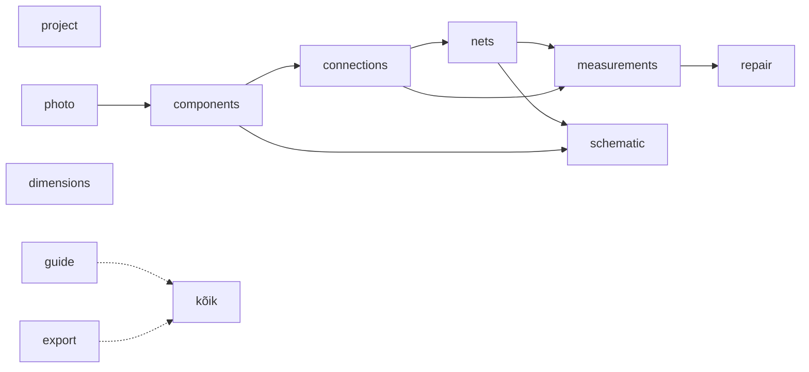

# 05 · Moodulid

Iga moodul on kaust `packages/features/<id>/`. Kaustas on kolm osa: `contract.ts` (avalik leping), `engine/` (backendi pool, `EngineModule`) ja `ui/` (frontendi pool, `UiModule`). Liidesed on kirjas [03 § 4](03-arhitektuur.md#4-moodulisüsteem)-s. Kest ega mootor ei tea moodulitest midagi peale registrite.

Moodulite arv on teadlikult väike (11). Tihedalt seotud osad on ühes moodulis, et omandireeglite erandeid oleks vähe:
- jalad on `components` moodulis;
- mõõtkava on `photo` moodulis;
- piiksumisrežiim on `measurements` moodulis;
- logi vahekaart on `project` moodulis.

Valik ja raamvalik on lõuendi baasvõimekus, mitte moodul.

## Moodulite kaart



Nool tähendab `dependsOn` seost. `guide` ja `export` ei sõltu teistest moodulitest otse: nad koguvad teiste moodulite kaastöid (`guideSteps`, `progressMetrics`, `exporters`).

## Moodulid ja nende vastutus

| Moodul | Vastutus | Käsud (`id`) | Tööriistad (klahv) | Paneelid ja sektsioonid | Kihid (z) |
|---|---|---|---|---|---|
| **project** | avaleht, uus/ava, viimased projektid, salvestuse olek ja sulgemise dialoog ([03 § 9](03-arhitektuur.md#salvestuse-vastutaja-savecoordinator-moodul-project)), varukoopiate taastamine, pisipilt, prototüübi import, projekti JSON eksport, logi vahekaart | `project.rename`, `project.setInfo`, `project.markMapped`, `project.unmarkMapped` | | Avaleht (sh „Taasta varukoopiast…“); uue plaadi dialoog; ülariba nimi ja salvestuse olek; navigaator: **Logi** | |
| **photo** | foto lisamine ja vahetus (import Rustis, EXIF, kuvamisvariant), nähtavus, kontrast, hall, pööramine ja peegeldamine kogu stseenile; mõõtkava kahe punktiga ja korpuse joondusest tulev ettepanek | `photo.add`, `photo.transform`, `scale.set` | Kalibreeri (`K`) | mõõteriba: nähtavuse liugur, kontrast, ⟳, ⇋, mõõtkava kiip; kalibreerimise aken | foto (0), kalibreerimisjoon (100) |
| **components** | korpuste teek, paigutus, pööramine, pool, suuruse muutmine, kahe jala joondus, korpuse vahetus ([04 › Kustutamise reeglid](04-andmemudel.md#kustutamise-reeglid)), identiteet, DNP; jalad ja nende olekud, oma jalad, nimed, NC; BOM eksport | `components.add`, `components.update`, `components.duplicate`, `components.rotate`, `components.flipSide`, `components.align`, `components.addPin`, `components.removePin`, `components.renamePin`, `components.setNc` | Paiguta (teegist), Punkt plaadil (`P`: testpunkt, via, padjand, juhe, ava), Joonda (`A`), Lisa jalg (`J`) | navigaator: **Teek**, **Plaadil**; kontekst: Komponent (10), Korpus ja asend (20), Jalg (10, kui valitud on jalg), Jalgade tabel (30) | kered (30), jalad (50), tähised ja jalgade numbrid (60), käepidemed (90) |
| **connections** | rajad (kihiga), juhtmed, lingid, käänupunktid, kiirühendus; ühenduse tase ja „Mõõda uuesti“ | `connections.add`, `connections.update`, `connections.insertWaypoint`, `connections.removeWaypoint` | Rada (`T`), Kiirühendus (`C`, valitud jalgadele) | kontekst: Ühendus (10) | alumised rajad (20), pealmised rajad (40), juhtmed ja lingid (55) |
| **nets** | võrgud, nimed, rollid, rollide redaktor, konfliktid, võrguloendi eksport | `nets.assign`, `roles.add`, `roles.update`, `roles.remove` | | navigaator: **Võrgud**; kontekst: Võrk (15) | võrgu esiletõst (45) |
| **measurements** | kiirsisestus, mustand jala kaupa, hinnangud, tolerantsi seade, mõõtmiste nimekiri ja filtrid, mõõtmiste CSV; piiksumisrežiim ([04 › Piiks](04-andmemudel.md#piiks-ei-tõenda-sama-vaskrada)) | `measurements.add`, `measurements.update`, `measurements.remove`, `measurements.setSettings`, `beep.record` | Mõõda (`M`: viib fookuse väärtuse väljale), Piiks (`B`) | kontekst: **Mõõda** (0, jalal), Mõõtmised (40); navigaator: **Mõõtmised**; ankru silt ja küsimus lõuendil; seaded: tolerants | hinnangute rõngad ja sildid (80), piiksu ankur ja küsimus (100) |
| **repair** | remonditoimingud, aegumine, kahjustatud alad, kahtlaste vaade | `repair.add`, `repair.remove`, `areas.add`, `areas.update`, `areas.remove` | Märgi ala (`X`) | kontekst: Remont (50); mõõteriba: „Näita kahtlaseid“ | alad (10), kahtlaste tuhmistus (85) |
| **dimensions** | mõõtjooned, plaadi kontuur, nullpunkt | `dimensions.add`, `dimensions.update`, `outline.set`, `outline.clear` | Mõõtjoon (`D`), Kontuur (`O`) | kontekst: Mõõtjoon, Kontuur | kontuur (15), mõõtjooned (70) |
| **schematic** | skeemivaade, sümbolid, automaatne paigutus, käsitsi paigutus, skeemi eksport | `schematic.place`, `schematic.resetLayout` | (skeemivaates Vali ja Liiguta) | ülariba: **Plaat \| Skeem** | `schematicLayers`: sümbolid, võrgusildid, toitesümbolid |
| **guide** | „Järgmine samm“, edenemisriba, „Kaardistuse seis“ | `guide.skip`, `guide.unskip` | | kontekst: Järgmine samm (kui midagi pole valitud); ülariba: edenemine | |
| **export** | ekspordi aken, mis kogub `exporters` kaastööd; SVG, PNG ja remondiraport | | | ülariba: Ekspordi | |

**Valik ja üldkäsud ei ole moodul.**
- Valimine, raamvalik ja nihutamine nooltega on `packages/ui/canvas`-is. Sinna kuuluvad tööriistad Vali (`V`) ja Liiguta vaadet (`H`) ning valikuraami kiht (90).
- Käsud `items.translate` ja `items.delete` on mootori üldkäsud (`packages/engine`), sest need puudutavad mitut objektitüüpi.
- Kustutamise reeglid on failis [04 › Kustutamise reeglid](04-andmemudel.md#kustutamise-reeglid).

## Andmete omanikud

Igal `BoardDoc` väljal on üks omanik-moodul (`owns`). Teise mooduli käsk tohib välja muuta ainult siis, kui see on tema `alsoWrites` loendis. Mootor kontrollib seda paikade järgi ja lükkab rikkumise tagasi ka väljalaskes ([03 § 4](03-arhitektuur.md#4-moodulisüsteem)). Uus erand lisatakse siia tabelisse koos põhjusega.

| Väli | Omanik | Teised kirjutajad (`alsoWrites`) ja põhjus |
|---|---|---|
| `name`, `device`, `problem`, `status`, `mappedAt`, `mappedSnapshot` | project | — |
| `photos`, `activePhotoId`, `scale` | photo | — |
| `components` | components | üldkäsud `items.translate`, `items.delete` |
| `connections` | connections | components (`components.removePin` ja korpuse vahetus vabastavad otsad); measurements (`beep.record` loob lingi); üldkäsud `items.*` |
| `netLabels`, `roles` | nets | components (`components.removePin` ja korpuse vahetus kustutavad kaduva jala sildid); üldkäsk `items.delete` |
| `measurements`, `measureSettings` | measurements | repair (`repair.add` märgib aegunuks) |
| `repairs`, `areas` | repair | üldkäsud `items.*` |
| `dimensions`, `outline` | dimensions | üldkäsud `items.*` |
| `schematic` | schematic | üldkäsk `items.delete` (eemaldab paigutuse) |
| `guide` | guide | — |
| `rev`, `format_version` | tuum (mootor, migratsioonid) | — |

Foto pööramine ja peegeldamine ei kirjuta teiste moodulite andmeid, sest teisendus rakendub kogu stseenile ([03 § 7.1](03-arhitektuur.md#71-koordinaadid)).

## Kaastööd, mida mitu moodulit annavad

| Kaastöö | Pool | Kes annab |
|---|---|---|
| `exporters` | UI | project (JSON), components (BOM CSV), nets (võrguloend CSV), measurements (mõõtmised CSV), export (SVG, PNG, raport), schematic (skeemi SVG/PNG) |
| `guideSteps` | UI | photo (1 foto, 2 mõõtkava), components (3), connections (4), nets (5), measurements (6), schematic (7), project (8) |
| `progressMetrics` | UI | components, nets, connections, measurements |
| `derive` | mootor | nets (võrgud, konfliktid, lühistatud kahejalgsed komponendid), measurements (hinnangud), connections (ühenduse tasemed, läbivuse vastuolud), guide (valmidus) |
| `importers` | mootor | project (`.pcbk`, `.pcbmap.json`, `project.json`), photo (`.jpg`, `.png`, `.webp`) |

## Uue mooduli tegemine

Näide: moodul **„Märkmed“**, mis lisab navigaatorisse vahekaardi vabateksti märkmete jaoks. M0 ehitab just selle mooduli läbi kõigi kolme osa.

```
packages/features/notes/
  contract.ts          # käskude skeemid ja avalikud selektorid (selectNotes)
  engine/index.ts      # notesEngine: EngineModule
  engine/commands.ts   # CommandSpec-id
  ui/index.tsx         # notesUi: UiModule
  ui/NotesTab.tsx
  notes.test.ts        # mootori pool Node'is, UI pool võltsmootoriga
```

```ts
// packages/features/notes/engine/index.ts — backend, Reacti ei tunne
import type { EngineModule } from '@pcbk/engine';
import { addNote, removeNote } from './commands';

export const notesEngine: EngineModule = {
  id: 'notes',
  owns: ['notes'],
  commands: [addNote, removeNote],
  migrations: [addNotesField],   // lisab vaikeväärtuse `notes: []`
};
```

```tsx
// packages/features/notes/ui/index.tsx — frontend, mootorit ei tunne
import type { UiModule } from '@pcbk/ui';
import { NotesTab } from './NotesTab';

export const notesUi: UiModule = {
  id: 'notes',
  title: 'Märkmed',
  navigatorTabs: [{ id: 'notes', label: 'Märkmed', order: 60, render: () => <NotesTab /> }],
};
```

```ts
// apps/desktop/src/engine.features.ts     // apps/desktop/src/ui.features.ts
export const engineModules = [ /* … */, notesEngine ];   export const uiModules = [ /* … */, notesUi ];
```

**Kontrollnimekiri:**
1. **Impordid:**
   - `engine/` impordib ainult `@pcbk/engine`, `@pcbk/domain`, oma `contract.ts`-i ja nende moodulite lepinguid, mis on `dependsOn` loendis;
   - `ui/` impordib ainult `@pcbk/ui`, `@pcbk/client`, `@pcbk/contracts` ja lepinguid;
   - `ui/` ei impordi kunagi mootorit.
2. **Uus dokumendi väli:** zod-skeemi laiendus, `owns`, `format_version` tõus, migratsioon vaikeväärtusega ja migratsiooni test.
3. **Muudatused:** iga dokumendi muudatus on käsk, mis käib `engine.execute` kaudu. UI kirjutab ainult `SessionStore`'i ja `ViewStore`'i.
4. **Teise mooduli väljad:** neid muudetakse ainult `alsoWrites` kaudu ning siinne omanike tabel uuendatakse.
5. **Tekstid:** lähevad faili `i18n/et.ts` võtme `notes.*` alla. Mootor tagastab ainult koode.
6. **Testid:** mootori pool ühiktestidega Node'is, UI pool vähemalt ühe Testing Library testiga võltsmootori peal.
7. **Dokumentatsioon:** uuenda selle faili tabeleid.
8. **Kontroll:** `pnpm check` (tsc, eslint, dependency-cruiser, failipikkus, testid) on roheline.

## Mida moodul ei tee

- UI osa ei impordi mootorit ega muuda dokumenti.
- Mootori osa ei impordi Reacti, DOM-i ega Taurit; faile loeb ja kirjutab ainult portide kaudu.
- Ei muuda kesta ega teise mooduli faile.
- Ei hoia dokumendi andmeid oma lokaalses olekus (ainult UI olek, nt avatud või suletud).
- Ei muuda valikut tööriista vahetamisel ega paneeli avamisel.
