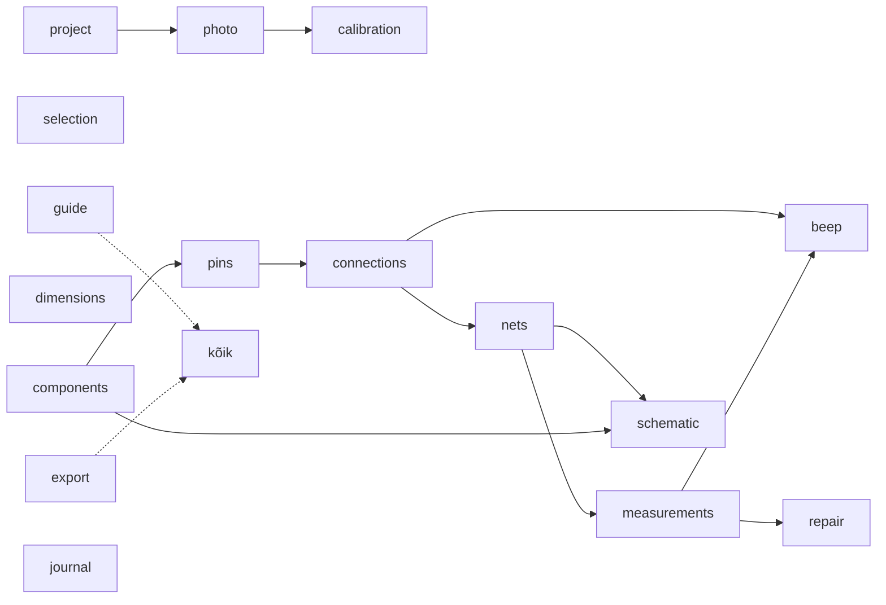

# 05 · Moodulid

Iga moodul on kaust `src/modules/<id>/`, mille `index.ts` ekspordib `AppModule` objekti (liides: [03 § 4](03-arhitektuur.md#4-moodulisüsteem)). Kest ei tea moodulitest midagi peale registri.

## Moodulite kaart



Nool tähendab `dependsOn` seost. `guide` ja `export` ei sõltu teistest moodulitest otse: nad koguvad teiste moodulite kaastöid (`guideSteps`, `progressMetrics`, `exporters`).

## Moodulid ja nende vastutus

| Moodul | Vastutus | Käsud (`id`) | Tööriistad (klahv) | Paneelid ja sektsioonid | Kihid (z) |
|---|---|---|---|---|---|
| **project** | avaleht, uus/ava, viimased, salvestuse vastutaja `SaveCoordinator` (automaatsalvestus, üks järjekord, veaolek, sulgemisel lõpuni salvestamine, koopia; [03 § 9](03-arhitektuur.md#salvestuse-vastutaja-savecoordinator-moodul-project)), pisipilt, prototüübi import, projekti JSON eksport | `project.rename`, `project.setInfo`, `project.markMapped`, `project.unmarkMapped` | | Avaleht; uue plaadi dialoog; ülariba nimi ja salvestuse olek | |
| **photo** | foto lisamine ja vahetus, nähtavus, kontrast, hall, pööramine ja peegeldamine koos kaardistuse teisendusega | `photo.add`, `photo.transform` | | mõõteriba: nähtavuse liugur, kontrast, ⟳, ⇋ | foto (0) |
| **calibration** | mõõtkava kahe punktiga, korpuse joondusest tulev ettepanek | `scale.set` | Kalibreeri (`K`) | kalibreerimise aken; mõõteriba kiip | kalibreerimisjoon (100) |
| **selection** | valimine, raamvalik, liigutamine, kustutamine, nihutamine nooltega, valiku sünk | `items.translate`, `items.delete`, `selection.set` | Vali (`V`), Liiguta vaadet (`H`) | | valikuraam (90) |
| **components** | korpuste teek, paigutus, pööramine, pool, suuruse muutmine, kahe jala joondus, identiteet, DNP, BOM eksport | `components.add`, `components.update`, `components.duplicate`, `components.rotate`, `components.flipSide`, `components.align` | Paiguta (teegist), Punkt plaadil (`P`: testpunkt, via, padjand, juhe, ava), Joonda (`A`) | navigaator: **Teek**, **Plaadil**; kontekst: Komponent (10), Korpus ja asend (20) | kered (30), tähised (60), käepidemed (90) |
| **pins** | jalgade joonistus ja olekud, oma jalad, nimed, NC, jala vaade | `pins.add`, `pins.remove`, `pins.rename`, `pins.setNc` | Lisa jalg (`J`) | kontekst: Jalg (10, kui valitud on jalg), Jalgade tabel (30, komponendil) | jalad (50), jalgade numbrid (60) |
| **connections** | rajad, juhtmed, lingid, käänupunktid, kiirühendus | `connections.add`, `connections.update`, `connections.insertWaypoint`, `connections.removeWaypoint` | Rada (`T`), Kiirühendus (`C`, valitud jalgadele) | kontekst: Ühendus (10) | alumised rajad (20), pealmised rajad (40), juhtmed ja lingid (55) |
| **nets** | võrgud, nimed, rollid, rollide redaktor, konfliktid, võrguloendi eksport | `nets.assign`, `roles.add`, `roles.update`, `roles.remove` | | navigaator: **Võrgud**; kontekst: Võrk (15) | võrgu esiletõst (45) |
| **measurements** | kiirsisestus, hinnangud, mõõtmiste nimekiri ja filtrid, mõõtmiste CSV | `measurements.add`, `measurements.update`, `measurements.remove` | Mõõda (`M`: viib fookuse väärtuse väljale) | kontekst: **Mõõda** (0, jalal), Mõõtmised (40); navigaator: **Mõõtmised** | hinnangute rõngad ja sildid (80) |
| **beep** | piiksumisrežiim: ankur, jah/ei, mõõdetud ühendused | `beep.record` (üks tagasivõetav samm: läbivuse mõõtmine ja ühenduse loomine või kinnitamine; [04 › Ühenduse tase](04-andmemudel.md#ühenduse-tase-coremeasureconnectionlevel)) | Piiks (`B`) | ankru silt lõuendil | ankur ja küsimus (100) |
| **repair** | remonditoimingud, aegumine, kahjustatud alad, kahtlaste vaade | `repair.add`, `repair.remove`, `areas.add`, `areas.update`, `areas.remove` | Märgi ala (`X`) | kontekst: Remont (50); mõõteriba: „Näita kahtlaseid“ | alad (10), kahtlaste tuhmistus (85) |
| **dimensions** | mõõtjooned, plaadi kontuur, nullpunkt | `dimensions.add`, `dimensions.update`, `outline.set`, `outline.clear` | Mõõtjoon (`D`), Kontuur (`O`) | kontekst: Mõõtjoon, Kontuur | kontuur (15), mõõtjooned (70) |
| **schematic** | skeemivaade, sümbolid, automaatne paigutus, käsitsi paigutus, skeemi eksport | `schematic.place`, `schematic.resetLayout` | (skeemivaates Vali ja Liiguta) | ülariba: **Plaat \| Skeem** | `schematicLayers`: sümbolid, võrgusildid, toitesümbolid |
| **guide** | „Järgmine samm“, edenemisriba, „Kaardistuse seis“ | `guide.skip`, `guide.unskip` | | kontekst: Järgmine samm (kui midagi pole valitud); ülariba: edenemine | |
| **export** | ekspordi aken, mis kogub `exporters` kaastööd; SVG, PNG ja remondiraport | | | ülariba: Ekspordi | |
| **journal** | Logi vahekaart: remondid, mõõtmised, märkused, muudatuste kokkuvõtted | | | navigaator: **Logi** | |

**Üldised käsud** (`items.translate`, `items.delete`) asuvad `core/commands/items.ts`-is, sest need puudutavad mitut objektitüüpi. Iga objektitüübi kustutamise reeglid on failis [04 › Kustutamise reeglid](04-andmemudel.md#kustutamise-reeglid).

## Andmete omanikud

Igal `BoardDoc` väljal on üks omanik-moodul (`owns`). Teise mooduli käsk tohib välja muuta ainult siis, kui see on tema `alsoWrites` loendis; `dispatch` kontrollib seda paikade järgi ([03 § 4](03-arhitektuur.md#4-moodulisüsteem)). Uus erand lisatakse siia tabelisse koos põhjusega.

| Väli | Omanik | Teised kirjutajad (`alsoWrites`) ja põhjus |
|---|---|---|
| `name`, `device`, `problem`, `status`, `mappedAt`, `mappedSnapshot` | project | — |
| `photos`, `activePhotoId` | photo | — |
| `scale` | calibration | — |
| `components` | components | pins (`pins.*`: jalgade nimed, NC ja oma jalad asuvad komponendi sees); photo (`photo.transform` teisendab koordinaadid); core `items.translate`, `items.delete` |
| `connections` | connections | beep (`beep.record`); pins (`pins.remove` vabastab otsad); photo (`photo.transform`); core `items.*` |
| `netLabels`, `roles` | nets | pins (`pins.remove`) ja core `items.delete` kustutavad jala sildid |
| `measurements` | measurements | beep (`beep.record`); repair (`repair.add` märgib aegunuks) |
| `repairs`, `areas` | repair | photo (`photo.transform`, alad); core `items.*` |
| `dimensions`, `outline` | dimensions | photo (`photo.transform`); core `items.*` |
| `schematic` | schematic | core `items.delete` (eemaldab paigutuse) |
| `guide` | guide | — |
| `rev`, `format_version` | tuum (`dispatch`, migratsioonid) | — |

## Kaastööd, mida mitu moodulit annavad

| Kaastöö | Kes annab |
|---|---|
| `exporters` | project (JSON), components (BOM CSV), nets (võrguloend CSV), measurements (mõõtmised CSV), export (SVG, PNG, raport), schematic (skeemi SVG/PNG) |
| `guideSteps` | photo (1), calibration (2), components (3), connections (4), nets (5), measurements (6), schematic (7), project (8) |
| `progressMetrics` | components, pins, nets, connections, measurements |
| `importers` | project (`.pcbk`, `.pcbmap.json`, `project.json`), photo (`.jpg`, `.png`, `.webp`) |

## Uue mooduli tegemine

Näide: moodul **„Märkmed“**, mis lisab navigaatorisse vahekaardi vabateksti märkmete jaoks.

```
src/modules/notes/
  index.ts          # ekspordib notesModule
  model.ts          # zod-skeem ja tüüp (kui moodul lisab dokumenti välja)
  commands.ts       # CommandSpec-id
  NotesTab.tsx      # UI
  notes.test.ts     # käskude ja UI testid
```

```ts
// src/modules/notes/index.ts
import type { AppModule } from '@/app/module';
import { addNote, removeNote } from './commands';
import { NotesTab } from './NotesTab';

export const notesModule: AppModule = {
  id: 'notes',
  title: 'Märkmed',
  commands: [addNote, removeNote],
  navigatorTabs: [{ id: 'notes', label: 'Märkmed', order: 60, render: () => <NotesTab /> }],
};
```

```ts
// src/app/modules.ts
export const modules: AppModule[] = [ /* … */, notesModule ];
```

**Kontrollnimekiri:**
1. Moodul impordib ainult `@/core`, `@/ui`, `@/app/module` ja teiste moodulite `index.ts` faile (need peavad olema `dependsOn` loendis).
2. Kui moodul lisab dokumenti uue välja, siis: zod-skeem `BoardDocSchema` laiendus, `format_version` tõus, migratsioon, mis lisab vaikeväärtuse, ning migratsiooni test.
3. Iga dokumendi muudatus on käsk; komponendist otse store'i ei kirjutata.
4. Tekstid lähevad faili `src/app/i18n/et.ts` võtme `notes.*` alla.
5. Testid: käskude puhul ühiktest, UI puhul vähemalt üks Testing Library test.
6. Uuenda selle faili tabelit.
7. `pnpm check` (tsc, eslint, dependency-cruiser, failipikkus, testid) on roheline.

## Mida moodul ei tee

- Ei muuda kesta (`AppShell`) ega teise mooduli faile.
- Ei loe ega kirjuta faile otse; selleks on platvormikiht.
- Ei hoia dokumendi andmeid oma lokaalses olekus (ainult UI olek, nt avatud/suletud).
- Ei muuda valikut tööriista vahetamisel ega paneeli avamisel.
