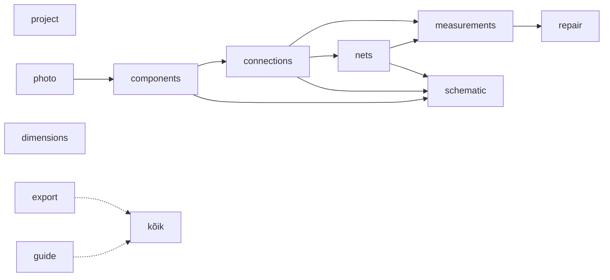

# 05 · Moodulid

Iga moodul on kaust `packages/features/<id>/`. Kaustas on kolm osa: `contract.ts` (avalik leping), `engine/` (backendi pool, `EngineModule`) ja `ui/` (frontendi pool, `UiModule`). Liidesed on kirjas [03 § 4](03-arhitektuur.md#4-moodulisüsteem)-s. Kest ega mootor ei tea moodulitest midagi peale registrite.

Moodulite arv on teadlikult väike (11). Tihedalt seotud osad on ühes moodulis, et omandireeglite erandeid oleks vähe:
- jalad on `components` moodulis;
- mõõtkava on `photo` moodulis;
- piiksumisrežiim on `measurements` moodulis;
- logi ja impordi kontrollnimekiri on `project` moodulis.

Valik ja raamvalik on lõuendi baasvõimekus, mitte moodul. Mooduli kaust luuakse alles siis, kui moodulit ehitatakse ([07](07-teekaart.md)); tühje mooduleid ega laienduskohti ette ei tehta.

## Moodulite kaart



Nool tähendab `dependsOn` seost. `guide` ja `export` ei sõltu teistest moodulitest otse: nad koguvad teiste moodulite kaastöid (`guideSteps`, `progressMetrics`, `exporters`).

## Moodulid ja nende vastutus

| Moodul | Vastutus | Käsud (`id`) | Tööriistad (klahv) | Paneelid ja sektsioonid | Kihid (z) |
|---|---|---|---|---|---|
| **project** | avaleht, uus/ava, viimased projektid, salvestuse olek ja sulgemise dialoog ([03 § 9](03-arhitektuur.md#salvestuse-vastutaja-savecoordinator-moodul-project)), varukoopiate taastamine, pisipilt, prototüübi import koos kontrollnimekirjaga, projekti JSON eksport, logi vahekaart | `project.rename`, `project.setInfo`, `project.markMapped`, `project.unmarkMapped`, `importChecks.resolve` | | Avaleht (sh „Taasta varukoopiast…“); uue plaadi dialoog; ülariba nimi ja salvestuse olek; navigaator: **Logi**, **Kontrolli ühenduskohti** (kui on) | impordi kontrollkohad (88) |
| **photo** | foto lisamine ja vahetus (terviklik import Rustis, EXIF, kuvamisvariant), nähtavus, kontrast, hall, pööramine ja peegeldamine kogu stseenile; mõõtkava kahe punktiga ja korpuse joondusest tulev ettepanek | `photo.add`, `photo.transform`, `scale.set` | Kalibreeri (`K`) | mõõteriba: nähtavuse liugur, kontrast, ⟳, ⇋, mõõtkava kiip; kalibreerimise aken | foto (0), kalibreerimisjoon (100) |
| **components** | komponendi identiteet (tähis, tüüp, märgistus, väärtus, DNP), jalad ja nende olekud, oma jalad, nimed, NC; plaadipaigutus: korpuste teek, paigutus, pööramine, pool, suurus, kahe jala joondus, korpuse vahetus koos jalgade vastavusega ([04 › Kustutamise reeglid](04-andmemudel.md#kustutamise-reeglid)); tundmatu komponent alana; „Plaadile paigutamata“ loend; BOM eksport | `components.add`, `components.update`, `components.duplicate`, `components.rotate`, `components.flipSide`, `components.align`, `components.placeOnBoard`, `components.removeFromBoard`, `components.addPin`, `components.removePin`, `components.renamePin`, `components.setNc` | Paiguta (teegist), Tundmatu komponent (ala märkimine), Punkt plaadil (`P`: testpunkt, via, padjand, juhe, ava), Joonda (`A`), Lisa jalg (`J`) | navigaator: **Teek**, **Plaadil**, **Plaadile paigutamata**; kontekst: Komponent (10), Korpus ja asend (20), Jalg (10, kui valitud on jalg), Jalgade tabel (30) | kered (30), jalad (50), tähised ja jalgade numbrid (60), käepidemed (90) |
| **connections** | elektrilised ühendused ja liitepunktid; rada fotol (kihiga), juhe, õhujoon, haru, käänupunktid; „Joonista rada fotol“ olemasolevale ühendusele; „Eemalda joonistus“ vs „Kustuta ühendus“; ühenduse tase ja „Mõõda uuesti“ | `connections.add`, `connections.update`, `connections.drawOnBoard`, `connections.removeBoardDrawing`, `connections.remove`, `connections.branch`, `connections.insertWaypoint`, `connections.removeWaypoint`, `junctions.move`, `junctions.attachToPin`, `junctions.remove` | Rada (`T`), Kiirühendus (`C`, valitud jalgadele) | kontekst: Ühendus (10), Liitepunkt (10) | alumised rajad (20), pealmised rajad (40), juhtmed ja õhujooned (55), liitepunktid (56) |
| **nets** | võrgud, nimed, rollid, rollide redaktor, konfliktid, lühistatud komponendid, „Ühenda võrguga…“, võrguloendi eksport | `nets.assign`, `nets.join`, `roles.add`, `roles.update`, `roles.remove` | | navigaator: **Võrgud**; kontekst: Võrk (15) | võrgu esiletõst (45) |
| **measurements** | kiirsisestus (punane ja must sond, režiim, toide, näit, OL), mustand sondipaari kaupa, hinnangud, tolerantsi seade, mõõtmiste nimekiri ja filtrid (sh ajaloolised), mõõtmiste CSV; piiksumisrežiim ([04 › Piiks](04-andmemudel.md#piiks-ei-tõenda-sama-vaskrada)) | `measurements.add`, `measurements.update`, `measurements.remove`, `measurements.setSettings`, `beep.record` | Mõõda (`M`: viib fookuse väärtuse väljale), Piiks (`B`) | kontekst: **Mõõda** (0, jalal), Mõõtmised (40); navigaator: **Mõõtmised**; ankru silt ja nupud lõuendil; seaded: tolerants | hinnangute rõngad ja sildid (80), piiksu ankur ja nupud (100) |
| **repair** | remonditoimingud koos mõjuga (komponent, võrgud, kogu plaat, mitte midagi), aegumine, kahjustatud alad, kahtlaste vaade | `repair.add`, `repair.remove`, `areas.add`, `areas.update`, `areas.remove` | Märgi ala (`X`) | kontekst: Remont (50); mõõteriba: „Näita kahtlaseid“ | alad (10), kahtlaste tuhmistus (85) |
| **dimensions** | mõõtjooned, plaadi kontuur, nullpunkt, tekstimärkused mõlemas vaates | `dimensions.add`, `dimensions.update`, `outline.set`, `outline.clear`, `notes.add`, `notes.update`, `notes.remove` | Mõõtjoon (`D`), Kontuur (`O`), Märkus (käsupaletist) | kontekst: Mõõtjoon, Kontuur, Märkus | kontuur (15), mõõtjooned (70), märkused (75) |
| **schematic** | muudetav skeemivaade: sümbolid, komponendi lisamine ja paigutamine skeemil, ühendusjooned ja liitepunktid skeemil, võrgusildid, toite- ja maandussümbolid, jalgade funktsiooni määramine (`pinMap`), „Skeemile paigutamata“ loend, „Näita plaadil“; hiljem automaatpaigutus abilisena; skeemi eksport | `schematic.place`, `schematic.remove`, `schematic.setSymbol`, `schematic.drawWire`, `schematic.removeWire`, `schematic.moveJunction`, `schematic.autoPlace` (M4) | skeemivaates: Vali, Lisa sümbol, Juhe (`W`), Silt (`L`) | ülariba: **Plaat \| Skeem**; navigaator: **Skeemile paigutamata** | `schematicLayers`: sümbolid, juhtmed, liitepunktid, võrgusildid, toitesümbolid, märkused |
| **guide** | „Järgmine samm“, edenemisriba, „Kaardistuse seis“ | `guide.skip`, `guide.unskip` | | kontekst: Järgmine samm (kui midagi pole valitud); ülariba: edenemine | |
| **export** | ekspordi aken, mis kogub `exporters` kaastööd; SVG, PNG, remondiraport, kaardi ja skeemi printimine | | | ülariba: Ekspordi | |

**Valik ja üldkäsud ei ole moodul.**
- Valimine, raamvalik ja nihutamine nooltega on `packages/ui/canvas`-is ja toimivad mõlemas vaates. Sinna kuuluvad tööriistad Vali (`V`) ja Liiguta vaadet (`H`) ning valikuraami kiht (90).
- Käsud `items.translate` ja `items.delete` on mootori üldkäsud (`packages/engine`), sest need puudutavad mitut objektitüüpi.
- Kustutamise reeglid on failis [04 › Kustutamise reeglid](04-andmemudel.md#kustutamise-reeglid).

**Skeemil lisamine** kasutab sama käsku `components.add` (ainult skeemipaigutusega) ja **skeemil ühendamine** sama käsku `connections.add` (ainult skeemijoonistusega). Objekte on üks komplekt, vaateid kaks.

## Andmete omanikud

Igal `BoardDoc` väljal on üks omanik-moodul (`owns`). Teise mooduli käsk tohib välja muuta ainult siis, kui see on tema `alsoWrites` loendis. Mootor kontrollib seda paikade järgi ja lükkab rikkumise tagasi ka väljalaskes ([03 § 4](03-arhitektuur.md#4-moodulisüsteem)). Uus erand lisatakse siia tabelisse koos põhjusega.

| Väli | Omanik | Teised kirjutajad (`alsoWrites`) ja põhjus |
|---|---|---|
| `name`, `device`, `problem`, `status`, `mappedAt`, `mappedSnapshot`, `importChecks` | project | — |
| `photos`, `activePhotoId`, `scale` | photo | — |
| `components` | components | schematic (`schematic.*` muudab komponendi skeemipaigutust); üldkäsud `items.translate`, `items.delete` |
| `connections`, `junctions` | connections | components (`components.removePin`, korpuse vahetus ja kustutamine muudavad otsad liitepunktideks); measurements (`beep.record` loob ühenduse); schematic (`schematic.drawWire`, `schematic.removeWire`, `schematic.moveJunction`); nets (`nets.join` loob ühenduse); project (`importChecks.resolve` kinnitab liite); üldkäsud `items.*` |
| `netLabels`, `roles` | nets | components (`components.removePin` ja korpuse vahetus kustutavad kaduva jala sildid); connections (liitepunkti eemaldamisel tõstetakse või kustutatakse sellele ankurdatud sildid, [04 › Võrkude arvutus](04-andmemudel.md#võrkude-arvutus-resolvenets)); schematic (võrgusildi paigutus skeemil; juhtme eemaldamine võib liitepunkti eemaldada); project (`importChecks.resolve`); üldkäsk `items.delete` |
| `measurements`, `measureSettings` | measurements | repair (`repair.add` märgib aegunuks) |
| `repairs`, `areas` | repair | üldkäsud `items.*` |
| `dimensions`, `outline`, `textNotes` | dimensions | üldkäsud `items.*` |
| `guide` | guide | — |
| `rev`, `format_version` | tuum (mootor, migratsioonid) | — |

- Foto pööramine ja peegeldamine ei kirjuta teiste moodulite andmeid, sest teisendus rakendub kogu stseenile ([03 § 7.1](03-arhitektuur.md#71-koordinaadid)).
- Import ja projekti loomine teevad uue dokumendi `ProjectService`'i kaudu ega ole käsud olemasoleva dokumendi peal.

## Kaastööd, mida mitu moodulit annavad

| Kaastöö | Pool | Kes annab |
|---|---|---|
| `exporters` | UI | project (JSON), components (BOM CSV), nets (võrguloend CSV), measurements (mõõtmised CSV), export (SVG, PNG, raport, print), schematic (skeemi SVG/PNG) |
| `guideSteps` | UI | photo (1 foto, 2 mõõtkava), components (3), schematic (4), connections (5), nets (6), measurements (7), project (8) |
| `progressMetrics` | UI | components (sh paigutamata), nets, connections, measurements, project (impordi kontrollkohad) |
| `derive` | mootor | nets (võrgud, konfliktid, lühistatud kahejalgsed komponendid), measurements (hinnangud, ajaloolised mõõtmised), connections (ühenduse tasemed, läbivuse vastuolud), components (paigutamata loendid), guide (valmidus) |
| `importers` | mootor | project (`.pcbk`, `.pcbmap.json` koos kontrollnimekirjaga, `project.json`), photo (`.jpg`, `.png`, `.webp`) |

## Uue mooduli tegemine

M0 ehitab esimese päris mooduli **`components`** läbi kõigi kolme osa: lisa komponent, nimeta, tagasi/uuesti, sulge ja ava uuesti. Uus moodul tehakse sama malli järgi.

```
packages/features/components/
  contract.ts          # käskude skeemid ja avalikud selektorid (selectComponents, selectUnplaced)
  engine/index.ts      # componentsEngine: EngineModule
  engine/commands.ts   # CommandSpec-id
  ui/index.tsx         # componentsUi: UiModule
  ui/ComponentSection.tsx
  components.test.ts   # mootori pool Node'is, UI pool võltsmootoriga
```

```ts
// packages/features/components/engine/index.ts — backend, Reacti ei tunne
import type { EngineModule } from '@pcbk/engine';
import { addComponent, updateComponent } from './commands';

export const componentsEngine: EngineModule = {
  id: 'components',
  owns: ['components'],
  commands: [addComponent, updateComponent],
};
```

```tsx
// packages/features/components/ui/index.tsx — frontend, mootorit ei tunne
import type { UiModule } from '@pcbk/ui';
import { ComponentSection } from './ComponentSection';

export const componentsUi: UiModule = {
  id: 'components',
  title: 'Komponendid',
  contextSections: [{ id: 'component', order: 10, appliesTo: ['component'], render: (p) => <ComponentSection {...p} /> }],
};
```

```ts
// apps/desktop/src/engine.features.ts          // apps/desktop/src/ui.features.ts
export const engineModules = [ /* … */, componentsEngine ];   export const uiModules = [ /* … */, componentsUi ];
```

**Kontrollnimekiri:**
1. **Impordid:**
   - `engine/` impordib ainult `@pcbk/engine`, `@pcbk/domain`, oma `contract.ts`-i ja nende moodulite lepinguid, mis on `dependsOn` loendis;
   - `ui/` impordib ainult `@pcbk/ui`, `@pcbk/client`, `@pcbk/contracts` ja lepinguid;
   - `ui/` ei impordi kunagi mootorit.
2. **Uus dokumendi väli:** zod-skeemi laiendus, `owns`, `format_version` tõus, migratsioon vaikeväärtusega ja migratsiooni test.
3. **Muudatused:** iga dokumendi muudatus on käsk, mis käib `engine.execute` kaudu. UI kirjutab ainult `SessionStore`'i ja `ViewStore`'i.
4. **Teise mooduli väljad:** neid muudetakse ainult `alsoWrites` kaudu ning siinne omanike tabel uuendatakse.
5. **Tekstid:** lähevad faili `i18n/et.ts` mooduli võtme alla. Mootor tagastab ainult koode.
6. **Testid:** mootori pool ühiktestidega Node'is, UI pool vähemalt ühe Testing Library testiga võltsmootori peal. Ohtlikud reeglid (sihtmärk, topoloogia, andmete säilimine) saavad invariandi testi ([03 § 12](03-arhitektuur.md#kohustuslikud-invariandid)).
7. **Dokumentatsioon:** uuenda selle faili tabeleid.
8. **Kontroll:** `pnpm check` (tsc, eslint, dependency-cruiser, failipikkus, testid) on roheline.

Mooduli „kaks rida registris“ kehtib tavalise UI-kaastöö puhul. Uus domeenivaldkond vajab lisaks mudelit, käske ja teste.

## Mida moodul ei tee

- UI osa ei impordi mootorit ega muuda dokumenti.
- Mootori osa ei impordi Reacti, DOM-i ega Taurit; faile loeb ja kirjutab ainult portide kaudu.
- Ei muuda kesta ega teise mooduli faile.
- Ei hoia dokumendi andmeid oma lokaalses olekus (ainult UI olek, nt avatud või suletud).
- Ei muuda valikut ega mõõtmise kohta tööriista vahetamisel, paneeli avamisel ega vaate vahetamisel.
- Ei loo elektrilist ühendust geomeetria, nime ega mõõtmise põhjal ilma nähtava kasutaja tegevuseta.
