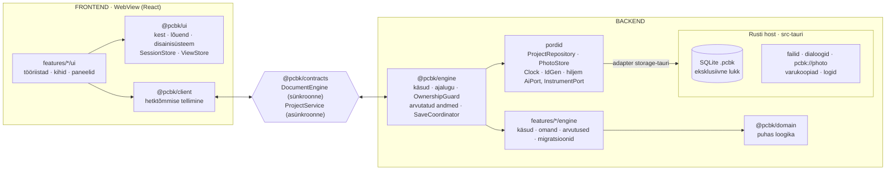
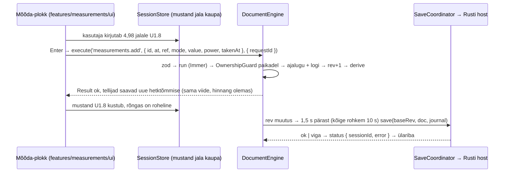

# ADR-003: Frontend ja backend eraldi: kohalik mootor lepingu taga ja Rusti host

**Staatus:** Vastu võetud (kasutaja otsus 2026-11-07), versioon 2 (muudetud pärast GPT ja Gemini ülevaatust)
**Kuupäev:** 2026-11-07
**Otsustaja:** kasutaja
**Täpsustab:** [ADR-002](ADR-002-typescript-tauri.md) (tehnoloogia jääb samaks: TypeScript, React, Tauri 2, SQLite)
**Ülevaatused:** [pakett](../review/2026-11-07-ulevaatuse-pakett.md), [otsused leidude kaupa](../review/2026-11-07-ulevaatuste-otsused.md)

## Kontekst

ADR-002 valis tehnoloogia. Esimene arhitektuurikirjeldus oli aga **paks klient**: dokument elas Reacti hoidlas ja moodulid segasid kasutajaliidest ning andmeloogikat. See töötab, aga sel on kolm nõrkust:

1. **Esi- ja tagaosa pole eraldatud.** Miski ei takista paneelil dokumenti otse muutmast. BenchBeep läks just nii katki: 209 KB ekraanifail ja megakontrollerid.
2. **Pole kuhu kasvada.** Tahvel, AI, multimeeter, varundus ja sünk vajavad loogikat, mis töötab ilma Reactita.
3. **Testimine on seotud UI-ga.** Käske, salvestamist ja omandireegleid peab saama testida Node'is ilma DOM-ita.

Nõuded tähtsuse järjekorras:
- **Lihtsus on esikohal**, sest arendab üks inimene koos AI-assistentidega;
- piiri UI ja andmete vahel kontrollib masin, mitte kokkulepe;
- moodulid jäävad vertikaalseteks;
- äpp saab kasvada ilma ümberkirjutamiseta;
- lohistamine on vähemalt 45 fps ning pan ja suum 60 fps;
- ühtegi torustikku (sündmuste logi → materializer → projektsioon) ei kasutata tõe allikana.

## Otsus

Äpp jaguneb **frontendiks**, **lepinguks** ja **backendiks**. Backend koosneb TypeScripti mootorist ja Rusti hostist. Eraldus on **lepingus ja pakettide piirides, mitte protsessis**: täna jookseb kõik ühes WebView lõimes.

Äpp on **kohalik ennekõike (local-first)**: mootor jääb alati kasutaja arvutisse. Kui tulevikus tuleb varundus või sünk, vahetab äpp serveriga andmeid, aga mootor ei koli serverisse. Seepärast võib dokumendimootor olla sünkroonne.



| Osa | Vastutab | Ei tee kunagi |
|---|---|---|
| **Frontend** (`@pcbk/ui`, `features/*/ui`, `@pcbk/client`) | joonistus, sisend, tööriistad, valik, **eelvaade** (lohistamine, suurus, pööre, pooleli rada), mõõtmise mustandid, vaade, tekstid | ei muuda dokumenti, ei impordi mootorit, ei arvuta võrke ega hinnanguid, ei räägi Rustiga otse |
| **Leping** (`@pcbk/contracts`, `features/*/contract`) | käskude skeemid, hetktõmmise ja sündmuste kuju, veakoodid, moodulite avalikud tüübitud selektorid | ei hoia olekut |
| **Backend: mootor** (`@pcbk/engine`, `features/*/engine`) | autoriteetne dokument, käskude kontroll ja täitmine, tagasivõtmine, omandikontroll, **arvutatud andmed** (võrgud, hinnangud, ühenduse tase, valmidus), logi, salvestuse vastutaja, migratsioonid, seansid | ei impordi Reacti, DOM-i ega Tauri API-t |
| **Backend: host** (Rust) | SQLite tehingud ja lukk, `rev`-i võrdlus, koopiad ja varukoopiad, fotode import ja `pcbk://photo` protokoll, dialoogid, logid; hiljem seriaalport, AI võtmed ja võrgupäringud | ei sisalda domeeniloogikat |

### Leping

```ts
// Sünkroonne dokumendimootor: iga klõps ja klahv, ilma Promise'ita
export interface DocumentEngine {
  execute<C extends CommandId>(id: C, params: ParamsOf<C>, opts?: { requestId?: string }): Result<CommandOk, EngineError>;
  undo(): Result<CommandOk, EngineError>;
  redo(): Result<CommandOk, EngineError>;
  snapshot(): Snapshot;
  subscribe(fn: (s: Snapshot) => void): Unsubscribe;
  events(fn: (e: DomainEvent) => void): Unsubscribe;   // measurement.added, repair.added …
}

// Hetktõmmis: sügavalt külmutatud, samas lõimes sama viide (koopiat ei tehta)
export interface Snapshot {
  readonly sessionId: string;              // projekti avamisseanss
  readonly rev: number;
  readonly doc: Readonly<BoardDoc>;
  readonly derived: Readonly<Derived>;     // võrgud, hinnangud, ühenduse tasemed, valmidus
}

// Asünkroonne projektihaldur: kõik, mis puudutab faile ja Rusti
export interface ProjectService {
  create(req: CreateReq): Promise<Result<ProjectInfo, EngineError>>;
  open(req: OpenReq): Promise<Result<ProjectInfo, EngineError>>;     // ProjectInfo: projectId, sessionId, readOnly
  close(): Promise<Result<void, EngineError>>;                       // flush() enne sulgemist
  flush(): Promise<Result<void, EngineError>>;
  saveView(view: ViewState): void;                                    // vaade: ei loo ajaloosammu ega muuda rev-i
  copy(req: CopyReq): Promise<Result<ProjectInfo, EngineError>>;      // identity: 'same' | 'new'
  backups(): Promise<Result<BackupInfo[], EngineError>>;
  restore(req: RestoreReq): Promise<Result<ProjectInfo, EngineError>>;
  status(fn: (s: SaveStatus & { sessionId: string }) => void): Unsubscribe;
}

export type EngineError =
  | { code: 'validation'; issues: ZodIssue[] }
  | { code: 'ownership'; field: DocKey; command: CommandId }
  | { code: 'not_found'; id: string }
  | { code: 'read_only' }
  | { code: 'stale_rev'; expected: number; actual: number }
  | { code: 'stale_session' }
  | { code: 'storage'; reason: 'disk_full' | 'read_only' | 'missing' | 'locked' | 'unknown' };
```

Lepingu reeglid:
- **Üks dokument, mitte kaks.** Frontend saab pärast iga käsku sama külmutatud viite, mis on mootoris. Muuta seda ei saa: Immer külmutab ja tüüp on `Readonly`. Paikade protokolli v1-s pole. Paigad on mootori sees ainult ajaloo jaoks.
- **Arvutatud andmed tulevad mootorist** koos sama `rev`-iga. Mootor vajab neid ise niikuinii (`repair.add` peab teadma võrke) ja arvutab need ühe korra versiooni kohta. Frontend arvutab ainult joonistusgeomeetriat ja vormindab tekste.
- **Eelvaade ei ole dokument.** Lohistamine, suuruse muutmine, pööramine ja pooleli rada elavad `SessionStore`'is. Mootorisse läheb üks käsk hiire vabastamisel ja `Esc` kustutab eelvaate. Salvestus ja logi eelvaadet ei näe, tehinguid lepingus ei ole.
- **Seansid ja identiteet:**
  - `projectId` on projekti püsiv tunnus failis;
  - `sessionId` luuakse iga avamisega;
  - `requestId` antakse iga käsuga kaasa ja salvestatakse logisse.

  Klient eirab kõiki vastuseid ja sündmusi, mille `sessionId` pole aktiivne. Uue objekti id loob kutsuja.
- **Omandikontroll kehtib ka väljalaskes.** Mootor kontrollib käsu paiku enne muudatuse avaldamist. Lubamatu käsk lükatakse tervikuna tagasi ning dokument, ajalugu ja salvestusjärjekord jäävad muutmata.
- **Versioone on üks:** faili `format_version`. Frontend, mootor ja Rust tulevad alati ühest paigaldajast, nii et lepingu- ja host-API versiooni pole vaja. Rusti käskude TypeScripti tüübid genereeritakse (`tauri-specta` või `ts-rs`, valik M0-s).
- **Veakood, mitte tekst:** mootor tagastab koodi ja frontend teeb sellest eestikeelse lause.

### Kaustastruktuur

Kerge pnpm monorepo. Paketid on sisemised lähtekoodi paketid ilma ehitussammuta.

```
pcb-kaardistaja/
  apps/
    desktop/                 # kompositsioonijuur: ainus koht, kus mootor ja UI kokku pannakse
      src/main.tsx           #   createEngine({ repo: tauriRepo, photos, clock, ids }) → mount(<App engine projects />)
      src/engine.features.ts #   mootori moodulid (rida mooduli kohta)
      src/ui.features.ts     #   UI moodulid (rida mooduli kohta)
      src-tauri/             # Rusti host: ipc/, storage/ (lukk, CAS, koopia, varukoopia), photos/ (EXIF, eelvaate variant,
                             #   pcbk:// protokoll), files.rs, dialogs.rs, recent.rs, logging.rs, capabilities/
    web/                     # sama UI brauseris (storage-web): arendus ja Playwright
  packages/
    domain/                  # puhas: mudel + zod, geomeetria, korpused, võrgud, hindamine, skeem, valmidus, migratsioonid
    contracts/               # DocumentEngine, ProjectService, Snapshot, käsud, sündmused, vead
    engine/                  # CommandBus, History, OwnershipGuard, Derived, ProjectService, SaveCoordinator, Journal,
                             #   ModuleRegistry, üldkäsud (items.translate, items.delete), pordid
    client/                  # hetktõmmise tellimine Reactile (useSnapshot, useDerived), sessionId filter
    ui/                      # kit/ · canvas/ (BoardCanvas, ToolMachine, tabamuse indeks, valik) · shell/ (kest, UiRegistry,
                             #   SessionStore, ViewStore, i18n, ErrorBoundary)
    adapters/                # storage-tauri · storage-memory (testid) · storage-web (IndexedDB, minimaalne)
    features/                # 11 vertikaalset moodulit, igaühel kolm osa
      measurements/
        contract.ts          #   käskude skeemid, sündmused, avalikud selektorid
        engine/              #   EngineModule: owns, commands, derive, migrations
        ui/                  #   UiModule: tools, layers, contextSections, navigatorTabs, keymap, guideSteps
      project/ photo/ components/ connections/ nets/ repair/ dimensions/ schematic/ guide/ export/
  tests/e2e/                 # Playwright (apps/web) + Tauri suitsutestid
  tooling/                   # dependency-cruiser, eslint, tsconfig.base
```

### Sõltuvusreeglid (CI-s kohustuslik)

| Kiht | Tohib importida | Ei tohi importida |
|---|---|---|
| `domain` | `zod` | kõike muud |
| `contracts` | `domain` (tüübid) | `engine`, `client`, `ui`, React |
| `engine` | `domain`, `contracts` | React, DOM, Tauri, `client`, `ui`, `features/*/ui` |
| `features/X/contract` | `contracts`, `domain` | `engine`, `ui`, `client` |
| `features/X/engine` | `engine` avalik API, `domain`, `X/contract`, `Y/contract` (kui `dependsOn`) | `ui`, `client`, `features/*/ui`, React, DOM, Tauri |
| `features/X/ui` | `ui`, `client`, `contracts`, `X/contract`, `Y/contract`, `Y/ui` avalik API | **`engine`, `features/*/engine`**, Tauri |
| `ui`, `client` | `contracts`, `domain` (tüübid ja geomeetria) | `engine`, `features` |
| `adapters` | `engine` pordid, Tauri ja IndexedDB API | `ui`, `client`, `features` |
| `apps/*` | kõike | — |

### Andmevoog: mõõtmise salvestamine



### Kasvutee

Eesmärk on kasvada ilma ümberkirjutamiseta, aga see on **eesmärk, mitte lubadus**. Iga samm vajab oma mõõtmist ja otsust.

| Faas | Muudatus | Tingimus |
|---|---|---|
| 1 · M0–M4 | kõik ühes lõimes | kohe |
| 2 · jõudlus | rasked puhtad arvutused (`derive`, skeemi paigutus) Web Workerisse; dokumendimootor jääb sünkroonseks | kui kasutajale nähtav viivitus (käsk → uus pilt) ületab 100 ms või lohistamine langeb alla 45 fps |
| 3 · tahvel | sama äpp Tauri Androidil | M5 |
| 4 · AI | `AiPort`, võrgupäring Rustis, ettepanek mootori kontrolli all (03 § 13) | M6, eraldi otsusega |
| 5 · multimeeter | Rust loeb seriaalporti; lugem täidab mustandi, mõõtmist ei salvesta | „Hiljem“ |
| 6 · varundus / sünk | serveriga vahetatakse andmeid (failid või käsulogi + `rev`); autentimine, katkestused ja kordused tuleb eraldi lahendada | eraldi ADR |

## Kaalutud variandid

| | A: paks klient | B: domeen Rustis | C: kohalik Node-server | **D: kohalik mootor lepingu taga (valitud)** |
|---|---|---|---|---|
| Keerukus alguses | madal | kõrge (kaks keelt sama mudeli jaoks) | kõrge (protsess, pordid, autentimine) | keskmine (~2 päeva M0-s) |
| Front/back eraldus | nõrk (kokkulepe) | tugev (protsess) | tugev (protsess) | tugev (paketid ja CI reeglid) |
| Jõudlus | väga hea | keskmine (iga samm üle IPC) | keskmine | väga hea |
| Tulevik | lahtiharutamine hiljem | brauser ja e2e ainult WASM-iga | tahvel raske | Worker, tahvel ja AI on lisatavad |
| Testitavus | hea | keskmine | hea | väga hea (mootor Node'is, UI võltsmootoriga) |
| Ühe arendaja + AI | väga hea | nõrk | keskmine | väga hea |

## Kompromisside analüüs

- **Loogiline vs füüsiline eraldus.** B ja C maksavad protsessipiiri eest kohe. D teeb sama piiri tüüpide ja sõltuvusreeglitega ning lisab protsessipiiri alles mõõdetud vajaduse korral.
- **Sünkroonne mootor.** Kohalikus äpis on asünkroonne `execute` ainult koormus. See lisaks hilinenud vastuste ja järjekorra probleemid, mida GPT ülevaatus kirjeldas. Asünkroonne on ainult see, mis päriselt ootab ketast: `ProjectService`.
- **Paikade asemel sama viide.** Kaks sünkroonis hoitavat koopiat oleksid tervet klassi vigu väärt. Külmutatud viide annab sama kaitse ilma kopeerimiseta.
- **Arvutused mootoris.** See hoiab UI lõime kergena ja kaotab topeltarvutuse. Kui arvutus muutub raskeks, liigub see Workerisse ühes kohas.
- **Mida me teadlikult ei tee:** mikroteenuseid, REST- või GraphQL-serverit localhostil, sündmuste allikat (event sourcing) tõe allikana, Reduxi šabloonkoodi ega CRDT-d v1-s.

## Tagajärjed

- **Lihtsamaks läheb:**
  - mootorit, salvestust ja omandireegleid saab testida Node'is ning UI-d võltsmootoriga;
  - ühe võimaluse kood on ühes kaustas;
  - AI ettepanek on lepingu käskude loend, mida kontrollivad samad skeemid.
- **Raskemaks läheb:**
  - iga käsk tuleb kirjeldada lepingus;
  - registrikirjeid on kaks (mootor ja UI);
  - eelvaate joonistamine (valitud objektid koos ajutise teisendusega) on lõuendi kohustus.
- **Hiljem üle vaadata:**
  - jõudlus M1.2 varase proovi järel (SVG või Canvas jalgadele);
  - Rusti tüüpide generaator M0-s;
  - sünk eraldi ADR-iga.

## Tegevused

1. [x] Kasutaja otsus: ADR-003 v2 võeti vastu 2026-11-07.
2. [x] Dokumendid on selle ettepanekuga kooskõlla viidud: [03](../03-arhitektuur.md), [04](../04-andmemudel.md), [05](../05-moodulid.md), [07](../07-teekaart.md), lisaks 01, 02, 06 ja 08.
3. [ ] M0 ehitab ainult vundamendi, projekti ja ühe päris mooduli (`components`) kõigi kolme osaga ([ADR-004](ADR-004-kaks-vaadet-ja-uhendused.md) järgi; varem oli kavas näidismoodul). Ülejäänud moodulite registrid ja paneelid tulevad oma verstapostis.
