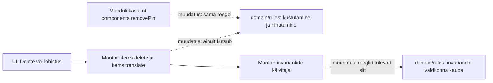

# ADR-005: Tuuma ja moodulite piir: üldkäsud, invariandid ja tuletised enne M2.1

**Staatus:** Vastu võetud (kasutaja otsus 2026-11-17); dokumendid 03, 05 ja 07 on selle järgi muudetud, teostus tuleb M2.1 esimeste ülesannetena
**Kuupäev:** 2026-11-17
**Otsustaja:** kasutaja
**Täpsustab:** [ADR-003](ADR-003-frontend-backend.md) (kihid, leping ja mootori piir jäävad samaks)
**Alus:** arhitekti koodi- ja arhitektuuriülevaatus 2026-11-17 koodil `main` `e4ca06a`

## Kontekst

[03 § 4](../03-arhitektuur.md#4-moodulisüsteem) ütleb, et moodul ei muuda kesta ega mootori koodi. Praegu tunneb tuum mooduleid viies kohas:

| Koht | Mida tuum teab |
|---|---|
| `packages/engine/src/derivation.ts:32` | arvutab `unplacedBoard` ja `unplacedSchematic` otse komponentidest |
| `packages/engine/src/items.ts` | `items.delete` ja `items.translate` oskavad ainult komponente (`kind: 'component'`) |
| `packages/engine/src/invariants.ts:59-64` | mõõtmise reeglid, tähiste ja jalgade `uid`-ide unikaalsus; iga käsk valideerib kogu dokumendi |
| `packages/ui/src/shell/AppShell.tsx:24` | valiku kehtivust kontrollitakse komponentide ja jalgade järgi |
| `packages/ui/src/canvas/SelectTool.ts:29` | liigutatavaks loetakse ainult paigutatud komponent |

Nelja mooduliga on see väike. M2.1 lisab moodulid `connections` ja `nets` ning siis ei ole:

- [kustutamise reeglid](../04-andmemudel.md#kustutamise-reeglid) on moodulitevahelised: komponendi kustutamine muudab ühenduste otsad liitepunktideks, kustutab jalale ankurdatud sildid ja jätab mõõtmised ajaloolisteks;
- [omanike tabel](../05-moodulid.md#andmete-omanikud) nimetab üldkäske `items.*` viie väljarühma kirjutajana;
- [03 § 6](../03-arhitektuur.md#6-käsud-tagasivõtmine-ja-logi) samm 4 lisab invariandid ühenduste otste, sildi ankrute ja ühenduseta liitepunktide kohta.

Ilma otsuseta lähevad kõik need reeglid mootori tuuma failidesse ja tuum muutub kohaks, kus kõigi moodulite reeglid kokku saavad.

Piirang: lahendus peab olema lihtne. Vana projekt ebaõnnestus muu hulgas liiga keerulise sündmuste torustiku tõttu ([08](../08-benchbeepi-opetused.md)).

## Otsus

### 1. Moodulitevahelised reeglid on puhtad funktsioonid domeenis

Uus alamtee `@pcbk/domain/rules`. Seal on üks funktsioon iga reegli kohta, mis puudutab mitut objektitüüpi:

```ts
export function deleteItems(doc: BoardDoc, ids: readonly string[]): void;        // 04 › Kustutamise reeglid
export function translateItems(doc: BoardDoc, items: readonly ItemRef[], delta: Vec2): void;
```

- Funktsioon muudab talle antud dokumenti kohapeal. Mootor annab sinna Immeri mustandi; domeen Immerit ei impordi.
- `items.delete` ja `items.translate` jäävad mootori üldkäskudeks, kuid ainult kontrollivad parameetreid ja kutsuvad domeeni funktsiooni. Objektitüübi koodi mootoris ei ole.
- Mooduli käsk, mis käivitab sama reegli (jala eemaldamine, korpuse vahetus, liitepunkti kustutamine), kutsub sama funktsiooni. Reegel on koodis üks kord.
- Reegli keeldumine jõuab kasutajani sama `validation` veana nagu praegu.

### 2. Invariandid on domeenis valdkonna kaupa

```ts
export interface Invariant { id: string; inputs: readonly DocKey[]; check(doc: BoardDoc): Issue[] }
export const INVARIANTS: readonly Invariant[];
```

- Mootor käivitab loendi ega sisalda ühtegi objektireeglit.
- `inputs` ütleb, millistest väljadest reegel sõltub. Esialgu käivitatakse kõik reeglid iga käsu järel nagu praegu. Ainult muutunud väljadest sõltuvate reeglite käivitamine lülitatakse sisse pärast mõõtmist (M2.1 jõudlustingimus).

### 3. Tuumas ei ole mooduli tuletisi

`unplacedBoard` ja `unplacedSchematic` saavad mooduli `components` tuletiseks (`DeriveSpec`). Võtmete nimed hetktõmmises ei muutu.

### 4. Kest ei tunne objektitüüpe

```ts
export interface SelectionKindSpec {
  kind: string;
  exists(item: SelectionItem, snapshot: Snapshot): boolean;
  movable?(item: SelectionItem, snapshot: Snapshot): boolean;
}
// UiModule.selectionKinds?: SelectionKindSpec[]
```

- Kest küsib registrist, kas valitud objekt on alles ja kas seda saab liigutada. `AppShell` ja `SelectTool` ei viita komponentidele.
- Vaikevahekaart on registri esimene vahekaart; lepingus mooduli nime ei ole.

### Mis ei muutu

Registrid, omandikontroll, käskude tüübid, hetktõmmis ja failivorming. Moodulite vahele ei lisandu sündmusi ega käsitlejate ahelat.

## Skeem



## Kaalutud variandid

| | **A: reeglid domeenis (valitud)** | B: moodulite käsitlejad registris | C: jätta tuuma |
|---|---|---|---|
| Kus on kustutamise reegel | ühes kohas, nagu 04-s kirjas | jagatud 3–4 mooduli vahel | mootori tuumas |
| Uus objektitüüp puudutab | moodulit ja domeeni | ainult moodulit | moodulit ja mootorit |
| Moodulite järjekord | pole vaja | vaja kokku leppida, kes enne käivitub | pole vaja |
| Omandikontrolli täpsus | üldkäskudel lai `alsoWrites` | täpne käsitleja kaupa | üldkäskudel lai |
| Keerukus | madal | kõrge: uus registrimehhanism | madal praegu, kasvab iga mooduliga |
| Testitavus | üks testifail reegli kohta | reegel tuleb testida moodulite koosmõjus | mootori testides |

## Kompromisside analüüs

04 kirjeldab kustutamist ühe sidusa reeglina, mis läbib komponente, ühendusi ja silte. Variant B jagaks selle käsitlejateks, mille järjekord ja vahepealne olek tuleb eraldi kokku leppida. See on sama laadi torustik, millest vana projekt loobus.

Variandi A hind on see, et domeen kasvab ja kahel üldkäsul on lai kirjutusõigus. Esimest leevendavad alamteed ja genereeritud liideste kokkuvõte, teist invariandid ja reeglite testid.

Variant B oleks õige siis, kui mooduleid lisaksid kolmandad osapooled, keda tuum ei tunne. See ei ole v1 eesmärk.

## Tagajärjed

- **Lihtsamaks läheb:**
  - M2.1 ühenduste ja võrkude reeglid lisanduvad mootorit muutmata;
  - iga reegel on ühes kohas ja vastab 04 tekstile;
  - invariantide kiirendamiseks on koht olemas;
  - uus valitav objektitüüp ei muuda kesta.
- **Raskemaks läheb:**
  - domeen kasvab;
  - mooduli autor puudutab moodulitevahelise käitumise jaoks ka domeeni (skeemi jaoks peab ta seda juba praegu tegema);
  - `items.*` kirjutusõigus on lai.
- **Hiljem üle vaadata:**
  - muutunud väljade järgi käivitamine pärast M2.1 mõõtmist (300 komponenti, 3000 jalga, 1000 rada);
  - variant B, kui kunagi tulevad lisamoodulid väljastpoolt.

## Tegevused

Kaardid kirjutatakse M2.1 plaani koostamisel. Töö on M2.1 esimesed ülesanded, mitte eraldi hooldusvoor.

1. Rada B: olemasolevad reeglid domeeni (`items.*` komponentidele, invariandid, `unplaced*` tuletis). Käitumine ei muutu; olemasolevad testid läbivad muutmata.
2. Rada A: `selectionKinds` registris; `AppShell` ja `SelectTool` kasutavad seda.
3. Dokumendid on otsusega kooskõlla viidud (2026-11-17): 03 § 4, § 6 ja [§ 7.4](../03-arhitektuur.md#74-arvutatud-andmed), 05 üldkäskude lõik ja uue mooduli kontrollnimekiri, 07 M2.1, `docs/README.md` ja STATUS.
4. M2.1 plaan ehitab ühenduste, liitepunktide ja siltide kustutamise selle peale koos [03 § 12](../03-arhitektuur.md#kohustuslikud-invariandid) invarianditestidega.

## Seotud

[03 § 4](../03-arhitektuur.md#4-moodulisüsteem), [04 › Kustutamise reeglid](../04-andmemudel.md#kustutamise-reeglid), [05 › Andmete omanikud](../05-moodulid.md#andmete-omanikud), [07 › M2.1](../07-teekaart.md#m21--ühendused-ja-võrgud-plaadil)
