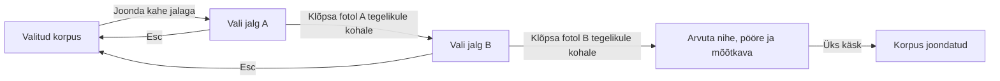

# M1.4 · Suurus, joondus, oma jalad ja jõudlus: teostusplaan

**Olek:** kinnitatud 2026-11-17 (kasutaja: O1 jõudlus enne, O2 `R`/`Shift+R`, O3 ühe telje venitus lubatud). Kaardid kirjutatakse vahetult enne iga ülesannet ([snaipriülesanded](../tasks/README.md)); hetkeseis on [STATUS-es](../STATUS.md).

**Eesmärk** ([07 › M1.4](../07-teekaart.md#m14--suurus-ja-joondus)): tehnik joondab korpuse fotol kahe jalaga täpselt ja muudab vajadusel selle suurust. Puuduva jala saab ise lisada. Paremklõps pakub sama tegevusi kui klahvid. Tööpind püsib sujuv ka 300 komponendi ja 3000 jalaga plaadil.

**Alus:** `main` `3953382` (`v0.3.0` = `a995825`). Haru: uus tööpuu ja haru `codex/m1-4`.

**Sisend:**
- [07 › M1.4](../07-teekaart.md#m14--suurus-ja-joondus);
- [02 § 16](../02-kasutaja-teekond.md#16-vastuvõtustsenaarium-e2e-test-plaat-algusest-lõpuni) sammud 1–5;
- [03 § 7.3](../03-arhitektuur.md#73-kihid-ja-jõudlus) jõudluseelarve;
- [M1-2-7 renderdusotsus](../tasks/M1-2-7.md);
- [M1.3 plaani](M1-3-toopind-ja-korpused.md#mis-jääb-järgmistesse-plaanidesse) edasilükatud asjad.

**Lähtemõõdud (M1-2-7, Tauri, 300 komponenti / 3000 jalga / 1500 mõõtmist / 12 MP foto):**

| Mõõdik | Tulemus | Eelarve |
|---|---|---|
| Avamine | 590 ms | < 1,5 s |
| Pan | 49,8 fps | 60 fps |
| Suum | 7,5 fps | 60 fps |
| Lohistamine | 22,3 fps | ≥ 45 fps |

Kulu tuleb SVG ümberjoonistusest, mitte skriptist.

## Kavandatud otsused

1. **Jõudlus kõigepealt.** M1-2-7 järjekord:
   1. žesti ajal bitmap-teisendus;
   2. foto eraldi kihina SVG all;
   3. lohistuse eelvaade liigutab ainult lohistatavat gruppi;
   4. kordusmõõtmine sama prooviga ja `perf.spec.ts`.

   Jalad lähevad Canvas'ele ainult siis, kui pärast samme 1–3 eelarve ikka ei pea. Selle otsuse teeb arhitekt kordusmõõtmise järel.
2. **Suurus.**
   - Valitud komponendil on 8 käepidet. Nurgad muudavad suurust ühtlaselt, küljed ainult ühel teljel.
   - Omaduste paneelis on mõõtkava väljad X ja Y.
   - Üks žest või sisestus on üks käsk ja üks tagasivõtmise samm. Piirid on skeemi järgi 0,2–5.
   - Padjandid järgivad mõõtkava (`boardPads` arvestab juba `scaleX`/`scaleY`).
3. **Kahe jala joondus.**
   - Tööriist „Joonda kahe jalaga“: tehnik valib korpuse jala A ja klõpsab fotol selle tegelikule kohale, siis teeb sama jalaga B.
   - Arvutatakse sarnasusteisendus (nihe, pööre, ühtlane mõõtkava), mis viib A ja B täpselt sihtpunktidesse. See on üks käsk.
   - Täpsus < 0,01 px ja < 0,01° (07 tingimus).
4. **Oma jalad.**
   - „Lisa jalg siia“ lisab komponendile jala, mille padjand on klõpsatud kohas (`customPads`, ümmargune, suurus mm). See on üks käsk.
   - Prototüübi „Kohandatud“ paigutused (2 rida, 1 rida, 4 külge, tühi) tulevad `unknown`/`area` kirje laiendusena. M1-3-7 jättis need siia.
5. **Kontekstimenüü baas.**
   - Paremklõps avab registri kaudu laiendatava menüü (`UiModule.contextMenu`).
   - Komponendil: pööra, pool, dubleeri, kustuta. Jalal: mõõda, nimeta, NC. Tühjal alal: lisa komponent siia.
   - Kirjed kutsuvad samu käske kui klahvid ja tööriistad.
   - `Esc` sulgeb menüü muudatusteta. Klaviatuurilt avavad menüü `Shift+F10` ja menüüklahv.
6. **Tiheduse ülevaatus.**
   - Siltide takistuste kanal saab ka naaberkomponentide kered ja padjandid, nii et pikk väärtus ei jookse naabri peale (M1-3-11 suitsukatse).
   - Teegi nimekirjas on siluetid (disainiülevaatus, punkt 1).
   - Paneelide tihedus (M1.3 märge).
7. **Failivorming ei muutu.** `scaleX`, `scaleY` ja `customPads` on `BoardPlacement`-is olemas. Kui ülesanne vajab skeemi muutust, peatub ehitaja ja küsib.

## Joonduse töövoog

## Kasutaja otsused enne ehitust

- **O1 · Järjekord.** Kõigepealt jõudlus (osa A), siis suurus ja joondus. Põhjus: iga järgmine tööriist lisab lõuendile koormust, kehtiva joonistusviisi peale on hea ehitada ja M1-2-7 otsus ütleb „enne M1.4 lõppu“. *Arhitekti soovitus: jah.*
- **O2 · Pööramise klahv.** 02 § 16 nimetab `Q`/`E`, aga M1.1-st alates on kasutusel `R` / `Shift+R`, mida kasutaja on suitsukatsetes kasutanud. *Soovitus: jääb `R` / `Shift+R`, 02 uuendatakse.*
- **O3 · Ebaühtlane suurus.** Kas külgkäepide võib korpust ühel teljel venitada? See on vajalik siis, kui foto pole täpselt ülalt pildistatud või korpus on mittestandardne. *Soovitus: jah, piirides 0,2–5; vaikimisi nurgakäepide hoiab proportsiooni.*

## Globaalsed piirangud

Kehtivad M1.3 piirangud:
- strict TS;
- failid ≤ 400 rida;
- sõltuvusreeglid;
- tekstid `i18n/et.ts`-is;
- kümnendkoma.

Lisaks:
- iga kaart kontrollitakse käsuga `pnpm bb-review-card <ID>`;
- brauseri muudatustele lisandub võimalusel `pnpm proof` juhtum;
- uusi sõltuvusi ei lisata ilma kasutaja loata.

Rajad: ülesanded 11 (koos endise 4-ga) ja H on **rada B** (jõudluseelarve, vastuvõtt ja salvestuse hooldus), ülejäänud **rada A**.

**Järjekord pärast M1-4-1 tulemust** (kasutaja otsus 2026-11-17, vähem testiringe): H → 3 → 3b → 5 → 6 → 9b → 7 → 8 → 9 → 10 → 11. Suum on servapuhvriga 58 fps, seega tehakse ülesanne 2 ainult siis, kui ülesande 11 kordusmõõt jääb eelarvest välja. Ülesanne 4 on liidetud ülesandega 11.

## Ülesanded

**Osa A · Jõudlus**

1. **Profiil ja bitmap-teisendus žesti ajal.**
   - Enne muudatust tehakse WebView2 Performance-profiil ühest suumist.
   - Pani ja suumi ajal saab tööpinna grupp CSS `transform` + `will-change` ja SVG `transform`-atribuuti ei muudeta. Terav joonistus tuleb sama 120 ms LOD-viite järel.
   - Testid: `gesture_does_not_touch_svg_transform`, `sharp_redraw_after_lod_delay`.

1b. **Vaate muutus ei renderda kesta paneele** ([M1-4-1b](../tasks/M1-4-1b.md), koodi ülevaatus 2026-11-17). Salvestuse olekuteade renderdab praegu iga pani- ja suumikaadriga navigaatori ja omaduste paneeli. Test: `pan_frames_do_not_rerender_shell_panels`.

2. **Foto eraldi kihina** (tingimuslik, vt järjekord).
   - Foto on `` või `<canvas>` SVG all ja sama teisendusega.
   - EXIF-reegel (M1-2-9) ja kõigi 8 teisenduse joondus kehtivad edasi: `bb-check-canvas` tsentroidikontroll ≤ 2 px.
   - Testid: `photo_layer_aligns_with_pins_under_all_8_transforms`, `photo_layer_outside_svg`.
3. **Kitsam lohistuse eelvaade.**
   - Ainult lohistatava komponendi grupp saab nihke. Teised kihid uut `preview` propi ei saa.
   - Test: `drag_preview_rerenders_only_dragged_group`.
3b. **LOD-rahunemise skriptikulu** (M1-4-1 profiil). Pärast LOD-taimerit renderdab React kõik kihid uue `lodZoom`-iga: ühe suumi järel 243 ms Script. LOD-muutus peab renderdama ainult kihte ja komponente, mille väljund sõltub LOD-lävedest. Näiteks muutuvad jalanumbrid, kui lühema külje pool ületab 7 või 14 px; kered ei muutu. Mõõt on rahunemise pikim kaader enne/pärast.
4. **Kordusmõõtmine ja `perf.spec.ts`** (rada B). **Liidetud ülesandega 11**; allolev sisu on ülesande 11 mõõtmise osa.
   - Sama generaator ja Tauri proov nagu M1-2-7; tulemus tabelina enne/pärast.
   - `apps/web/e2e/perf.spec.ts` (03 § 7.3) jääb regressioonikaitseks.
   - Arhitekt otsustab, kas jalad lähevad Canvas'ele.
   - Žestifaasi Script enne ja pärast M1-4-1b (algprofiilis 35 ms ühe rattasündmuse kohta).
   - Mõõda samas proovis `project_open` ja `project_save` kestus. Need käsud on sünkroonsed ja jooksevad Tauri peaniidis koos täiskoopiaga (päeva esimene avamine, salvestus pärast foto lisamist). Kui kestus ületab 100 ms, tuleb eraldi kaart käskude viimiseks `spawn_blocking`-ule nagu fotoimpordil (koodi ülevaatus 2026-11-17, mõõtmata).

**Osa B · Suurus, joondus ja oma jalad**

5. **Suurus käepidemetega ja numbritega.** Käsk `components.setScale { id, scaleX, scaleY }`.
   - Testid:
     - `corner_handle_scales_uniformly`
     - `side_handle_scales_one_axis`
     - `scale_fields_accept_decimal_comma`
     - `scale_is_one_undo_step`
     - `scale_clamped_to_schema_limits`
6. **Kahe jala joondus.** Tööriist ja puhas funktsioon `alignByTwoPins`, käsk `components.alignByTwoPins` (või olemasolevate väljade ühekordne muutmine).
   - Testid:
     - `align_by_two_pins_restores_known_pose_within_0_01px_and_0_01deg` (07)
     - `align_handles_mirrored_bottom_side`
     - `align_cancel_with_escape_changes_nothing`
7. **Oma jalad.** „Lisa jalg siia“ (`customPads`) ja jala eemaldamisel `customPads`/`padMap` koristus (M1 võlg A6).
   - Jalgade ja padjandite vastavus (koodi ülevaatus 2026-11-17, tõendatud testiga): paigutatud tavakorpusel lubavad `components.addPin` ja `components.removePin` praegu padjandita jala ja jalata padjandi. Pärast „Eemalda paigutus plaadilt“ lükkab `placeOnBoard` sama korpuse tagasi (`footprint_pins_mismatch`). Kaart otsustab reegli ja lisab testi `placed_footprint_pins_and_pads_stay_matched`.
   - Testid:
     - `add_own_pin_places_pad_at_click`
     - `own_pin_survives_rotate_scale_and_reopen`
     - `own_pin_is_one_undo_step`
8. **Kohandatud korpus.** `unknown` kirje saab prototüübi paigutused (2 rida, 1 rida, 4 külge, tühi), jalgade arvu ja sammu.
   - Testid:
     - `custom_layout_matches_prototype_pin_positions`
     - `custom_empty_layout_keeps_area_behaviour`

**Osa C · Kontekstimenüü**

9. **Paremklõpsu menüü baas.** `UiModule.contextMenu` register; komponendi, jala ja tühja ala kirjed.
   - Testid:
     - `context_menu_items_run_same_commands_as_keys`
     - `escape_closes_menu_without_change`
     - `shift_f10_opens_menu_for_selection`

9b. **Leia komponent valikut muutmata** ([BenchBeepi disainivõrdlus](../review/2026-11-17-benchbeepi-disainivordlus.md), 2026-11-17).
   - „Plaadil“ loendi reale osutamine või klaviatuuriga reale liikumine näitab plaadil komponendi ümber ajutist kontuuri. Kontuur erineb valikust joone kuju poolest. Valik, vaade, mõõtmise mustand ja dokument ei muutu. Klõps valib komponendi nagu praegu.
   - Omaduste päis näitab valitud objekti tähist: „Omadused · J29“ või „Omadused · J29.15“. Tähis uueneb samas kohas ja on loetav 280 px laiuses paneelis.
   - Plaadil oleva näidu juurest saab ühe toiminguga näha selle mõõtmise sondipaari ja toiteoleku (näiteks −7 V: punane 5 V siinil, must 12 V siinil). Üldvaates jääb näit lühikeseks ([töövoo hinnang](../review/2026-11-17-toovoo-ja-arhitektuuri-hinnang.md)).
   - Testid:
     - `list_row_hover_previews_component_without_selecting` (ka realt lahkudes kontuur kaob)
     - `keyboard_row_focus_previews_component`
     - `preview_keeps_measure_draft_and_view`
     - `properties_header_shows_selected_ref`
     - `reading_reveals_probe_pair_and_power`

**Osa D · Tihedus**

10. **Tiheduse ülevaatus.** Naaberkomponentide kered ja padjandid on siltide takistused, teegis on siluetid ja paneelide tihedus vaadatakse üle.
    - Testid:
      - `long_value_avoids_neighbour_component`
      - `library_rows_show_silhouettes_at_240px`

**Osa E · Vastuvõtt**

11. **E2e, jõudluseelarve, suitsukatse ja väljalase** (rada B).
    - `apps/web/e2e/full-flow.spec.ts`: 02 § 16 sammud 1–5 sünteetilise plaadifotoga.
    - `perf.spec.ts`, `v0.3.0` näidisfail, kasutaja suitsukatse ja versioon `v0.4.0`.
    - Kasutaja katse oma tiheda plaadi fotoga (Codex sinu fotosid ei ava): mõõda sama musta sondiga kolm jalga, sulge projekt ja ava see järgmisel päeval. Tõend on see, kas ekraanilt saab kohe vastuse küsimusele „mida ma mõõtsin ja mille suhtes?“ ([töövoo hinnang](../review/2026-11-17-toovoo-ja-arhitektuuri-hinnang.md)).
    - Versioon ühest allikast: `Cargo.toml` on `0.0.0`, seepärast on faili `meta.app_version` ja diagnostika kokkuvõte (`use-workbench-host.ts`) alati `0.0.0` (koodi ülevaatus 2026-11-17).

**Osa F · Hooldus**

H. **Vormingu versiooni kaitse ja „Salvesta mujale…“ täis kettaga** ([M1-4-H](../tasks/M1-4-H.md), rada B, koodi ülevaatus 2026-11-17). Rust ei kirjuta dokumenti, mille vorming on tema konstandist uuem, ja tooling-test võrdleb Rusti ja TS-i konstanti. Täis sihtketas annab koopial vea, mitte fotodeta päästekoopia. Pinge sisestus lükkab numbrite vahel oleva tühiku tagasi (`3 5 V` ei salvestu kui 35 V; [töövoo hinnang](../review/2026-11-17-toovoo-ja-arhitektuuri-hinnang.md)). See on M1.4 ainus hooldusvoor.

## M1.4 vastuvõtt: tingimus → tõend

| Tingimus ([07](../07-teekaart.md#m14--suurus-ja-joondus)) | Tõend |
|---|---|
| 02 § 16 sammud 1–5 lähevad läbi | Ül. 11 `full-flow.spec.ts` |
| Kahe jala joondus taastab asendi < 0,01 px ja < 0,01° | Ül. 6 |
| Jõudluseelarve on täidetud (03 § 7.3) | Ül. 11 kordusmõõtmine (endine ül. 4), `perf.spec.ts` |
| Paremklõps komponendil, jalal ja tühjal alal; `Esc` sulgeb muudatusteta | Ül. 9 |
| Suurus käepidemetega ja numbritega | Ül. 5 |
| Oma jalg ja kohandatud korpus | Ül. 7, 8 |
| Vana `v0.3.0` fail avaneb | Ül. 11 |

## Mis jääb järgmistesse plaanidesse

- **M2:** ühendused ja rajad, skeem, piiks, võrgud ja rollid.
  - ADR-005 teostuse vastuvõtukatse M2.1-s: kustuta mõõdetud ja ühendatud komponent ning võta kustutamine tagasi; komponent, ühenduse ots ja mõõtmisajalugu peavad jääma kooskõlla ([töövoo hinnang](../review/2026-11-17-toovoo-ja-arhitektuuri-hinnang.md)).
- **Hiljem:**
  - foto vahetus ja teine foto koos joondusega (`toBoard`);
  - PNG-ekspordi funktsioon ja tootmise CORS (M4).
  - avalehe sondimotiiv algse BenchBeepi märgi järgi vasevärvis, kujunduskatse heledas ja tumedas teemas ([disainivõrdlus](../review/2026-11-17-benchbeepi-disainivordlus.md); M4.3).
- **Väiksemad lahtised asjad (M1.3-st):**
  - katkenud impordi integratsioonitest (järgmine raja B salvestuskaart);
  - taastamisdialoog eelistab selle faili varukoopiaid, mille kaardilt taastamine avati, ja näitab iga taastepunkti juures, kas see on sama fail või teine koopia. Vajab välja `RecentProject.fileId` (lepingu muudatus), seepärast järgmises raja B salvestuskaardis. Andmed ei kao, sest taastus kirjutatakse uude faili ([töövoo hinnang](../review/2026-11-17-toovoo-ja-arhitektuuri-hinnang.md));
  - `photo_orientation` tavaliseks mooduliks järgmisel Rusti puudutusel.
- **Koodi ülevaatusest 2026-11-17 (`main` `e4ca06a`), märkusteks järgmistele kaartidele:**
  - kirjutuskaitstud projektil puudub märguanne ja lõuendi tegevused eiravad käsu tulemust (`SelectTool.ts`, `hits.ts`, `PlacementSection.tsx` klahvid), nii et komponent hüppab selgituseta tagasi; hiljemalt enne näidisprojekti (M4.3);
  - mootori sisevead lähevad töölaual ainult konsooli (`apps/desktop/src/runtime.ts`), mitte logifaili, seega diagnostika ekspordis neid pole; järgmisel töölaua puudutusel;
  - `useSnapshot` selektor ei piira renderdusi, iga tarbija renderdab iga käsu järel; koos ülesandega 3b, kui mõõtmine näitab vajadust.
