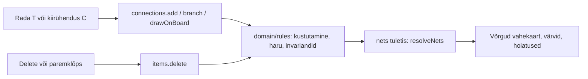

# M2.1 · Ühendused ja võrgud plaadil: teostusplaan

**Olek:** kinnitatud 2026-11-19 (kasutaja kinnitas soovitused O1–O5: järjekord 2 → 11, kiirühendus ahelana, dubleerimine M2.1-s, võrguloend CSV semikooloniga, väljalase `v0.5.0`). Kaardid kirjutatakse vahetult enne iga ülesannet ([snaipriülesanded](../tasks/README.md)); hetkeseis on [STATUS-es](../STATUS.md).

**Eesmärk** ([07 › M2.1](../07-teekaart.md#m21--ühendused-ja-võrgud-plaadil)): tehnik joonistab fotol nähtava raja jalalt jalale, ühendab peidetud jalad kiirühendusega ja näeb, millised jalad on ühes võrgus. Võrgule saab anda nime ja rolli. Toiteliinid paistavad värviga välja ja vale liide annab hoiatuse. Ükski ühendus ei teki iseenesest: lähedus, ristumine, mõõtkava ega sama nimi ei liida midagi.

**Alus:** `main` `671c2a3`. Haru `codex/m2-1` (`d0bf319`) sisaldab juba M2.1 eeltöid [M2-1-H](../tasks/M2-1-H.md) ja [M2-1-1](../tasks/M2-1-1.md). Tööpuu on `C:/Users/TRUMPIT/.codex/worktrees/bb-m2-1/BB`.

**Sisend:**
- [07 › M2.1](../07-teekaart.md#m21--ühendused-ja-võrgud-plaadil) ja [ADR-005](../adr/ADR-005-tuuma-ja-moodulite-piir.md) (esimesed ülesanded);
- [02 § 8](../02-kasutaja-teekond.md#8-ühendused) ja [§ 9](../02-kasutaja-teekond.md#9-võrgud-ja-rollid);
- [04 › Võrkude arvutus](../04-andmemudel.md#võrkude-arvutus-resolvenets) ja [Kustutamise reeglid](../04-andmemudel.md#kustutamise-reeglid);
- [05 › Andmete omanikud](../05-moodulid.md#andmete-omanikud) (käskude nimed ja `alsoWrites`);
- [03 › Kohustuslikud invariandid](../03-arhitektuur.md#kohustuslikud-invariandid);
- [M1.4 plaani lahtised](M1-4-suurus-joondus-joudlus.md#mis-jääb-järgmistesse-plaanidesse) ja [koodiülevaatuse 2026-11-19](../review/2026-11-19-koodiulevaatus-00a424e.md) väiksemad leiud.

**Failivorming ei muutu.** `BoardDoc` sisaldab juba välju `junctions`, `connections`, `netLabels` ja `roles` (vaikerollid luuakse uue dokumendiga). Raja joonistusel on `kind`, `layer`, `waypoints`, `widthMm` ja `labelOffset`; padjandil on `through`. Kui ülesanne vajab skeemi muutust, peatub ehitaja ja küsib.

## Kavandatud otsused

1. **Tuuma piir kõigepealt (ADR-005).** Olemasolevad kustutamise ja nihutamise reeglid, invariandid ja „paigutamata“ tuletis lähevad domeeni ning valiku kehtivus registrisse. Käitumine ei muutu. Ühendused ja sildid ehitatakse selle peale, mootorit muutmata.
2. **Ühendus on teadlik otsus.** Ühenduse loovad ainult rada, kiirühendus ja „Ühenda võrguga…“. Haru tekib ainult liitepunktiga. Võrgud on tuletis (`resolveNets`, union-find üle jalgade ja liitepunktide), mitte salvestatud andmed.
3. **Kaks kustutamist.** „Eemalda joonistus“ jätab elektrilise ühenduse alles (fotol õhujoon) ja „Kustuta ühendus“ eemaldab selle. Komponendi kustutamisel muutuvad ühenduse otsad liitepunktideks, jala sildid kustutatakse ja mõõtmised jäävad ajaloolistena alles. Kõik on üks tagasivõetav käsk.
4. **Kihid.** Pealmise ja alumise kihi rajad liituvad ainult läbiva padjandi kaudu (`through`: läbiv jalg, via, testpunkt). Juhe võib lõppeda mõlemal kihil. Kihi vahetus ega kattumine ei ühenda.
5. **Valik.** `Shift`+klõps ja raamvalik tulevad enne ühendusi, sest kiirühendus vajab mitut valitud jalga. Mitme valiku toiming on üks ajaloosamm.
6. **Rolli värv** joonistab rajad, õhujooned ja ühendatud jalad. Nimi ei liida võrke. Kahe eri rolliga võrgu liitmine ei kirjuta rolli üle, vaid annab konflikti.

## Kasutaja otsused enne ehitust

Kasutaja kinnitas 2026-11-19 kõik viis soovitust.

- **O1 · Järjekord.** 2 → 3 → 4 → 5 → 6 → 7 → 8 → 9 → 10 → 11: tuuma piir, valik, ühendused, rada, võrgud, silt ja menüü, vastuvõtt. *Soovitus: jah. ADR-005 nõuab tuuma piiri enne ühendusi ja kiirühendus vajab mitmikvalikut.*
- **O2 · Kiirühendus mitme jalaga.** Kui valitud on n jalga, tekib n − 1 ühendust. Variant „ahel“ ühendab need valiku järjekorras (1–2, 2–3, …), variant „täht“ ühendab kõik esimesega. Võrk on mõlemal juhul sama. *Soovitus: ahel. Õhujooned ei koondu ühte punkti ja rada on hiljem lihtsam paari kaupa fotole joonistada.*
- **O3 · Dubleerimine M2.1-s.** `components.duplicate`, `Ctrl+D` ja menüükirje „Dubleeri“ liikusid M1.4-st M2-sse. *Soovitus: jah, valikukaardis (ül. 4). Koopia saab sama tüübi, korpuse ja parameetrid, uue tähise ja uued jalgade `uid`-d. Ühendusi, silte ja mõõtmisi ei kopeerita.*
- **O4 · Võrguloendi vorming.** *Soovitus: CSV (UTF-8 BOM-iga, eraldaja semikoolon, sest eesti Excel kasutab kümnendkoma), üks rida jala kohta: võrk; roll; tähis.jalg; jala nimi. Eksport tuleb `exporters` kaastööna ([05](../05-moodulid.md#kaastööd-mida-mitu-moodulit-annavad)).*
- **O5 · Väljalase.** *Soovitus: M2.1 lõpus versioon `v0.5.0` koos kasutaja suitsukatsega nagu varasemates verstapostides.*

## Globaalsed piirangud

Kehtivad M1.4 piirangud:
- strict TS;
- failid ≤ 400 rida;
- sõltuvusreeglid;
- tekstid `i18n/et.ts`-is;
- kümnendkoma.

Lisaks:
- iga kaart kontrollitakse käsuga `pnpm bb-review-card <ID>`;
- uusi sõltuvusi ei lisata ilma kasutaja loata;
- Codex kasutab ainult sünteetilisi projekte ja fotosid.

Rajad: ülesanded 2, 5, 6 ja 11 on **rada B** (tuuma piir, andmereeglid ja invariandid, vastuvõtt), ülejäänud **rada A**. Hooldusvoor on juba tehtud ([M2-1-H](../tasks/M2-1-H.md)); väiksemad tööd lähevad märkusena ehituskaardi juurde.

## Ülesanded

**Osa A · Tuuma piir (ADR-005)**

2. **Reeglid domeeni** (rada B).
   - Uus alamtee `@pcbk/domain/rules`: `deleteItems`, `translateItems` ja `INVARIANTS` (tähiste ja jalgade `uid`-ide unikaalsus, mõõtmise reeglid). Mootor käivitab invariantide loendi ega sisalda objektireegleid. `inputs` väli on olemas, kuid esialgu käivituvad kõik reeglid iga käsu järel.
   - `items.delete` ja `items.translate` kontrollivad ainult parameetreid ja kutsuvad domeeni. `components.removePin` ja korpuse vahetus kutsuvad kaduvate jalgade jaoks sama reeglit.
   - `unplacedBoard` ja `unplacedSchematic` saavad mooduli `components` tuletiseks; võtmete nimed ei muutu.
   - Olemasolevad testid läbivad muutmata (lubatud on ainult importide muutus).
   - Testid:
     - `engine_source_has_no_object_rules`
     - `invariants_come_from_domain_list`
     - `unplaced_keys_come_from_components_module`
     - `remove_pin_and_footprint_change_use_remove_pins`
3. **Valiku kehtivus registrisse.** `UiModule.selectionKinds` (`kind`, `exists`, `moveRef`). `components` registreerib komponendi ja jala. `AppShell` ja `SelectTool` ei viita komponentidele. Vaikevahekaart jääb salvestatud vaate olekusse ([M2-1-3](../tasks/M2-1-3.md) otsus 7).
   - Testid:
     - `selection_validity_comes_from_registry`
     - `select_tool_moves_only_registry_movable_items`
     - `shell_and_select_tool_have_no_component_kind`
     - `components_register_component_and_pin_kinds`

**Osa B · Valik**

4. **Mitmikvalik, raamvalik ja dubleerimine.**
   - `Shift`+klõps lisab või eemaldab komponendi või jala. Valikutööriista lohistus tühjal alal joonistab raami, mis valib komponendid, mille kere on tervikuna raami sees. `Shift`+raam lisab valikule.
   - Mitme valiku toimingud (`Delete`, lohistus, nooleklahvid, `R`/`Shift+R`, `F`) on üks käsk ja üks ajaloosamm. Eelistatud viis on käsk, mis võtab id-de loendi nagu `items.*`. Mootori partiikäsk tuleb ainult siis, kui loend ei sobi; kaart otsustab pärast koodi lugemist.
   - O3: `components.duplicate`, `Ctrl+D` ja menüükirje „Dubleeri“. Koopia on nihutatud, saab järgmise vaba tähise ja uued `uid`-d. Mitme valiku dubleerimine on üks samm.
   - Hooldus samal puudutusel: `interaction.test.tsx` (435 rida) jagatakse, kui kaart seda faili muudab.
   - Testid:
     - `shift_click_toggles_component_and_pin`
     - `frame_selects_components_fully_inside`
     - `multi_selection_action_is_one_undo_step`
     - `duplicate_ctrl_d_gives_new_ref_and_uids_without_measurements`

**Osa C · Ühendused**

5. **Moodul `connections`, kiirühendus ja kustutamise reeglid** (rada B).
   - Moodul omab välju `connections` ja `junctions`; `alsoWrites` on [05 tabeli](../05-moodulid.md#andmete-omanikud) järgi.
   - Käsud: `connections.add`, `connections.remove`, `connections.removeBoardDrawing`, `junctions.remove`.
   - Kiirühendus `C` valitud jalgadele: `basis: 'assumed'` ühendused ühe käsuna (O2). Paarid, mis on juba samas võrgus, jäetakse vahele.
   - Õhujoon on õhuke katkendlik joon otste vahel eraldi kihil, mida saab peita. Õhujoon ja liitepunkt registreeritakse `selectionKinds`-is ning `Delete` kutsub `items.delete`-i.
   - `domain/rules`:
     - `resolveNets` liikmesus: ainult ühendused liidavad;
     - komponendi või jala kustutamisel muutuvad ühenduse otsad liitepunktideks jala endises kohas, jala sildid kustutatakse ja mõõtmised jäävad;
     - ühenduseta liitepunkt kaob ning tema sildid tõstetakse või kustutatakse 04 järgi; reegel tagastab kustutatud sildid ja kasutaja teade tuleb ülesandes 8, kui silte saab luua ([M2-1-5](../tasks/M2-1-5.md) otsus 3).
   - Invariandid ([03 § 6](../03-arhitektuur.md#6-käsud-tagasivõtmine-ja-logi) samm 4): ühenduse otsad on olemas ja erinevad, sildi ankur on olemas, igal liitepunktil on vähemalt üks ühendus.
   - Testid:
     - `quick_connect_creates_assumed_air_lines_in_one_step`
     - `delete_component_turns_connection_ends_into_junctions`
     - `remove_board_drawing_keeps_connection_as_air_line`
     - `remove_connection_drops_orphan_junctions`
     - `orphan_junction_label_moves_or_is_removed`
     - `invariants_reject_dangling_end_and_label_anchor`
     - `delete_measured_connected_component_and_undo_stays_consistent` (ADR-005 vastuvõtukatse M1.4 plaanist)
6. **Tööriist Rada** (`T`, rada B).
   - Klõps jalal või liitepunktil, käänupunktid mööda fotol nähtavat rada ja lõpp jalal, liitepunktil, teisel rajal või topeltklõpsuga tühjal kohal (lahtine ots on liitepunkt). Haakumine on enne klõpsu esile tõstetud. Raja peale haakub ainult raja joone tabamus; ristumine ega lähedus ei liida.
   - `connections.add` loob ühenduse koos joonistusega (`basis: 'visual'`). Kui jalgade vahel on ühendus juba olemas, lisab `connections.drawOnBoard` sellele ainult joonistuse. `connections.branch` loob teise raja peale liitepunkti ja jagab selle raja ühe käsuga.
   - Kihireegel 04 järgi; `L` vahetab: pealmine → alumine → juhe.
   - `Shift` annab 45° nurgad, `Backspace` sammu tagasi, `Esc` katkestab jäljetult. Lõpetamata lõigu kohal on pikkus millimeetrites.
   - „Joonista rada fotol“ valitud õhujoonele.
   - Seotud: leid 17. Haakumine kasutab padjandi kuju, seega `boardPads` annab kasutaja padjandi kuju `rect` edasi.
   - Testid:
     - `crossing_traces_do_not_connect`
     - `trace_end_1px_from_trace_does_not_join`
     - `branch_on_trace_creates_junction_and_splits_in_one_step`
     - `top_trace_joins_bottom_only_through_pad`
     - `trace_on_existing_connection_adds_only_drawing`
     - `trace_tool_escape_leaves_no_trace`
     - `rect_custom_pad_keeps_shape_and_hit`
7. **Raja muutmine.** Käänupunkti lohistus (`connections.update`), lisamine (`connections.insertWaypoint`) ja eemaldamine (`connections.removeWaypoint`); liitepunkti liigutamine (`junctions.move`) ja kinnitamine jalale (`junctions.attachToPin`, sildid tõstetakse kaasa). Liigutamine muudab ainult paigutust, ühendatus jääb samaks.
   - Testid:
     - `waypoint_drag_changes_only_drawing_in_one_step`
     - `insert_and_remove_waypoint`
     - `junction_move_keeps_connectivity`
     - `attach_junction_to_pin_moves_labels`

**Osa D · Võrgud**

8. **Moodul `nets`: arvutus ja käsud.**
   - Tuletis `nets` ([04](../04-andmemudel.md#võrkude-arvutus-resolvenets)): võti, liikmed, nimi (sildist või N1, N2 …), roll, `roleConflict`, `conflictingRoles`, `beepContradiction`, `shortedComponents`.
   - Käsud `nets.assign` (nimi ja roll sildina võrgu liikmele), `nets.join` (loob ühenduse), `roles.add`, `roles.update` ja `roles.remove` (ainult kasutamata roll; vaikerolle ei kustutata).
   - Teade „Võrgusilt VBUS eemaldati · Ctrl+Z toob tagasi“, kui käsk kustutab sildi (M2-1-5 reeglite `removedLabels`).
   - Testid:
     - `same_name_does_not_join_nets`
     - `joining_gnd_and_5v_flags_conflict_and_undo_restores`
     - `scale_change_leaves_nets_unchanged`
     - `negative_beep_then_connect_flags_contradiction`
     - `shorted_two_pin_component_is_reported`
9. **Võrgud vahekaart, värvid ja eksport.**
   - Navigaatori vahekaart **Võrgud**: loend, rolli kiibid (GND · 3V3 · 5V · 12V · Signaal · Teadmata · + Uus roll), nimi ja uue rolli dialoog.
   - Rajad, õhujooned ja ühendatud jalad joonistatakse rolli värviga. Tumedas teemas on GND `#9aa5a0`.
   - Rollikonflikt: punane äär ja hoiatus „Võimalik lühis või vale ühendus: GND + 5V“ nuppudega „Näita ühendust“ ja „Vali õige roll“.
   - Võrgu vaade: jalad (klõps viib jalale), rajade kogupikkus millimeetrites ja võrgu mõõtmised. „Ühenda võrguga…“ dialoog.
   - Võrguloendi eksport (O4).
   - Seotud: leid 16 (punktkomponendi esiletõst) ja M1.4 sisend „jala sildi ühtne kuju“ (`pin.name || pin.id`).
   - Testid:
     - `nets_tab_assigns_role_and_name`
     - `role_color_reaches_traces_and_pins_in_both_themes`
     - `role_conflict_warning_shows_both_roles`
     - `net_view_pin_click_focuses_pin_including_point_parts`
     - `netlist_csv_lists_every_member`

**Osa E · Silt ja menüü**

10. **Raja silt ja paremklõps.**
    - Raja silt (võrgu nimi) lohistatava nihkega (`board.labelOffset`) on üks samm. Rajal on näha mõlema otsa tähis ja „nähtud“ või „oletatud“.
    - Komponendi ja raja sildid on samas takistuste kanalis ega kattu omavahel (M1.4 sisend).
    - Paremklõps: jalal „Alusta rada siit“, ühendusel „Joonista rada fotol“, „Eemalda joonistus“ ja „Kustuta ühendus“, liitepunktil „Kustuta liitepunkt“ koos ühenduste arvuga.
    - Testid:
      - `trace_label_drag_is_one_step_and_survives_reopen`
      - `labels_do_not_overlap_each_other`
      - `context_menu_starts_trace_from_pin`
      - `context_menu_remove_drawing_vs_remove_connection`
      - `junction_delete_states_connection_count`

**Osa F · Vastuvõtt**

11. **Jõudlus, E2E, suitsukatse ja väljalase** (rada B).
    - Sünteetiline plaat: 300 komponenti, 3000 jalga ja 1000 rada (generaator laieneb radadega). Tauri proov [03 § 7.3](../03-arhitektuur.md#73-kihid-ja-jõudlus) eelarve järgi: avamine, pan, suum ja lohistus. Lisaks mõõdetakse võrkude arvutuse ja invariantide aeg käsu järel. Kui invariandid ei mahu eelarvesse, lülitatakse sisse muutunud väljade järgi käivitamine (ADR-005 § 2).
    - E2E: rada kahe jala vahel, haru, kiirühendus, roll, konflikt, „Eemalda joonistus“, „Kustuta ühendus“ ja tagasivõtmine.
    - `v0.4.0` näidisfail avaneb.
    - Kasutaja suitsukatse oma plaadi fotoga (Codex kasutaja fotosid ei ava) ja väljalase `v0.5.0` (O5).
    - Hooldus samal puudutusel: `old_files.rs` (445 rida) jagamine, kui ühilduvustest seda muudab, ja ühine `__PCBK_APP_VERSION__` deklaratsioon.

## Väiksemad tööd koodiülevaatusest

Triaaži järgi kuuluvad need M2.1 plaani loendisse. Eraldi hooldusvooru ei tehta, iga leid liigub selle tööga, mis sama koodi niikuinii puudutab.

| Leid | Kuhu | Põhjus |
|---|---|---|
| 17 (kasutaja padjand `rect` muutub ringiks) | ül. 6 | raja haakumine kasutab padjandi kuju |
| 16 (punktkomponendi esiletõst loendist) | ül. 9 | võrgu vaade viib jalale sama esiletõstuga |
| 12, 13 (QFN-i sobivus, vormist loodud kinnitusava) | M2.3 | komponendi lisamine kummaski vaates puudutab sama vormi ja sobivust |
| 15, 18 (sondipaari mustandi võti, võrdse ajatempliga näidud) | M2.2 | piiksumisrežiim puudutab mõõtmise mustandit ja näitude järjekorda |
| 14, 19 (foto mahupiir, fotoviite nimi) | järgmine fotoimpordi kaart, hiljemalt M5 | M2.1 fotoimporti ei puuduta |
| 04, 05, 06 (pikk Windowsi tee, puuduvaks märgitud projekt, vigane fail hiljutistes) | järgmine salvestuse või avalehe kaart, hiljemalt M4.3 | M2.1-s salvestuse kaarti pole |
| 20–24 (veebiversiooni andmed) | enne, kui veebiversioon kasutajale jagatakse, hiljemalt M4.3 | veebiversioon on praegu arenduse ja E2E alus |

`storage/mod.rs` (421 rida) jagatakse järgmisel Rusti puudutusel.

## M2.1 vastuvõtt: tingimus → tõend

| Tingimus ([07](../07-teekaart.md#m21--ühendused-ja-võrgud-plaadil)) | Tõend |
|---|---|
| Ristuvad rajad ja 1 px kaugusel lõppev ots ei liitu; haru ainult liitepunktiga; kihid liituvad ainult läbiva jala kaudu | Ül. 6 |
| Mõõtkava muutmine ei muuda võrke | Ül. 8 |
| Liitepunkti eemaldamine ei jäta sildile katkist ankrut | Ül. 5 |
| Kaks GND-võrku jäävad eraldi; GND + 5V annab konflikti; tagasivõtmine taastab | Ül. 8, 9 |
| „Eemalda joonistus“ jätab õhujoone, „Kustuta ühendus“ eemaldab; mõlemad tagasivõetavad | Ül. 5, 10 |
| Jõudlus: 300 komponenti, 3000 jalga, 1000 rada; võrkude arvutus mõõdetud | Ül. 11 |
| ADR-005: tuumas pole objektireegleid, käitumine ei muutunud | Ül. 2, 3 |
| Vana `v0.4.0` fail avaneb | Ül. 11 |

## Mis jääb järgmistesse plaanidesse

- **M2.2:** piiksumisrežiim, ühenduse tase (`connectionLevels`) ja „Mõõda uuesti“; leiud 15 ja 18.
- **M2.3–M2.4:** skeemivaade, skeemi juhtmed ja sildid; leiud 12 ja 13.
- **M4.2:** impordi `importChecks` („Kontrolli neid ühenduskohti“) ja ülejäänud eksportijad.
- Invariantide käivitamine muutunud väljade järgi, kui ül. 11 mõõtmine seda ei nõudnud.
