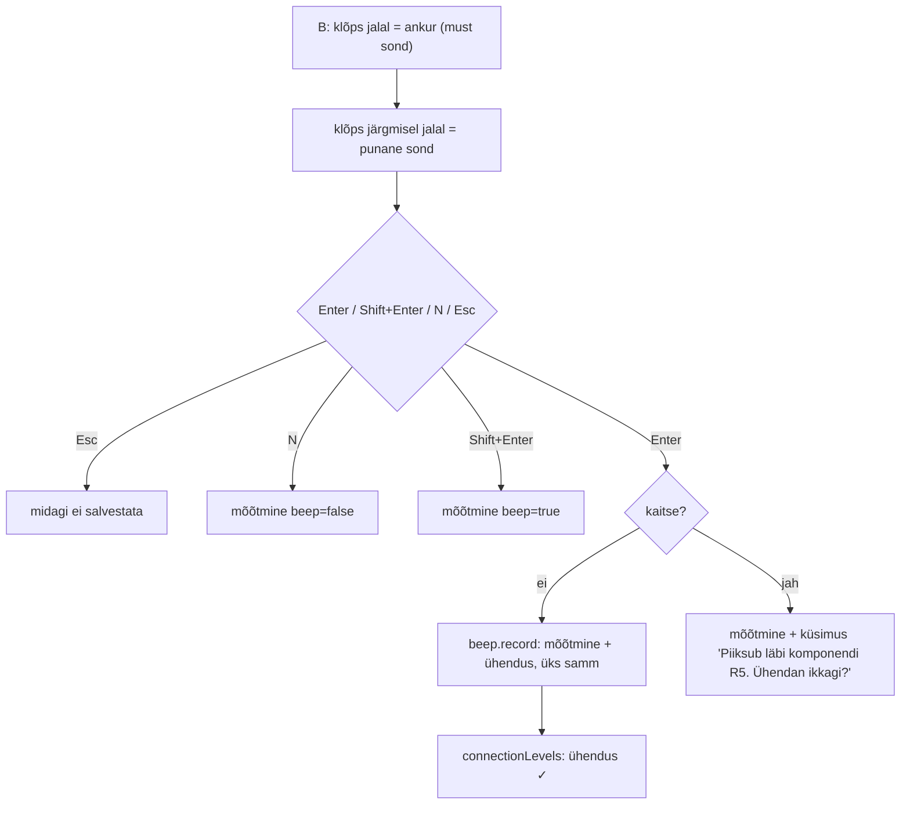

# M2.2 · Piiksumisrežiim ja ühenduse tase: teostusplaan

**Olek:** kinnitatud 2026-11-20 (kasutaja kinnitas soovitused O1–O6: järjekord 1 → 8, läbivus Mõõda-plokki, kaitse korral kaks sammu, „Mõõda uuesti“, Astra leid 16 M2.4-sse, väljalase `v0.6.0`). Kaardid kirjutatakse vahetult enne iga ülesannet ([snaipriülesanded](../tasks/README.md)). Hetkeseis on [STATUS-es](../STATUS.md).

**Eesmärk** ([07 › M2.2](../07-teekaart.md#m22--piiksumisrežiim-ja-ühenduse-tase)): tehnik kaardistab plaadi multimeetri piiksuga. Ta paneb musta sondi jalale, klõpsab järgmist jalga ja vajutab `Enter`. Mõõtmine ja ühendus tekivad ühe tagasivõetava sammuna. Ühendus, mille piiks kinnitab, saab ✓-märgi. Märk kaob, kui mõõtmine kustutatakse või aegub. Piiks läbi väikese takisti ei liida võrke ilma küsimata.

**Alus:** `main` `ccb4b17` (`v0.5.0`). Uus haru `codex/m2-2` tehakse `main`-ist, tööpuu luuakse esimese kaardiga.

**Sisend:**
- [07 › M2.2](../07-teekaart.md#m22--piiksumisrežiim-ja-ühenduse-tase);
- [02 § 8.3](../02-kasutaja-teekond.md#83-piiksumisrežiim-mõõdetud-kõige-kiirem-kaardistus) ja [§ 10](../02-kasutaja-teekond.md#10-mõõtmine);
- [04 › Ühenduse tase](../04-andmemudel.md#ühenduse-tase-connectionlevels), [Piiks ei tõenda sama vaskrada](../04-andmemudel.md#piiks-ei-tõenda-sama-vaskrada) ja [Mõõtmise kontaktid](../04-andmemudel.md#mõõtmise-kontaktid-ja-ajalugu);
- [05 › moodulid](../05-moodulid.md) (`beep.record` moodulis `measurements`, ühenduse tase moodulis `connections`);
- [06 › Ühendused](../06-kasutajaliides.md#ühendused) (✓-märk, punktiirõhujoon, „Mõõda uuesti“);
- [Astra ülevaatuse 2026-11-20](../review/2026-11-20-m2-1-ulevaatus-8a2304d.md) leiud 14–20 ja [koodiülevaatuse 2026-11-19](../review/2026-11-19-koodiulevaatus-00a424e.md) leiud 15 ja 18.

**Failivorming ei muutu.** `Measurement` sisaldab juba režiimi `continuity`, välju `beep`, `source: 'beep_mode'` ja `staleByRepairId`. Piiksu ühendus on tavaline `Connection` (`basis: 'assumed'`, fotojoonistuseta). Tase arvutatakse ja seda ei salvestata.

**Tegelik lähtekoht.** `measurements.add` võtab praegu vastu ainult pinge (`mode: 'voltage'`) ja Mõõda-plokis on ainult pinge. Läbivuse mõõtmist pole veel võimalik salvestada. Seepärast algab M2.2 läbivuse mõõtmisega (O2).

## Kavandatud otsused

1. **Mõõtmine ja otsus on eraldi.** Piiks salvestatakse alati mõõtmisena. Ühendus tekib ainult nähtava valikuga („Piiksub ja ühenda“). Tavaline läbivusmõõtmine Mõõda-plokis ei ühenda kunagi.
2. **Tase on tuletis.** `connectionLevels` arvutab tasemed mõõtmistest [04](../04-andmemudel.md#ühenduse-tase-connectionlevels) järgi:
   - jalapaar on mõõdetud, kui selle viimane kehtiv läbivus on `beep = true`;
   - ühendus on mõõdetud, kui see on paari vahelisel teel, mis läbib ainult liitepunkte.
   Nii jääb haruks jagatud A–B ✓ alles. A → B ja B → C ei tee A → C mõõdetuks.
3. **Üks samm.** `beep.record` lisab mõõtmise ja vajadusel ühenduse ühes käsus. See on moodulitevaheline reegel ja läheb domeeni ([ADR-005](../adr/ADR-005-tuuma-ja-moodulite-piir.md)), käsk deklareerib `alsoWrites: ['connections']`.
4. **Kaitsed on abilised.** Kolmel juhul ei ühenda „Piiksub ja ühenda“ ise, vaid küsib (O3):
   - kahejalgse passiivkomponendi otsad;
   - uus lühistatud komponent;
   - kahe eri rolliga võrgu liitmine.
5. **Piiks on oma tööriist** (`B`), mitte Mõõda-ploki režiim. Ankur jääb jada ajaks paigale. Nuppudel on klahvid kirjas. `Esc` ei salvesta midagi.

## Kasutaja otsused enne ehitust

Kasutaja kinnitas 2026-11-20 kõik kuus soovitust.

- **O1 · Järjekord.** 1 → 2 → 3 → 4 → 5 → 6 → 7 → 8: läbivuse mõõtmine, tase, `beep.record`, tööriist, taseme kuvamine, väiksemad parandused, vastuvõtt. *Soovitus: jah. Tase vajab läbivuse mõõtmist. „Mõõda uuesti“ avab Piiksu tööriista, seega kuvamine tuleb pärast tööriista.*
- **O2 · Läbivus Mõõda-plokki juba M2.2-s.** Mõõda-plokk saab režiimi „Läbivus“ (`Alt+4`) koos valikuga „Piiksub“ või „Ei piiksu“. Vastaspunkt on kohustuslik. Takistus ja diood jäävad M3-sse. *Soovitus: jah. Teekaardi tingimus nõuab, et tavaline läbivusmõõtmine taastab ✓. Praegu seda mõõtmist salvestada ei saa.*
- **O3 · Kaitse korral kaks sammu.** Kui kaitse rakendub, salvestatakse kõigepealt ainult mõõtmine ja lõuendil küsitakse „Piiksub läbi komponendi R5. Ühendan ikkagi?“. „Ühenda ikkagi“ lisab ühenduse teise tagasivõetava sammuna. *Soovitus: jah, täpselt nagu [04](../04-andmemudel.md#piiks-ei-tõenda-sama-vaskrada) kirjeldab. Piiks on mõõtetulemusena tõene igal juhul. Küsimus puudutab ainult tehniku otsust.*
- **O4 · „Mõõda uuesti“.** Mõõtmata ühenduse kontekstis on nupp. Kui varasem tõend on aegunud või kontakt kustutatud, on nupu tekst „Mõõda uuesti“, muidu „Mõõda piiksuga“. Nupp avab Piiksu tööriista, ankur on ühenduse ühel jalal ja punane sond teisel ning nupud on kohe avatud. Ühendusel, mille otsad pole mõlemad jalad, nuppu pole. *Soovitus: jah. Remondijärgne kordusmõõtmine on siis kaks klahvivajutust.*
- **O5 · Astra leid 16 (juhtme kaar haru järel) jääb hiljemaks.** Haru tegemisel arvutatakse juhtme mõlemale poolele uus kaar ja kuju muutub. Ühendatus jääb õigeks. Kuju säilitamine vajab geomeetria ja failivormingu otsust. *Soovitus: lükata M2.4-sse (skeemi juhtmed), kus juhtme kuju niikuinii üle vaadatakse. Kirjas teadaoleva piiranguna.*
- **O6 · Väljalase.** M2.2 lõpus tuleb versioon `v0.6.0`. Sinna kuuluvad kasutaja suitsukatse ja kasutuskatse „50 jalga alla 2 minuti“. *Soovitus: jah, nagu varasemates verstapostides.*

## Globaalsed piirangud

Kehtivad M2.1 piirangud:
- strict TS;
- failid ≤ 400 rida;
- sõltuvusreeglid;
- tekstid `i18n/et.ts`-is;
- kümnendkoma;
- iga kaart kontrollitakse käsuga `pnpm bb-review-card <ID>`;
- uusi sõltuvusi ei lisata ilma kasutaja loata;
- Codex kasutab ainult sünteetilisi projekte ja fotosid.

Lisaks: nimega testid on kaardi loendi järgi, lisateste ei tehta. Rada B on ainult kaitstud töö jaoks (andmereeglid, moodulitevaheline käsk, vastuvõtt).

Rajad: ülesanded 2, 3 ja 8 on **rada B**, ülejäänud on **rada A**.

## Ülesanded

**Osa A · Läbivuse mõõtmine**

1. **Läbivus Mõõda-plokis, mustandi võti ja näitude järjekord** (rada A, O2; koodiülevaatuse leiud 15 ja 18).
   - `measurements.add` võtab vastu ka läbivuse: `mode: 'continuity'`, `beep: boolean`, kohustuslik `ref`, väärtust pole, `source: 'manual'`.
   - Mõõda-plokk saab režiimi „Läbivus“ (`Alt+4`). Salvestamine käib nuppudega „Piiksub“ ja „Ei piiksu“ ning kuni vastaspunktita on salvestamine keelatud.
   - Mõõtmiste nimekiri ja jala ajalugu näitavad läbivust kujul „Läbivus · piiksub“ või „Läbivus · ei piiksu“.
   - Leid 15: sondipaari mustandi võti kodeerib mõlema jala UID üheselt.
   - Leid 18: võrdse ajatempliga näidud on kõigis vaadetes lisamise järjekorras.

**Osa B · Ühenduse tase**

2. **`connectionLevels` ja läbivuse vastuolu ühendusel** (rada B).
   - Domeenireegel arvutab iga ühenduse taseme: `measured`, `seen` (joonistatud) või `assumed`.
   - Jalapaari tõend on viimane kehtiv läbivus kummaski suunas: mitte aegunud (`staleByRepairId`) ja mõlema kontaktiga aktiivne.
   - Mõõdetud ühendused on paari vahelisel lühimal liitepunkte läbival teel. Võrdse pikkuse korral otsustab ühenduste ID järjekord.
   - Kui viimane kehtiv läbivus on `beep = false`, saavad sama tee ühendused hoiatuse „Läbivustest ütles, et ühendust pole“.
   - Moodul `connections` avaldab tuletise `connectionLevels`. Võrgu tuletis `beepContradiction` jääb, nagu on.
   - Jõudlus: 300 komponenti, 3000 jalga, 1000 rada ja 500 läbivust. Arvutuse aeg pannakse kirja ja eelarve on kaardil.

**Osa C · Piiksumisrežiim**

3. **Käsk `beep.record` ja kaitsed** (rada B).
   - Käsk on `beep.record({ anchor, pin, beep, connect, measurementId, connectionId, takenAt })`.
   - See lisab läbivuse (`source: 'beep_mode'`). Kui `beep && connect` ja jalad pole samas võrgus, lisab käsk ühenduse (`basis: 'assumed'`). Kõik on üks samm.
   - Kaitsed (O3) võrdlevad `shortedComponents`-i ja rolle enne ja pärast kavandatud ühendust. Kaitse korral lisab käsk ainult mõõtmise ja tagastab põhjuse koos komponendi tähisega.
   - Reegel on domeenis, käsk on moodulis `measurements` ja deklareerib `alsoWrites: ['connections']`.
4. **Tööriist Piiks (`B`)** (rada A).
   - Klõps jalal teeb ankru: sinine 3 px rõngas ja silt „Must sond · U1.4“.
   - Klõps järgmisel jalal avab kursori juures kolm nuppu: „Piiksub ja ühenda“ (`Enter`), „Ainult mõõtmine“ (`Shift+Enter`) ja „Ei piiksu“ (`N`).
   - `Esc` sulgeb nupud ilma salvestamata. Teine `Esc` lõpetab režiimi.
   - `Shift`+klõps teeb uue ankru. Pärast salvestamist jääb ankur alles.
   - Kaitse korral kuvatakse küsimus „Piiksub läbi komponendi R5. Ühendan ikkagi?“ nuppudega „Ühenda ikkagi“ ja „Jäta ühendamata“.
   - Kontekstiklahvid ei lähe käsupaletti.
5. **Taseme kuvamine ja „Mõõda uuesti“** (rada A, O4).
   - Mõõdetud rajal on raja keskel ✓.
   - Mõõdetud õhujoon on punktiirjoon `2 3` koos ✓-ga.
   - Kontekstis on tase („Mõõdetud ✓“, „Nähtud“ või „Oletatud“), vastuolu hoiatus ja O4 nupp.
   - Võrgu vaates on mõõdetud ühenduste arv.

**Osa D · Väiksemad parandused** (Astra 2026-11-20)

6. **Võrgud ja kustutamine** (rada A, leiud 14, 15 ja 19).
   - 14: kui võrgu silt viitab puuduvale rollile, näitab CSV rolli veerus kõiki võrgu rolle kujul „GND + rol_missing (puudub)“. See on sama mis võrgu vaate konfliktihoiatus. Nelja veeru vorming jääb.
   - 15: kui Delete eemaldab mitu liitepunkti või liitepunkti koos komponendiga, näitab teade eemaldatud ühenduste arvu ja tagasivõtmise vihjet.
   - 19: valitud rolli kiibi uus vajutus eemaldab rolli (`nets.assign` `roleId: null`).
7. **Lõuendi täpsus** (rada A, leiud 17, 18 ja 20).
   - 17: suuruse muutmise eelvaates liiguvad rollirõngas ja raja otsad samas kaadris.
   - 18: liitepunkti kinnitamisel jalale eelistatakse liitepunkti kihil olevat padjandit, kui eri külgede padjandid kattuvad.
   - 20: `connections.branch` lükkab tagasi punkti, mis pole raja joonistatud laiuse sees.

**Osa E · Vastuvõtt**

8. **Jõudlus, E2E, kasutuskatse ja väljalase** (rada B, O6).
   - E2E läbib piiksuvoo:
     - `Enter` ühendab ja üks `Ctrl+Z` eemaldab mõõtmise koos ühendusega;
     - `Shift+Enter` ei ühenda;
     - `Esc` ei salvesta midagi;
     - 10 Ω takisti otste piiks küsib kinnitust;
     - haru säilitab ✓;
     - mõõtmise kustutamine võtab ✓ ära ja tavaline läbivus taastab selle.
   - Lohistuse kiirus ei lange alla `v0.5.0` taseme (40,68 fps). Ühenduse taseme arvutus on mõõdetud.
   - `v0.4.0` ja `v0.5.0` failid avanevad.
   - Kasutaja teeb suitsukatse ja kasutuskatse „50 jalga alla 2 minuti“. Seejärel tulevad liitmine ja `v0.6.0`.

## M2.2 vastuvõtt: tingimus → tõend

| Tingimus ([07](../07-teekaart.md#m22--piiksumisrežiim-ja-ühenduse-tase)) | Tõend |
|---|---|
| „Piiksub ja ühenda“ on üks samm. „Ainult mõõtmine“ ei ühenda. `Esc` ei salvesta. 10 Ω takisti piiks ei liida ilma kinnituseta. | Ül. 3, 4, 8 |
| Mõõdetud A–B haru jätab A–J ja J–B mõõdetuks | Ül. 2, 8 |
| Mõõtmise kustutamine või aegumine võtab ✓ ära. Tavaline läbivus samade jalgade vahel taastab selle. | Ül. 1, 2, 8 |
| 50 jala kaardistamine piiksumisrežiimis alla 2 minuti (kasutuskatse) | Ül. 8 |

## Mis jääb järgmistesse plaanidesse

- **M2.3–M2.4:** skeemivaade, skeemi juhtmed ja sildid; Astra leid 16 (juhtme kaar haru järel, O5).
- **M3:** takistuse ja dioodi režiimid, hindamise täisreeglid ning remondi kasutajaliides ja aegumine. `connectionLevels` arvestab `staleByRepairId`-d juba M2.2-s.
- **Salvestus, hiljemalt M4.3:** koodiülevaatuse 2026-11-19 leiud 04–06 ja lühinimega tee normaliseerimine (`absolute()`).
- **Astra tööriistad:** leid 25, seejärel 26–30.
