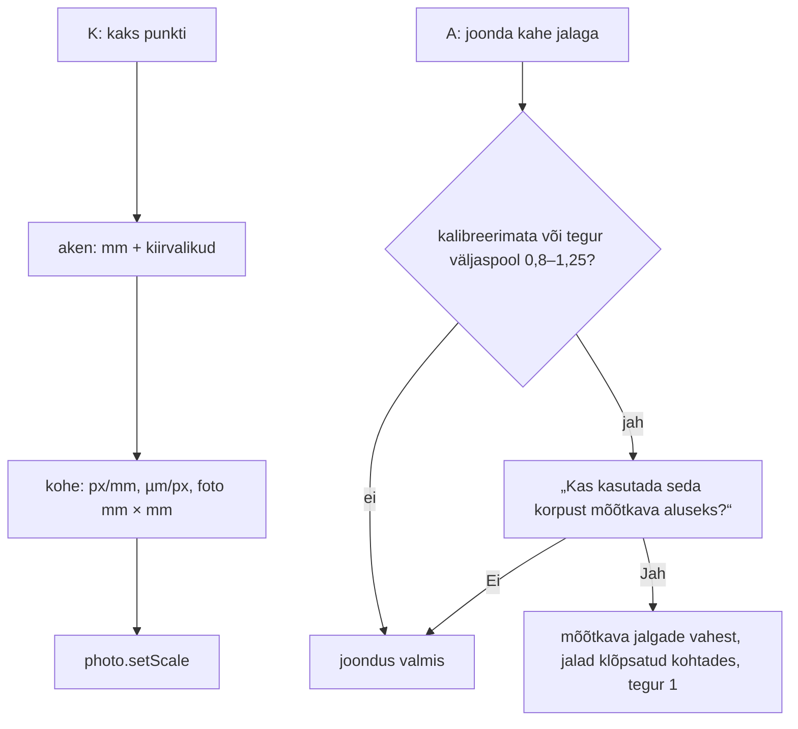

# M2.2b · Korpuste kuju ja mõõtkava: teostusplaan

**Olek:** kinnitatud 2026-11-25 (kasutaja kinnitas soovitused O1–O5: vahevoor M2.2b enne M2.3, mõõtkava enne kuju, kontroll ka kalibreeritud fotol, keraamilise kondensaatori nimi, piiratud ulatus, väljalase `v0.7.0`). Kaardid kirjutatakse vahetult enne iga ülesannet ([snaipriülesanded](../tasks/README.md)). Hetkeseis on [STATUS-es](../STATUS.md).

**Eesmärk:** tehnik näeb komponente fotol õiges suuruses ja tunneb need ühe pilguga ära. Vale mõõtkava paistab kohe välja ja standardse korpuse järgi saab mõõtkava parandada. Ümar elektrolüüt on ümar, dioodil on triip, mikroskeemil sälk ja polaarsel osal „+“.

**Alus:** `main` `e9cbbe4` (`v0.6.0`). Uus haru `codex/m2-2b` tehakse `main`-ist, tööpuu luuakse esimese kaardiga.

**Sisend:**
- kasutaja katse 2026-11-24 ([M2.2 üleandmine › suitsukatse](M2-2-uleandmine.md#kasutaja-suitsukatse-ja-kasutuskatse)): „suurused ei ole reaalsed“, „komponendid natuke viletsa graafikaga ja segased“;
- [02 § 5 Mõõtkava](../02-kasutaja-teekond.md#5-mõõtkava) ja [01 põhimõtted](../01-pohimotted.md) („kahe punktiga kalibreerimine või teadaoleva korpuse joondamisest“);
- [05 › photo](../05-moodulid.md) („mõõtkava kahe punktiga ja korpuse joondusest tulev ettepanek“);
- [07 › M1.3 korpuste teek](../07-teekaart.md#m13--korpuste-teek).

**Failivorming ei muutu.** Korpuse kuju ja märgid arvutatakse korpuse võtmest ja parameetritest nagu praegu jalad; neid ei salvestata. Mõõtkava kirjutab olemasolev väli `doc.scale`, komponendi tegur on olemasolev `board.scaleX/scaleY`.

## Tegelik lähtekoht

- **Mõõtkava.** Kasutaja tõmbas kalibreerimisjoone üle kogu foto laiuse (2716 px) ja sisestas 30 mm. Plaat on umbes 150–160 mm, seega joonistati kõik umbes 5 korda liiga suurena. Kalibreerimisaken (`CalibrationDialog`) näitab ainult punktide vahet pikslites ja välja „Vahe millimeetrites“. 02 § 5 nõuab kiirvalikuid (2,54 · 10,16 · 25,4 · 10 · 50 · 100) ja tulemuse kohest kuvamist; neid pole. `photo.setScale` lubab vahemikku 0,1–1000 px/mm, nii et 30 mm möödus kontrollist.
- **Joondus.** Joonda (`A`) muudab komponendi enda tegurit (`scaleX/scaleY`, lubatud 0,2–5), mitte foto mõõtkava. 02 § 5 küsimust „Kas kasutada seda korpust mõõtkava aluseks?“ koodis pole. Kui mõõtkava on vale, „parandab“ kasutaja selle iga komponendi kaupa ja suurused jäävad valeks. Sinu katse 5-kordne viga (tegur umbes 0,19) jääks vahemikust välja ja joondus annaks ainult vea „Joondus viiks mõõtkava lubatud vahemikust (0,2–5) välja“.
- **Kuju.** Korpuse andmetes on ainult `body: { w, h, pin1? }`. `bodyOutline` annab alati neli nurka; lõuend (`ComponentShape`) ja teegi eelvaade (`FootprintPreview`) joonistavad ristküliku ja 1. jala punkti. Ümar elektrolüüt on ruut. Aksiaalsel dioodil on parameeter `band: 'jah'`, aga triipu ei joonistata. Polaarsete osade jalgadel on nimed (`K`/`A`, `+`/`−`), aga korpusel märki pole.
- **Nimed.** Kasutaja valis 28 elektrolüüdile „Kondensaator THT“ (ketas), mitte „Elektrolüüt THT“. Teegi eelvaade on mõlemal ristkülik, nii et pilt ei aita valida.

## Kavandatud otsused

1. **Viga paistab enne kinnitamist.** Kalibreerimisaken arvutab sisestuse ajal tulemuse: px/mm, ühe piksli suurus µm-ites ja **foto suurus millimeetrites** („Foto: 30 × 36 mm“). Foto suurus on see arv, mille järgi tehnik kohe näeb, et 16 cm plaat ei ole 3 cm.
2. **Korpus annab mõõtkava.** Kahe jalaga joondus arvutab komponendi teguri. Kui mõõtkava pole kalibreeritud või tegur oleks väljaspool 0,8–1,25, küsib äpp lõuendil: „Kas kasutada seda korpust mõõtkava aluseks?“. Ka vahemikust 0,2–5 väljuv tegur annab vea asemel selle küsimuse. „Jah“ seab foto mõõtkava jalgade vahe järgi (korpuse mm ja fotol klõpsatud punktid) ning paigutab komponendi nii, et jalad on klõpsatud kohtades ja tegur on 1. Kui joondus jõudis enne küsimust rakenduda, on see teine tagasivõetav samm, nagu M2.2 kaitseküsimus.
3. **Kuju tuleb korpuse andmetest.** `body` saab valikulise kuju (`rect` vaikimisi, `circle`, `oval`, `d`) ja märkide loendi (`plus`, `band`, `notch`, `tab`). Lõuend, tabamus ja teegi eelvaade kasutavad sama domeenifunktsiooni, nii et teek näitab sama pilti mis plaat.
4. **Fotol joonistus, mitte täidis.** Kuju on õhuke kontuur nagu plaadi trükis. Senine läbipaistev täidis ja halo jäävad, et foto paistaks läbi ja joon oleks loetav mõlemas teemas.

## Kasutaja otsused enne ehitust

Kasutaja kinnitas 2026-11-25 kõik viis soovitust.

- **O1 · Nimi, järjekord ja koht teekaardil.** Vahevoor „M2.2b“ enne M2.3 skeemi; järjekord 1 → 2 → 3 → 4 → 5 (mõõtkava enne kuju). M2.3 ja M2.4 numbrid ei muutu. *Soovitus: jah. Suuruse viga mõjutab kõiki komponente, kuju on järgmine samm.*
- **O2 · Mõõtkava kontroll ka kalibreeritud fotol.** Küsimus tuleb ka siis, kui mõõtkava on olemas, aga joondus annab teguri väljaspool 0,8–1,25. 02 § 5 nõuab küsimust ainult kalibreerimata fotol. *Soovitus: jah. Sinu katses oli foto kalibreeritud, aga valesti; ainult kalibreerimata juhtum poleks seda püüdnud.*
- **O3 · Korpuste nimed teegis.** „Kondensaator THT“ → „Keraamiline kondensaator THT“, „Kondensaator SMD“ → „Keraamiline kondensaator SMD“. Elektrolüütide nimed jäävad. *Soovitus: jah, koos uue eelvaatega (ümar elektrolüüt, ovaalne ketas).*
- **O4 · Ulatus.** Kuju ja märgid saavad ainult need korpused, mille fotolt äratundmine sellest sõltub (tabel ülesandes 3–4). Konnektorid, nupp, trimmer, USB ja pinnirida jäävad ristkülikuks. *Soovitus: jah. Saab hiljem laiendada sama mudeliga.*
- **O5 · Väljalase.** M2.2b lõpus tuleb `v0.7.0`. Suitsukatse tehakse oma plaadi fotoga: kalibreerimine uuesti, korpuse järgi mõõtkava, kuju võrdlus fotoga. Sinna läheb ka M2.2-st tegemata 50 jala kasutuskatse. *Soovitus: jah.*

**Lahtine:** mis täpselt oli „segane“? Ekraanipilt sellest kohast täpsustab ülesannet 3 enne kaardi kirjutamist.

## Globaalsed piirangud

Kehtivad M2.2 piirangud:
- strict TS;
- failid ≤ 400 rida;
- sõltuvusreeglid;
- tekstid `i18n/et.ts`-is;
- kümnendkoma;
- iga kaart kontrollitakse käsuga `pnpm bb-review-card <ID>`;
- uusi sõltuvusi ei lisata ilma kasutaja loata;
- Codex kasutab ainult sünteetilisi projekte ja fotosid.

Nimega testid on kaardi loendi järgi, lisateste ei tehta. Rajad: ülesanded 2 ja 5 on **rada B** (mõõtkava muutev käsk, vastuvõtt), ülejäänud on **rada A**.

## Ülesanded

**Osa A · Mõõtkava**

1. **Kalibreerimisaken 02 § 5 järgi** (rada A).
   - Pealkiri „Kui pikk see lõik on?“, suur mm-väli ja kiirvalikud 2,54 · 10,16 · 25,4 · 10 · 50 · 100. Kiirvalik täidab välja, `Enter` kinnitab.
   - Sisestuse ajal kohe tulemus: „= 14,05 px/mm · 1 px = 71 µm“ ja „Foto: 192 × 229 mm“ (foto `widthPx`/`heightPx` jagatud px/mm-ga, pööramist arvestades).
   - Vigane sisestus ei näita tulemust. Senised veateated jäävad.
   - Mõõtkava kiip alumisel ribal näitab vihjes sama foto suurust.

2. **Mõõtkava korpuse joondusest** (rada B, O2).
   - Kahe jalaga joondusel: kui foto on kalibreerimata või komponendi tegur oleks väljaspool 0,8–1,25, ilmub lõuendil küsimus „Kas kasutada seda korpust mõõtkava aluseks?“ koos teguriga („Korpus on fotol 5,2 korda väiksem kui praeguse mõõtkava järgi“). Nupud „Kasuta mõõtkavaks“ ja „Jäta nii“.
   - Tegur vahemikus 0,2–5: joondus rakendub nagu praegu ja küsimus tuleb pärast seda. Tegur väljaspool 0,2–5: viga „Joondus viiks mõõtkava …“ asendub sama küsimusega ja komponenti enne vastust ei muudeta.
   - „Kasuta mõõtkavaks“ käivitab ühe käsu `{ componentId, pinA, pinB, targetA, targetB }`. See kirjutab `scale` (fotol klõpsatud punktide vahe jagatud jalgade vahega korpuse mm-ides, `calib` = need punktid) ning paneb komponendi keskpunkti ja nurga nii, et jalad on klõpsatud kohtades ja `scaleX = scaleY = 1`. Käsk deklareerib teise mooduli välja `alsoWrites`-iga; moodul ja reegel täpsustuvad kaardil [ADR-005](../adr/ADR-005-tuuma-ja-moodulite-piir.md) järgi. Üks `Ctrl+Z` võtab tagasi mõõtkava ja selle paigutuse, järgmine `Ctrl+Z` varem rakendunud joonduse.
   - Teised komponendid muudavad suurust millimeetrite järgi ja keskpunktid jäävad paigale (02 § 5). Komponendid, mille tegur ei ole 1, jäävad oma teguriga.
   - „Jäta nii“ ja `Esc` ei muuda midagi peale juba rakendunud joonduse.

**Osa B · Korpuste kuju**

3. **Kuju mudel, joonistus ja teegi eelvaade** (rada A, O3, O4).
   - Kuju `'rect' | 'circle' | 'oval' | 'd'` on korpuse definitsioonis (`FootprintDef.bodyShape`); puudumisel `rect`. `FootprintGeom` ei muutu, sest kaitsetest `existing_footprints_geometry_unchanged` võrdleb geomeetria JSON-i ([M2-2b-3](../tasks/M2-2b-3.md)). Uus domeenifunktsioon annab kontuuri hulknurgana, mida kasutavad lõuend, tabamus ja `FootprintPreview`.
   - Korpused: `radial`, `el_smd` → `circle`; `led_tht` (lame külg `K` pool), `to92` → `d`; `disc`, `xtal` → `oval`. Ülejäänud jäävad `rect`.
   - Teegi nimed O3 järgi.

4. **Polaarsus ja suund** (rada A, O4).
   - `body.marks`: `plus` (jala `+` juures), `band` (katoodi triip `K` poolel või tantaali triip `+` poolel), `notch` (sälk 1. jala otsas), `tab` (TO-220 metallplaat).
   - Korpused: `radial`, `el_smd`, `chip_tant` → `plus` ja triip; `axial` (`band: 'jah'`), `chip_diode`, `chip_led`, `led_tht` → `band` `K` poolel; `dip`, `soic`, `sop`, `qfp`, `qfn` → `notch` (1. jala punkt jääb); `to220` → `tab`.
   - Märgid pöörlevad ja peegelduvad koos korpusega; alumise poole korpusel on märgid sama punktiiriga nagu kontuur.

**Osa C · Vastuvõtt**

5. **Vastuvõtt ja `v0.7.0`** (rada B).
   - E2E: kalibreerimine kiirvalikuga ja foto suurus aknas; joondus vale mõõtkavaga → küsimus → „Kasuta mõõtkavaks“ → `Ctrl+Z`.
   - Tauri jõudlus suurel plaadil (300 komponenti, kõik märgid nähtavad): panoraam ja lohistus ei lange alla `v0.6.0` mõõdetud piiride (56,84 fps ja 40,22 fps).
   - Katse-EXE ja kasutaja suitsukatse O5 järgi.

## M2.2b vastuvõtt: tingimus → tõend

| Tingimus | Tõend |
|---|---|
| Kalibreerimisaken näitab enne kinnitamist px/mm-i, µm/px-i ja foto suurust mm-ides | ülesanne 1, E2E |
| Vale mõõtkava avastab joondus ja korpus parandab selle ühe tagasivõetava sammuna | ülesanne 2, E2E |
| Elektrolüüt on ümar, dioodil on triip, mikroskeemil sälk, polaarsel osal „+“, teegis sama pilt | ülesanded 3–4, ühiktestid, ekraanipilt mõlemas teemas |
| Jõudlus ei lange alla `v0.6.0` piiride | ülesanne 5, Tauri mõõtmine |
| Kasutaja tunneb oma plaadi komponendid ära ja suurused vastavad fotole | kasutaja suitsukatse oma fotoga |
| 50 jala kaardistamine piiksuga alla 2 minuti (M2.2-st) | kasutuskatse |

## Mis jääb järgmistesse plaanidesse

- Ülejäänud korpuste kuju (konnektorid, nupp, trimmer, USB, toitepesa) sama mudeliga, kui kasutaja seda vajab.
- Mitme komponendi tegurite ühtlustamine pärast mõõtkava muutust (praegu jääb joondusega muudetud tegur alles).
- M2.3 jõudlus: `connectionLevels`-i ja `nets`-i tuletise sisendi kitsendamine ([M2.2 plaan](M2-2-piiksumisreziim.md#mis-jääb-järgmistesse-plaanidesse)).
