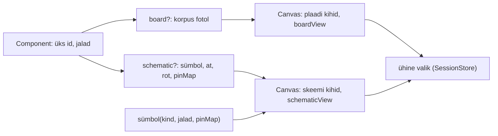

# M2.3 · Skeemi sümbolid ja paigutus: teostusplaan

**Olek:** kinnitatud 2026-11-26. Kasutaja kinnitas soovitused O1–O6: ettevalmistav ülesanne, IEC sümbolid, A3 leht ja 2,54 mm ruudustik, jalgade vastavus nimede järgi, plaadipunktid skeemil ja väljalase `v0.8.0`. Kaardid kirjutatakse vahetult enne iga ülesannet ([snaipriülesanded](../tasks/README.md)). Hetkeseis on [STATUS-es](../STATUS.md).

**Eesmärk:** tehnik avab skeemi ühe klahviga ja näeb plaadi komponente sümbolitena: takisti, kondensaator, diood, transistor ja IC kastina. Komponendi saab lisada skeemil ja hiljem fotole paigutada või vastupidi. See on sama komponent samade jalgade, ühenduste ja mõõtmistega. Valik on mõlemas vaates sama.

**Alus:** `main` `4e27885` (`v0.7.0`). Uus haru `codex/m2-3` tehakse `main`-ist ja tööpuu luuakse esimese kaardiga.

**Sisend:**
- [07 › M2.3](../07-teekaart.md#m23--skeemi-sümbolid-ja-paigutus);
- [02 § 13.1 Skeem](../02-kasutaja-teekond.md#131-skeem-muudetav);
- [03 § 8 Skeemivaade](../03-arhitektuur.md#8-skeemivaade) ja [ADR-004](../adr/ADR-004-kaks-vaadet-ja-uhendused.md) (üks komponent, kaks paigutust);
- [05 › schematic](../05-moodulid.md);
- [Astra M2.2b audit](../review/2026-11-25-m2-2b-ulevaatus-2eb1a1c.md#arhitekti-triaaž-2026-11-26), leiud 08–12 ja 14;
- [M2.2 plaani järgmised tööd](M2-2-piiksumisreziim.md#mis-jääb-järgmistesse-plaanidesse) (tuletiste sisend).

**Failivorming ei muutu.** Skeemi väljad on vormingus v1 juba olemas:
- `Component.schematic` (`symbol`, `at`, `rot` 0/90/180/270, `mirror`, `pinMap?`, `labelOffset?`);
- ühenduse `schematic.waypoints` ja liitepunkti `schematic.at`.

Sümboli kuju arvutatakse tüübist ja jalgadest ning seda ei salvestata.

## Tegelik lähtekoht

- **Andmed on olemas, töövõime puudub.** Tuletis `unplacedSchematic` loendab skeemita komponente, aga moodulit `schematic` pole: käske, kihte, tööriistu ega vaadet pole. `components.add` võtab ainult `board`-i. Üldkäsk `items.translate` liigutab ainult plaadipaigutust.
- **Lõuend on parameetriline.** `Canvas` saab kihid, tööriistad, vaate, pinna ja `sceneTransform`-i propsidena. `Workbench` kasutab seda ainult `BoardCanvas`-is. Vaatehoidlas on ainult `boardView` ja registris ainult `canvasLayers()`. Teine vaade on seega peamiselt kooste küsimus, mitte lõuendi ümberkirjutus. Seda kontrollib ülesanne 2.
- **Tüüpe on 23** (`ComponentKind`). Polaarsete osade jalgadel on korpusest nimed (`K`/`A`, `+`/`−`). Transistoride jalad on tavaliselt ainult numbritega.
- **Tuletised.** `nets` ja `connectionLevels` arvutatakse uuesti iga komponendi muutuse järel, ka liigutuse järel. M2-2-11 mõõtis 17–20 ms (eelarve 16 ms) ja kasutaja aktsepteeris selle `v0.6.0` jaoks. Skeemil liigutamine lisab samu muudatusi.
- **Auditi leiud M2.3 jaoks:**
  - 08: repos olev Tauri jõudlusproov ei taasta mõõdetud koormust;
  - 09: `@pcbk/features/nets/ui` avalik tee ei lahene ja API kontroll jätab selle vahele;
  - 10: tuletis, mis loeb teist tuletist, võib jääda eelmisele revisjonile;
  - 11: UI saab mooduli juurkausta abifaili kaudu mootorit importida ja sõltuvuskontroll seda ei märka;
  - 12: Piiksu kaitse kinnitamine vajab `connections`-i käsku, mida `measurements` sõltuvusena ei deklareeri;
  - 14: `bodyOutline` tagastab vahemälu muudetavad punktid.

## Kavandatud otsused

1. **Üks lõuend, kaks vaadet.** Skeem on sama `Canvas` teise vaatega:
   - oma `schematicView` (suum ja asukoht), ruudustikuga pind ilma fotota ja `sceneTransform: 'none'`;
   - registrist `schematicLayers()` ja skeemi tööriistad;
   - ülariba lüliti „Plaat | Skeem“ ja `Ctrl+Tab`, vahetamisel säilib kummagi vaate suum ja asukoht.

   Lõuendi koodi ei kopeerita.
2. **Sümbol tuleb tüübist ja on domeenis.** Puhas funktsioon annab tüübi ja jalgade järgi sümboli joonistuse, jalgade ankrud ruudustikul ja sildi koha. Joonistus, tabamus ja „Näita teises vaates“ kasutavad sama funktsiooni, nagu korpuse kontuur M2.2b-s. Tulemus on kirjutuskaitstud ka tüübis (leid 14 sama mustriga).
3. **Jalgade vastavus.** Sümboli kontaktid (näiteks `A`/`K`, `B`/`C`/`E`) viitavad komponendi jalale `pinMap`-i kaudu.
   - Kahe sümmeetrilise jalaga osad (takisti, kondensaator, induktiivsus, kaitse, kvarts, lüliti) vastavust ei vaja.
   - Kui `pinMap` puudub, tuletatakse see jalgade nimedest (O4). Tuletatud vastavust ei salvestata.
   - Kui nimed ei anna kõiki kontakte üheselt, on komponent nummerdatud kast, kuni kasutaja määrab jalgade funktsiooni.
4. **Samad käsud, vaate parameeter.**
   - Skeemil lisamine on `components.add` koos skeemipaigutusega (05).
   - `items.translate` saab valikulise vaate: vaikimisi `board`, lisaks `schematic`.
   - Moodulis `schematic` on uued käsud:
     - `schematic.place` paigutab, pöörab ja peegeldab;
     - `schematic.remove` eemaldab skeemilt, komponent jääb alles;
     - `schematic.setSymbol` määrab `pinMap`-i.
   - Iga tegevus on üks samm ajaloos.
5. **Ruudustik.** Skeemi ühik on mm ja ruudustik 2,54 mm. Sümbolite jalad on ruudustikul ja `at` haakub ruudustikule. Pind on A3 rõhtne leht (O3).
6. **Valik on ühine.** Mõlemas vaates on sama `SessionStore`-i valik. Tavaline valik vaadet ei liiguta. „Näita teises vaates“ vahetab vaate ja toob objekti nähtavale suumi muutmata.

## Kasutaja otsused enne ehitust

Kasutaja kinnitas 2026-11-26 kõik kuus soovitust.

- **O1 · Ettevalmistav ülesanne enne skeemi.** Ülesanne 1 parandab moodulite piirid ja tuletised (leiud 09–12 ja tuletiste sisend) enne uue mooduli lisamist. See on verstaposti ainus hooldusvoor. *Soovitus: jah. Muidu kasutaks uus moodul `schematic` kohe vigast eksporditeed ja auguga sõltuvuskontrolli ning skeemil liigutamine arvutaks võrgud iga kord uuesti.*
- **O2 · Sümbolite stiil.** IEC (EN 60617): takisti on ristkülik, mitte siksak. *Soovitus: IEC, see on Eestis ja Euroopas tavaline.*
- **O3 · Leht ja ruudustik.** A3 rõhtne leht (420 × 297 mm), ruudustik 2,54 mm. *Soovitus: jah. 300 sümbolit mahub ära ja lehe suurust saab hiljem muuta.*
- **O4 · Jalgade vastavus nimede järgi.** Polaarsed osad (`K`/`A`, `+`/`−`) ja transistorid, mille jalgade nimed on `B`/`C`/`E` või `G`/`D`/`S`, saavad sümboli kohe. Muul juhul on komponent nummerdatud kast, kuni määrad jalgade funktsiooni. *Soovitus: jah. Korpuse numbrid ei tähenda iseenesest `B, C, E` (02 § 13.1), aga jalgade nimed tähendavad.*
- **O5 · Plaadipunktid skeemil.** Testpunkt, padjand ja juhtmepunkt on skeemil ühe kontaktiga klemm. Via ja ava skeemile ei lähe: neid pole loendis „Skeemile paigutamata“ ega paigutamata arvus. *Soovitus: jah. Via on vaskühendus, mitte komponent, ja ava on mehaaniline.*
- **O6 · Väljalase.** M2.3 lõpus tuleb `v0.8.0` ja suitsukatse oma plaadiga: ava skeem, paiguta komponendid ja määra transistori jalad. M2.4 juhtmed ja sildid tulevad järgmises väljalaskes. *Soovitus: jah. Varajane katse andis M2.2b-s kasuliku tagasiside.*

## Globaalsed piirangud

Kehtivad M2.2b piirangud:
- strict TS;
- failid ≤ 400 rida;
- sõltuvusreeglid;
- tekstid `i18n/et.ts`-is;
- kümnendkoma;
- iga kaart kontrollitakse käsuga `pnpm bb-review-card <ID>`;
- uusi sõltuvusi ei lisata ilma kasutaja loata;
- Codex kasutab ainult sünteetilisi projekte ja fotosid.

Nimega testid on kaardi loendi järgi ja lisateste ei tehta. Rajad: ülesanded 1, 4, 5 ja 6 on **rada B** (mootori leping, uued käsud, vastuvõtt). Ülesanded 2 ja 3 on **rada A**.

## Ülesanded

**Osa A · Ettevalmistus**

1. **Moodulite piirid ja tuletised** (rada B, O1, leiud 09–12).
   - Iga lubatud `@pcbk/features/*` alamtee laheneb. API ülevaade kukub, kui lubatud alamtee ei lahene (09).
   - Sõltuvuskontroll leiab ka kaudse tee UI → mooduli juurkausta fail → mootor. Mõlemad näited on regressioonikatses (11).
   - Tuletis ei saa lugeda teisi tuletisi: leping kitseneb sõltumatutele arvutustele. Test võrdleb inkrementaalset arvutust täisarvutusega, ka pärast `Ctrl+Z`-d (10).
   - Piiksu kaitse kinnituse käsusõltuvus on deklareeritud ja minimaalse moodulikoostega test katab selle (12).
   - `nets`-i ja `connectionLevels`-i sisend kitseneb jalgade topoloogiale, nii et komponendi liigutus neid uuesti ei arvuta. Mõõdetakse suurel plaadil enne ja pärast.

**Osa B · Skeemivaade ja sümbolid**

2. **Skeemivaade ühe lõuendiga** (rada A, otsused 1 ja 5, O3).
   - Lüliti „Plaat | Skeem“, `Ctrl+Tab`, `schematicView`, A3 leht ruudustikuga, `schematicLayers()` ja vaatepõhised tööriistad.
   - Taaskasutuse proov: mõlemad vaated kasutavad sama `Canvas`-it, sisestust ja tabamisindeksit. Test kinnitab, et skeem ei kopeeri lõuendi koodi.
   - Tühi skeem näitab ruudustikku ja vihjet, kuidas komponendid skeemile saada.
3. **Sümbolite teek** (rada A, otsused 2 ja 3, O2, O4, leid 14).
   - Domeenifunktsioon katab kõik 23 tüüpi. IC, regulaator, konnektor ja „muu“ on kast jalgade nime ja numbriga. Tundmatu vastavusega komponent on nummerdatud kast.
   - Sümbolikiht ja tabamus (sümbol, jalad, tähis) tulevad samast funktsioonist; pööre ja peegeldus kehtivad mõlemale.
   - Korpuse kontuur ja sümbol on kirjutuskaitstud ka tüübis. Test kasutab kahte sõltumatut tarbijat (leid 14).
   - Ekraanipildid kõigist tüüpidest mõlemas teemas.

**Osa C · Töö skeemil**

4. **Komponendid skeemil** (rada B, otsus 4, O5).
   - Lisamine skeemivaates teegist: `components.add` skeemipaigutusega. Komponent ilmub loendisse „Plaadile paigutamata“ ja „Paiguta plaadile“ toimib nagu praegu.
   - Loend „Skeemile paigutamata“; lohistamine skeemile käivitab `schematic.place`-i.
   - Liigutamine (`items.translate` vaatega `schematic`), pööramine `R`/`Shift+R`, peegeldus ja „Eemalda skeemilt“ (`schematic.remove`). Kustutamine eemaldab komponendi mõlemast vaatest nagu praegu.
   - Iga tegevus võetakse tagasi ühe `Ctrl+Z`-ga.
5. **Jalgade funktsioon, ühine valik ja „Näita teises vaates“** (rada B, otsused 3 ja 6).
   - Kontekstipaneelis saab määrata jalgade funktsiooni (näiteks transistor: 1 → B, 2 → C, 3 → E). Seda teeb `schematic.setSymbol` ja nummerdatud kast muutub sümboliks.
   - Valik on mõlemas vaates sama; „Näita plaadil“ ja „Näita skeemil“.
   - Tähistus 02 § 13.1 järgi: tuvastamata komponent on küsimärgiga, DNP hallina.

**Osa D · Vastuvõtt**

6. **Vastuvõtt, jõudlus ja `v0.8.0`** (rada B, O6, leid 08).
   - E2E:
     - skeemil lisatud takisti paigutatakse hiljem fotole sama id-ga;
     - tähise ümbernimetamine ei muuda ühendusi ega mõõtmisi;
     - valik on mõlemas vaates sama.
   - Tauri jõudlus: 300 sümboliga skeem püsib [03 § 7.3](../03-arhitektuur.md#73-kihid-ja-jõudlus) eelarves (pan ja suum 60 fps, lohistus ≥ 45 fps). Plaadi mõõdikud ei lange alla `v0.7.0` omade.
   - Jõudlusproov on repos ja kontrollib enne ajastamist andmete arvu. Tulemus salvestab sisendi ja kooste tunnuse koos kolme jooksuga (leid 08).
   - Näidisfail `v0.8.0` skeemipaigutusega (03 § 9), katse-EXE ja kasutaja suitsukatse.

## M2.3 vastuvõtt: tingimus → tõend

| Tingimus | Tõend |
|---|---|
| Skeemil lisatud takisti paigutatakse hiljem fotole sama id-ga; tähise ümbernimetamine ei muuda ühendusi ega mõõtmisi | ülesanded 4 ja 6, E2E |
| Skeem kasutab sama lõuendi baasi ja tabamust nagu plaat (ühiskood, mitte koopia) | ülesanne 2, test |
| Kõigil 23 tüübil on sümbol; tundmatu vastavusega komponent on nummerdatud kast | ülesanne 3, domeenitestid ja ekraanipildid |
| Jalgade funktsiooni saab määrata ja see on üks tagasivõetav samm | ülesanne 5 |
| Valik on ühine ja „Näita teises vaates“ viib sama objekti juurde | ülesanded 5 ja 6, E2E |
| 300 sümboliga skeem püsib eelarves | ülesanne 6, Tauri mõõtmine |
| Auditi leiud 08–12 ja 14 on parandatud | ülesanded 1, 3 ja 6 |
| Kasutaja tunneb oma plaadi skeemil ära | kasutaja suitsukatse |

## Mis jääb järgmistesse plaanidesse

- **M2.4:** juhtmed, liitepunktid ja võrgusildid skeemil, toite- ja maandussümbolid rolli järgi ning mõõtmine skeemilt. Sinna läheb ka Astra M2.2 leid 16 (juhtme kaar haru järel).
- **M4:** automaatpaigutus abilisena (ELK).
- **Salvestuse kaart, hiljemalt M4.3:** salvestuse leiud 04–06, lühinimega tee normaliseerimine ja Astra M2.2b leid 13 (algfaili kaardilt taastamine valib teise töökoopia varukoopia).
- **Astra tööriistad:** leid 25, seejärel 26–30.
