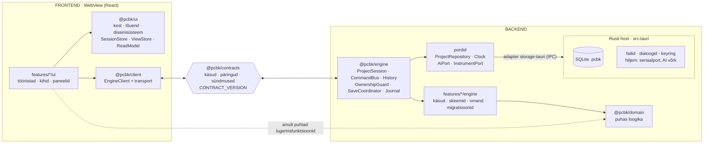

# PCB Kaardistaja: arhitektuuri ülevaatuse pakett (GPT ja Gemini)

> **Kuidas kasutada:** kopeeri kogu see fail GPT ja Gemini vestlusesse ühe sõnumina. Fail on iseseisev. Täielik dokumentatsioon on avalikus repos https://github.com/Fuuduuu/BB (kaust `docs/`). Kui viidatud fail repos puudub, tugine sellele paketile.

---

## Ülesanne ülevaatajale

Oled kogenud vanem tarkvaraarhitekt. Vaata allolev kavand kriitiliselt üle **enne, kui koodi kirjutama hakatakse**. Kirjutatud koodi veel ei ole, on ainult dokumentatsioon ja veebiprototüüp.

Reeglid:
- Vasta **eesti keeles**.
- Ole konkreetne: viita jaotisele (nt „§ 6 Salvestus“) ja ütle, mida täpselt muuta.
- **Lihtsus on kõige tähtsam nõue.** Arendab üks inimene koos AI-assistentidega. Ära paku keerukust, mida v1 ei vaja. Kui midagi tuleks ära jätta või lihtsustada, ütle seda julgelt.
- Ära kirjuta toodet ümber. Hinda, kas see kavand viib töökindla, moodulipõhise ja tulevikus laiendatava äpini.
- Punktid, mis on juba parandatud (§ 11), kontrolli üle, aga ära korda neid uue leiuna.

Vasta selles vormis:

1. **Üldhinnang** (2–3 lauset): kas sellega võib M0 ehitust alustada? `JAH` / `JAH, PÄRAST PARANDUSI` / `EI`.
2. **ADR-003 otsus** (§ 4): kas valitud variant D on õige? Kui ei, siis milline ja miks.
3. **Kõige tähtsamad riskid** (kuni 7), tähtsuse järjekorras. Iga riski juures: mis läheb valesti (konkreetne stsenaarium), mõju, jaotis ja soovitatud muudatus.
4. **Mida lihtsustada või ära jätta** (kuni 5).
5. **Mis puudub** (kuni 5): asjad, mida v1 kindlasti vajab, aga mida kavand ei kata.
6. **Vastused avatud küsimustele** (§ 12), lühidalt, küsimuse numbri järgi.
7. **Esimese nädala soovitus:** millest M0 ehitust alustada.

---

## 1. Toode lühidalt

**Kasutaja:** elektroonika parandaja töölaua taga. Tal on plaat, multimeeter ja telefon, aga skeemi pole.

**Lubadus:** *pildista → märgi → ühenda → mõõda → leia viga → skeem valmis*, kõik ühes töölaua-äpis plaadi foto peal.

**Lõpptulemus:**
- plaadi kaart (foto, komponendid, jalad, rajad, mõõdud millimeetrites);
- võrguloend koos rollidega (GND, 3V3, 5V, 12V …);
- automaatselt tekkiv loogiline skeem;
- mõõtmiste ja remonditoimingute logi;
- remondiraport ja ekspordid (SVG 1:1, PNG, CSV-d, projekti JSON).

**v1 teeb:**
- projekt ühe failina `.pcbk` ja automaatsalvestus;
- foto koos nähtavuse, kontrasti, pööramise ja peegeldamisega;
- mõõtkava kahe punktiga või korpuse joondusest;
- parameetriline korpuste teek (~40 korpust prototüübist), suuruse muutmine ja kahe jala joondus;
- jalad, oma jalad ja nimed;
- rajad, kiirühendus ja piiksumisrežiim (läbivusega võrkude kaardistus);
- võrgud ja rollid koos konfliktihoiatusega;
- mõõtmised (pinge, takistus, diood, läbivus) koos automaatse hinnanguga;
- remonditoimingud koos varasemate mõõtmiste aegumisega;
- mõõtjooned ja kontuur;
- skeemivaade, valmiduse näitaja ja ekspordid.

**v1 ei tee:** AI-d, mõlema plaadipoole fotode joondust, multimeetri otseühendust, pilve, kontosid ega koostööd.

**Põhimõtted** tähtsuse järjekorras:
1. Plaat on keskel.
2. Kohe tööle: ≤ 3 klõpsu ja 0 kohustuslikku välja.
3. Üks komponent on üks objekt.
4. Muudatus jõustub kohe ja on alati tagasivõetav (`Ctrl+Z`); ainus teadlik kinnitus on mõõtmise salvestamine (`Enter`).
5. Valik ei kao ega vahetu iseenesest.
6. Äpp juhatab, aga ei sunni.
7. Klaviatuur kiirendab, hiir piisab.
8. Ausus: viga ei näidata kunagi õnnestumisena.
9. Eesti keel ja töökoja sõnavara.

## 2. Taust: miks alustatakse nullist

Vana projekt BenchBeep (Flutter) läks valele rajale:
- üks ekraanifail kasvas 209 KB-ni ja tekkisid megakontrollerid;
- tõde liikus läbi torustiku (`events.jsonl` → Pythoni materializer → `known_facts.json` → käsitsi „Värskenda andmeid“), mida kasutaja pidi ise juhtima;
- sama komponent elas kahe objektina (kandidaat ja kinnitatud);
- mõõtmise sihtmärk vahetus ise: valisid C2, aga mõõtmine salvestati R1-le.

Uues äpis neid vigu korrata ei tohi. BenchBeepiga ühilduvus ei ole nõue.

## 3. Tehnoloogia (ADR-002, vastu võetud)

- **Keel ja UI:** TypeScript (strict, `noUncheckedIndexedAccess`), React 18, Vite.
- **Olek ja valideerimine:** Zustand + Immer (paigad tagasivõtmiseks), zod (skeemid, hiljem ka AI tööriistade skeemid).
- **Joonistus:** SVG kihtidena (ekraan ja SVG-eksport sama koodiga).
- **Kest ja fail:** Tauri 2 (Rust), projekti fail SQLite (`rusqlite`).
- **Testid ja kvaliteet:** Vitest, Testing Library, Playwright (brauseris), `cargo test`, ESLint, dependency-cruiser, failipikkuse piir 400/600 rida.
- **Töökeskkond:** töötab võrguühenduseta, fondid on kaasa pakitud, paigaldaja `.msi`.

**Jõudluseelarve:** 12 MP foto, 300 komponenti, 3000 jalga, 1000 rada; pan ja suum 60 fps, lohistamine ≥ 45 fps, avamine < 1,5 s. Kui SVG ei pea vastu, viiakse jalad Canvas-kihile (otsus M1 lõpus).

## 4. Arhitektuur: frontend ja backend eraldi (ADR-003, ettepanek)

**Otsus:** eraldus tehakse **lepinguga ja pakettide piiridega, mitte protsessiga**. Täna jookseb kõik samas WebView lõimes. Protsessipiiri (Web Worker, server) saab hiljem lisada, vahetades ainult transpordi või adapteri.



| Osa | Vastutab | Ei tee kunagi |
|---|---|---|
| **Frontend** | joonistus, sisend, tööriistad, valik, mõõtmise mustandid, vaade, tekstid; dokumendist kirjutuskaitstud koopia (ReadModel), mida uuendatakse paikadega | ei muuda dokumenti ise, ei impordi mootorit, ei räägi Rustiga otse |
| **Leping** | käskude ja päringute zod-skeemid, sündmused, veakoodid, ReadModeli kuju, versioon; moodulite avalikud selektorid | ei hoia olekut |
| **Backend: mootor (TypeScript)** | autoriteetne dokument, käskude valideerimine ja täitmine, tagasivõtmine, andmete omaniku kontroll, logi, salvestuse vastutaja, migratsioonid | ei impordi Reacti, DOM-i ega Tauri API-t; välismaailmaga suhtleb portide kaudu |
| **Backend: host (Rust)** | SQLite tehingud, `rev`-i kontroll, koopia (`VACUUM INTO`), fotod blob'idena, dialoogid; hiljem seriaalport, AI võtmed ja võrgupäringud | ei sisalda domeeniloogikat |

**Leping lühidalt:**

```ts
interface EngineApi {
  createProject / openProject / closeProject / copyProject (…): Promise<Result<…, EngineError>>;
  execute(id, params): Promise<Result<CommandOk, EngineError>>;
  beginTransaction(label): TxHandle;                 // update() · commit() · cancel(); lohistamiseks
  undo(); redo();
  subscribe(fn: ({ rev, patches } | snapshot) => void);
  query(id, params);
  events(fn);                                        // measurement.added, repair.added, save.status …
}
type EngineError = validation | ownership | not_found | stale_rev | storage(disk_full | read_only | missing | locked | unknown);
```

Lepingu reeglid:
- kõik andmed on kloonitavad (`structuredClone` test);
- mootor tagastab veakoodi ja frontend teeb sellest eestikeelse teksti;
- uue objekti id loob kutsuja, et käsk oleks deterministlik;
- arvutatud andmed (võrgud, hinnangud, ühenduse tase, valmidus) arvutab frontend `@pcbk/domain` puhaste funktsioonidega `rev`-i järgi;
- versioone on kolm: `CONTRACT_VERSION`, `HOST_API_VERSION` ja faili `format_version`;
- Rusti käskude TypeScripti tüübid genereeritakse (`tauri-specta` või `ts-rs`).

**Kaustastruktuur** on kerge pnpm monorepo, kus pakettidel ehitussammu pole:

```
apps/desktop/        kompositsioonijuur + src-tauri (Rust host)
apps/web/            sama UI brauseris (IndexedDB), arenduseks ja Playwrighti jaoks
packages/domain      puhas loogika: mudel+zod, geomeetria, korpused, võrgud, hindamine, skeem, valmidus, migratsioonid
packages/contracts   EngineApi, käsud/päringud/sündmused, vead, versioonid
packages/engine      ProjectSession, CommandBus, History, Transaction, OwnershipGuard, SaveCoordinator, Journal, pordid
packages/client      EngineClient, ReadModelStore, transpordid (inproc; hiljem worker, ws)
packages/ui          kit/ (disainisüsteem) · canvas/ (lõuendi mootor) · shell/ (kest, UiRegistry, SessionStore, ViewStore, i18n)
packages/adapters    storage-tauri · storage-web · storage-memory
packages/features/<x>/   contract.ts · engine/ (EngineModule) · ui/ (UiModule)   ← üks võimalus = üks kaust
```

**Sõltuvusreeglid** (CI kontrollib):
- `domain` ei impordi midagi peale zodi;
- `engine` ei impordi Reacti, DOM-i, Taurit, `ui`-d ega `client`-i;
- **`features/*/ui` ei impordi `engine`-it ega `features/*/engine`-it** (see on frontendi ja backendi sein);
- `ui` ja `client` ei impordi mootorit;
- ainult `apps/*` paneb mootori ja UI kokku.

**Kasvutee:**

| Faas | Muudatus | Tingimus |
|---|---|---|
| 1 | kõik samas lõimes | kohe |
| 2 | mootor Web Workerisse | kui käsu p95 või `resolveNets` > 8 ms |
| 3 | tahvel (Tauri Android) | M5 |
| 4 | AI port, võrgupäring Rustis | M6, eraldi otsusega |
| 5 | multimeeter: Rust loeb seriaalporti, lugem täidab mustandi (mõõtmist ei salvesta) | „Hiljem“ |
| 6 | sama mootor Node'i serveris: käsulogi + `rev` | eraldi ADR; CRDT ainult reaalajas koostöö korral |

**Kaalutud ja tagasi lükatud:**
- **A, paks klient:** piir UI ja andmete vahel oleks ainult kokkulepe.
- **B, domeen Rustis:** kaks keelt, lohistamine üle IPC, brauserirežiim kaob.
- **C, kohalik Node-server:** keerukus täna ilma vajaduseta.

**Hind:** M0 läheb 2–3 päeva suuremaks, dokumendist on kaks koopiat (mootor ja ReadModel) ning registrikirjeid on kaks (mootor ja UI).

## 5. Olek, käsud ja tagasivõtmine

- **Hoidlad:**
  - mootoris autoriteetne `BoardDoc`;
  - frontendis ReadModel (koopia);
  - `SessionStore`: valik, hover, tööriist, tööriista mustand, **mõõtmise mustandid jala kaupa**, piiksu ankur; ei salvestu;
  - `ViewStore`: suum, kihid, foto nähtavus; salvestub eraldi `view` tabelisse.
- **Käsk** = `{ id: 'components.add', params: zod, run(draft, params) }`. Käsk on puhas ja sünkroonne. Failid ja dialoogid käivad väljaspool käsku.
- **Ajalugu:** Immeri `produceWithPatches`, ajalukku lähevad paigad ja pöördpaigad (200 sammu). Transaktsioon teeb lohistamisest ühe sammu.
- **Andmete omanik:** igal `BoardDoc` väljal on üks omanik-moodul (`owns`). Teise mooduli käsk tohib välja muuta ainult siis, kui see on tema `alsoWrites` loendis, näiteks:
  - `repair.add` → `measurements`;
  - `beep.record` → `measurements` ja `connections`;
  - `photo.transform` → kõik koordinaadid.

  `dispatch` kontrollib seda paiga tee esimese osa järgi: arenduses ja testides tuleb viga, väljalaskes hoiatus logis.
- **Valik ja mustand:** tööriista, filtri või paneeli vahetus ei muuda valikut ega mustandit. Koha vahetus (`Tab`, klõps) ei vii sisestatud väärtust teisele jalale.

## 6. Salvestus

- **Fail:** `<nimi>.pcbk` on SQLite andmebaas tabelitega `meta`, `document` (terve JSON + `rev`), `view`, `photos` (blob), `attachments`, `journal` ja `thumbnail`. Režiim on WAL.
- **Automaatsalvestus:** 1,5 s pärast viimast käsku kirjutatakse üks tehing (dokument, uued logiread, vaade).
- **`SaveCoordinator`** on ainus kirjutaja:
  - korraga käib üks kirjutus;
  - kirjutuse ajal tulnud muudatused kirjutatakse kohe järgmisena;
  - `project_save` keeldub vanemast `rev`-ist;
  - logiread ei kao, kui kirjutus ebaõnnestub;
  - olek on alati nähtav: „Salvestatud · 14:32“, „Salvestan…“ või punane veariba.
- **Sulgemine ja projekti vahetus:** enne tehakse `flush()`. Kui see ebaõnnestub, akent ei suleta; dialoog pakub **Proovi uuesti**, **Salvesta mujale…** või **Sulge salvestamata**.
- **Koopia:** `project_copy` teeb `VACUUM INTO` koos fotodega ja kirjutab sinna uusima oleku. Kui algne fail pole loetav, öeldakse selgelt, et fotod jäid sinna.
- **Versioonid:** `format_version` ja järjestikused migratsioonid. Fail, mis on uuem kui äpp, avatakse kirjutuskaitstuna.

## 7. Andmemudel (põhiosa)

```ts
BoardDoc { format_version, rev, name, device?, problem?, status: 'mapping'|'mapped', scale{pxPerMm, calibrated},
  photos[], components[], connections[], netLabels[], roles[], measurements[], repairs[], areas[], dimensions[],
  outline?, schematic{placements}, guide{skipped} }
Component { id, ref, value, kind, footprint, params, center, rotationDeg, side, scaleX, scaleY, identified, dnp,
  pinNames, pinNc, extraPins[], note }
Connection { id, kind: 'trace'|'wire'|'link', a, b (jalg või punkt), waypoints[], layer, widthMm,
  basis: 'assumed'|'visual', evidenceId? }
Measurement { id, mode: 'voltage'|'resistance'|'diode'|'continuity', at (punane sond), ref? (must sond), value?, beep?,
  power: 'on'|'off'|'unknown', takenAt, atLabel, refLabel?, staleByRepairId?, source: 'manual'|'beep_mode' }
NetRole { id, label, kind: 'ground'|'power'|'signal'|'unknown', nominalV?, color }
```

- **Võrgud:** union-find üle jalgade ja ühenduste. Roll tuleb siltidest; kaks eri rolli tähendab konflikti (rolli ei kirjutata üle). `beep = false` mõõtmine samas võrgus annab hoiatuse.
- **Pinge hinnang arvestab mõlemat sondi:** `exp = nominalV(at) − nominalV(ref)` ja `tol = max(0,1; 0,1·|exp|)`.
  - `|v − exp| ≤ tol` → OK;
  - vastupidine märk → „kõrge“ koos vihjega „Sondid võivad olla vahetuses“;
  - `|v| < |exp|` → madal, muidu kõrge.

  Ilma vastaspunktita pinget ei hinnata. Näide: punane 5V, must 12V, näit −7 V → OK.
- **Takistus ja läbivus:** takistus toite ja maa vahel < 1 Ω → lühise kahtlus. Läbivus kahe eri toiterolli vahel → lühise kahtlus.
- **Ühenduse tase arvutatakse:** „mõõdetud“ kehtib ainult siis, kui `evidenceId` viitab olemasolevale ja mitte aegunud läbivusmõõtmisele samade jalgade vahel. Muidu on tase `basis`.

  Mõõtmise kustutamine või remont võtab ✓ ära ilma ühenduse andmeid muutmata. Piiksumisrežiimi „Jah“ on üks käsk `beep.record`.
- **Remont:** `repair.add` märgib aegunuks komponendi jalgade ja nendega samas võrgus olevad mõõtmised. Need jäävad ajalukku märkega „enne remonti“.
- **Kustutamine:** komponendi kustutamisel muutuvad ühenduste otsad vabadeks punktideks, mõõtmised jäävad alles (loetav `atLabel`), sildid ja skeemi paigutus eemaldatakse. Kõik see on üks tagasivõetav käsk.

## 8. Moodulid (16)

| Moodul | Vastutus |
|---|---|
| project | avaleht, uus/ava, viimased projektid, `SaveCoordinator`, prototüübi import, JSON eksport |
| photo | foto, nähtavus, kontrast, pööramine ja peegeldamine koos kaardistuse teisendusega |
| calibration | mõõtkava |
| selection | valik, raamvalik, liigutamine, kustutamine |
| components | korpuste teek, paigutus, suurus, kahe jala joondus, identiteet, BOM |
| pins | jalad, oma jalad, nimed, NC |
| connections | rajad, juhtmed, lingid, kiirühendus |
| nets | võrgud, rollid, konfliktid, võrguloend |
| measurements | kiirsisestus, hinnangud, nimekiri, CSV |
| beep | piiksumisrežiim (`beep.record`) |
| repair | remont, aegumine, kahjustatud alad, kahtlaste vaade |
| dimensions | mõõtjooned, kontuur |
| schematic | skeemivaade, sümbolid, automaatne paigutus |
| guide | „Järgmine samm“, edenemine |
| export | ekspordi aken, SVG, PNG, raport |
| journal | logi vahekaart |

Sõltuvused: `components → pins → connections → nets → measurements → repair`; `beep` sõltub moodulitest `connections` ja `measurements`; `schematic` moodulitest `nets` ja `components`. Moodul annab kesta registrisse kaastöid: käsud, tööriistad, kihid, paneelid, klahvid, ekspordid ja juhendi sammud. Kesta koodi moodul ei muuda.

## 9. Kasutajaliides lühidalt

- **Paigutus:** ülariba (nimi, salvestuse olek, edenemine, Plaat | Skeem, ↶ ↷, `Ctrl+K`, Ekspordi), vasakul navigaator (Teek, Plaadil, Võrgud, Mõõtmised, Logi), keskel lõuend, paremal kontekstipaneel, all mõõteriba.
- **Mõõtmine käib klaviatuuriga:** jalg → väärtus → `Enter` → `Tab` järgmisele jalale. Eesmärk on 20 pinget järjest ilma hiireta.
- **Jalgade olekud:** ühendamata (kontuur), ühendatud (rolli värv), OK (roheline rõngas), kahtlane (punane rõngas), NC (rist).

## 10. Teekaart

| Verstapost | Sisu | Peamised „valmis kui“ tingimused |
|---|---|---|
| M0 Vundament | monorepo, leping, mootor, klient, hoidlad, käsud koos tagasivõtmisega, platvormikiht, SQLite, `SaveCoordinator`, avaleht, CI | uus plaat → nime muutmine → sulge → ava: alles; jõuga suletud protsessi järel avaneb fail; kirjutuskaitstud fail ei kaota andmeid sulgemisel; vanem `rev` ei kirjuta üle; omandirikkumine kukutab testi |
| M1 Plaat ja komponendid | foto, kalibreerimine, valik, komponendid, jalad, korpuste teek, **minimaalne mõõtmine** | **esimene läbiv töövoog:** loo projekt → lisa komponent → vali jalg → salvesta mõõtmine → sulge → ava (mõõtmine alles); mustand ei liigu teisele jalale; jõudluseelarve on täidetud |
| M2 Ühendused ja võrgud | connections, nets, beep | piiksu „Jah“ on üks samm; mõõtmise kustutamine võtab ✓ ära; 50 jalga piiksumisrežiimis < 2 min |
| M3 Mõõtmised ja vead | täielik mõõtmine, hindamine, repair, journal | kõik hindamise kontrollväärtused (sh −7 V juhtum); 20 pinget ainult klaviatuuriga; BenchBeepi BB-01, BB-04 ja BB-11 regressioonitestid |
| M4 Skeem ja eksport | dimensions, schematic, guide, export, prototüübi import | täielik e2e stsenaarium; SVG 1:1; v1.0 `.msi` |
| M5 | alumise poole foto joondus, perspektiiv, tahvel | |
| M6 | AI ainult ettepanekutena (eraldi otsusega) | |

## 11. Juba tehtud väline ülevaatus (GPT, 2026-11-07) ja parandused

| Leid | Parandus dokumentides |
|---|---|
| 1. Pinge hinnang arvestas ainult punast sondi | hinnang mõlema sondi järgi; ilma vastaspunktita hinnangut pole; märgivahetuse vihje (§ 7) |
| 2. „Mõõdetud“ ühendusel polnud tõendit | `evidenceId` ja arvutatud tase; „Jah“ on üks käsk (§ 7) |
| 3. Salvestamise vastutaja oli lahtine | `SaveCoordinator`, järjekord, `rev`-i kontroll, sulgemisel `flush()`, koopia koos fotodega (§ 6) |
| 4. Kõik käsud said kogu dokumendi, oht megakontrollerile | `owns` ja `alsoWrites` igale väljale, kontroll paikade järgi (§ 5) |
| 5. Piiksumisrežiim (M2) vajas M3 mõõtmisi | minimaalne mõõtmine viidi M1-sse (§ 10) |
| 6. Pooleli sisestus võis minna teisele jalale | mustand on seotud jalaga (§ 5) |

## 12. Avatud küsimused, millele ootame vastust

1. Kas ADR-003 variant D (loogiline eraldus lepinguga, protsessipiir hiljem) on ühe arendaja jaoks õige? Või on ReadModel koos paikadega v1 jaoks üleliigne ja paks klient koos range sõltuvusreegliga oleks piisav?
2. Kas monorepo pakettide jaotus on mõistlik, või on seda liiga palju või liiga vähe? Kas `features/<x>/{contract,engine,ui}` ühes paketis on parem kui iga moodul eraldi paketina?
3. Kas dokumendi hoidmine ühe JSON-ina ja selle täielik ülekirjutamine iga 1,5 s järel kannab välja 300 komponendi ja 3000 jala korral? Kas `journal` tabeli kasv vajab piiri?
4. Kas SVG pidamine 3000 jala ja 12 MP fotoga on realistlik, või tuleks jalgade Canvas-kiht kohe kavandada?
5. Kas arvutatud andmete (võrgud, hinnangud) arvutamine frontendis ReadModeli peal on õige koht, või peaks mootor need valmis andma?
6. Kas omandikontroll paiga tee esimese osa järgi on piisav, või tekib sellest liiga palju erandeid (`photo.transform`, `items.delete`)?
7. Kas pinge hindamise reegel (tolerants, märgivahetus) on elektroonika remondis mõistlik? Mis on puudu, nt dioodirežiim või AC?
8. Kas „mõõdetud“ ühenduse arvutatud tasemel on ohtlikke piirjuhte, näiteks jala ümbernimetamine, komponendi kustutamine ja tagasivõtmine või samade jalgade mitu ühendust?
9. Salvestus: kas `VACUUM INTO` WAL-režiimis, `rev`-i kontroll ja sulgemise voog on õiged? Mis juhtub, kui sama fail on avatud kahes aknas või kahes äpi eksemplaris?
10. Kas leping (`rev` + paigad + kutsuja loodud id-d) on piisav alus hilisemale varundusele või sünkile, või tuleks juba nüüd midagi lisada (nt projekti `lineage`-id või käsulogi kuju)?
11. Kas AI ettepanekud käskude loendina (kasutaja kinnitab, sama zod-kontroll) on turvaline ja piisav?
12. Kas M1 on liiga suur? Kas verstapostide järjekord on õige?
13. Mida kavand ei kata, aga v1 vajab, näiteks automaatne uuendamine, `.msi` allkirjastamine, automaatsed varukoopiad, ligipääsetavus, vearaportid, ühe eksemplari lukk või suure foto mälukasutus?
