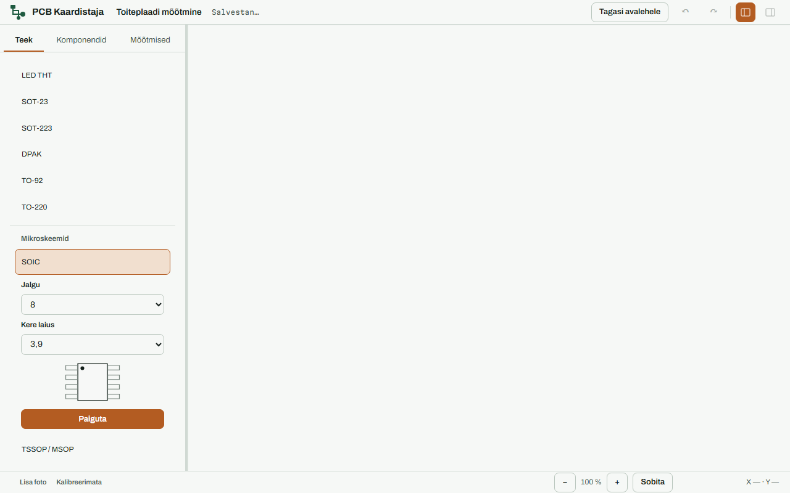
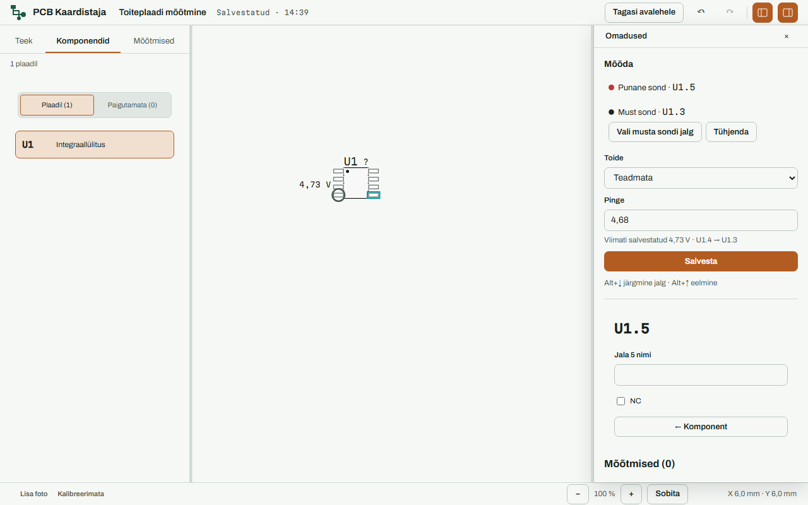
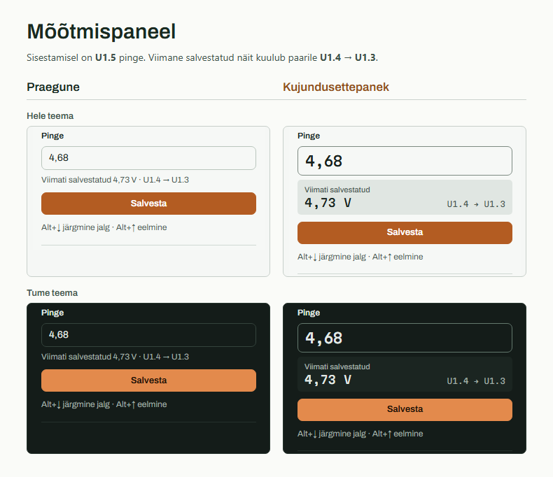
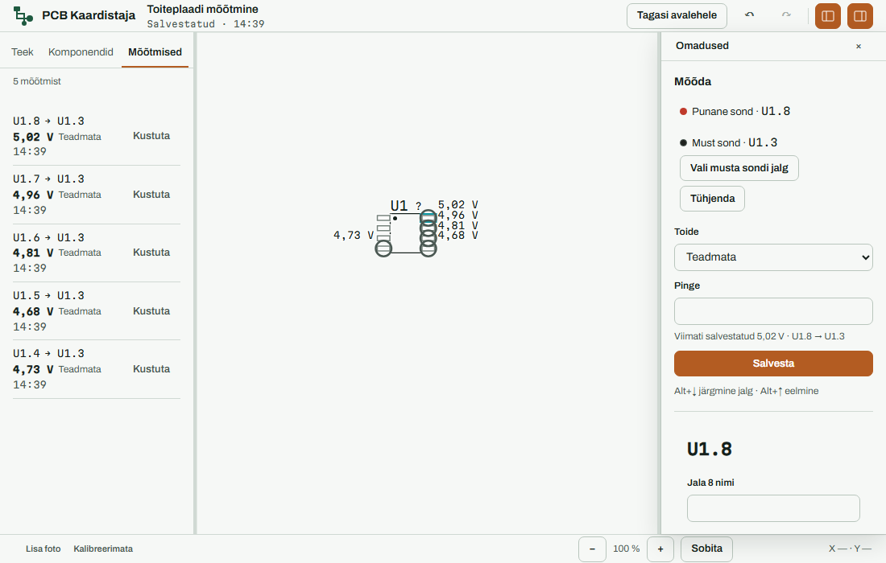

# BB tööpinna disainiülevaatus

15.11.2026 · `codex/m1-3` · `adc8fb4` · Product Design

**Muudaksin esimesena mõõtmispaneeli.** Praegu saab toite olek sama palju visuaalset kaalu kui arv, mida tehnik parajasti sisestab. Eelmise jala salvestatud näit on aga väikeses abitekstis. Olemasolev oranž põhitegevus, rahulik tööpind ja jalgade monokirjas tähised tasub alles hoida.

## 1. Korpuse valimine teegist

SOIC-i avamisel näeb kasutaja korpuse kuju, jalgade arvu ja kere laiust enne paigutamist. See on hea koht valiku kontrollimiseks. 40 kirje seast korpust otsides on suletud read valdavalt tekstinimed. Kuju järgi tuttavat korpust on nii raske pilguga üles leida.

**Ettepanek.** Katseta väikest pealtvaate siluetti kõige erinevamatel korpuseperekondadel. SOIC-il on jalad kahel küljel, QFP-l neljal ja pinnireal ühes reas. Kasuta olemasolevat padjandite geomeetriat. Täpne 120 × 72 px eelvaade jääb avatud kirjesse. Kontrolli, et pikem nimi mahuks ka 240 px navigaatorisse ja valitud rida oleks klaviatuuriga liikudes hõlpsasti leitav. Koodikohad on `Library.tsx`, `FootprintPreview.tsx` ja `components.css` kataloogis `packages/features/components/ui`.

## 2. Järgmise jala pinge sisestamine

Salvestasin paarile **U1.4 → U1.3** näidu **4,73 V**, valisin punase sondi uueks jalaks **U1.5** ja sisestasin **4,68**. BB säilitas vana näidu juures õige sondipaari. Samas on uus arv 14 px Archivo kirjas ja eelmine tulemus 12 px abitekstis. Tühja pingevälja raam eristub samavärvilisest paneelist mõlemas teemas kontrastisuhtega **1,66 : 1**.

**Ettepanek.** Kasuta sisestatava pinge jaoks olemasolevat Martian Monot suurusega 20 px. Anna viimasele salvestusele oma rida ning jäta arv ja selle sondipaar kõrvuti. Tugevda sisendite raami. Pildil proovitud raam annab heledas teemas **3,38 : 1** (`#7d8a82`) ja tumedas **3,67 : 1** (`#63786d`). W3C kasutab juhtelemendi äratundmiseks vajaliku visuaalse tunnuse puhul orientiirina 3 : 1. [W3C selgitus](https://www.w3.org/WAI/WCAG22/Understanding/non-text-contrast.html)

Võrdluse parempoolne variant kuvati kohalikus brauseris. 1100 × 700 aknas, 280 px omaduste paanil ja 240 px navigaatoriga mahtusid nii vorm kui ka tulemuserida laiusesse. Teostusel tuleb veel kontrollida tühja ja vigase väärtuse olekut ning klaviatuurifookust. Koodikohad on `packages/features/measurements/ui/MeasureBlock.tsx`, `measure-block.css` samas kaustas ning `packages/ui/src/kit/kit.css`.

## 3. Viie mõõtmise võrdlemine ajaloos

Kitsas navigaatoris jäid kõik viis näitu ja nende sondipaarid loetavaks. Iga rea paremas servas kordus „Kustuta“ ning kellaaeg murdus eraldi reale. Tehniku pilk peab leidma samast reast nii mõõtetulemuse kui ka kõrvaltegevuse.

**Ettepanek.** Anna pingele rea tugevaim kirjasuurus, näiteks 15 px tabulaarsete numbritega. Hoia sondipaar alati nähtaval ning toiteolek ja kellaaeg väiksemas kirjas. Proovi tekstnupu asemel püsivas kitsas veerus prügikastiikooni. Sellele kuuluvad nähtav klaviatuurifookus, kohtspikker ja mõõtmist nimetav ligipääsetav nimi. Võrdle sama viit rida 240 ja 300 px navigaatoris. Koodikohad on `packages/features/measurements/ui/MeasurementList.tsx` ja `measurement-list.css`.

## Üleandmine Claude’ile

Esimene kujundusotsus on punkti 2 mõõtmispaneel. Selle näidist saab kasutaja kohe võrrelda praeguse vaatega. Teegi siluetid ja ajaloo rea muudatus on eraldi proovimist vajavad ettepanekud.

Kõik kolm kuvatõmmist pärinevad selle ülevaatuse ajal käivitatud veebirakendusest ja sünteetilisest projektist. Mõõtevälja võrdlus sisaldab ka brauseris proovitud kujundust. Tauri akent, päris plaadi fotot ja ekraanilugejat selles ülevaatuses ei testitud. Lõuendil tähise ja mõõtenäidu kattumist käsitleb juba [M1-3-10](../tasks/M1-3-10.md).
