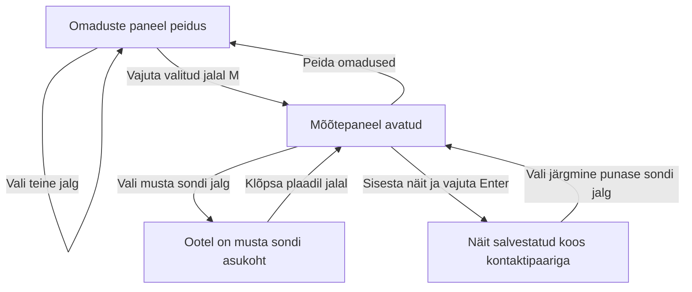
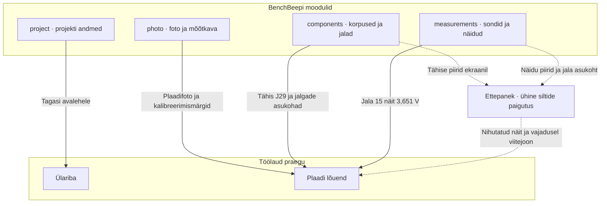

# M1.3 üleandmine Claude’ile · mõõtmine ja siltide paigutus

Esimene skeem kirjeldab tehniku mõõtmistöövoogu. Teine näitab, kuidas moodulite väljundid töölaual kokku saavad ja kus võiks lahendada J29 tähise ning mõõtenäidu kattumise. Koodi lähtekoht on haru `codex/m1-3` commit `adc8fb4`. Mõlemad skeemid on siin muudetava Mermaidi lähtekoodina.

## 1. Tehnik valib sondi ja salvestab näidu

**Kontrollnäide.** Vali punasele sondile U1.4 ja mustale U1.3. Sisesta `4,73` ja vajuta `Enter`. Vali järgmiseks punase sondi jalaks U1.5. Paneel peab korraga näitama uut asukohta **Punane sond · U1.5** ja eelmist tulemust **Viimati salvestatud 4,73 V · U1.4 → U1.3**. Skeem näitab mõlema sondiga mõõtmist. Musta sondi võib jätta määramata. [Paneeli käitumine](../tasks/M1-3-1.md) ja [sondide ning viimase näidu reeglid](../tasks/M1-3-3.md).

## 2. Moodulite vastutus ja J29 mõõtenäit

Pidev nool näitab praegust seost töölaual. Katkendlik nool näitab siltide paigutuse ettepanekut. Nooled kirjeldavad kuvatava info liikumist.

**Kust koodis alustada.** Komponendi tähise asukoht arvutatakse failis `packages/features/components/ui/layers/hits.ts` ja tekst joonistatakse samas kaustas failis `ComponentShape.tsx`. Mõõtenäidu teksti ning nihke määrab `packages/features/measurements/ui/layers/ReadingLabels.tsx`. Mõlemad kihid joonistab lõuend `packages/ui/src/canvas/Canvas.tsx`.

## Claude’ile · otsustuskoht M1-3-10 kaardi jaoks

**Vastuvõtutingimus on plaanis juba olemas.** 15-jalalise sünteetilise pistiku J29 jalal 15 mõõdeti 3,651 V. 100% suumil kattusid tähise „J29 ?“ ja näidu tekstikastid umbes 20 × 18 px. Pärast parandust peavad mõlemad olema korraga loetavad. Plaanis on selle jaoks testid `reading_label_avoids_own_ref_label` ja `j29_reading_does_not_overlap_ref_label`. [M1.3 plaani ülesanne 10 „Näit ja tähis eraldi“](../plans/M1-3-toopind-ja-korpused.md#ülesanded).

**Palun otsusta kaardi koostamisel**, kus võrrelda tähise ja näidu piire nii, et moodulid saaksid jääda teineteisest sõltumatuks. Ettepanek on jätta komponendi tähis tehniku valitud kohta ja nihutada kattuvat näitu ekraanikoordinaatides. Vajadusel seob lühike viitejoon näidu jalaga 15. Kontrolli sama juhtumit ka pööratud ja peegeldatud plaadivaates.
