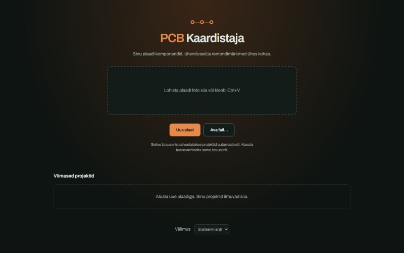
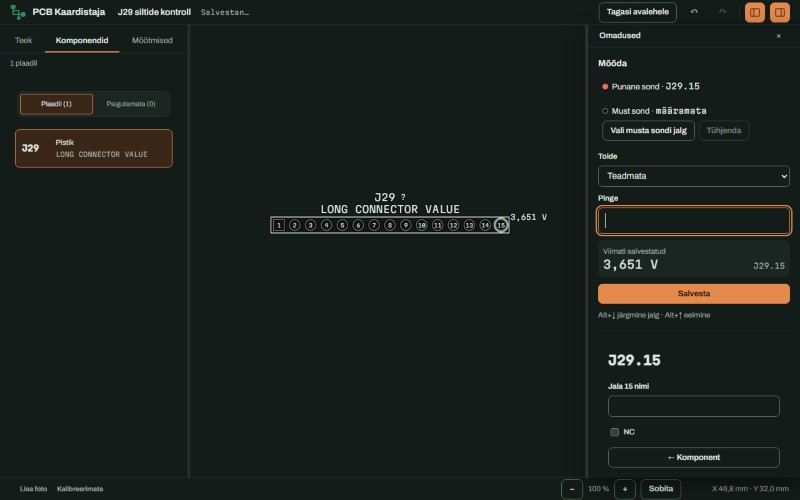
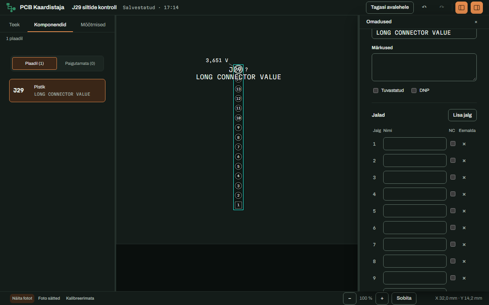
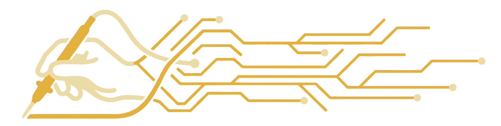
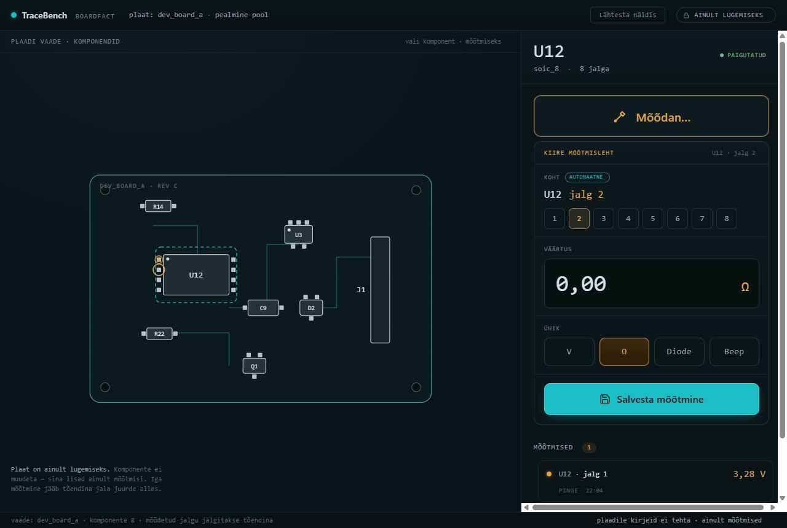

# BB töölaud algse BenchBeepi kõrval

17.11.2026 · BB v0.3.0 tootekood · põhiharu `2052025`

**Esimesena prooviksin algse BenchBeepi komponendi eelvaadet.** Kui tehnikul on sond ühel jalal ja ta otsib plaadilt teist komponenti, peaks ta saama asukohta vaadata pooleliolevat mõõtmist puutumata. Visuaalselt jätaksin BB-le praeguse rohelise tööpinna, vaskse tegevusnupu ja monokirjas näidud.

## Kolm hetke praegusel töölaual

1. **Ava BB esimest korda.** Avalehel on foto lohistamise ala, „Uus plaat“ ja „Ava fail…“ korraga näha. Päise kolme padjandiga märk meenutab plaadirada. Algse BenchBeepi sondi hoidev käsi seob sama kujundi kohe remonditööga.

   

2. **Vali J29 jalg 15 ja salvesta 3,651 V.** Valitud jalg on plaadil kontuuriga ja paremal on sama tähis. Pärast salvestamist on pingeväli järgmise näidu jaoks tühi. Selle all seisavad koos „Viimati salvestatud“, väärtus ja jala tähis. See on juba toimiv lahendus, mida tasub hoida.

   

3. **Vali komponent ja keri omadused jalgade tabelini.** Paremal on näha „Omadused“, muudetavad jalanimed ja NC-ruudud. Tähis J29 on endiselt vasakus loendis, kuid paremas päises seda pole. Kui loendis on mitu sarnast pistikut, tuleb enne jalanime muutmist vaadata tagasi üle plaadi.

   

## Mida algsest projektist üle võtta

| Järjekord | Algse BenchBeepi eeskuju | Ettepanek BB jaoks | Nähtav vastuvõtukatse |
| --- | --- | --- | --- |
| 1. Leia komponent valikut muutmata | Flutteri navigaator näitas komponendi rea kohal hiirt hoides selle ümber plaadil ajutist kontuuri. Klõps kinnitas valiku eraldi. | Näita „Plaadil“ loendi reale osutades või klaviatuuriga reale liikudes komponendi ümber ajutist kontuuri. Erista eelvaade valikust ka joone kuju järgi. | Sisesta U1.2 pingeväljale mustand. Osuta J29 reale ja korda Tab-klahviga. Leia J29 kontuuri järgi. Reast lahkudes kontuur kaob. Tagasi mõõteväljal salvestades läheb algne väärtus U1.2 juurde ja plaadi vaade püsib paigal. |
| 2. Hoia muudetava objekti nimi nähtaval | BoardFacti mõõtmislehel on paneeli ülaservas „U12“ ja mõõtmiskohas „U12 jalg 2“. | Kasuta olemasolevat päiserida. Komponendi puhul kuva „Omadused · J29“, jala puhul „Omadused · J29.15“. Valikuta kinnitatud sektsioonile sobib üldpealkiri. | Peida vasak loend ja keri J29 jalgade tabelini. Tähis peab olema loetav ka 280 px laiuses paneelis. Jala vahetamisel uueneb tähis samas kohas ja sulgemisnupp jääb kättesaadavaks. |
| 3. Anna avalehele BenchBeepi käekiri | Algse avalehe märgil läheb mõõtesondi juhe üle vaskradadeks. | Katseta praeguse kolme padjandi asemel lihtsustatud sondimotiivi BB vasevärvis. Jäta foto lisamine ja „Uus plaat“ senisele kohale. | Võrdle kahte avalehte heledas ja tumedas teemas 1100 × 700 aknas. Märk peaks olema sondina äratuntav ning foto lisamine ja projekti avamine kohe leitavad. |

**Algse projekti disainiallikad.** Sondimärk oli Flutteri avalehel kasutusel. Allolev U12 mõõtmisleht pärineb eraldi BoardFacti ideelaborist. Seal on näha nii aktiivse jala rõngas plaadil kui ka sama jala number paneelis.

## Tõendid ja töö piir

- BB pildid tulid selle ülevaatuse käigus sünteetiliselt plaadilt 1280 × 800 brauseriaknas. Kaks esimest on kordusjooksu salvestise kaadrid. Käsk `pnpm proof M1-3-10 --worktree .` läbis kõik neli juhtu. J29 automaatse tähise kattumine jalanumbritega oli kummaski teemas 0 px². Kolmandal pildil on tähis **pärast käsitsi lohistust**.
- Loendi eelvaate ettepanek põhineb kahe rakenduse koodivõrdlusel. BB rea klõps muudab valikut. Algse projekti juur on `C:/dev/TraceBench`. Seal saab käitumist kontrollida failist `lib/features/board_canvas/widgets/component_navigator.dart` ja testist `component hover previews only its visible placements` failis `test/widget/board_canvas_screen_test.dart`. BB vastavad kohad on [komponendiloend](../../packages/features/components/ui/ComponentList.tsx), [omaduste päis](../../packages/ui/src/shell/AppShell.tsx) ja [avaleht](../../packages/ui/src/shell/StartScreen.tsx).
- Teegi siluetid ja paneelide tihedus on juba [M1.4 plaanis](../plans/M1-4-suurus-joondus-joudlus.md). Siinsed kolm mõtet on kujunduskatsed. Tauri akent, päris plaadifotol töötamist ja ekraanilugejat see ülevaatus ei hõlmanud. Enne eelvaate otsust tasub esimese rea katse teha oma tiheda plaadifotoga.
