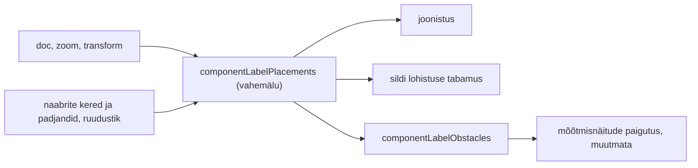

# M1-4-10 · Tihedus: sildid naabrite kõrval ja teegi siluetid

**Olek:** ehitamiseks · **Rada:** A · **Haru:** `codex/m1-4` (sama tööpuu) · **Alus:** `d909fe9` (M1-4-9) · **Plaan:** [M1.4 ülesanne 10](../plans/M1-4-suurus-joondus-joudlus.md#ülesanded)

## Eesmärk
Tihedal plaadil peab komponendi tähis ja väärtus olema loetav ega tohi katta naabri padjandeid. M1-3-11 suitsukatses jooksis pikk väärtus (näiteks 20 märki) väikesel suumil naaberkomponendi padjanditele. Põhjus oli selles, et automaatne silt hoiab eemale ainult oma kerest ja jalgadest. Nüüd valib automaatne silt esimese vaba külje, kus see ei puuduta ühegi komponendi keret ega padjandit.

Teegis tunneb tehnik korpuse ära kujust, mitte ainult nimest. Igal suletud teegireal on väike pealtvaate siluett, mis tehakse olemasolevast padjandite geomeetriast. Siluett mahub ka 240 px laiusesse navigaatorisse ja rida ei lähe kõrgemaks ([disainiülevaatus, punkt 1](../review/2026-11-15-m1-3-disaini-ulevaatus.md)).

## Loe (ainult need)
Loe tööpuust (`d909fe9`), sest M1.4 muudatusi pole veel `main`-is. Rea numbrid on tööpuu järgi.
- `packages/features/components/ui/layers/hits.ts:10-90` (`defaultLabelOffset`, `componentLabelLayout`, `componentLabelBox`; sildi lohistuse tabamus ja `componentLabelObstacles` on samas failis allpool)
- `packages/features/components/ui/layers/ComponentShape.tsx:78-112` (sildi joonistus)
- `packages/features/components/ui/Library.tsx:136-170` (teegi read)
- `packages/features/components/ui/FootprintPreview.tsx:1-60` (`previewViewBox`, 120 × 72 eelvaade)
- `apps/web/e2e/m1-3-navigator.spec.ts:40-60` (navigaatori laius 240 px brauseritestis)

## Muuda
- `packages/features/components/ui/layers/`:
  - uus `label-placement.ts` ja selle test;
  - `hits.ts` (sildi kast, lohistuse tabamus ja takistused tulevad ühisest paigutusest);
  - `ComponentShape.tsx` ja `ComponentsLayer.tsx` (joonistus kasutab sama paigutust).
- `packages/features/components/ui/`:
  - `FootprintPreview.tsx`: uus väike siluett, sama `previewViewBox`;
  - `Library.tsx` ja `components.css`: siluett teegireal;
  - `OwnPinHint.tsx` ja `Library.tsx` (`AnchoredPlacementActions`): tekstisisesed stiilid CSS-klassideks (M1-4-9 märkus 2).
- `apps/web/e2e/`: uus `m1-4-density.spec.ts`.
- `pnpm api`, kui avalik liides muutub.

## Ära puutu
- Mõõtmisnäitude paigutus (`reading-placement.ts`) ja takistuste kanali liides (`LayerSpec.obstacles`, `LabelObstacle`). Vt otsus 3.
- Kasutaja lohistatud silt (`board.labelOffset` on olemas): selle koht ei muutu.
- Mootor, käsud, skeem ja failivorming.
- Paneelide mõõdud (fondid, nupud ja vahed). Kasutaja vaatab need üle ülesande 11 oma foto katses ([M1.2 plaani märge](../plans/M1-2-foto-ja-kalibreerimine.md)).

## Otsused ja liidesed
1. **Ühine sildipaigutus.**
   - Uus funktsioon `componentLabelPlacements(doc, zoom, transform): ReadonlyMap<string, ComponentLabelBox>`. `ComponentLabelBox` on praeguse `componentLabelBox`-i tulemus: `at`, `offset`, `textSize`, `valueAt` ja `box`.
   - Tulemus arvutatakse üks kord sama `doc`-i, `zoom`-i ja `transform`-i kohta (vahemälu). Seda kasutavad joonistus, sildi lohistuse tabamus ja `componentLabelObstacles`. Kõik kolm näevad silti samas kohas.
   - Sildi lohistus algab valitud kohast ja salvestab `labelOffset`-i nagu praegu.
   - Komponendi lohistamise eelvaates liigub silt koos komponendiga. Paigutus arvutatakse uuesti alles pärast käsku.
2. **Külje valik.** Kehtib ainult siis, kui `labelOffset` puudub.
   - Kandidaadid on ekraani suunas järjekorras:
     1. üleval (praegune `defaultLabelOffset`);
     2. all (sama vahe oma kere ja padjandite alumisest servast);
     3. paremal;
     4. vasakul.
   - Paremal ja vasakul asetseb sildikasti serv oma kere ja padjandite servast sama `1 / zoom` vahega nagu üleval.
   - Kandidaat sobib, kui selle `box` ei kattu ühegi paigutatud komponendi (ka oma) kere ega padjandi ekraanijoondatud ümbriskastiga.
     - Kere kast tuleb `bodyOutline`-ist.
     - Padjandi kast tuleb `boardPads`-ist ja on vähemalt `2,5 / zoom` pool-laiusega, nagu `defaultLabelOffset`-is.
   - Valitakse esimene sobiv kandidaat. Kui ükski ei sobi, jääb silt üles nagu praegu.
   - Naabrid leitakse ruudustikust, et suure plaadi arvutus jääks ligikaudu lineaarseks. Ühe sildi jaoks ei tohi läbi käia kõiki komponente.
3. **Takistuste kanal jääb samaks.**
   - `componentLabelObstacles` annab edasi ainult sildikastid, nüüd valitud kohas. Seetõttu hoiavad mõõtmisnäidud eemale ka ümberpaigutatud sildist.
   - Kerede ja padjandite lisamine kanalisse muudaks ka mõõtmisnäitude paigutust. Peene sammuga IC-l poleks näidule vaba kohta ja see läheks juhtjoonega kaugele.
   - Plaani sõnastus („kanal saab kered ja padjandid“) täidetakse siin komponendi sildi poolel. Näitude käitumine jääb M1-3 järgi.
4. **Siluett teegireal.**
   - Igal teegireal on nime ees `svg` mõõdus 28 × 18 px, `aria-hidden="true"`, `data-silhouette=""`. See tehakse kirje vaikeparameetrite `footprintGeometry`-st ja `previewViewBox`-iga.
   - Siluett arvutatakse kirje kohta üks kord (mooduli tasemel vahemälu).
   - Värvid tulevad tokenitest: keha on joon, padjandid on täidetud.
   - Pinnirida, SOIC ja QFP erinevad padjandite arvu ja paigutuse poolest. Punktikirjetel (testpunkt, via, padjand) on üks padjand ja kirjel „Tundmatu komponent“ ainult keha.
   - Rida ei lähe kõrgemaks: 18 px siluett mahub olemasolevasse ritta. Nimi jääb ühele reale ka 240 px navigaatoris.
   - Avatud kirjes jääb 120 × 72 eelvaade valitud parameetritega.
   - Klaviatuuriga liikudes on fookuses olev rida nähtava fookusjoonega.
5. **Stiilid CSS-i.**
   - `OwnPinHint`-i veavärv tuleb klassist või `data-error` atribuudist.
   - `AnchoredPlacementActions`-i ruudustik tuleb klassist failis `components.css`.
   - Nähtav tulemus ei muutu.
6. **Jõudlus.** Lõuendi muutuse järel käivita `pnpm proof` ja kirjuta üleandmisse panoraami, suumi ja lohistuse fps ning suumi rahunemise aeg. Viimased tulemused: lohistus 50 fps (M1-4-3), rahunemine 67 ms (M1-4-3b). Kui mõni näit on üle 10 % halvem, peatu ja kirjelda põhjust.

## Tõend
- TS:
  - `long_value_avoids_neighbour_component`: U1 (SOIC-8, väärtus `STM32F103C8T6 LQFP48`) ja selle kohal R1 on nii lähestikku, et praegune ülemine silt kataks R1 padjandeid. U1 silt läheb alla ja selle kast ei kattu ühegi kere ega padjandiga. Kui kõik neli külge on kinni, jääb silt üles. Komponendil, millel on `labelOffset`, jääb silt samaks. Joonistatud tähise koordinaadid, sildi lohistuse tabamus ja `componentLabelObstacles`-i kast on samas kohas.
- E2E:
  - `library_rows_show_silhouettes_at_240px`: navigaatori laius on 240 px. Kõigil 41 teegireal on 28 × 18 px siluett rea piires ja nimi on ühel real. SOIC-i, QFP ja pinnirea siluettides on erinev arv padjandeid. Tab viib fookuse reale ja fookusjoon on nähtav. Avatud kirjes on 120 × 72 eelvaade.
- Senised siltide brauseritestid (`m1-3-labels.spec.ts`) jäävad roheliseks.
- Põhikaustast `pnpm bb-review-card M1-4-10`. Lisa üleandmisse kaks ekraanipilti sünteetilisest projektist: tihe plaat, kus pikk väärtus on naabri kõrval vabal küljel, ja 240 px teek siluettidega.

## Valmis kui
- [ ] Testid ja käsud läbivad.
- [ ] `pnpm proof` tulemused on üleandmises.
- [ ] Üleandmises on kaks ekraanipilti.
- [ ] Üleandmine on allpool, kuni 15 rida.

## Üleandmine
