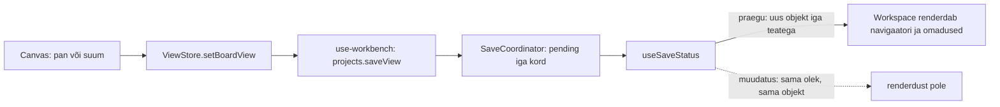

# M1-4-1b · Vaate muutus ei renderda kesta paneele

**Olek:** vajab parandust (punkt 0) · **Rada:** A · **Haru:** `codex/m1-4` (sama tööpuu) · **Alus:** `09383e4` (M1-4-1) · **Plaan:** [M1.4 ülesanne 1b](../plans/M1-4-suurus-joondus-joudlus.md#ülesanded) · **Allikas:** koodi ülevaatus 2026-11-17 (`main` `e4ca06a`)

## Eesmärk
Iga pani- ja suumikaader renderdab praegu kogu kesta: navigaatori ja omaduste paneeli koos nende loenditega. Põhjus on salvestuse olekuteade, mitte lõuend. Pärast muudatust ei renderda vaate muutus ühtegi paneeli. Olekuriba muutub ainult siis, kui salvestuse olek päriselt muutub.

Tõend `main`-is (`e4ca06a`, arhitekti ajutine jsdom-test): 30 `setBoardView` kutset andsid 30 `pending` teadet ja 30 navigaatori paneeli renderdust; dokumendi `rev` ei muutunud. [M1-4-1](M1-4-1.md) algprofiilis oli ühe rattasündmuse žestifaasis Script 35 ms. Kui suur osa sellest on kesta renderdus, on mõõtmata.

## Loe (ainult need)
- `packages/client/src/use-save-status.ts:1-42` (terve fail)
- `packages/engine/src/save-coordinator.ts:79-93` (`schedule` avaldab iga muutusega `pending`)
- `packages/ui/src/app/use-workbench.ts:166-177` (vaate tellimus kutsub `projects.saveView`)
- `packages/ui/src/shell/AppShell.tsx:213-221` (`Workspace` kasutab `useSaveStatus`-t)
- `apps/web/src/test-support/workbench.tsx:55-93` (`mount`, `seedProject`, `openWorkbenchProject`)

## Muuda
- `packages/client/src/use-save-status.ts` ja `packages/client/src/client.test.tsx`.
- `apps/web/src/workbench-view.test.tsx` (üks uus test).

## Ära puutu
- `packages/engine/src/save-coordinator.ts` ja `project-service.ts` (kaitstud salvestuspind). Teadete voog jääb samaks.
- `packages/ui/src/canvas/` (M1-4-1 ulatus) ja `use-workbench.ts` vaate tellimus.
- `SaveStatus` tüüp ja `@pcbk/client` avalik liides. `docs/api` ei tohi muutuda.

## Otsused ja liidesed
- **Sama teade ei muuda olekut.** `useSaveStatus` võrdleb saabunud teadet hoitava kirjega. Kui `engine`, `projects`, `sessionId` ja olek on samad, tagastab `setEntry` uuendaja **sama objekti** ja React ei renderda.
- **Oleku võrdsus** on failisisene abifunktsioon `sameStatus(a, b)`, mida ei ekspordita:
  - `state` on sama;
  - `saved` korral on samad ka `rev` ja `at`;
  - `error` korral on sama `reason`.
- Olemasolevad reeglid jäävad: vana seansi teade ja vanema `rev`-iga `saved` teade jäetakse kõrvale; seansi vahetus annab kohe `pending`.
- Esimene vaate muutus pärast salvestatud olekut tohib renderdada ühe korra (`saved` → `pending`). Järgmised kaadrid ei renderda.
- Mootor avaldab teateid edasi iga muutusega. Seda ei muudeta: teate hind on väike ja salvestuspind on kaitstud.

## Skeem

## Tõend
- TS (`client.test.tsx`):
  - `repeated_identical_status_notice_does_not_rerender`: kolm järjestikust `pending` teadet annavad tarbijale ühe renderduse.
  - `changed_status_notice_still_rerenders`: `pending` → `saving` → `saved` (uus `rev`) → `error` renderdab iga kord; sama `saved` teade teist korda ei renderda.
- TS (`workbench-view.test.tsx`):
  - `pan_frames_do_not_rerender_shell_panels`: päris `createRuntime`, avatud projekt ja proovimoodul, mille navigaatori vahekaart loeb renderdusi. 30 `useViewStore.getState().setBoardView(...)` kutset eri `pan`-iga annavad paneelile **kõige rohkem ühe** renderduse ja `rev` ei muutu.
- Olemasolevad `client.test.tsx`, `workbench-*.test.tsx` ja e2e `board_zoom_pan_survive_view_only_close_and_reopen` läbivad muutmata.
- Põhikaustast `pnpm bb-review-card M1-4-1b`.

## Valmis kui
- [x] Testid ja käsud läbivad; `docs/api` ei muutu.
- [x] Üleandmises on RED-tõend: `pan_frames_do_not_rerender_shell_panels` kukub enne muudatust (oodatav 30 renderdust).
- [x] Üleandmine on allpool, kuni 15 rida.

## Küsimus arhitektile

Tööpuu `C:/Users/TRUMPIT/.codex/worktrees/bb-m1-4/BB` harul `codex/m1-4` on commit’il `3953382` ja sisaldab M1-4-1 commit’imata muudatusi. M1-4-1 kaardi päises on „sobib (ootab commit'i)“ ning `3953382` on seal märgitud alusena.

Milline on M1-4-1 vastuvõetud commit’i räsi, millel peab puhas `codex/m1-4` tööpuu enne M1-4-1b alustamist olema?

## Arhitekti vastus ehitajale (2026-11-17)

M1-4-1 vastuvõetud commit on `09383e4`. See on push'itud ja harul `codex/m1-4` on nüüd HEAD. Alusta puhtast tööpuust sellelt commit'ilt.

## Arhitekti lisa: punkt 0, CI parandus (2026-11-17)

Haru `codex/m1-4` CI kukkus commit'il `09383e4` (jooks 44157071337, samm `coverage`). Test `probe base zoom keeps every actual pad number visible throughout the zoom wave` (`apps/desktop/src/perf/probe-fixes.test.ts:148`) kestis CI katvusega 5966 ms ja ületas 5000 ms piiri. Kohalikult läbis see sama piiri all. Tooteviga see ei ole. Sama juhtus M1-3-10c-ga ja parandati M1-3-11 punktis 0.

Tee see kõigepealt; see võib olla sama üleandmise osa:
- Ehita proovidokument korraga: sünteetilise plaadi komponendid lähevad otse `host.load`-i dokumenti. Ära kutsu 300 korda `engine.execute('components.add', …)`.
- Renderda ainult laine madalaim suum (`zoom * 0.85`). Jalanumbrite nähtavus ainult kasvab suumiga, seega `1` ja `1.15` ei lisa tõendit. Väide jääb samaks: kõik 3300 numbrit on nähtavad.
- Testi ajapiiri ei tõsteta. Üleandmisse kirjuta testi kestus kohalikult `pnpm coverage` all.
- Testi nimi ja väide jäävad samaks; `bb-review-card M1-4-1b` kontrollib seda koos kaardi testidega.

## Üleandmine

- Tööpuu `C:/Users/TRUMPIT/.codex/worktrees/bb-m1-4/BB`, haru `codex/m1-4`. Alustades oli tööpuu puhas ja HEAD vastas M1-4-1 vastuvõetud commit’ile `09383e4`.
- `useSaveStatus` jätab sama mootori, projektiteenuse ja seansi korduva olekuteate korral senise kirje alles. Uus `rev`, `at` või vea `reason` jõuab tarbijani.
- RED enne tootekoodi muudatust: `pan_frames_do_not_rerender_shell_panels` andis 30 kaadriga **30 renderdust**, ootus ≤ 1. Dokumendi `rev` jäi samaks. Tööpuu logi `output/playwright/m1-4-1b/pan-shell-red.log`.
- GREEN: sama katse läbis piiriga ≤ 1 renderdust. Ka mõlemad olekuteadete katsed läbisid. Tööpuu logi `output/m1-4-1b/green-targeted.log`.
- Põhikausta `pnpm bb-review-card M1-4-1b` läbis kõik kontrollid. **1487/1487** Vitest, **38/38** e2e ja **3/3** kaardikatset. Vaate salvestamise ja taasavamise test läbis. Kokkuvõte `output/review-card/M1-4-1b-bpyC1e/summary.json`.
- Muudetud on ainult kaardil lubatud kolm faili. Kaitstud salvestuspinna, lõuendi, avaliku liidese ja `docs/api` diff on tühi.

## Arhitekti ülevaatus (2026-11-17)

**Mida kontrollisin**
- **Kood.** `use-save-status.ts`: `sameStatus` on failisisene. `setEntry` uuendaja tagastab sama kirje, kui mootor, projektiteenus, seanss ja olek on samad. Seansi- ja `rev`-filtrid jäid samaks. Muudetud on ainult kolm lubatud faili. Salvestuse vastutaja, lõuendi ja `docs/api` diff on tühi.
- **Test.** `pan_frames_do_not_rerender_shell_panels` kasutab päris `createRuntime`-i ja proovimooduli paneeli: 30 `setBoardView` kutset, `rev` jääb samaks, renderdusi on kuni 1. Kõik kolm kaardi testi on olemas.
- **Põhikaustast `pnpm bb-review-card M1-4-1b`:** kõik läbis (`M1-4-1b-YmDvbU`). Vitest 1487/1487, e2e 38/38, kaardi testid 3/3. Katvus: read 100 %, harud 99,25 %.
- **Brauser.** UI-s nähtavat muudatust pole, seega jäi brauserikatse ära.

**Otsus: vajab parandust.** Kaardi M1-4-1b osa sobib.
1. Punkt 0 (CI parandus) on tegemata: `probe-fixes.test.ts` diff on tühi. Punkt lisati kaardile alles pärast ehituse algust. Tõend: punkti 0 test kestab kohalikult `pnpm coverage` all selgelt alla 5000 ms ja kestus on üleandmises kirjas. Lisaks läbib `pnpm bb-review-card M1-4-1b`.
