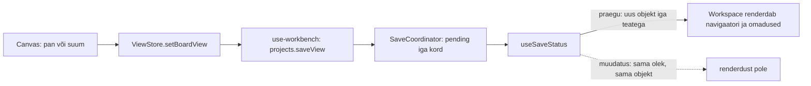

# M1-4-1b · Vaate muutus ei renderda kesta paneele

**Olek:** ehitamiseks (pärast M1-4-1 vastuvõttu) · **Rada:** A · **Haru:** `codex/m1-4` (sama tööpuu) · **Alus:** M1-4-1 vastuvõetud commit · **Plaan:** [M1.4 ülesanne 1b](../plans/M1-4-suurus-joondus-joudlus.md#ülesanded) · **Allikas:** koodi ülevaatus 2026-11-17 (`main` `e4ca06a`)

## Eesmärk
Iga pani- ja suumikaader renderdab praegu kogu kesta: navigaatori ja omaduste paneeli koos nende loenditega. Põhjus on salvestuse olekuteade, mitte lõuend. Pärast muudatust ei renderda vaate muutus ühtegi paneeli. Olekuriba muutub ainult siis, kui salvestuse olek päriselt muutub.

Tõend `main`-is (`e4ca06a`, arhitekti ajutine jsdom-test): 30 `setBoardView` kutset andsid 30 `pending` teadet ja 30 navigaatori paneeli renderdust; dokumendi `rev` ei muutunud. [M1-4-1](M1-4-1.md) algprofiilis oli ühe rattasündmuse žestifaasis Script 35 ms. Kui suur osa sellest on kesta renderdus, on mõõtmata.

## Loe (ainult need)
- `packages/client/src/use-save-status.ts:1-42` (terve fail)
- `packages/engine/src/save-coordinator.ts:79-93` (`schedule` avaldab iga muutusega `pending`)
- `packages/ui/src/app/use-workbench.ts:166-177` (vaate tellimus kutsub `projects.saveView`)
- `packages/ui/src/shell/AppShell.tsx:213-221` (`Workspace` kasutab `useSaveStatus`-t)
- `apps/web/src/test-support/workbench.tsx:55-93` (`mount`, `seedProject`, `openWorkbenchProject`)

## Muuda
- `packages/client/src/use-save-status.ts` ja `packages/client/src/client.test.tsx`.
- `apps/web/src/workbench-view.test.tsx` (üks uus test).

## Ära puutu
- `packages/engine/src/save-coordinator.ts` ja `project-service.ts` (kaitstud salvestuspind). Teadete voog jääb samaks.
- `packages/ui/src/canvas/` (M1-4-1 ulatus) ja `use-workbench.ts` vaate tellimus.
- `SaveStatus` tüüp ja `@pcbk/client` avalik liides. `docs/api` ei tohi muutuda.

## Otsused ja liidesed
- **Sama teade ei muuda olekut.** `useSaveStatus` võrdleb saabunud teadet hoitava kirjega. Kui `engine`, `projects`, `sessionId` ja olek on samad, tagastab `setEntry` uuendaja **sama objekti** ja React ei renderda.
- **Oleku võrdsus** on failisisene abifunktsioon `sameStatus(a, b)`, mida ei ekspordita:
  - `state` on sama;
  - `saved` korral on samad ka `rev` ja `at`;
  - `error` korral on sama `reason`.
- Olemasolevad reeglid jäävad: vana seansi teade ja vanema `rev`-iga `saved` teade jäetakse kõrvale; seansi vahetus annab kohe `pending`.
- Esimene vaate muutus pärast salvestatud olekut tohib renderdada ühe korra (`saved` → `pending`). Järgmised kaadrid ei renderda.
- Mootor avaldab teateid edasi iga muutusega. Seda ei muudeta: teate hind on väike ja salvestuspind on kaitstud.

## Skeem

## Tõend
- TS (`client.test.tsx`):
  - `repeated_identical_status_notice_does_not_rerender`: kolm järjestikust `pending` teadet annavad tarbijale ühe renderduse.
  - `changed_status_notice_still_rerenders`: `pending` → `saving` → `saved` (uus `rev`) → `error` renderdab iga kord; sama `saved` teade teist korda ei renderda.
- TS (`workbench-view.test.tsx`):
  - `pan_frames_do_not_rerender_shell_panels`: päris `createRuntime`, avatud projekt ja proovimoodul, mille navigaatori vahekaart loeb renderdusi. 30 `useViewStore.getState().setBoardView(...)` kutset eri `pan`-iga annavad paneelile **kõige rohkem ühe** renderduse ja `rev` ei muutu.
- Olemasolevad `client.test.tsx`, `workbench-*.test.tsx` ja e2e `board_zoom_pan_survive_view_only_close_and_reopen` läbivad muutmata.
- Põhikaustast `pnpm bb-review-card M1-4-1b`.

## Valmis kui
- [ ] Testid ja käsud läbivad; `docs/api` ei muutu.
- [ ] Üleandmises on RED-tõend: `pan_frames_do_not_rerender_shell_panels` kukub enne muudatust (oodatav 30 renderdust).
- [ ] Üleandmine on allpool, kuni 15 rida.

## Üleandmine
