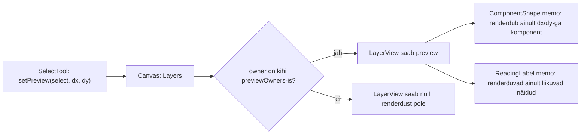

# M1-4-3 · Lohistamisel renderdub ainult liigutatav komponent

**Olek:** ehitamiseks · **Rada:** A · **Haru:** `codex/m1-4` (sama tööpuu) · **Alus:** `7fb0de2` (M1-4-H) · **Plaan:** [M1.4 ülesanne 3](../plans/M1-4-suurus-joondus-joudlus.md#ülesanded)

## Eesmärk
[M1-2-7](M1-2-7.md) mõõtis Tauri aknas komponendi lohistamiseks 22 fps. Eelarve on vähemalt 45 fps ([03 § 7.3](../03-arhitektuur.md#73-kihid-ja-jõudlus)). Lohistamine annab igal hiireliigutusel uue `preview`. `Canvas` annab selle kõigile kihtidele, nii et iga kaader renderdab kõik kihid uuesti. Näitude kiht joonistab seejuures kõik näidud (proovis 1500) uuesti, kuigi liiguvad ainult lohistatava komponendi omad.

Pärast muudatust renderduvad lohistamise ajal ainult lohistatava komponendi kere, jalad, sildid ja näidud. Teised komponendid, näidud ja kihid ei renderdu.

## Loe (ainult need)
- `packages/ui/src/canvas/Canvas.tsx:35-50` (`Layers` annab `preview` kõigile kihtidele)
- `packages/ui/src/canvas/tools.ts:47-53` (`LayerSpec`)
- `packages/features/components/ui/layers/ComponentsLayer.tsx:82-139` (eelvaate omanikud: `select`, tähise lohistus, paigutus)
- `packages/features/measurements/ui/layers/ReadingLabels.tsx:14-125` (paigutus on `useMemo`-s, iga näidu `<g>` renderdub iga kaadriga)
- `apps/desktop/src/perf/probe-input.ts:31-60` (proovi lohistus, `dragComponent`)

## Muuda
- `packages/ui/src/canvas/Canvas.tsx` ja `tools.ts`, `packages/features/components/ui/layers/index.ts` ning `packages/features/measurements/ui/layers/ReadingLabels.tsx`, koos testidega.
- `apps/desktop/src/perf/probe-input.ts`: lohistuse algpunkti kontroll võtab piirid SVG nähtavast konteinerist (`svg.parentElement`), mitte servapuhvriga SVG-st. Sama parandus tehti J29 tõendis.
- `pnpm api` (`LayerSpec` on avalik liides) ja [03 § 7.3](../03-arhitektuur.md#73-kihid-ja-jõudlus) lause eelvaate kohta.

## Ära puutu
- `SelectTool` žest ja käsud: vabastamisel jääb täpselt üks `items.translate`. `Esc` ja `pointercancel` ei jäta jälge.
- Tabamuste indeks, siltide takistused, LOD ja rahunemine (ülesanne 3b), `use-canvas-view.ts` (M1-4-1).
- Failivorming, salvestus ja mootor.

## Otsused ja liidesed
- **Profiil kõigepealt.** Tee enne muudatust üks WebView2 profiil ühest lohistusest sama prooviga. Kui suurim kulu pole Reacti renderdus (Script), peatu ja küsi arhitektilt.
- **Kiht ütleb, milliseid eelvaateid ta vajab.** `LayerSpec` saab välja `previewOwners?: readonly string[]`. `Canvas` annab kihile `preview` ainult siis, kui eelvaate `owner` on selles loendis. Muul juhul saab kiht `null`-i. Kui väli puudub, ei saa kiht eelvaadet üldse.
- **Iga kiht on oma memo-komponent.** `Layers` renderdab iga kihi eraldi `memo` komponendina (`LayerView`, failisisene). Selle props on `layer`, `snapshot`, filtreeritud `preview` ja `zoom`. Kiht, mille sisend ei muutunud, ei renderdu.
- **Deklaratsioonid:**
  - `components.bodies`: `select` ja paigutuse tööriist (`PLACE_TOOL_ID`);
  - `components.pins`: `select`;
  - `components.labels`: `select` ja tähise lohistus (`LABEL_DRAG_OWNER`);
  - `measurements.readings`: `select`;
  - fotokihid: ei vaja eelvaadet.
- **Näit on oma memo-komponent.** `ReadingLabels` renderdab iga näidu failisisese `memo` komponendina (`ReadingLabel`), mille props on paigutuse kirje ning `dx` ja `dy`. Paigutuse `useMemo` jääb eelvaatest sõltumatuks, nagu praegu.
- `ComponentShape` on juba `memo`. Kontrolli, et lohistamata komponendi props jäävad samaks (`dx = 0`, sama `component` objekt).

## Skeem

## Tõend
- TS:
  - `drag_preview_rerenders_only_dragged_group`: 20 komponendiga dokumendis, 10 eelvaate kaadri jooksul renderdub ainult lohistatava komponendi `ComponentShape` (kere, jalad, sildid); teiste renderdusi on 0.
  - `drag_preview_rerenders_only_dragged_readings`: renderduvad ainult lohistatava komponendi näidud; paigutust ei arvutata uuesti (`placeReadingLabel` kutsete arv ei kasva).
  - `layer_without_preview_owner_gets_null_preview`: kiht ilma `previewOwners`-ita saab `null`-i ega renderdu eelvaate muutudes.
- Olemasolevad lohistamise, `Esc`-i ja `pointercancel`-i testid läbivad muutmata.
- Natiivne proov (sama mis M1-4-1, 180 kaadrit): lohistus enne ja pärast, **värav ≥ 45 fps**. Pan ja suum ei lange alla 55 fps.
- Põhikaustast `pnpm bb-review-card M1-4-3`.

## Valmis kui
- [ ] Testid ja käsud läbivad, `docs/api` on uuendatud.
- [ ] Üleandmises on profiil ning lohistuse, pani ja suumi enne/pärast mõõt.
- [ ] Üleandmine on allpool, kuni 15 rida.

## Üleandmine
