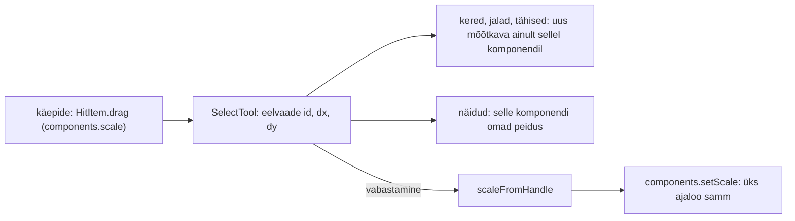

# M1-4-5 · Komponendi suurus käepidemete ja numbritega

**Olek:** ehitamiseks · **Rada:** A · **Haru:** `codex/m1-4` (sama tööpuu) · **Alus:** `dde0424` (M1-4-3b) · **Plaan:** [M1.4 ülesanne 5](../plans/M1-4-suurus-joondus-joudlus.md#ülesanded)

## Eesmärk
Teegi korpus ei kattu alati foto omaga: foto pole täpselt ülalt pildistatud või korpus on mittestandardne. Praegu saab tehnik komponenti pöörata ja liigutada, aga mitte suurust muuta. Pärast muudatust on valitud komponendil 8 käepidet ja omaduste paneelis on mõõtkava väljad X ja Y. Väli `BoardPlacement.scaleX`/`scaleY` on skeemis juba olemas (0,2–5) ja `boardPads` arvestab seda, seega failivorming ei muutu.

## Loe (ainult need)
- `packages/features/components/engine/commands.ts:212-239` (käskude muster: `rotate`, `setLabelOffset`)
- `packages/features/components/ui/layers/hits.ts:130-165` (`HitItem.drag`: tähise lohistus ja `commit`)
- `packages/ui/src/canvas/SelectTool.ts:84-110` (lohistuse eelvaade `{ owner, data: { id, dx, dy } }` ja vabastamine)
- `packages/features/components/ui/PlacementSection.tsx:35-75` (Korpus ja asend)
- `packages/domain/src/geometry/board.ts:8-20` (kohalik → plaat koos `scaleX`/`scaleY`, pöörde ja poolega)

## Muuda
- `packages/features/components/`: `contract.ts`, `engine/commands.ts`, uus käepidemete kiht ja selle tabamused (`ui/layers/`), `ui/layers/ComponentsLayer.tsx` (suuruse eelvaade), `ui/PlacementSection.tsx`, tekstid `ui/i18n/et.ts`, testid.
- `packages/features/measurements/ui/layers/ReadingLabels.tsx`: suuruse eelvaate ajal on selle komponendi näidud peidus.
- [05](../05-moodulid.md) komponentide käskude loend: `components.setScale`.
- `pnpm api`.

## Ära puutu
- `packages/ui/src/canvas/Canvas.tsx` (401 rida) ja `SelectTool.ts`. Käepidemed kasutavad olemasolevat `HitItem.drag` kanalit.
- Skeem (`BoardPlacement`), failivorming ja migratsioonid. Kahe jala joondus on ülesanne 6.

## Otsused ja liidesed
- **Käsk** `components.setScale { id, scaleX, scaleY }`. Skeem lubab vahemikku 0,2–5 ja nõuab paigutatud komponenti (`placedBoard`). Käsk muudab ainult `scaleX` ja `scaleY`; kese, pööre ja pool jäävad samaks. See on üks ajaloo samm.
- **Puhas funktsioon** `scaleFromHandle(board, handle, delta, pxPerMm): { scaleX, scaleY }` (failis `ui/layers/scale-handles.ts`).
  - `handle` on üks väärtustest `n`, `ne`, `e`, `se`, `s`, `sw`, `w`, `nw`.
  - Lohistuse nihe pööratakse komponendi kohalikku teljestikku, arvestades pööret ja alumist poolt.
  - Suurus muutub keskme ümber.
  - **Nurk** muudab mõlemat telge sama teguriga (proportsioon säilib).
  - **Külg** muudab ainult oma telge.
  - Tulemus piiratakse vahemikku 0,2–5.
- **Käepidemete kiht** `components.handles` (z 90) näitab käepidemeid ainult siis, kui valitud on täpselt üks paigutatud komponent. Käepide on ekraanil 8 px ruut, sõltumata suumist. Tabamuse prioriteet on kõrgem kui kerel ja tähisel. `HitItem.drag.owner` on `components.scale`, `id` on `<komponendi id>:<käepide>` ja `commit` kutsub `components.setScale`.
- **Eelvaade.** Kered, jalad ja tähised lisavad `previewOwners`-isse `components.scale` ja joonistavad lohistatava komponendi uue mõõtkavaga. Teiste komponentide sisend ei muutu (M1-4-3 reegel). Näitude kiht lisab samuti `components.scale` ja peidab eelvaate ajaks selle komponendi näidud. Pärast vabastamist ilmuvad need uute padjandite juures.
- **Väljad** „Mõõtkava X“ ja „Mõõtkava Y“ asuvad Korpus ja asend plokis.
  - Väärtus kinnitub Enteri või fookuse lahkumisega ühe `components.setScale` käsuga.
  - Koma ja punkt on võrdsed (olemasolev `decimalValue` muster).
  - Vahemikust väljas olev väärtus piiratakse vahemikku 0,2–5 ja väli näitab piiratud väärtust.
  - Tühi või vigane sisend taastab eelmise väärtuse ega anna käsku.

## Skeem

## Tõend
- TS:
  - `corner_handle_scales_uniformly`: nurk muudab mõlemat telge sama teguriga, ka 90° pööratud ja alumisel poolel komponendil.
  - `side_handle_scales_one_axis`: külg muudab ainult oma telge, ka pööratud komponendil.
  - `scale_fields_accept_decimal_comma`: `1,25` annab `scaleX = 1.25`.
  - `scale_is_one_undo_step`: üks lohistus annab ühe käsu; `Ctrl+Z` taastab eelmise mõõtkava.
  - `scale_clamped_to_schema_limits`: käepide ja väli piiravad 0,2 ja 5 juures; käsk lükkab vahemikust välja jääva väärtuse tagasi.
- Põhikaustast `pnpm bb-review-card M1-4-5`. UI muutus, seega lisa üleandmisse kaks ekraanipilti (hele ja tume) valitud komponendist koos käepidemetega.

## Valmis kui
- [ ] Testid ja käsud läbivad, `docs/api` ja 05 on uuendatud.
- [ ] Üleandmises on ekraanipildid.
- [ ] Üleandmine on allpool, kuni 15 rida.

## Üleandmine
