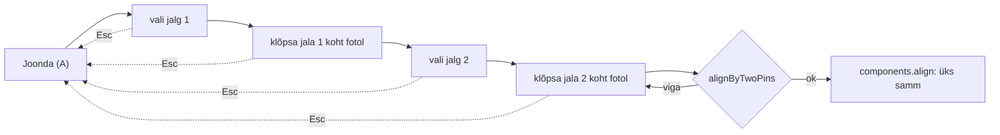

# M1-4-6 · Joonda kahe jalaga

**Olek:** vastu võetud `345791a` · **Rada:** A · **Haru:** `codex/m1-4` (sama tööpuu) · **Alus:** `8f3d54f` (M1-4-5) · **Plaan:** [M1.4 ülesanne 6](../plans/M1-4-suurus-joondus-joudlus.md#ülesanded)

## Eesmärk
IC-d on käsitsi raske täpselt foto peale panna: tuleb korraga liigutada, pöörata ja suurust muuta. Tööriist **Joonda** (`A`) teeb selle kahe jalaga ([02 › kahe jala joondus](../02-kasutaja-teekond.md)):
1. Tehnik klõpsab komponendi jalal 1.
2. Ta klõpsab fotol kohal, kus see jalg tegelikult on.
3. Sama korratakse jalaga 2.

Komponent saab nihke, pöörde ja ühtlase mõõtkava, nii et mõlemad jalad satuvad täpselt klõpsatud kohtadesse. See on üks käsk ja üks tagasivõtmise samm. Täpsus on alla 0,01 px ja 0,01° ([07](../07-teekaart.md) M1.4 tingimus).

## Loe (ainult need)
- `packages/features/photo/ui/CalibrateTool.ts:12-59` (kahe klõpsuga tööriista muster, `onCancel`)
- `packages/features/photo/ui/calibrate-store.ts:1-36` (tööriista olek Zustandis)
- `packages/domain/src/geometry/board.ts:8-50` (`padToBoard`, `boardPads`: jala asukoht plaadil)
- `packages/features/components/ui/index.tsx:14-22` (mooduli `tools`, `canvasLayers`, `keys`)

## Muuda
- `packages/features/components/`:
  - `contract.ts` ja `engine/commands.ts` (käsk `components.align`);
  - uus tööriist `ui/AlignTool.ts`, olek `ui/align-store.ts`, puhas funktsioon `ui/align.ts` ja ülekate `ui/layers/AlignLayer.tsx`;
  - `ui/index.tsx` (tööriist, kiht ja alumise riba vihje), tekstid `ui/i18n/et.ts` ning testid.
- `pnpm api`.

## Ära puutu
- `packages/ui/src/canvas/` (Canvas, SelectTool, tabamuste indeks). Tööriist kasutab olemasolevat `ToolApi`-t (`hitIndex.query`, `execute`, `select`).
- Skeem ja failivorming. `center`, `rotationDeg`, `scaleX` ja `scaleY` on olemas.

## Otsused ja liidesed
- **Käsk** `components.align { id, center, rotationDeg, scaleX, scaleY }`. See nõuab paigutatud komponenti, mõõtkava vahemik on 0,2–5 ja pööre normaliseeritakse nagu `components.rotate`-is. Käsk seab need neli välja korraga: üks ajaloo samm.
- **Puhas funktsioon** `alignByTwoPins({ board, pxPerMm, pinA, pinB, targetA, targetB, minTargetDistance })` tagastab `{ ok: true, center, rotationDeg, scaleX, scaleY }` või `{ ok: false, reason }`.
  - Arvutus käib plaadi koordinaatides: `pA` ja `pB` on jalgade praegused asukohad (`boardPads`), `tA` ja `tB` on sihtpunktid.
  - Pööre on `angle(tB − tA) − angle(pB − pA)`, tegur `k = |tB − tA| / |pB − pA|`.
  - Uus kese: `tA + R(pööre) · k · (center − pA)`.
  - Mõlemad mõõtkavad korrutatakse `k`-ga, nii et proportsioon säilib.
  - Arvutus on sarnasusteisendus plaadil, seega kehtib see ka alumisel poolel ja peegeldatud fotol eraldi harudeta.
  - `reason` on `same_pin`, `pins_coincide` (jalad samas kohas), `targets_coincide` (sihtpunktide kaugus alla `minTargetDistance`; tööriist annab selleks 5 ekraanipikslit plaadi koordinaatides) või `scale_out_of_range` (`k`-ga mõõtkava jääks väljapoole 0,2–5). Viimasel juhul tulemust ei kärbita, sest siis poleks see täpne.
- **Tööriist** `components.align`: klahv `A`, rühm `mechanical`, kursor `crosshair`. Sammud:
  1. **Vali jalg 1:** klõps peab tabama jalga (`hitIndex.query`, `kind: 'pin'`). Komponent valitakse.
  2. **Klõpsa jala 1 kohta fotol:** klõps annab sihtpunkti; jalgade tabamusi ei arvestata.
  3. **Vali jalg 2:** sama komponendi teine jalg.
  4. **Klõpsa jala 2 kohta fotol:** arvutus ja käsk `components.align`. Tööriist naaseb sammu 1 ja komponent jääb valituks.
- `Esc`, tööriista vahetus (`onCancel`) ja seansi vahetus (`onSessionReset`) tühjendavad oleku ega muuda dokumenti.
- Vale klõps (näiteks teise komponendi jalg sammus 3) või `ok: false` näitab vea teksti ja jätab tööriista samale sammule.
- **Vihje ja ülekate.** Alumisel ribal on tööriista ajal üks rida, näiteks „Joonda: vali jalg 1 · Esc katkestab“, ja vea korral selle asemel veatekst. Kiht `components.align` (z 100) näitab valitud jalgu numbritega 1 ja 2, sihtpunkte ristidena ning nende vahel katkendjoont. Suurused on ekraanil konstantsed. Kiht kasutab tööriista olekut, mitte `preview`-d.

## Skeem

## Tõend
- TS:
  - `align_by_two_pins_restores_known_pose_within_0_01px_and_0_01deg`: teadaoleva asendi jalgade asukohad on sihtpunktid ja algasend on teine. Joondus taastab asendi: mõlemad jalad < 0,01 px, pööre < 0,01°.
  - `align_handles_mirrored_bottom_side`: sama alumisel poolel oleva komponendiga.
  - `align_cancel_with_escape_changes_nothing`: `Esc` pärast sammu 3 jätab `rev`-i ja ajaloo samaks.
  - `align_is_one_undo_step`: neli klõpsu annavad ühe käsu, `Ctrl+Z` taastab algasendi.
  - `align_rejects_scale_outside_limits`: `scale_out_of_range` ei muuda dokumenti ja näitab veateksti.
- Põhikaustast `pnpm bb-review-card M1-4-6`. Lisa üleandmisse ekraanipilt sammust 4 enne viimast klõpsu (numbrid, ristid ja katkendjooned), sünteetilise projektiga.

## Valmis kui
- [x] Testid ja käsud läbivad, `docs/api` on uuendatud.
- [x] Üleandmises on ekraanipilt.
- [x] Üleandmine on allpool, kuni 15 rida.

## Üleandmine

- Tööpuu `C:/Users/TRUMPIT/.codex/worktrees/bb-m1-4/BB`, haru `codex/m1-4`. Enne tööd puhas, HEAD `8f3d54f`. Muudatused on commitimata.
- „Joonda“ (`A`) kasutab olemasolevat `ToolApi`-t. Neli klõpsu kinnitavad keskme, pöörde ja mõõtkava ühe `components.align` käsuga. `packages/ui/src/canvas/` vastab alusele.
- Mõlema telje suhe säilib. Mitme padjaga jala puhul kasutatakse tabatud padjandit. Mõõtkava piiril korrigeeritakse ainult ujukomaarvutuse ümardusviga. Väljapoole vahemikku jääv joondus annab vea.
- Vale klõps jätab tööriista samale sammule. Esc ning tööriista või seansi vahetus tühjendavad joondamise oleku. Vihje ja märgid tulevad tööriista olekust.
- Sünteetilise SOIC-8 brauserikatses oli 100% suumil mõlema jala keskme viga alla 0,00002 px. Lõpuklõps viis tööriista tagasi esimesse sammu, U1 jäi valituks ja üks `Ctrl+Z` taastas algasendi.
- Neljas samm enne viimast klõpsu, 1440 × 960, sünteetiline plaat: `output/playwright/m1-4-6/step-4.png`. Pildil on jalgade numbritähised, mõlemad sihtristid, katkendjooned ja alumine vihje.
- RED → GREEN logid on tööpuus `output/playwright/m1-4-6/`. `pnpm api` uuendas lepingudokumentatsiooni. Põhikausta `pnpm bb-review-card M1-4-6` läbis 1542/1542 ühiktesti, 38/38 E2E ja 5/5 kaarditesti. Kokkuvõte `output/review-card/M1-4-6-lCYyqy/summary.json`.
- Dokumendikontrollis on tööpuul alusega samad kuus varasemat tõendifailiviidet. Failipikkuse hoiatused: `interaction.test.tsx` 435, genereeritud komponendi lepingu kokkuvõte 404 ja varasem `Canvas.tsx` 401 rida. Järgmine samm on arhitekti ülevaatus.

## Arhitekti ülevaatus (2026-11-18)

**Mida kontrollisin**
- **Kood.**
  - `alignByTwoPins` teeb plaadil sarnasusteisenduse: pööre on vektorite nurkade vahe, tegur on kauguste suhe ja uus kese on `tA + R·k·(center − pA)`. Mõlemad mõõtkavad korrutatakse sama teguriga.
  - Vahemikust välja jääv tulemus annab `scale_out_of_range`. Kärbitakse ainult ujukomaarvutuse ümardusviga piiril.
  - Mitme padjandiga jala puhul kasutatakse klõpsatud padjandit (`padIndex`).
  - `components.align` seab neli välja ühe käsuga ja normaliseerib pöörde nagu `rotate`.
  - `packages/ui/src/canvas/` on alusega `8f3d54f` identne.
- **TS.** Ehitaja `bb-review-card` kokkuvõte `M1-4-6-lCYyqy` on uuem kui tööpuu viimane muudatus. Kokkuvõttes on `ok: true`, Vitest 1542/1542, e2e 38/38 ja kaardi testid 5/5 läbisid (täpsus, alumine pool, `Esc`, üks samm, piir); puuduvaid teste ega hoiatusi pole.
- **Brauser.** Ekraanipildil `step-4.png` on sünteetilisel plaadil kõik kaardil nõutud märgid: valitud jalad numbritega 1 ja 2, sihtristid foto padjanditel, katkendjooned ja alumise riba vihje „Joonda: klõpsa jala 2 kohta fotol · Esc katkestab“. Ehitaja mõõtis brauseris jalgade vea alla 0,00002 px.

**Otsus: sobib.**

Mitteblokeeriv:
- `hitAlignPin` leiab padjandi tabamuse keskme täpse võrdsusega. Praegu töötab see, sest mõlemad väärtused tulevad samast `boardPads`-ist. Kui tabamuse kese hakkab tulema muust arvutusest, on vaja tolerantsi.
- `interaction.test.tsx` on 435 rida ja ületab failipikkuse hoiatuse piiri. Järgmine seda faili puudutav kaart jagab selle osadeks.
