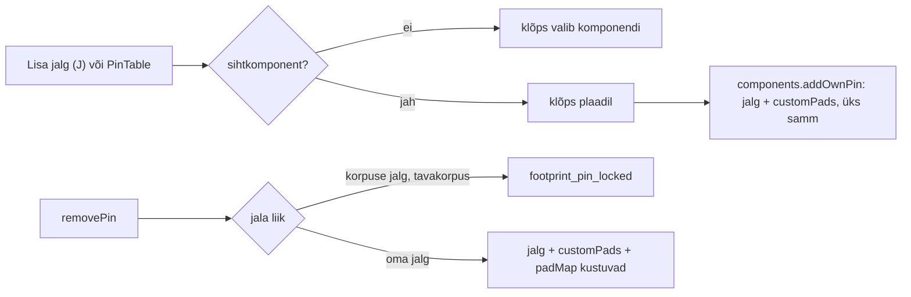

# M1-4-7 · Oma jalad

**Olek:** ehitamiseks · **Rada:** A · **Haru:** `codex/m1-4` (sama tööpuu) · **Alus:** `8193de7` (M1-4-9b) · **Plaan:** [M1.4 ülesanne 7](../plans/M1-4-suurus-joondus-joudlus.md#ülesanded)

## Eesmärk
Teegi korpusel võib puududa jalg, mis plaadil on olemas, näiteks SOIC-8 all olev jahutuspadi. Tehnik lisab selle tööriistaga **Lisa jalg** (`J`): ta klõpsab plaadil kohta, kus jalg on. Komponent saab uue jala ja ümmarguse padjandi täpselt sellesse kohta. See on üks käsk ja üks tagasivõtmise samm. Padjand liigub komponendiga kaasa pööramisel, mõõtkava muutmisel ja poole vahetamisel ning jääb alles ka pärast projekti uuesti avamist.

Kaart parandab ka jalgade ja padjandite vastavuse (M1 võlg A6). Praegu saab paigutatud korpusele lisada jala, millel pole padjandit, ja eemaldada jala nii, et padjand jääb ilma jalata. Pärast „Eemalda paigutus plaadilt“ lükkab `placeOnBoard` sama korpuse siis tagasi.

Tööriista muster on harus failis `packages/features/components/ui/AlignTool.ts` (`createAlignTool`, `alignToolSpec`, klõps ilma lohistuseta, `onCancel`). Alumise riba vihje muster on `layers/AlignLayer.tsx` failis `AlignHint`.

## Loe (ainult need)
- `packages/features/components/engine/commands.ts:49-80` (`makeBoardPlacement`, `footprint_pins_mismatch`)
- `packages/features/components/engine/commands.ts:114-215` (`addPin`, `removePin`, `removeFromBoard`, `changeFootprint`)
- `packages/domain/src/geometry/board.ts:9-66` (`padToBoard`, `boardPads`, `customPads` joonistamine)
- `packages/features/components/ui/PinTable.tsx:11-30` (nupp „Lisa jalg“ ja järgmise jala number)
- `packages/features/components/ui/errors.ts:1-21` (tagasilükkamise põhjus on `issue.message`)

## Muuda
- `packages/domain/src/geometry/board.ts`: uus `boardToPad` (padToBoard pöördfunktsioon) ja selle test.
- `packages/features/components/`:
  - `contract.ts` ja `engine/commands.ts`: uus käsk `components.addOwnPin`; reeglid `addPin`, `removePin` ja `changeFootprint` jaoks;
  - uus tööriist `ui/OwnPinTool.ts`, puhas abifunktsioon `ui/own-pin.ts` (`nextPinId`, `ownPadSizeMm`), vihje `OwnPinHint`;
  - `ui/PinTable.tsx`, `ui/errors.ts`, `ui/index.tsx`, tekstid `ui/i18n/et.ts` ja testid.
- `pnpm api`.

## Ära puutu
- `packages/ui/src/canvas/` (Canvas, SelectTool, tabamuste indeks). Tööriist kasutab olemasolevat `ToolApi`-t (`hitIndex.query`, `execute`, `select`).
- Skeem ja failivorming. `customPads` on `BoardPlacement`-is olemas.
- `placeOnBoard` reegel tavakorpusel (jalad ja korpuse padjandid peavad täpselt kattuma) ning `PlaceTool`.
- Mõõtmiste moodul. Jala eemaldamise mõju mõõtmistele jääb nagu praegu (ADR-005, M2.1).

## Otsused ja liidesed
1. **Reegel paigutatud tavakorpusel** (`board` olemas ja `footprint !== 'area'`). Igal jalal on täpselt üks padjand: kas korpuse padjand (`padMap` või sama id) või oma padjand (`customPads[pin.id]`). Igal korpuse padjandil on jalg.
   - `components.addPin` lükatakse tagasi põhjusega `pin_needs_pad` ja dokument ei muutu. Paigutamata komponendil ja „Ala“ korpusel töötab see nagu praegu.
   - `components.removePin`:
     - korpuse padjandi jalg lükatakse tagasi põhjusega `footprint_pin_locked`;
     - oma jala eemaldamisel kustuvad samas käsus jalg, `customPads[pinId]` ja kõik `padMap` kirjed, mis sellele viitavad.
     - Paigutamata komponendil ja „Ala“ korpusel eemaldatakse jalg nagu praegu ning lisaks koristatakse `customPads` ja `padMap` (A6).
   - `components.changeFootprint` jätab oma jalad ja nende padjandid alles. Kui uuel korpusel on sama id-ga padjand, saab jalast korpuse jalg ja oma padjand kustub. Jalgade järjekord: kõigepealt korpuse jalad, siis oma jalad endises järjekorras.
   - `components.removeFromBoard` jääb samaks: oma padjandite asukohad kaovad koos paigutusega, jalad jäävad. Kui komponendil on oma jalgu, lükkab `placeOnBoard` sama korpuse edaspidi tagasi põhjusega `footprint_pins_mismatch`. See on teadlik piirang: andmed ei kao, „Ala“ korpus sobib ja `Ctrl+Z` taastab paigutuse. Tavakorpusel ilma oma jalgadeta õnnestub uuesti paigutamine alati.
2. **Käsk** `components.addOwnPin { id, pin: { id, uid, name? }, local: Vec2, sizeMm: number }`.
   - Nõuab paigutatud komponenti (`component_not_placed`), sobib ka „Ala“ korpusele.
   - Olemasolev jala id lükatakse tagasi põhjusega `duplicate_pin`.
   - Lisab jala `{ ...pin, nc: false }` ja padjandi `customPads[pin.id] = { local, sizeMm, shape: 'circle', through: false }`. Üks käsk ja üks ajaloo samm.
3. **Puhtad funktsioonid.**
   - `boardToPad(placement, point, pxPerMm): Vec2` on `padToBoard`-i pöördfunktsioon, mis arvestab pööret, mõõtkava ja alumist poolt. `padToBoard(boardToPad(p)) ≈ p`.
   - `nextPinId(pins)`: väikseim vaba positiivne täisarv stringina. PinTable kasutab sama funktsiooni.
   - `ownPadSizeMm(board)`: komponendi väikseima padjandi lühem külg mm-des. Arvesse lähevad korpuse padjandid (`min(w, h)`) ja oma padjandid (`sizeMm`). Kui padjandeid pole, on tulemus 1 mm.
4. **Tööriist** `components.addOwnPin` (`ownPinToolSpec(ids)`, nagu `createPlaceToolSpec(ids)`): klahv `J`, rühm `mechanical`, kursor `crosshair`, silt „Lisa jalg“.
   - Sihtkomponent on valitud komponent või valitud jala komponent, kui see on plaadil.
   - Sihtkomponendita klõps valib tabatud komponendi (`hitIndex.query`) ega lisa jalga.
   - Sihtkomponendiga klõps (ilma lohistuseta) käivitab `components.addOwnPin`. Parameetrid: `local = boardToPad(board, world, pxPerMm)`, `sizeMm = ownPadSizeMm(board)`, `pin.id = nextPinId(pins)` ja `pin.uid = ids.newId('pin')`. Uus jalg valitakse, et selle saaks jala kaardil kohe nimetada. Tööriist jääb aktiivseks.
   - `Esc` ja tööriista vahetus naasevad valikutööriista juurde; pooleli olekut pole.
   - Vihje alumisel ribal: „Lisa jalg: klõpsa plaadil jala kohal · Esc lõpetab“. Sihtkomponendita on vihje „Lisa jalg: vali enne komponent · Esc lõpetab“. Vea korral on vihje asemel veatekst.
5. **PinTable.** Paigutatud tavakorpusel valib „Lisa jalg“ komponendi ja lülitab sisse tööriista `components.addOwnPin` (`useSessionStore.getState().setToolId`). Käsku see ei käivita. Paigutamata komponendil ja „Ala“ korpusel käivitub `components.addPin` nagu praegu.
6. **Veatekstid** (`commandError`, `issue.message` järgi):
   - `pin_needs_pad`: „Paigutatud korpusele lisa jalg plaadil: Lisa jalg (J).“
   - `footprint_pin_locked`: „Korpuse jalga ei saa eemaldada. Märgi see NC-ks või vaheta korpust.“
   - `footprint_pins_mismatch`: „Jalgade arv ei sobi selle korpusega. Vali sobiv korpus või „Ala“.“
   - `duplicate_pin`: „Sellise numbriga jalg on juba olemas.“

## Skeem

## Tõend
- TS:
  - `add_own_pin_places_pad_at_click`: SOIC-8 on pööratud 30°, `scaleX` on 1,5 ja komponent on alumisel poolel. Klõps lisab jala `9`, mille padjandi kese `boardPads`-is on klõpsukohast alla 0,01 px kaugusel. Uus jalg on valitud ja padjandi suurus on väikseima padjandi lühem külg.
  - `own_pin_survives_rotate_scale_and_reopen`: pärast pööramist, `setScale`-i, poole vahetust ja dokumendi JSON-i läbimist koos skeemiga (uuesti avamine) on oma padjand `padToBoard(local)` kohas ja `boardPads`-is.
  - `own_pin_is_one_undo_step`: üks klõps on üks ajaloo samm ja `Ctrl+Z` eemaldab jala ja padjandi. Oma jala eemaldamine PinTable'ist on samuti üks samm ning `Ctrl+Z` taastab mõlemad.
  - `placed_footprint_pins_and_pads_stay_matched`: kontrollitakse paigutatud SOIC-8-l.
    - `addPin` annab `pin_needs_pad` ja korpuse jala `removePin` annab `footprint_pin_locked`; kummalgi juhul dokument ei muutu.
    - Oma jala lisamise ja eemaldamise järel on alles täpselt korpuse jalad ning `customPads` ja `padMap` on tühjad.
    - `changeFootprint` jätab oma jala alles.
    - Ilma oma jalgadeta õnnestub `removeFromBoard` ja seejärel sama korpusega `placeOnBoard`.
    - Iga sammu järel kehtib vastavus: igal jalal on üks padjand ja igal padjandil on jalg.
  - `pin_table_add_pin_on_placed_component_starts_own_pin_tool`: paigutatud SOIC-8-l lülitab „Lisa jalg“ sisse tööriista ega muuda `rev`-i. Paigutamata komponendil lisab sama nupp jala nagu praegu.
- Põhikaustast `pnpm bb-review-card M1-4-7`. Lisa üleandmisse ekraanipilt, kus sünteetilise SOIC-8 keha all on oma jalg `9` ja alumisel ribal on tööriista vihje.

## Valmis kui
- [ ] Testid ja käsud läbivad, `docs/api` on uuendatud.
- [ ] Üleandmises on ekraanipilt.
- [ ] Üleandmine on allpool, kuni 15 rida.

## Üleandmine
