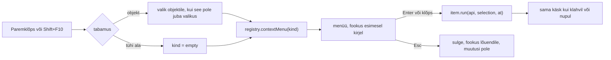

# M1-4-9 · Paremklõpsu menüü

**Olek:** ehitamiseks · **Rada:** A · **Haru:** `codex/m1-4` (sama tööpuu) · **Alus:** `dc124bf` (M1-4-8) · **Plaan:** [M1.4 ülesanne 9](../plans/M1-4-suurus-joondus-joudlus.md#ülesanded)

## Eesmärk
Tehnik teeb plaadil sagedasi toiminguid sealt, kus kursor juba on. Paremklõps komponendil, jalal või tühjal alal avab lühikese menüü. Menüü kirjed kutsuvad samu käske ja samu funktsioone kui klahvid ning omaduste paneeli nupud, seega tulemus ja ajalugu on samad.

Klaviatuurilt avavad menüü `Shift+F10` ja menüüklahv. `Esc` sulgeb menüü ja midagi ei muutu. Menüü on ajutine kiht: see ei võta lõuendilt püsivat ruumi.

## Loe (ainult need)
Loe tööpuust (`dc124bf`), sest M1.4 muudatusi pole veel `main`-is. Rea numbrid on tööpuu järgi.
- `packages/ui/src/shell/UiRegistry.ts:18-58` (`KeySpec`, `UiModule`; registri kontrollid allpool samas failis)
- `packages/ui/src/canvas/Canvas.tsx:226-362` (klahvid, kursorisündmused, vaateala)
- `packages/features/components/ui/PlacementSection.tsx:132-166` (`forPlaced`, `placementKeys`)
- `packages/features/components/ui/PlaceTool.ts:57-110` (klõpsuga paigutus)
- `packages/features/measurements/ui/index.tsx:60-76` (klahv `M`)

## Muuda
- `packages/ui/src/shell/`:
  - `UiRegistry.ts`: `ContextMenuItemSpec`, `UiModule.contextMenu`, `UiRegistry.contextMenu(kind)`;
  - `keymap.ts`: `SHELL_KEYS` kirjed `Shift+F10` ja `ContextMenu`;
  - tekstid `et`-s.
- `packages/ui/src/canvas/`:
  - uus `ContextMenu.tsx` (menüü) ja uus hook menüü avamiseks;
  - `Canvas.tsx` (ainult ühendus ja prop `contextMenu`);
  - klaviatuuri effect viiakse eraldi faili `use-canvas-keys.ts`, et `Canvas.tsx` jääks alla 400 rea (praegu 401);
  - `SelectTool.ts`: `selectionForHit` muutub kausta sees jagatuks.
- `packages/ui/src/app/Workbench.tsx`: `contextMenu` antakse lõuendile registrist.
- `packages/features/components/ui/`:
  - `index.tsx`: menüükirjed;
  - `PlacementSection.tsx`: klahvide `run`-funktsioonid nimega konstantideks;
  - `PinCard.tsx`: nimevälja fookuse soov;
  - `place-store.ts`, `PlaceTool.ts` ja `Library.tsx`: „Lisa komponent siia“;
  - tekstid `i18n/et.ts`.
- `packages/features/measurements/ui/index.tsx`: kirje „Mõõda“ ja tekst.
- `pnpm api`.

## Ära puutu
- Mootor, käsud, skeem ja failivorming. Uut käsku ei tule.
- Klahvide senine käitumine (`R`, `Shift+R`, `F`, `M`, `Esc`, tööriistaklahvid) ja klõpsuga paigutus.
- Dubleerimine ja `Ctrl`-klahvid (vt otsus 6).

## Otsused ja liidesed
1. **Register.**
   ```ts
   export interface ContextMenuItemSpec {
     id: string;
     appliesTo: string[]; // valikuliigid; 'empty' tähendab tühja ala
     order: number;
     label(snapshot: Snapshot, selection: Selection): string;
     shortcut?: { key: string; shift?: boolean };
     run(api: ToolApi, selection: Selection, at: Vec2): boolean;
   }
   // UiModule
   contextMenu?: ContextMenuItemSpec[];
   // UiRegistry
   contextMenu(kind: string): ContextMenuItemSpec[];
   ```
   - `contextMenu(kind)` tagastab kõigi moodulite kirjed, mille `appliesTo` sisaldab `kind`-i, `order` järgi.
   - Kirjete id-d on unikaalsed: registri `uniqueIds` kontroll, nagu klahvidel.
   - `at` on stseenipunkt, kus menüü avati.
2. **Avamine hiirega.**
   - Lõuendi `contextmenu`-sündmusel on brauseri menüü alati keelatud.
   - BB menüü avaneb ainult valikutööriistaga ja siis, kui žesti pole pooleli.
   - Tabamus tehakse sama `hitIndex`-iga ja valik saadakse `selectionForHit`-iga.
     - Kui tabatud objekt pole valikus, saab sellest valik.
     - Kui objekt on juba valikus, jääb mitmikvalik alles ja kirjed rakenduvad kõigile valitud komponentidele nagu klahvidel.
     - Tühjal alal on `kind` `'empty'` ja valik ei muutu.
   - Kui liigil kirjeid pole, menüüd ei avata.
3. **Avamine klaviatuurilt.**
   - `Shift+F10` ja `ContextMenu` avavad menüü valiku esimese elemendi liigi järgi. Tühja valiku korral avaneb tühja ala menüü.
   - Asukoht on viimane kursori koht lõuendil. Kui seda pole, on asukoht nähtava lõuendi keskel.
   - Brauser võib nende klahvide järel saata ka `contextmenu`-sündmuse. Menüü avaneb siiski ainult üks kord.
4. **Menüü.**
   - Menüü on `role="menu"` sildiga „Toimingud“ ja kirjed on `role="menuitem"`.
   - Klahviga kirjel on paremal klahvi tekst („R“, „Shift+R“, „F“, „M“) ning `aria-keyshortcuts`.
   - Menüü asub avamispunktis ja jääb tervenisti lõuendi vaatealasse.
   - Avamisel saab fookuse esimene kirje.
   - Klaviatuur:
     - `↓` ja `↑` liiguvad ringiratast, `Home` ja `End` viivad esimesele ja viimasele kirjele;
     - `Enter` ja tühik käivitavad kirje;
     - `Esc` ja `Tab` sulgevad menüü.
   - Avatud menüü võtab klaviatuuri: lõuendi klahvid ei käivitu enne sulgemist ja `Esc` ei tühjenda valikut.
   - Menüü sulgub ka kirje käivitamisel, kursorivajutusel väljaspool menüüd, rattal, akna fookuse kadumisel ja seansi vahetusel.
   - Pärast sulgemist naaseb fookus lõuendile.
   - Kujundus tuleb olemasolevatest tokenitest: minimaalne laius 180 px, kirje kõrgus vähemalt 28 px, klahvi tekst on tuhm. Menüü on lõuendi kihtidest kõrgemal ja dialoogidest madalamal.
5. **Kirjed.** Klahviga kirje kasutab **sama `run`-funktsiooni** kui `KeySpec`: ühine nimega konstant, mitte koopia. Tekstid on samad, mis omaduste paneelis.

   | Liik | `order` | Tekst | Klahv | Tegevus |
   |---|---|---|---|---|
   | `component` | 10 | „Pööra +90°“ | `R` | sama mis `R` |
   | `component` | 20 | „Pööra −90°“ | `Shift+R` | sama mis `Shift+R` |
   | `component` | 30 | „Teisele poolele“ | `F` | sama mis `F` |
   | `component` | 40 | „Eemalda paigutus plaadilt“ | — | `components.removeFromBoard` igale valitud paigutatud komponendile (sama käsk kui paneeli nupul) |
   | `pin` | 10 | „Mõõda“ (mõõtmiste moodul) | `M` | sama mis `M` |
   | `pin` | 20 | „Nimeta jalg“ | — | avab omaduste paneeli ja annab fookuse jala nimeväljale (`PinCard`, fookuse soov nagu `measure-store.requestFocus`) |
   | `pin` | 30 | „Märgi NC-ks“ või NC-jalal „Eemalda NC-märge“ | — | `components.setNc { id, pinId, nc: !pin.nc }` |
   | `empty` | 10 | „Lisa komponent siia“ | — | otsus 7 |

   - Jala kirjed rakenduvad valiku esimesele jalale.
   - Iga dokumenti muutev kirje on üks ajaloo samm.
6. **Dubleerimine jääb välja.**
   - BB-s pole dubleerimise käsku ega klahvi.
   - `KeySpec` ega lõuendi klahvikäsitlus ei toeta `Ctrl`-klahve.
   - Dubleerimine (käsk ja `Ctrl+D`) läheb M2 plaani.
   - Plaani „kustuta“ on siin olemasolev „Eemalda paigutus plaadilt“: komponent, jalad ja mõõtmised jäävad loendisse.
7. **„Lisa komponent siia“.**
   - Kirje salvestab `place-store`-i ankru `{ center: at, rotationDeg }`. `rotationDeg` on sama `placementRotation(api.sceneTransform())`, mida kasutab klõpsuga paigutus.
   - Kirje avab navigaatori vahekaardi „Teek“ (`setNavigatorOpen(true)`, `setNavigatorTab('library')`) ja annab fookuse otsinguväljale.
   - Ankru ajal on teegi põhinupp „Paiguta siia“ ja selle kõrval on nupp „Loobu“.
     - „Paiguta siia“ teeb ühe `components.add` samade parameetritega nagu klõpsuga paigutus, valib uue komponendi ja kustutab ankru. Paigutustööriista ei aktiveerita.
     - Selleks tõstetakse `PlaceTool.onPointerUp`-ist uue komponendi loomine ühisesse funktsiooni, mida kasutavad mõlemad. `Library` saab propi `ids`.
     - „Loobu“ kustutab ankru.
   - Ankur kustub ka seansi vahetusel.
8. **Tekstid.**
   - Kest: `contextMenu: 'Toimingud'`.
   - Komponendid: „Nimeta jalg“, „Märgi NC-ks“, „Eemalda NC-märge“, „Lisa komponent siia“, „Paiguta siia“ ja „Loobu“.
   - Mõõtmised: „Mõõda“.



## Tõend
- TS (integratsioon sama töölaua abiga nagu `custom-footprint.test.tsx`):
  - `context_menu_items_run_same_commands_as_keys`: paremklõps paigutatud komponendil näitab nelja komponendi kirjet otsuse 5 järjekorras ja klahvi tekstidega. „Pööra +90°“ annab samad komponendid kui klahv `R` samal algseisul ja „Teisele poolele“ sama tulemuse kui `F`. Paremklõps jalal näitab kirjeid „Mõõda“, „Nimeta jalg“ ja „Märgi NC-ks“. „Mõõda“ annab sama mõõtmise seisu kui `M` sama jala valikuga. „Märgi NC-ks“ märgib jala NC-ks ja üks `Ctrl+Z` võtab märke tagasi. „Nimeta jalg“ annab fookuse jala nimeväljale.
  - `escape_closes_menu_without_change`: avatud menüüs vajutatakse `Esc`. Menüü kaob, dokumendi `rev` ja ajalugu ei muutu, valik ja tööriist jäävad samaks ning fookus on lõuendil. Sama kehtib kursorivajutusel väljaspool menüüd.
  - `shift_f10_opens_menu_for_selection`: valitud komponendi korral avab `Shift+F10` komponendi menüü ja fookus on esimesel kirjel. Klahvid `↓` ja `Enter` käivitavad „Pööra −90°“ ning menüü sulgub. Menüüklahv avab sama menüü ja klahvile järgnev `contextmenu`-sündmus ei ava teist menüüd. Tühja valiku korral avab `Shift+F10` tühja ala menüü.
  - `empty_area_menu_places_component_here`: paremklõps tühjal alal näitab ainult kirjet „Lisa komponent siia“. Kirje avab „Teegi“ ja otsinguväljal on fookus. Teegi kirje ja „Paiguta siia“ annavad komponendi, mille `center` on paremklõpsu stseenipunkt. Üks `Ctrl+Z` eemaldab komponendi ja nupp on uuesti „Paiguta“. „Loobu“ eemaldab ankru ilma paigutuseta.
- Põhikaustast `pnpm bb-review-card M1-4-9`. Lisa üleandmisse ekraanipilt sünteetilisest projektist: plaadil on avatud komponendi menüü.

## Valmis kui
- [ ] Testid ja käsud läbivad, `docs/api` on uuendatud.
- [ ] `Canvas.tsx` on alla 400 rea.
- [ ] Üleandmises on ekraanipilt.
- [ ] Üleandmine on allpool, kuni 15 rida.

## Üleandmine
