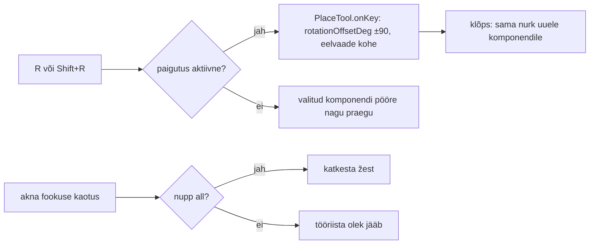

# M2-1-1 · Paigutus ja kalibreerimine ilma üllatusteta

**Olek:** ehitamiseks · **Rada:** A · **Haru:** `codex/m2-1` (sama tööpuu `C:/Users/TRUMPIT/.codex/worktrees/bb-m2-1/BB`) · **Alus:** `af5716b` (M2-1-H) · **Allikas:** [koodiülevaatus 2026-11-19](../review/2026-11-19-koodiulevaatus-00a424e.md), leiud 09, 10 ja 11

## Eesmärk
Kolm igapäevast viga. Koodiülevaatus kordas neid katses ja arhitekt leidis koodist põhjuse.
- **09 · `R` paigutamise ajal:** 02 § 6.1 järgi pöörab `R` paigutusrežiimis eelvaadet. Praegu pöördub juba plaadil olev ja valitud R1, eelvaade ega järgmine R2 aga ei pöördu. Paigutustööriist klahvi ei käsitle, seega jõuab see komponendi pööramise klahvini.
- **10 · Teegi parameetrid paigutamise ajal:** paigutus jätab parameetrid meelde alustamise hetkel. Kui tehnik muudab teegis SOIC-i 8 jalalt 16-le, näitab teegi eelvaade 16 jalga, aga plaadile läheb 8.
- **11 · Kalibreerimine akna vahetusel:** kui aken kaotab fookuse, katkestab lõuend aktiivse tööriista. Kalibreerimisel kaovad sellega kaks punkti, dialoog ja sisestatud väärtus, näiteks siis, kui tehnik vaatab mõõtu teisest aknast.

## Loe (ainult need)
Loe tööpuust (`af5716b`). Rea numbrid on tööpuu järgi.
- `packages/features/components/ui/PlaceTool.ts:48-143` (paigutustööriist, `endPlacement`, `addPlacedComponent`)
- `packages/features/components/ui/place-store.ts:1-36` (`PlacementRequest`, `beginPlacement`)
- `packages/features/components/ui/layers/ComponentsLayer.tsx:18-60` (`PlacementGhost`, nurk `placementRotation`-ist)
- `packages/features/components/ui/Library.tsx:51-80` (`LibraryParameters`: kohalikud parameetrid ja `isPlacing`)
- `packages/ui/src/canvas/use-canvas-keys.ts:85-102` (`onBlur`; kalibreerimise `onCancel` on `packages/features/photo/ui/CalibrateTool.ts:43-46`)

## Muuda
- `packages/features/components/ui/`:
  - `place-store.ts`: pöörde nihe ja parameetrite uuendus;
  - `PlaceTool.ts`: `onKey`, sama nurk eelvaates ja paigutuses;
  - `layers/ComponentsLayer.tsx`: eelvaade võtab nurga eelvaate andmetest;
  - `Library.tsx`: parameetrite muutus jõuab aktiivsesse paigutusse;
  - testid.
- `packages/ui/src/canvas/use-canvas-keys.ts` ja `Canvas.tsx`: akna fookuse kaotus katkestab ainult pooleli oleva kursoržesti.
- `pnpm api`, kui avalik liides muutub.

## Ära puutu
- Mootor, käsud, skeem ja failivorming.
- `R`, `Shift+R` ja `F` valikutööriistaga: valitud komponendi pööramine jääb samaks.
- Paigutus „Lisa komponent siia“ (ankur, M1-4-9) ja olemasoleva komponendi paigutuse loogika, välja arvatud otsuse 1 nurk.
- Kalibreerimise dialoog ja käsk `photo.setScale`.

## Otsused ja liidesed
1. **`R` paigutusrežiimis (09).**
   - `place-store` saab välja `rotationOffsetDeg` (0, 90, 180 või 270). `beginPlacement` ja `reset` seavad selle 0-ks.
   - `PlaceTool.onKey`:
     - `R` lisab +90° ja `Shift+R` −90°, kui paigutus on aktiivne;
     - klahvi kordus (`event.repeat`) ei pööra uuesti;
     - `Ctrl`, `Alt` ja `Meta` koos klahviga ei pööra;
     - kasutatud klahv tagastab `true`, seega valitud komponendi pööramise klahv ei käivitu ja dokument ei muutu.
   - Lõplik nurk on `placementRotation(sceneTransform) + rotationOffsetDeg` ja see normaliseeritakse vahemikku 0–360.
     - `PlacePreviewData` saab välja `rotationDeg` ning `PlacementGhost` kasutab seda, mitte ei arvuta nurka ise.
     - Uus komponent (`addPlacedComponent`) ja olemasoleva komponendi paigutus (`placeOnBoard`) saavad sama nurga.
   - Pärast pööret uueneb eelvaade kohe viimases kursori kohas, hiirt liigutamata.
   - Templirežiimis jääb nihe järgmistele paigutustele samaks: R2 tuleb samas asendis nagu pööratud eelvaade.
2. **Parameetrid paigutuse ajal (10).**
   - `place-store` saab funktsiooni `updatePlacementParams(params: FootprintParams | null)`. See uuendab aktiivse `mode: 'new'` päringu parameetrid koopiana.
   - `LibraryParameters` kutsub seda iga parameetri muutuse järel, kui sama kirje paigutus on aktiivne (`isPlacing`). Väärtus on `validatedFootprintParams(...)` või `null`.
   - `null` tähendab vigaseid parameetreid: eelvaade kaob, klõps plaadil ei paiguta ja teegis jääb senine vigase eelvaate teade. Kehtiv väärtus taastab eelvaate.
   - Eelvaade uueneb kohe viimases kursori kohas.
3. **Akna fookuse kaotus (11).**
   - `onBlur` lähtestab ajutise vaate liigutamise lipu (`space`). Tööriista katkestab see ainult siis, kui kursoržest on pooleli (`isGesturing()`, nupp all). Pooleli lohistus katkeb nagu praegu.
   - Tööriista olek jääb alles: kalibreerimise punktid, dialoog ja väärtus, joonduse samm, paigutusrežiim ning oma jala tööriist.
   - Paremklõpsu menüü sulgub akna fookuse kaotusel endiselt (M1-4-9).
   - Olemasolevad testid, mis eeldavad, et fookuse kaotus katkestab tööriista ilma žestita, uuendatakse selle reegli järgi. Muutused kirjuta üleandmisse.

## Tõend
- TS:
  - `place_tool_r_rotates_ghost_not_placed_component`: templirežiimis paigutatakse R1 ja kursor viiakse järgmisse kohta. `R` jätab dokumendi samaks: R1 nurk ja `rev` ei muutu, eelvaate nurk kasvab 90°. Klõps annab R2 sama nurgaga. `Shift+R` pöörab tagasi. Uus `beginPlacement` alustab nihkega 0. Valikutööriistaga pöörab `R` valitud komponenti nagu enne.
  - `stamp_uses_params_changed_during_placement`: aktiivse SOIC-i paigutuse ajal muudetakse jalgade arv 8 → 16. Eelvaates on kohe 16 padjandit ja klõps paigutab 16 jalaga komponendi. Sama kehtib takisti korpuse muutusel 0805 → 2512. Vigase väärtuse ajal eelvaadet pole ja klõps ei paiguta.
  - `window_blur_keeps_calibration_draft`: `K`, kaks punkti ja dialoogi 17. Akna fookuse kaotuse järel on dialoog avatud, väärtus 17 ja mõlemad punktid alles. `Enter` seab mõõtkava. Kui nupp on all ja aken kaotab fookuse, katkeb pooleli lohistus ilma käsuta.
- Põhikaustast `pnpm bb-review-card M2-1-1`.

## Valmis kui
- [ ] Testid ja käsud läbivad.
- [ ] Üleandmises on loend olemasolevatest testidest, mida fookuse kaotuse reegel muutis.
- [ ] Üleandmine on allpool, kuni 15 rida.

## Üleandmine
