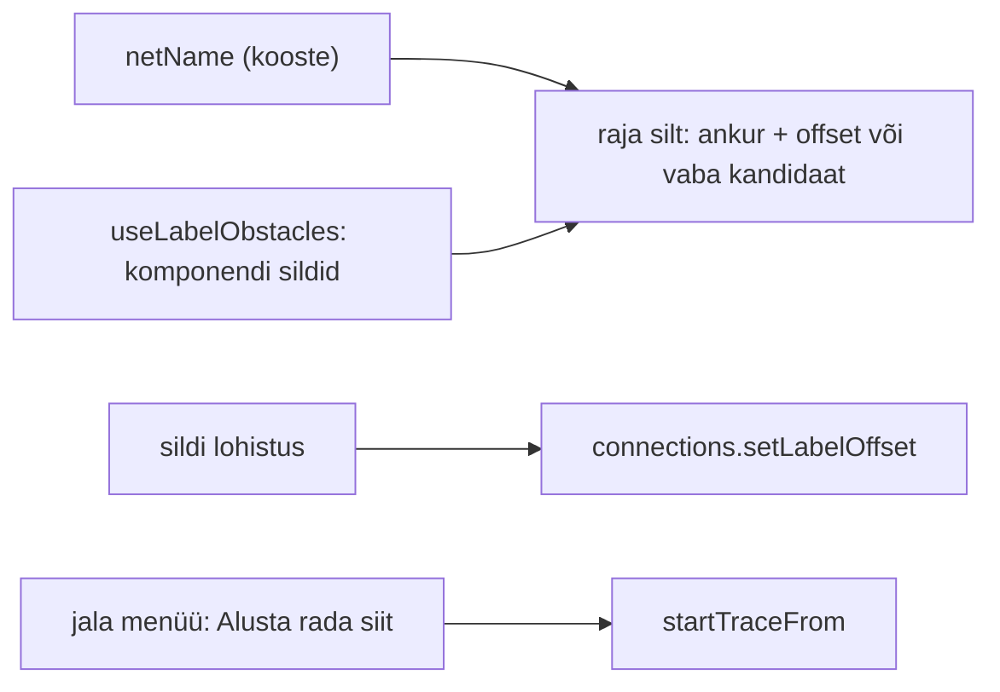

# M2-1-10 · Raja silt ja paremklõps

**Olek:** vastu võetud `a29cef4` · **Rada:** A · **Haru:** `codex/m2-1` (tööpuu `C:/Users/TRUMPIT/.codex/worktrees/bb-m2-1/BB`) · **Alus:** `dcd8425` (M2-1-9) · **Plaan:** [M2.1 › Ülesanne 10](../plans/M2-1-uhendused-ja-vorgud.md#ülesanded) · **Otsus:** 06 › Ühendused (raja silt)

## Eesmärk
Nimega võrgu rajal on võrgu nimi. Sildi saab lohistada sobivasse kohta ühe tagasivõetava sammuga ja asukoht jääb faili. Automaatne raja silt ei kata komponendi silte ega teisi raja silte. Valitud ühenduse omadustes on näha mõlema otsa tähis, alus („nähtud“ või „oletatud“) ja võrk. Jala paremklõpsu menüüst saab alustada rada.

Plaani testid `context_menu_remove_drawing_vs_remove_connection` ja `junction_delete_states_connection_count` jäävad ära: need menüükirjed ja nende käitumine on juba olemas ja testitud (M2-1-5 ja M2-1-6).

## Loe (ainult need)
Loe tööpuust (`dcd8425`). Rea numbrid on tööpuu järgi. `bb_task` laiendab viited põhikaustast, kus on M2.1 eelne kood; ava need read tööpuus.
- `packages/features/components/ui/layers/label-placement.ts:143-215` (komponendi sildi paigutus, `labelOffset`, nähtavus)
- `packages/ui/src/canvas/label-obstacles.ts:1-43` (ühine takistuste kanal)
- `packages/features/components/ui/layers/hits.ts:43-92` (sildi lohistus `drag.commit`-iga)
- `packages/features/connections/ui/index.tsx:1-206` (menüü, valikuliigid, kooste parameetrid)
- `packages/features/connections/ui/TraceTool.ts:56-80` (`begin`, `startExistingTrace`)

## Muuda
- `packages/features/connections/contract.ts` ja `engine/index.ts`: käsk `connections.setLabelOffset` (otsus 2).
- `packages/features/connections/ui/`: raja sildi kiht ja tabamus, ühenduse omaduste jaotis, jala menüükirje, `TraceTool.ts` alguse funktsioon ja tekstid.
- `packages/features/ui.ts`: connections kasutajaliides saab koosteist ka võrgu nime (otsus 1).
- `pnpm api`.

## Ära puutu
- Mootor, domeen, failivorming, invariandid, kest ja `Canvas.tsx`.
- Komponendi sildi paigutus (`label-placement.ts`) ja mõõtmiste näidud.
- Olemasolevad menüükirjed ja nende testid.

## Otsused ja liidesed
1. **Raja silt** (kiht `connections.traceLabels`, `z: 62`).
   - Silt on ainult nimega võrgu (`named: true`) joonistusega ühendusel. Tekst on võrgu nimi otsa `a` võrgu järgi, 11 px monokiri ja halo nagu komponendi sildil.
   - Võrgu nime annab kooste: `createConnectionsUi(ids, { roleColor, netName })`, kus `netName(snapshot, memberKey): string | undefined` tagastab nime ainult nimega võrgule. connections ei impordi nets-i kasutajaliidest.
   - **Ankur** on raja pikima lõigu keskpunkt (`connectionPoints`).
   - Kui `board.labelOffset` on olemas, on sildi keskpunkt `ankur + labelOffset` maailma ühikutes ja seda ei nihutata.
   - **Automaatne koht:** kandidaadid on iga lõigu keskpunkt pikimast alates, mõlemal pool risti 4 px + pool sildi kõrgust ekraanil. Valitakse esimene kandidaat, mis ei kattu `useLabelObstacles()` kastidega ega varem paigutatud raja siltidega (`screenBoxesOverlap`). Kui ükski ei sobi, silti ei näidata.
   - Silti ei näidata, kui pikima lõigu ekraanipikkus on väiksem kui sildi laius.
   - Kiht ei lisa oma kaste `obstacles()`-isse, sest automaatne koht sõltub teiste kihtide kastidest. Raja silt väldib komponendi silte, aga mõõtmiste näidud raja silte veel ei vältida (pole selle kaardi nõue).
2. **Lohistus ja käsk.**
   ```ts
   'connections.setLabelOffset': { id: string; offset: Vec2 | null } // not_found, not_drawn
   ```
   - Sildi tabamus on `{ kind: 'connection-label', id, target: { kind: 'connection', id }, drag: { owner: TRACE_LABEL_DRAG_OWNER, commit } }`. Eelvaade näitab nihutatud silti ja `commit` salvestab `offset = praegune keskpunkt + delta − ankur`. Kõik on üks käsk.
   - Kontekstimenüü „Lähtesta sildi asukoht“ (`available`: valitud ühendusel on `labelOffset`) käivitab käsu `offset: null`-iga.
3. **Ühenduse omadused** (`contextSections`, `appliesTo: ['connection']`, ainult üks valitud ühendus).
   - „{ots A} → {ots B}“ jala kujul `{tähis}.{nimi või id}` või „liitepunkt“.
   - „Alus: nähtud“ (`visual`) või „Alus: oletatud“ (`assumed`).
   - „Võrk: {nimi}“ (`netName` või `N…` tuletisest; puuduva tuletise korral rida puudub).
   - Joonistusega ühendusel on lisaks „Rada · pealmine · 0,30 mm“, „Rada · alumine · …“ või „Juhe · …“.
4. **Jala menüü.** Kirje „Alusta rada siit“ (`appliesTo: ['pin']`, `order: 10`) alustab tööriista Rada menüü jalast: uus eksport `startTraceFrom(api, end): boolean` kasutab sama `begin`-i ja aktiveerib tööriista. Pinnajala kiht tuleb jala poolelt nagu klõpsuga alustades.
5. **Tekstid:** „Alusta rada siit“, „Lähtesta sildi asukoht“, „Alus: nähtud“, „Alus: oletatud“, „Võrk: {nimi}“, „liitepunkt“.
6. **Olemasolevad testid.** Ootused jäävad samaks. Kõik muudetud testid loetle üleandmises.



## Tõend
- TS:
  - `trace_label_drag_is_one_step_and_survives_reopen` (`packages/features/connections/ui/trace-labels.test.tsx`): nimega võrgu rajal on silt pikima lõigu juures ja nimeta võrgu rajal silti pole. Sildi lohistus käivitab ühe `connections.setLabelOffset`-i ja `Ctrl+Z` taastab. Dokumendi uuesti avamine (`host.load`) näitab silti salvestatud kohas. „Lähtesta sildi asukoht“ viib automaatsesse kohta. Valitud ühenduse omadustes on „R1.2 → U1.5“, „Alus: nähtud“ ja „Võrk: VBUS“.
  - `labels_do_not_overlap_each_other` (`packages/features/connections/ui/trace-labels.test.tsx`): komponendi sildi kõrval oleva raja automaatne silt valib kandidaadi, mille ekraanikast ei kattu komponendi sildiga. Kaks lähestikku rada ei saa kattuvaid silte. Liiga lühikese lõiguga rajal silti ei näidata.
  - `context_menu_starts_trace_from_pin` (`packages/features/connections/ui/trace-tool.test.tsx`): jala paremklõpsu menüü „Alusta rada siit“ aktiveerib tööriista Rada ja mustandi algus on see jalg ning selle poole kiht. Järgmine klõps tühjal kohal lisab käänupunkti.
- Põhikaustast `pnpm bb-review-card M2-1-10` → `ok: true`, `missing: []`.

## Valmis kui
- [x] Testid ja `pnpm check` läbivad.
- [x] Mootor, domeen ja kest ei muutunud. Arhitekti kinnitatud muudatus olemasolevas testis on üleandmises loetletud.
- [x] Kõik muudetud failid on ≤ 400 rea. `pnpm api` on uuendatud.
- [x] Üleandmine on allpool, kuni 15 rida.

## Arhitekti vastus ehitajale (2026-11-20)

Otsus 4 lisab jala menüüsse uue kirje, seega muutub üks ootus. Failis `packages/features/components/ui/context-menu.test.tsx`, testis `context_menu_items_run_same_commands_as_keys`, on jala menüü oodatud loend `['Alusta rada siit', 'MõõdaM', 'Nimeta jalg', 'Märgi NC-ks']`. Teiste kirjete järjekord ja muud ootused jäävad samaks. Loetle see muudatus üleandmises.

## Üleandmine

- Tööpuu `C:/Users/TRUMPIT/.codex/worktrees/bb-m2-1/BB`, haru `codex/m2-1`, kontrollitud puhas alus `dcd8425`. Muudatused on tööpuus.
- Nimega võrgu silt väldib `useLabelObstacles()` kaste ja teisi rajasildikaste. Automaatsiltide paigutus arvestab käsitsi salvestatud kohti dokumendijärjekorrast sõltumata.
- Sildi tabamus on aktiivne ainult kihtide valitud kandidaadil. Lohistus ja lähtestamine kasutavad `connections.setLabelOffset`-i ning salvestatud nihe säilib taasavamisel.
- Ühenduse omadused kuvavad otsad, aluse, võrgu ja joonise kirjelduse. „Alusta rada siit“ kutsub `startTraceFrom`-i sama algusloogikaga ning kasutab paremklõpsatud jalga ka mitmikvalikus.
- Kõik kolm kaarditesti andsid enne teostust RED-i ja läbisid GREEN-is. Tööpuu logid `output/playwright/m2-1-10/`.
- Lisandus `packages/features/connections/ui/trace-labels.test.tsx` ja üks test failis `packages/features/connections/ui/trace-tool.test.tsx`.
- Arhitekti kinnitatud muudatus failis `packages/features/components/ui/context-menu.test.tsx` lisas testi `context_menu_items_run_same_commands_as_keys` jalamenüü ootuse algusse „Alusta rada siit“. Kõik kuus menüütesti läbisid. Tööpuu logi `output/playwright/m2-1-10/pin-menu-approved-green.log`.
- `pnpm api`, `api:check`, vormingu- ja diffikontroll läbisid. Pikim muudetud fail on 350 rida. Mootor, domeen, kest, failivorming ja komponendi sildi paigutus säilisid.
- Põhikaustast käivitatud `pnpm bb-review-card M2-1-10` läbis (`ok: true`, `missing: []`). Läbisid kõik 3 kaarditesti, 1672 ühiktesti ja 42 E2E testi. Kokkuvõte `output/review-card/M2-1-10-zyBVEu/summary.json`.

## Arhitekti ülevaatus (2026-11-20)

- **Kontrollitud:**
  - Tööpuus on 10 muudetud ja 3 uut faili, neist 2 genereeritud `docs/api` faili. Võõraid faile pole, HEAD on `dcd8425`.
  - Mootor, domeen ja `packages/ui` on muutmata.
  - Diff: `connections.setLabelOffset` (leping ja käsk), `trace-labels-layer.tsx`, `ConnectionProperties.tsx`, `index.tsx` (menüü, omadused, kooste parameetrid), `startTraceFrom` ja kooste `features/ui.ts` (`netName`). Olemasolevates testides lisandusid ainult read (menüü ootus vastuse järgi ja üks test).
  - Kokkuvõte `M2-1-10-zyBVEu/summary.json` (12:42) on uuem kui tööpuu viimane muudatus (12:37), seega käske uuesti ei käivitatud. Tulemused:
    - rada A, `missing: []`, `warnings: []`;
    - Vitest 1672/0, Playwright 42/0; check, api, format, coverage, e2e ja diff exit 0;
    - kõik 3 kaardi testi läbisid ja lisateste pole.
- **Otsused koodis:**
  - **Raja silt:**
    - silt on ainult nimega võrgul;
    - käsitsi koht (`labelOffset`) on fikseeritud ja automaatsed kohad väldivad `useLabelObstacles()` kaste, fikseeritud silte ja üksteist;
    - tabamus on aktiivne ainult valitud kohal;
    - kiht ei lisa kaste `obstacles()`-isse.
  - **Käsk:** `connections.setLabelOffset` (`not_found`, `not_drawn`, `null` lähtestab) on üks samm ja nihe jääb faili.
  - **Omadused:** paanis on otsad, alus, võrk ja joonistuse kirjeldus.
  - **Menüü:** „Alusta rada siit“ kasutab `startTraceFrom`-i (sama `begin`) ja paremklõpsatud jalga ka mitmikvalikus. „Lähtesta sildi asukoht“ on kaardi järgi.
- **Olemasolevad testid:** muutus ainult jala menüü oodatud loend (vastus ehitajale).
- **UI:** silt, omadused ja menüü on kontrollitud testides DOM-ist (kastide kattumine ekraaniühikutes). Brauseris ei kontrollinud; seda saab vaadata `v0.5.0` suitsukatses.
- **Otsus: sobib.**
- **Mitteblokeerivad märkused:**
  1. `netName` on kirjutatud koostesse (`features/ui.ts`), aga `netRoleColor` asub nets-i lepingus. Ühtsuse mõttes sobiks ka `netName` nets-i lepingusse; töö seda ei nõua.
  2. Mõõtmiste näidud ei väldi veel raja silte (kaardi piirang).
