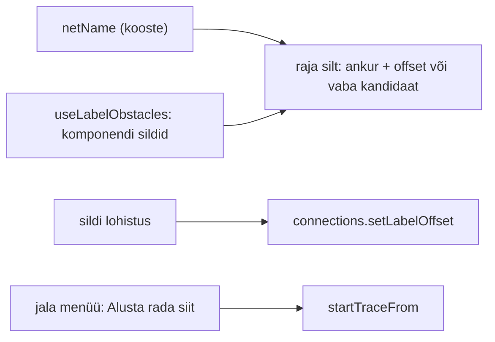

# M2-1-10 · Raja silt ja paremklõps

**Olek:** ehitamiseks · **Rada:** A · **Haru:** `codex/m2-1` (tööpuu `C:/Users/TRUMPIT/.codex/worktrees/bb-m2-1/BB`) · **Alus:** `dcd8425` (M2-1-9) · **Plaan:** [M2.1 › Ülesanne 10](../plans/M2-1-uhendused-ja-vorgud.md#ülesanded) · **Otsus:** 06 › Ühendused (raja silt)

## Eesmärk
Nimega võrgu rajal on võrgu nimi. Sildi saab lohistada sobivasse kohta ühe tagasivõetava sammuga ja asukoht jääb faili. Automaatne raja silt ei kata komponendi silte ega teisi raja silte. Valitud ühenduse omadustes on näha mõlema otsa tähis, alus („nähtud“ või „oletatud“) ja võrk. Jala paremklõpsu menüüst saab alustada rada.

Plaani testid `context_menu_remove_drawing_vs_remove_connection` ja `junction_delete_states_connection_count` jäävad ära: need menüükirjed ja nende käitumine on juba olemas ja testitud (M2-1-5 ja M2-1-6).

## Loe (ainult need)
Loe tööpuust (`dcd8425`). Rea numbrid on tööpuu järgi. `bb_task` laiendab viited põhikaustast, kus on M2.1 eelne kood; ava need read tööpuus.
- `packages/features/components/ui/layers/label-placement.ts:143-215` (komponendi sildi paigutus, `labelOffset`, nähtavus)
- `packages/ui/src/canvas/label-obstacles.ts:1-43` (ühine takistuste kanal)
- `packages/features/components/ui/layers/hits.ts:43-92` (sildi lohistus `drag.commit`-iga)
- `packages/features/connections/ui/index.tsx:1-206` (menüü, valikuliigid, kooste parameetrid)
- `packages/features/connections/ui/TraceTool.ts:56-80` (`begin`, `startExistingTrace`)

## Muuda
- `packages/features/connections/contract.ts` ja `engine/index.ts`: käsk `connections.setLabelOffset` (otsus 2).
- `packages/features/connections/ui/`: raja sildi kiht ja tabamus, ühenduse omaduste jaotis, jala menüükirje, `TraceTool.ts` alguse funktsioon ja tekstid.
- `packages/features/ui.ts`: connections kasutajaliides saab koosteist ka võrgu nime (otsus 1).
- `pnpm api`.

## Ära puutu
- Mootor, domeen, failivorming, invariandid, kest ja `Canvas.tsx`.
- Komponendi sildi paigutus (`label-placement.ts`) ja mõõtmiste näidud.
- Olemasolevad menüükirjed ja nende testid.

## Otsused ja liidesed
1. **Raja silt** (kiht `connections.traceLabels`, `z: 62`).
   - Silt on ainult nimega võrgu (`named: true`) joonistusega ühendusel. Tekst on võrgu nimi otsa `a` võrgu järgi, 11 px monokiri ja halo nagu komponendi sildil.
   - Võrgu nime annab kooste: `createConnectionsUi(ids, { roleColor, netName })`, kus `netName(snapshot, memberKey): string | undefined` tagastab nime ainult nimega võrgule. connections ei impordi nets-i kasutajaliidest.
   - **Ankur** on raja pikima lõigu keskpunkt (`connectionPoints`).
   - Kui `board.labelOffset` on olemas, on sildi keskpunkt `ankur + labelOffset` maailma ühikutes ja seda ei nihutata.
   - **Automaatne koht:** kandidaadid on iga lõigu keskpunkt pikimast alates, mõlemal pool risti 4 px + pool sildi kõrgust ekraanil. Valitakse esimene kandidaat, mis ei kattu `useLabelObstacles()` kastidega ega varem paigutatud raja siltidega (`screenBoxesOverlap`). Kui ükski ei sobi, silti ei näidata.
   - Silti ei näidata, kui pikima lõigu ekraanipikkus on väiksem kui sildi laius.
   - Kiht ei lisa oma kaste `obstacles()`-isse, sest automaatne koht sõltub teiste kihtide kastidest. Raja silt väldib komponendi silte, aga mõõtmiste näidud raja silte veel ei vältida (pole selle kaardi nõue).
2. **Lohistus ja käsk.**
   ```ts
   'connections.setLabelOffset': { id: string; offset: Vec2 | null } // not_found, not_drawn
   ```
   - Sildi tabamus on `{ kind: 'connection-label', id, target: { kind: 'connection', id }, drag: { owner: TRACE_LABEL_DRAG_OWNER, commit } }`. Eelvaade näitab nihutatud silti ja `commit` salvestab `offset = praegune keskpunkt + delta − ankur`. Kõik on üks käsk.
   - Kontekstimenüü „Lähtesta sildi asukoht“ (`available`: valitud ühendusel on `labelOffset`) käivitab käsu `offset: null`-iga.
3. **Ühenduse omadused** (`contextSections`, `appliesTo: ['connection']`, ainult üks valitud ühendus).
   - „{ots A} → {ots B}“ jala kujul `{tähis}.{nimi või id}` või „liitepunkt“.
   - „Alus: nähtud“ (`visual`) või „Alus: oletatud“ (`assumed`).
   - „Võrk: {nimi}“ (`netName` või `N…` tuletisest; puuduva tuletise korral rida puudub).
   - Joonistusega ühendusel on lisaks „Rada · pealmine · 0,30 mm“, „Rada · alumine · …“ või „Juhe · …“.
4. **Jala menüü.** Kirje „Alusta rada siit“ (`appliesTo: ['pin']`, `order: 10`) alustab tööriista Rada menüü jalast: uus eksport `startTraceFrom(api, end): boolean` kasutab sama `begin`-i ja aktiveerib tööriista. Pinnajala kiht tuleb jala poolelt nagu klõpsuga alustades.
5. **Tekstid:** „Alusta rada siit“, „Lähtesta sildi asukoht“, „Alus: nähtud“, „Alus: oletatud“, „Võrk: {nimi}“, „liitepunkt“.
6. **Olemasolevad testid.** Ootused jäävad samaks. Kõik muudetud testid loetle üleandmises.



## Tõend
- TS:
  - `trace_label_drag_is_one_step_and_survives_reopen` (`packages/features/connections/ui/trace-labels.test.tsx`): nimega võrgu rajal on silt pikima lõigu juures ja nimeta võrgu rajal silti pole. Sildi lohistus käivitab ühe `connections.setLabelOffset`-i ja `Ctrl+Z` taastab. Dokumendi uuesti avamine (`host.load`) näitab silti salvestatud kohas. „Lähtesta sildi asukoht“ viib automaatsesse kohta. Valitud ühenduse omadustes on „R1.2 → U1.5“, „Alus: nähtud“ ja „Võrk: VBUS“.
  - `labels_do_not_overlap_each_other` (`packages/features/connections/ui/trace-labels.test.tsx`): komponendi sildi kõrval oleva raja automaatne silt valib kandidaadi, mille ekraanikast ei kattu komponendi sildiga. Kaks lähestikku rada ei saa kattuvaid silte. Liiga lühikese lõiguga rajal silti ei näidata.
  - `context_menu_starts_trace_from_pin` (`packages/features/connections/ui/trace-tool.test.tsx`): jala paremklõpsu menüü „Alusta rada siit“ aktiveerib tööriista Rada ja mustandi algus on see jalg ning selle poole kiht. Järgmine klõps tühjal kohal lisab käänupunkti.
- Põhikaustast `pnpm bb-review-card M2-1-10` → `ok: true`, `missing: []`.

## Valmis kui
- [ ] Testid ja `pnpm check` läbivad.
- [ ] Mootor, domeen ja kest ei muutunud. Olemasolevate testide ootused on samad ja muudetud testid on üleandmises loetletud.
- [ ] Kõik muudetud failid on ≤ 400 rea. `pnpm api` on uuendatud.
- [ ] Üleandmine on allpool, kuni 15 rida.

## Üleandmine
