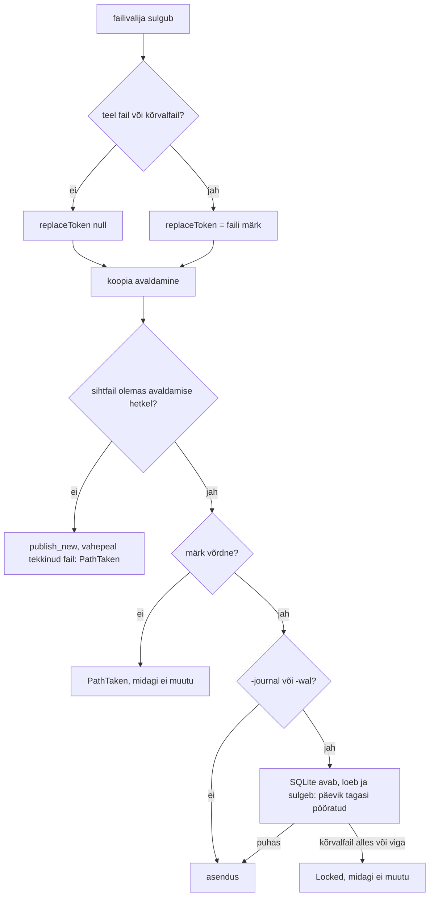

# M2-1-12 · Projektifaili kaitse

**Olek:** kirjutatud · **Rada:** B · **Haru:** `codex/m2-1` (tööpuu `C:/Users/TRUMPIT/.codex/worktrees/bb-m2-1/BB`) · **Alus:** `8a2304d` · **Allikas:** [Astra sõltumatu ülevaatus](../review/2026-11-20-m2-1-ulevaatus-8a2304d.md), leiud 01 ja 02 · [plaan, Osa G ül. 12](../plans/M2-1-uhendused-ja-vorgud.md)

## Eesmärk
Tehniku projektifail ei tohi pärast katkestust avaneda kinnitamata sisuga ega saada üle kirjutatud ilma kasutaja kinnituseta. Astra kinnitas katses kaks viga.
- **01:** olemasoleva projekti asendamisel tõstab [M2-1-H](M2-1-H.md) sihtfaili kuuma tagasipööramispäeviku (`-journal`) nime `.replaced` alla ja asendab faili alles siis. Kui protsess lõpeb nende kahe failitoimingu vahel, jääb vana fail ilma päevikuta. Järgmine avamine näitab kinnitamata andmeid (`UNCOMMITTED audit sample`).
- **02:** „Vali asukoht“ päästekoopial ja „Salvesta mujale“ annavad salvestuskihile ainult tee ja lubavad asendada. Kui valitud vabale teele tekib enne avaldamist teine projekt, kirjutatakse see kinnituseta üle.

Parandus: SQLite pöörab sihtfaili kuuma päeviku tagasi enne asendust, nii et ühtegi andmeid kandvat kõrvalfaili ei tõsteta kõrvale. Failivalija tee kannab kaasa otsuse, kas kasutaja lõi uue faili või kinnitas konkreetse olemasoleva faili asendamise, ja salvestus kontrollib seda otsust avaldamise hetkel.

## Loe (ainult need)
`bb_task` laiendab Loe-viited põhikaustast (vana kood), seega ava read tööpuus. Rea numbrid on `8a2304d` järgi.
- `apps/desktop/src-tauri/src/storage/mod.rs:63-146` (`PendingFile`, `publish`, `publish_new`, `replace_file` ja testikonks `before_replace`; poe `copy` on read 328-340 ja `destination` read 185-211)
- `apps/desktop/src-tauri/src/storage/sidecars.rs:1-91` (`SIDECARS`, `occupied`, `with_parked`)
- `apps/desktop/src-tauri/src/storage/publication_tests.rs:1-156` (konks, kuuma päeviku katse ja muudetav test; lapseprotsessi muster on `tests/support/hot_journal.rs:15-75`)
- `apps/desktop/src-tauri/src/storage/copy.rs:150-165` (`publish`, `write`; `CopyRequest` on read 11-20)
- `packages/ui/src/app/use-workbench.ts:265-300` (`copy`; failivalija on `apps/desktop/src/desktop-host.ts:57-62`, liides `packages/contracts/src/app-host.ts:18`)

## Muuda
- `apps/desktop/src-tauri/src/storage/`:
  - uus `pending.rs`: `PendingFile` ja `replace_file` liiguvad siia muutmata kujul (plaan: `mod.rs` jagatakse järgmisel Rusti puudutusel);
  - `pending.rs` ja `sidecars.rs`: otsus 1;
  - `mod.rs` ja `copy.rs`: otsus 2;
  - testid `publication_tests.rs`-is.
- `apps/desktop/src-tauri/src/ipc.rs`: `project_copy` saab `replace_token`-i, uus käsk `project_replace_token`.
- `packages/contracts/src/app-host.ts` (`SaveTarget`) ja `packages/contracts/src/project-service.ts` (`CopyReq.replaceToken`).
- `packages/adapters/src/storage-tauri.ts` ja `storage-memory.ts`, `apps/desktop/src/desktop-host.ts`.
- `packages/ui/src/app/use-workbench.ts`, `Workbench.tsx` ja testid.
- `pnpm api`.

## Ära puutu
- Failivorming ja skeem (`format_version` ei muutu).
- Faili avamine (`ProjectDb::open`). Oma päevikuga faili avamine jääb SQLite'i tavaliseks taastuseks.
- Eksklusiivne avaldamine (`publish_new`) ja automaatne päästekoopia vaiketeele. Need jäävad, nagu M2-1-H need tegi.
- Taastamine varukoopiast. See keeldub olemasolevast sihtfailist juba praegu.
- Koodiülevaatuse 2026-11-19 leiud 04–06 (pikk Windowsi tee, puuduvaks märgitud projekt, vigane fail hiljutistes). Need jäävad plaani järgi hiljemaks, hiljemalt M4.3.
- Kasutaja päris projektid ja fotod: ainult sünteetilised failid.

## Otsused ja liidesed
1. **Asendus ilma kuuma päeviku liigutamiseta (01).** `PendingFile::publish` muutub nii:
   - Kui sihtfail on olemas ja selle kõrval on `-journal` või `-wal`, avab avaldamine sihtfaili tavalise SQLite'i ühendusega. Ühendusel on `busy_timeout` 0. Avaldamine loeb skeemi ja sulgeb ühenduse. Nii pöörab SQLite kuuma päeviku tagasi vanasse faili ja kustutab selle.
   - Taastamiseks ei kasutata `ProjectDb::open`-i, sest asendatav fail ei pruugi olla BB projekt.
   - Kui pärast taastamist on `-journal` või `-wal` alles või taastamine ebaõnnestub (lukus, pole SQLite), lõpeb asendus veaga `Reason::Locked`. Sihtfaili ega selle kõrvalfaile ei muudeta.
   - Andmeid kandvaid kõrvalfaile (`-journal`, `-wal`) ei tõsteta kunagi kõrvale. `-shm` ei kanna püsivaid andmeid. Selle võib endiselt tõsta kõrvale ja pärast õnnestumist kustutada (`with_parked` ainult `-shm`-ile).
   - Tulemus. Kui protsess lõpeb enne asendust, avaneb sihtfail viimase kinnitatud versioonina. Kui protsess lõpeb pärast asendust, avaneb uus fail. Vahepealset olekut pole.
2. **Uus fail või kinnitatud asendus (02).**
   - `AppHost.pickSavePath` tagastab `SaveTarget | null`, kus `SaveTarget = { path: string; replaceToken: string | null }`.
   - Töölaua host küsib kohe pärast failivalija sulgemist Rusti käsult `project_replace_token(path)` märgi:
     - `null`, kui teel ega selle kõrval faili pole;
     - muidu olemasoleva faili märk (faili suurus ja muutmisaeg). Teistsugune fail samal teel annab teise märgi.
   - Märk tähendab, et kasutaja kinnitas failivalijas just selle faili asendamise. Windowsi salvestusdialoog küsib olemasoleva faili asendamist ise.
   - `CopyReq` saab välja `replaceToken?: string`. Rust saab `project_copy` argumendi `replace_token: Option<String>` ja `CopyRequest` välja `replace_token: Option<&str>`.
   - Mitte-eksklusiivne koopia avaldamisel:
     - kui sihtfaili ega kõrvalfaili pole, luuakse fail eksklusiivselt (`publish_new`). Vahepeal tekkinud fail annab `PathTaken`;
     - kui fail on olemas, võrreldakse selle praegust märki `replace_token`-iga vahetult enne avaldamist. Ainult võrdse märgi korral asendatakse fail otsuse 1 järgi, muidu tuleb `PathTaken`.
   - Ilma märgita mitte-eksklusiivne koopia ei asenda seega kunagi olemasolevat faili.
   - Mäluadapter rakendab sama reeglit oma failidele, märgi kuju valib ehitaja.
   - UI: „Salvesta mujale“, „Vali asukoht“ ja sulgemisdialoogi koopia saadavad valiku `replaceToken`-i. `PathTaken` näitab olemasolevat teksti `et.reason.exists` („See failinimi on juba kasutusel. Vali uus failinimi.“). Midagi ei aktiveerita ega asendata.
   - Taastamine varukoopiast kasutab ainult `SaveTarget.path`-i.

## Tõend
Iga Rusti test avab tulemuse pärast sulgemist uuesti ning kontrollib projekti ID-d, faili ID-d ja dokumendi nime. Kuum päevik tehakse päris SQLite'i tehinguga (`hot_journal::leave_hot_journal`). Seniste testide `create_replace_ignores_stale_journal_of_replaced_file`, `copy_replace_ignores_stale_journal_of_replaced_file` ja `rescue_copy_never_replaces_late_file` ootused jäävad samaks. Ehitaja lisab neile ainult uue välja `replace_token`.
- Rust:
  - `killed_replace_reopens_last_committed_version` (`publication_tests.rs`): projektil A („Original A“) on kuum päevik. Lapseprotsess asendab A uue projektiga B. Testikonks `before_replace` lõpetab protsessi enne `replace_file`-i (`process::exit`), koristust ei toimu. Taasavamisel on A ID, sama faili ID ja nimi „Original A“. `8a2304d` peal annab see test RED-i nimega „Uncommitted writer“.
  - `failed_replace_keeps_last_committed_version` (`publication_tests.rs`, asendab testi `failed_replace_puts_sidecars_back`): kuuma päevikuga A asendamine ebaõnnestub konksu veaga `Locked`. A avaneb nimega „Original A“ ja sama faili ID-ga. Kõrvale tõstetud faile pole ja kõrvalise projekti C ID ning nimi on samad.
  - `confirmed_replace_refuses_changed_destination` (`publication_tests.rs`): A märk loetakse. Enne avaldamist asendatakse A teel projektiga C (konks või otse). Koopia märgiga A annab `PathTaken` ja C avaneb oma ID ja nimega. Võrdse märgiga koopia asendab faili ja avaneb lähte ID-ga.
- TS:
  - `picker_copy_sends_create_or_confirmed_replace` (`use-workbench.test.ts` või olemasolev koopiatest): vaba tee korral saadab „Salvesta mujale“ koopia ilma `replaceToken`-ita. Olemasoleva tee korral saadab ta hosti antud märgi.
  - `picker_copy_reports_taken_path_without_replacing` (sama fail): koopia annab `exists`. Näha on tekst `et.reason.exists`, projekt jääb samaks ja sulgemist ega uuesti laadimist ei tehta.
- Põhikaustast `pnpm bb-review-card M2-1-12` (rada B: lisaks `cargo test` ja `pnpm tauri build --debug`).

## Valmis kui
- [ ] Testid ja käsud läbivad, `docs/api` on uuendatud.
- [ ] Üleandmises on iga Rusti testi taasavamise tulemus (projekti ID, faili ID, dokumendi nimi) ja `killed_replace_reopens_last_committed_version` RED-i nimi `8a2304d` peal.
- [ ] Üleandmine ütleb, kas Tauri salvestusdialoog küsib Windowsis olemasoleva faili asendamist (allikas: pistikprogrammi kood või dokumentatsioon, uusi sõltuvusi ei lisata).
- [ ] `storage/mod.rs` on alla 400 rea.
- [ ] Üleandmine on allpool, kuni 20 rida.

## Üleandmine
