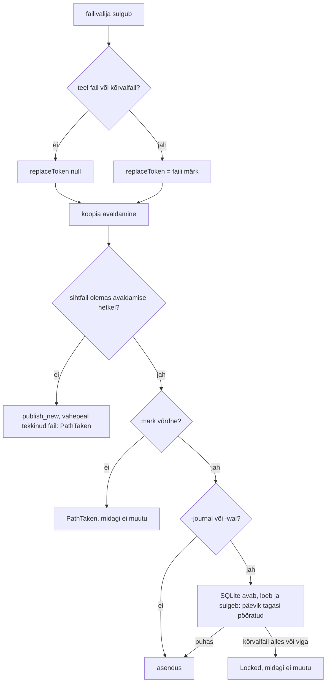

# M2-1-12 · Projektifaili kaitse

**Olek:** vastu võetud `fbc590c` · **Rada:** B · **Haru:** `codex/m2-1` (tööpuu `C:/Users/TRUMPIT/.codex/worktrees/bb-m2-1/BB`) · **Alus:** `8a2304d` · **Allikas:** [Astra sõltumatu ülevaatus](../review/2026-11-20-m2-1-ulevaatus-8a2304d.md), leiud 01 ja 02 · [plaan, Osa G ül. 12](../plans/M2-1-uhendused-ja-vorgud.md)

## Eesmärk
Tehniku projektifail ei tohi pärast katkestust avaneda kinnitamata sisuga ega saada üle kirjutatud ilma kasutaja kinnituseta. Astra kinnitas katses kaks viga.
- **01:** olemasoleva projekti asendamisel tõstab [M2-1-H](M2-1-H.md) sihtfaili kuuma tagasipööramispäeviku (`-journal`) nime `.replaced` alla ja asendab faili alles siis. Kui protsess lõpeb nende kahe failitoimingu vahel, jääb vana fail ilma päevikuta. Järgmine avamine näitab kinnitamata andmeid (`UNCOMMITTED audit sample`).
- **02:** „Vali asukoht“ päästekoopial ja „Salvesta mujale“ annavad salvestuskihile ainult tee ja lubavad asendada. Kui valitud vabale teele tekib enne avaldamist teine projekt, kirjutatakse see kinnituseta üle.

Parandus: SQLite pöörab sihtfaili kuuma päeviku tagasi enne asendust, nii et ühtegi andmeid kandvat kõrvalfaili ei tõsteta kõrvale. Failivalija tee kannab kaasa otsuse, kas kasutaja lõi uue faili või kinnitas konkreetse olemasoleva faili asendamise, ja salvestus kontrollib seda otsust avaldamise hetkel.

## Loe (ainult need)
`bb_task` laiendab Loe-viited põhikaustast (vana kood), seega ava read tööpuus. Rea numbrid on `8a2304d` järgi.
- `apps/desktop/src-tauri/src/storage/mod.rs:63-146` (`PendingFile`, `publish`, `publish_new`, `replace_file` ja testikonks `before_replace`; poe `copy` on read 328-340 ja `destination` read 185-211)
- `apps/desktop/src-tauri/src/storage/sidecars.rs:1-91` (`SIDECARS`, `occupied`, `with_parked`)
- `apps/desktop/src-tauri/src/storage/publication_tests.rs:1-156` (konks, kuuma päeviku katse ja muudetav test; lapseprotsessi muster on `tests/support/hot_journal.rs:15-75`)
- `apps/desktop/src-tauri/src/storage/copy.rs:150-165` (`publish`, `write`; `CopyRequest` on read 11-20)
- `packages/ui/src/app/use-workbench.ts:265-300` (`copy`; failivalija on `apps/desktop/src/desktop-host.ts:57-62`, liides `packages/contracts/src/app-host.ts:18`)

## Muuda
- `apps/desktop/src-tauri/src/storage/`:
  - uus `pending.rs`: `PendingFile` ja `replace_file` liiguvad siia muutmata kujul (plaan: `mod.rs` jagatakse järgmisel Rusti puudutusel);
  - `pending.rs` ja `sidecars.rs`: otsus 1;
  - `mod.rs` ja `copy.rs`: otsus 2;
  - testid `publication_tests.rs`-is.
- `apps/desktop/src-tauri/src/ipc.rs`: `project_copy` saab `replace_token`-i, uus käsk `project_replace_token`.
- `packages/contracts/src/app-host.ts` (`SaveTarget`) ja `packages/contracts/src/project-service.ts` (`CopyReq.replaceToken`).
- `packages/adapters/src/storage-tauri.ts` ja `storage-memory.ts`, `apps/desktop/src/desktop-host.ts`.
- `packages/ui/src/app/use-workbench.ts`, `Workbench.tsx` ja testid.
- `pnpm api`.

## Ära puutu
- Failivorming ja skeem (`format_version` ei muutu).
- Faili avamine (`ProjectDb::open`). Oma päevikuga faili avamine jääb SQLite'i tavaliseks taastuseks.
- Eksklusiivne avaldamine (`publish_new`) ja automaatne päästekoopia vaiketeele. Need jäävad, nagu M2-1-H need tegi.
- Taastamine varukoopiast. See keeldub olemasolevast sihtfailist juba praegu.
- Koodiülevaatuse 2026-11-19 leiud 04–06 (pikk Windowsi tee, puuduvaks märgitud projekt, vigane fail hiljutistes). Need jäävad plaani järgi hiljemaks, hiljemalt M4.3.
- Kasutaja päris projektid ja fotod: ainult sünteetilised failid.

## Otsused ja liidesed
1. **Asendus ilma kuuma päeviku liigutamiseta (01).** `PendingFile::publish` muutub nii:
   - Kui sihtfail on olemas ja selle kõrval on `-journal` või `-wal`, avab avaldamine sihtfaili tavalise SQLite'i ühendusega. Ühendusel on `busy_timeout` 0. Avaldamine loeb skeemi ja sulgeb ühenduse. Nii pöörab SQLite kuuma päeviku tagasi vanasse faili ja kustutab selle.
   - Taastamiseks ei kasutata `ProjectDb::open`-i, sest asendatav fail ei pruugi olla BB projekt.
   - Kui pärast taastamist on `-journal` või `-wal` alles või taastamine ebaõnnestub (lukus, pole SQLite), lõpeb asendus veaga `Reason::Locked`. Sihtfaili ega selle kõrvalfaile ei muudeta.
   - Andmeid kandvaid kõrvalfaile (`-journal`, `-wal`) ei tõsteta kunagi kõrvale. `-shm` ei kanna püsivaid andmeid. Selle võib endiselt tõsta kõrvale ja pärast õnnestumist kustutada (`with_parked` ainult `-shm`-ile).
   - Tulemus. Kui protsess lõpeb enne asendust, avaneb sihtfail viimase kinnitatud versioonina. Kui protsess lõpeb pärast asendust, avaneb uus fail. Vahepealset olekut pole.
2. **Uus fail või kinnitatud asendus (02).**
   - `AppHost.pickSavePath` tagastab `SaveTarget | null`, kus `SaveTarget = { path: string; replaceToken: string | null }`.
   - Töölaua host küsib kohe pärast failivalija sulgemist Rusti käsult `project_replace_token(path)` märgi:
     - `null`, kui teel ega selle kõrval faili pole;
     - muidu olemasoleva faili märk (faili suurus ja muutmisaeg). Teistsugune fail samal teel annab teise märgi.
   - Märk tähendab, et kasutaja kinnitas failivalijas just selle faili asendamise. Windowsi salvestusdialoog küsib olemasoleva faili asendamist ise.
   - `CopyReq` saab välja `replaceToken?: string`. Rust saab `project_copy` argumendi `replace_token: Option<String>` ja `CopyRequest` välja `replace_token: Option<&str>`.
   - Mitte-eksklusiivne koopia avaldamisel:
     - kui sihtfaili ega kõrvalfaili pole, luuakse fail eksklusiivselt (`publish_new`). Vahepeal tekkinud fail annab `PathTaken`;
     - kui fail on olemas, võrreldakse selle praegust märki `replace_token`-iga vahetult enne avaldamist. Ainult võrdse märgi korral asendatakse fail otsuse 1 järgi, muidu tuleb `PathTaken`.
   - Ilma märgita mitte-eksklusiivne koopia ei asenda seega kunagi olemasolevat faili.
   - Mäluadapter rakendab sama reeglit oma failidele, märgi kuju valib ehitaja.
   - UI: „Salvesta mujale“, „Vali asukoht“ ja sulgemisdialoogi koopia saadavad valiku `replaceToken`-i. `PathTaken` näitab olemasolevat teksti `et.reason.exists` („See failinimi on juba kasutusel. Vali uus failinimi.“). Midagi ei aktiveerita ega asendata.
   - Taastamine varukoopiast kasutab ainult `SaveTarget.path`-i.

## Tõend
Iga Rusti test avab tulemuse pärast sulgemist uuesti ning kontrollib projekti ID-d, faili ID-d ja dokumendi nime. Kuum päevik tehakse päris SQLite'i tehinguga (`hot_journal::leave_hot_journal`). Seniste testide `create_replace_ignores_stale_journal_of_replaced_file`, `copy_replace_ignores_stale_journal_of_replaced_file` ja `rescue_copy_never_replaces_late_file` ootused jäävad samaks. Ehitaja lisab neile ainult uue välja `replace_token`.
- Rust:
  - `killed_replace_reopens_last_committed_version` (`publication_tests.rs`): projektil A („Original A“) on kuum päevik. Lapseprotsess asendab A uue projektiga B. Testikonks `before_replace` lõpetab protsessi enne `replace_file`-i (`process::exit`), koristust ei toimu. Taasavamisel on A ID, sama faili ID ja nimi „Original A“. `8a2304d` peal annab see test RED-i nimega „Uncommitted writer“.
  - `failed_replace_keeps_last_committed_version` (`publication_tests.rs`, asendab testi `failed_replace_puts_sidecars_back`): kuuma päevikuga A asendamine ebaõnnestub konksu veaga `Locked`. A avaneb nimega „Original A“ ja sama faili ID-ga. Kõrvale tõstetud faile pole ja kõrvalise projekti C ID ning nimi on samad.
  - `confirmed_replace_refuses_changed_destination` (`publication_tests.rs`): A märk loetakse. Enne avaldamist asendatakse A teel projektiga C (konks või otse). Koopia märgiga A annab `PathTaken` ja C avaneb oma ID ja nimega. Võrdse märgiga koopia asendab faili ja avaneb lähte ID-ga.
- TS:
  - `picker_copy_sends_create_or_confirmed_replace` (`use-workbench.test.ts` või olemasolev koopiatest): vaba tee korral saadab „Salvesta mujale“ koopia ilma `replaceToken`-ita. Olemasoleva tee korral saadab ta hosti antud märgi.
  - `picker_copy_reports_taken_path_without_replacing` (sama fail): koopia annab `exists`. Näha on tekst `et.reason.exists`, projekt jääb samaks ja sulgemist ega uuesti laadimist ei tehta.
- Põhikaustast `pnpm bb-review-card M2-1-12` (rada B: lisaks `cargo test` ja `pnpm tauri build --debug`).

## Valmis kui
- [x] Testid ja käsud läbivad, `docs/api` on uuendatud.
- [x] Üleandmises on iga Rusti testi taasavamise tulemus (projekti ID, faili ID, dokumendi nimi) ja `killed_replace_reopens_last_committed_version` RED-i nimi `8a2304d` peal.
- [x] Üleandmine ütleb, kas Tauri salvestusdialoog küsib Windowsis olemasoleva faili asendamist (allikas: pistikprogrammi kood või dokumentatsioon, uusi sõltuvusi ei lisata).
- [x] `storage/mod.rs` on alla 400 rea.
- [x] Üleandmine on allpool, kuni 20 rida.

## Arhitekti vastus ehitajale (2026-11-20)

**Küsimus:** `create_replace_ignores_stale_journal_of_replaced_file` paneb kuuma päeviku kõrvale kunstliku `-wal`-i ja ootab edukat asendust. Otsus 1 nõuab aga allesjäänud `-wal`-i korral `Locked`-i.

**Vastus (täpsustatud pärast ehitaja proovi):** vana testi seadistus jääb muutmata.
- Ehitaja proov BB SQLite 3.54.1-ga näitas, et taastamine annab nime „Original A“ ning eemaldab päeviku ja kunstlikud `-wal`- ja `-shm`-failid. Asendus õnnestub, nagu vana test ootab.
- Otsus 1 jääb muutmata. `-journal` või `-wal` korral taastab SQLite faili. Kui mõni neist jääb pärast taastamist alles, on tulemus `Locked`. `-shm`-i võib endiselt kõrvale tõsta.

**Küsimus 2:** Windowsi dialoog küsib olemasoleva faili asendamist, kuid Tauri tagastab ainult tee. Fail võib ilmuda või vahetuda dialoogi sulgemise ja märgi lugemise vahel. Kas siduda märk BB eraldi asenduskinnitusega või kaitsta ainult märgi lugemisest avaldamiseni?

**Vastus:** kaitse ainult märgi lugemisest avaldamiseni. BB oma kinnitust ei lisata.
- Märk loetakse kohe pärast dialoogi sulgemist, enne koopia ettevalmistust. Jääkvahe kestab millisekundeid.
- Koopia ettevalmistus (snapshot, fotod, logi) võib kesta sekundeid. Selle vahe katab märk täielikult. Astra katse kuulub just sellesse vahesse.
- BB oma küsimus tähendaks, et iga „Salvesta mujale“ olemasoleva faili peale küsitaks kaks korda. Tauri ei luba Windowsi küsimust välja lülitada.
- Kirjuta jääkvahe üleandmisse ühe reana. Testid jäävad kaardi loendi järgi.

## Üleandmine

- Tööpuu `C:/Users/TRUMPIT/.codex/worktrees/bb-m2-1/BB`, haru `codex/m2-1`, puhas alus `8a2304d`. Katsed kasutasid sünteetilisi faile.
- Aluse `8a2304d` RED-is avas `killed_replace_reopens_last_committed_version` projekti A nimega **„Uncommitted writer“**. Tööpuu `output/playwright/m2-1-12/rust-publication-red.log`.
- GREEN-is avas `killed_replace_reopens_last_committed_version` sama `project-a`, faili ID `40f4e34a-8670-46bd-bc0e-b86e1015ec8d` ja nime „Original A“.
- `failed_replace_keeps_last_committed_version` avas uuesti `project-a`, faili ID `5f2a1519-b722-4b53-976f-8fd24b0cadc1` ja nime „Original A“. Kõrvaline `project-c`, faili ID `745bdbf9-fa31-4ca4-8f1d-ca6d2e2fd1d0`, „Independent C“, säilis.
- Testis `confirmed_replace_refuses_changed_destination` andis vana märk `PathTaken` ja taasavanes `project-c`, faili ID `08a30760-86fc-4707-aaf1-0bd0411a2098`, „Independent C“. Värske märgiga avanes `project-b`, faili ID `50d888c5-290a-445c-b207-446bb5bf1703`, „Copy source B“.
- SQLite taastab `-journal`-i või `-wal`-iga sihtfaili enne asendust. Kõrvale saab tõsta ainult `-shm`-i. Vana loomistesti WAL/SHM-fixture läbis muutmata. Taasavamiste logi `output/playwright/m2-1-12/rust-publication-green.log`.
- Mõlemad valitud tee TS-testid läbisid RED → GREEN. Vabale teele läheb koopia märgita. Hiline sihtfail säilib ja kasutaja näeb failinime veateadet. Tööpuus `output/playwright/m2-1-12/picker-copy-{red,green}.log` ja `picker-copy-late-file-baseline-red.log`.
- Windowsi salvestusdialoog küsib olemasoleva faili asendamist. Lukufaili `tauri-plugin-dialog 2.8.4` kasutab `rfd 0.17.2` kaudu Windowsi `FileSaveDialog`-i vaikimisi `FOS_OVERWRITEPROMPT`-iga. Plugina `src/commands.rs:222–258` tagastab ainult tee. [Windowsi dialoogi dokumentatsioon](https://learn.microsoft.com/en-us/windows/win32/api/shobjidl_core/ne-shobjidl_core-_fileopendialogoptions)
- Arhitekti hinnangul millisekundites jääkvahe on dialoogi sulgemise ja sellele kohe järgneva märgilugemise vahel. Kontroll katab seejärel koopia ettevalmistuse kuni avaldamiseni.
- Olemasolevate testide ootused säilisid. Rusti koopiapäringutele lisandus `replace_token`, TS-i olemasolevad koopiatestid kasutavad uut märki või `SaveTarget`-i kujuga mock’i.
- `pnpm api` ja tüübikontroll läbisid. `storage/mod.rs` on 343 rida.
- Esimese täisringi `zoom_keeps_point_under_cursor` jäljes oli kahe rattasündmuse vahe 155 ms ja rahunemispiir 120 ms. Põhikausta tõend `output/review-card/M2-1-12-Ajw4q1/e2e.log` ja selle jooksu `playwright/` jälg.
- Muutmata koodi kordusring põhikaustast andis `ok: true`, `missing: []`. Läbisid 1675 ühiktesti, 43 E2E ja 107 Rusti testi (2 lapseprotsessi testi on üldjooksus vahele jäetud) ning `pnpm tauri build --debug`. Põhikaustas `output/review-card/M2-1-12-Rprl25/summary.json`.

## Arhitekti ülevaatus (2026-11-20)

Kontrollisin tööpuu diffi alusel `8a2304d`: 28 faili ja uus `storage/pending.rs`. Ehitaja kokkuvõte `output/review-card/M2-1-12-Rprl25/summary.json` on uuem kui tööpuu viimane muudatus, seega käske uuesti ei käivitanud.

- **Otsus 1 (01):** `pending.rs` `replace` kutsub enne asendust `sidecars::recover_for_replace`.
  - Kui on `-journal` või `-wal`, avab funktsioon faili ilma `CREATE`-ita, `busy_timeout` on 0. Seejärel loeb ta `sqlite_schema` ja sulgeb ühenduse.
  - Kui taastamine ebaõnnestub või kõrvalfail jääb alles, on tulemus `Locked`. Sama kontroll kordub vahetult enne `replace_file`-i.
  - `with_parked` tõstab kõrvale ainult `-shm`-i.
  - `killed_replace_reopens_last_committed_version` käivitab päris lapseprotsessi, mis lõpeb konksus `process::exit`-iga. Test avab „Original A“ sama faili ID-ga. RED `8a2304d` peal oli „Uncommitted writer“.
- **Otsus 2 (02):**
  - Märgita mitte-eksklusiivne koopia läheb `publish_new`-i ega asenda kunagi olemasolevat faili.
  - Märgiga koopia (`publish_confirmed`) avab sihtfaili, võrdleb märki, hoiab käepidet ja kontrollib sama faili uuesti vahetult enne asendust. Taastamise järel võetakse aluseks käepideme uus suurus ja muutmisaeg.
  - Ainult kõrvalfailiga tee annab märgi `sidecar`. See ei luba tulevast põhifaili asendada.
  - Käsk `project_replace_token` on registreeritud ja lubatud (`main.rs`, `permissions/workbench.toml`).
  - Host loeb märgi kohe pärast dialoogi. Mäluadapter rakendab sama reeglit.
  - UI näitab `exists` korral teksti `et.reason.exists`. TS-test kontrollib teksti DOM-is. Muu UI ei muutunud, seega brauserikontrolli ei teinud.
- **Ulatus:** failivorming, `ProjectDb::open`, taastamine ja `publish_new` jäid muutmata. `storage/mod.rs` on 343 rida. Uusi sõltuvusi pole.
- **Kokkuvõte:** `ok: true`, `missing: []`, kaardi testid 5/5 läbisid. Vitest 1675/1675 (katvus: read 99,72 %, harud 96,27 %), E2E 43/43, Rust 107 läbis. Kaks lapseprotsessi sisendpunkti on üldjooksus `#[ignore]`-iga vahele jäetud, nagu M2-1-H-s. `pnpm tauri build --debug` läbis.

**Otsus: sobib.**

Mitteblokeerivad märkused:
1. Märk on faili suurus ja muutmisaeg. NTFS-i 100 ns täpsuse juures on sama suuruse ja ajaga teine fail praktiliselt võimatu.
2. Dialoogi sulgemise ja märgi lugemise vahel jääb millisekundiline jääkvahe. Kasutaja kinnitas selle 2026-11-20 ja see on üleandmises kirjas.
3. Esimeses täisringis kukkus ajastustundlik `zoom_keeps_point_under_cursor`: rattasündmuste vahe oli 155 ms, piir 120 ms. Muutmata koodiga kordus läbis. Kui see kordub, stabiliseerib selle järgmine lõuendit puudutav kaart.

## CI järelparandus (2026-11-20)

Haru CI kukkus `fbc590c` peal (run 44748304445). Test `copy_replaces_confirmed_destination_but_not_open_source` (`apps/desktop/src-tauri/tests/copy.rs:221`) ootas avatud failile kopeerimisel `Locked`-i, kuid sai `PathTaken`-i. Kohalikus täisringis see test läbis.

- Tõenäoline põhjus. GitHubi Windowsi masina `TEMP` on lühinimega (`RUNNER~1`). `absolute()` kanoniseerib ainult olemasoleva faili tee, seega uuena loodud seansi tee jääb lühikujule. Hilisem võrdlus kanoonilise teega ei tunne avatud seanssi ära.
- Varem andis `Locked`-i Windowsi faililuku tõttu asendus ise. Nüüd läheb märgita koopia `publish_new`-i ja annab õigesti `PathTaken`-i. Faili ei kirjutata kummalgi juhul üle.
- CI-s ei jõudnud käima `copy.rs`-ile järgnevad Rusti testifailid ja `cargo clippy`. Ühiktestid (`src/lib.rs`), `check`, `coverage`, `format:check` ja E2E läbisid.

**Parandus 1 (ehitajale).** Testi tsüklis `for blocked in [&original, &dest]` saadab koopia selle tee märgi (`replace_token(blocked)`). Nii kontrollib test, et ka kinnitatud asendus ei kirjuta avatud projekti üle: tulemus on `Locked`, ükskõik kas seansikontroll tunneb tee ära. Muud ootused jäävad samaks. Muuta tohib ainult `tests/copy.rs`-i.

**Parandatud** `763c373` (cargo test `--test copy` 6/6 ja clippy läbisid tööpuus). Lühinimega tee normaliseerimine (`absolute()` uue faili korral) on varasem viga. See läheb järgmise salvestuse kaardi juurde koos koodiülevaatuse 2026-11-19 leidudega 04–06.
