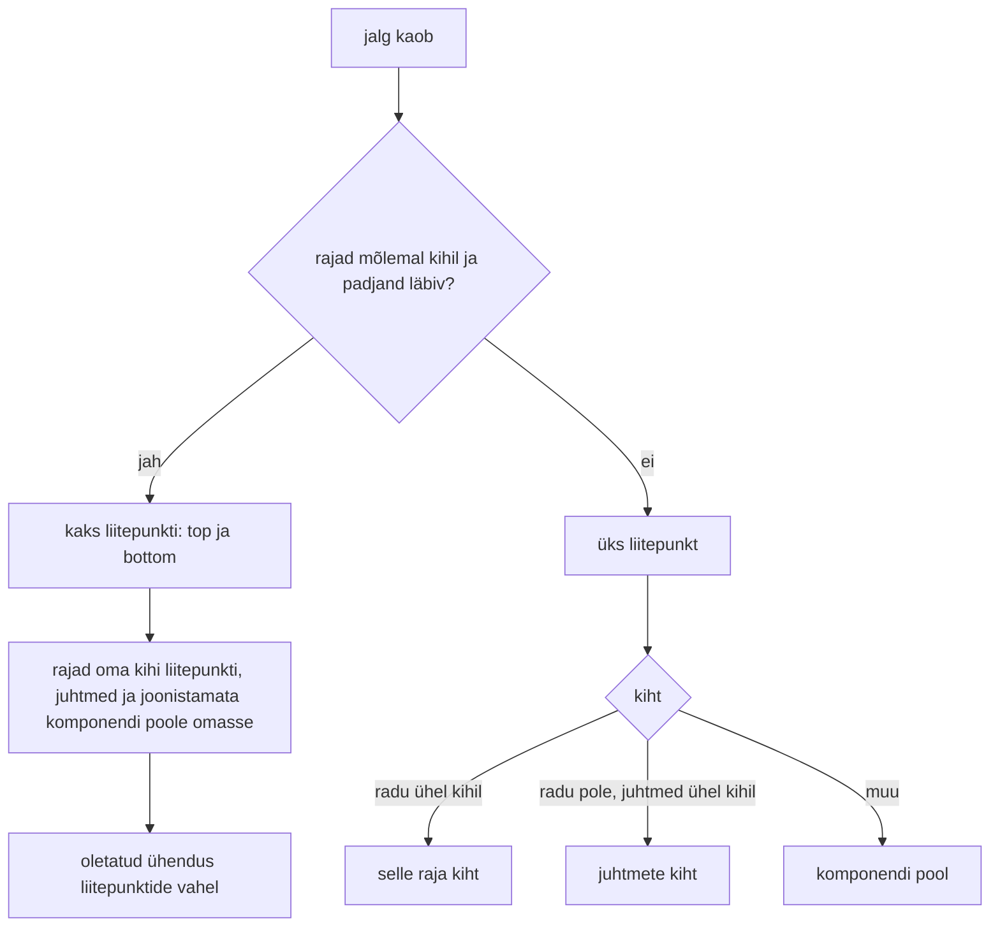

# M2-1-13 · Ühenduste andmete terviklus

**Olek:** kirjutatud · **Rada:** B · **Haru:** `codex/m2-1` (tööpuu `C:/Users/TRUMPIT/.codex/worktrees/bb-m2-1/BB`) · **Alus:** `fbc590c` · **Allikas:** [Astra sõltumatu ülevaatus](../review/2026-11-20-m2-1-ulevaatus-8a2304d.md), leiud 04, 05, 07 ja 13 · [plaan, Osa G ül. 13](../plans/M2-1-uhendused-ja-vorgud.md)

## Eesmärk
Võrk peab näitama ainult neid ühendusi, mis plaadil päriselt olemas on. Astra kinnitas katses neli viga.
- **04:** pinnajalaga komponendi poolevahetus jätab ülemise raja otsa jalale, mis on nüüd alumisel poolel. Järgmine alumine rada liidab mõlemad kihid ühte võrku ilma läbiva padjandita.
- **05:** läbiva jala kustutamisel saavad ülemine ja alumine rada ühe liitepunkti esimese ühenduse kihil. Teise kihi raja ots on siis vales kihis ja tulemus sõltub ühenduste järjekorrast failis.
- **07:** jala võti on tekst `komponent:jalg` ja liitepunkti võti on tema ID. Lubatud tunnused `('cmp_a', 'b:1')` ja `('cmp_a:b', '1')` saavad sama võtme. Liitepunkti viide `{junction: 'cmp_a:1'}` leiab jala, kuigi liitepunkti pole.
- **13:** C-kiirühendus arvutab iga jalapaari järel kõik võrgud uuesti. 64 jala ühendamine 3000 jalaga plaadil võtab üle sekundi.

Kasutaja kinnitas lahenduse 2026-11-20. Läbiva jala kadumisel saab iga kasutatud kiht oma liitepunkti ja nende vahele tuleb oletatud ühendus, sest plaaditud ava ühendab kihte edasi.

## Loe (ainult need)
`bb_task` laiendab Loe-viited põhikaustast (vana kood), seega ava read tööpuus. Rea numbrid on `fbc590c` järgi.
- `packages/domain/src/rules/connections.ts:23-80` (`newJunction`, `detachPins`; kutsujad `packages/domain/src/rules/items.ts:36-44` ja `removePins` read 66-94)
- `packages/domain/src/rules/layers.ts:1-37` (`endAcceptsDrawing`)
- `packages/domain/src/rules/nets.ts:1-59` (`pinKey`, `endKey`, `endRefsByKey`, `resolveNets`)
- `packages/features/components/engine/commands.ts:297-306` (`components.flipSide`)
- `packages/features/connections/engine/index.ts:47-67` (`connections.add`, `skipJoined`; kiirühendus `packages/features/connections/ui/index.tsx:82-96`)

## Muuda
- `packages/domain/src/rules/connections.ts`: otsused 1 ja 2.
- `packages/domain/src/rules/items.ts` või uus väike reeglifail: poolevahetuse reegel (otsus 1).
- `packages/domain/src/rules/nets.ts`: otsused 3 ja 4.
- `packages/features/components/engine/commands.ts`: `flipSide` kutsub domeenireeglit.
- `packages/features/connections/engine/index.ts`: `connections.add` (otsus 4).
- Testid: `packages/domain/src/rules/connections.test.ts`, `nets.test.ts`, `packages/features/connections/connections.test.ts`.
- `pnpm api`, kui avalik liides muutub.

## Ära puutu
- Failivorming ja skeem. Uut invarianti ei lisata, nii et senised failid avanevad nagu praegu.
- Seniste failide identifikaatorid. Ühtegi komponendi, jala ega liitepunkti ID-d ei nimetata ümber.
- Leiud 03, 06 ja 08–12 (M2-1-14) ning 14–20 (M2.2).
- Juhtmed (`kind: 'wire'`) ja joonistamata ühendused poolevahetusel. Need ei sõltu kihist.

## Otsused ja liidesed
1. **Poolevahetus (04).** Uus domeenireegel, mida kutsub `components.flipSide` (ADR-005: moodulitevaheline reegel on domeenis).
   - Reegel arvutab vahetatavate komponentide padjandite asukohad enne poolevahetust ja vahetab seejärel poole.
   - Iga raja (`kind: 'trace'`) ots, mis on vahetatud komponendi jalal ja mida `endAcceptsDrawing` uue poolega enam ei luba, saab liitepunkti. Liitepunkt on padjandi senises kohas, raja kihil.
   - Ühe jala sama kihi rajad jagavad üht liitepunkti. ID tuleb `newJunction`-iga nagu kustutamisel.
   - Läbivad padjandid, juhtmed ja joonistamata ühendused jäävad muutmata. Poolevahetus üksi ei loo kunagi kihtidevahelist ühendust.
   - Kõik toimub ühes käsus, seega üks Ctrl+Z taastab komponendid, ühendused ja liitepunktid.
2. **Kaduv jalg (05).** `detachPins` arvutab iga kaduva jala liitepunktid ühenduste hulgast, mitte järjekorrast. Seda kasutavad kustutamine, jala eemaldamine ja korpuse vahetus.
   - `T` on selle jala radade (`kind: 'trace'`) kihtide hulk.
   - **Läbiv padjand ja `T = {top, bottom}`:**
     - tekib kaks liitepunkti, kummagi kihi jaoks üks, padjandi kohas;
     - iga rada saab oma kihi liitepunkti;
     - juhtmed ja joonistamata ühendused saavad komponendi poole liitepunkti;
     - kahe liitepunkti vahele tuleb uus joonistamata ühendus `basis: 'assumed'`.
   - **Muul juhul tekib üks liitepunkt.** Selle kiht on:
     - `T` ainus kiht, kui `T`-s on üks kiht;
     - kui `T` on tühi, juhtmete ühine kiht, kui kõik juhtmed on samal kihil;
     - muidu komponendi pool.
   - ID-d on deterministlikud:
     - komponendi poole liitepunkt saab põhi-ID `jun_<komponent>_<jalg>`, teise kihi oma järgmise vaba sufiksi;
     - oletatud ühendus saab vaba ID kujul `con_via_<komponent>_<jalg>`, vajadusel sufiksiga.
   - Ühenduste järjekord failis ei muuda liitepunkte, ühendusi ega võrke. Kaduva jala sildid eemaldatakse nagu praegu.
   - Senise testi `delete_component_turns_connection_ends_into_junctions` ootused jäävad samaks.
3. **Üheselt kodeeritud võtmed (07).**
   - `pinKey` ja liitepunkti võti `nets.ts`-is kodeerivad liigi üheselt. Soovitus: `:` ja `\` ID-s saavad ette `\`. Jala võti on `esc(c) + ':' + esc(p)`, liitepunkti võti on `esc(id)`. Kodeerimata `:` on ainult jala võtmes.
   - Tunnuse ilma `:` ja `\`-ta võti jääb täpselt samaks. Võrkude järjekord ning nimed N1, N2… ei muutu.
   - `endKey`, `endRefsByKey`, validaator, `connections.add` ja `nets.assign` kasutavad sama kodeeringut. Liitepunkti viide leiab ainult liitepunkti ja jalaviide ainult jala.
4. **Kiirühendus arvutab võrgud üks kord (13).**
   - `nets.ts` saab ühendamisstruktuuri: luuakse dokumendist üks kord, sellel on `find` ja `union`. `resolveNets` kasutab sama struktuuri.
   - `connections.add` koos `skipJoined`-iga loob struktuuri käsu alguses üks kord ja ühendab pärast iga lisatud paari selle kaks võrku.
   - Tulemus on sama mis praegu. Paar jäetakse vahele, kui otsad on juba ühes võrgus, ka sama käsu varasema paari kaudu.

## Tõend
Testid kontrollivad tulemust, võrke ja seda, et iga joonistatud ots läbib `endAcceptsDrawing`-i. Seniste testide ootused jäävad samaks.
- TS:
  - `flip_side_turns_incompatible_trace_ends_into_junctions` (`packages/domain/src/rules/connections.test.ts`): pinnajalaga A on ülemisel poolel ja ülemine rada ühendab A ja B jalgu. `components.flipSide` A peal annab raja A-otsa asemele ülemise liitepunkti A padjandi senises kohas. A ja B pole enam samas võrgus. Alumine rada A ja C vahel on lubatud ning võrgud {A, C} ja {liitepunkt, B} on eraldi. Üks tagasivõtmine taastab dokumendi täpselt. Läbiva jalaga komponendi poolevahetus jätab rajad muutmata.
  - `lost_through_pin_keeps_layers_joined_by_assumed_connection` (sama fail): läbival jalal on ülemine rada, alumine rada ja joonistamata ühendus. Komponendi kustutamine annab kaks liitepunkti (top ja bottom) padjandi kohas, rajad on oma kihi liitepunktil ja nende vahel on oletatud ühendus. Allesjäänud otste võrgud on samad mis enne. Vastupidises järjekorras ühendustega dokument annab samad liitepunktid ja ühendused, välja arvatud nende järjekord loendis.
  - `net_keys_keep_pin_and_junction_ids_apart` (`packages/domain/src/rules/nets.test.ts`): jalad `('cmp_a', 'b:1')` ja `('cmp_a:b', '1')` oma partneritega annavad kaks kaheliikmelist võrku. `{junction: 'cmp_a:1'}` ilma liitepunktita annab sildi ankrule `dangling_label_anchor` ja ühenduse otsale `dangling_connection_end`. `pinKey({ c: 'cmp_1', p: '1' })` on endiselt `cmp_1:1`.
  - `quick_connect_resolves_nets_once` (`packages/features/connections/connections.test.ts`): sünteetiline plaat 300 komponendi, 3000 jala ja 900 ühendusega. 64 valitud jala kiirühendus loob võrkude struktuuri ühe korra (loendur või spioon). Lisatud ühendused on samad mis võrdlusel paarikaupa arvutamisega, sh sama käsu varasema paari kaudu ühendatud paar jäetakse vahele.
- Põhikaustast `pnpm bb-review-card M2-1-13` (rada B: lisaks `cargo test` ja `pnpm tauri build --debug`).

## Valmis kui
- [ ] Testid ja käsud läbivad, `docs/api` on vajadusel uuendatud.
- [ ] Üleandmises on Astra 13. leiu kordus: 64 jala kiirühenduse aeg 300 komponendi, 3000 jala ja 900 ühendusega plaadil enne ja pärast (Node'i mootorikatse).
- [ ] Üleandmises on loetletud seniste testide ootused, mida tuli muuta, ja põhjus. Eeldus on, et neid pole.
- [ ] Üleandmine on allpool, kuni 20 rida.

## Üleandmine
