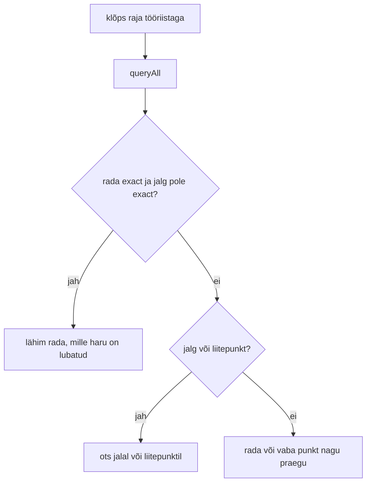

# M2-1-14 · Tööriista siht ja kasutajaliides

**Olek:** vastu võetud `d12a39d` · **Rada:** A · **Haru:** `codex/m2-1` (tööpuu `C:/Users/TRUMPIT/.codex/worktrees/bb-m2-1/BB`) · **Alus:** `fa8e0e9` · **Allikas:** [Astra sõltumatu ülevaatus](../review/2026-11-20-m2-1-ulevaatus-8a2304d.md), leiud 03, 06 ja 08–12 · [plaan, Osa G ül. 14](../plans/M2-1-uhendused-ja-vorgud.md)

## Eesmärk
Tehnik peab nägema, mida tööriist teeb, ja saama sihtida täpselt. Astra leidis seitse kasutajaliidese viga.
- **03:** raja keskele klõpsamine ühendab kõrvalasuva jala, sest jala tabamisraadius on vähemalt 6 ekraanipikslit ja jala prioriteet on suurem. Nähtav padjand võib olla rajast 2,5 px kaugusel.
- **10:** kahe kihi radade ristumiskohas valib indeks esimese raja dokumendis, isegi kui see on vale kihi oma.
- **06:** klaviatuurimenüü (`Shift+F10`) „Alusta rada siit“ tabab uuesti osuti kohta, mitte menüü sihti ehk esimest valitud jalga.
- **08:** korpuse vahetus eemaldab ühendatud jala võrgusildi ja ühenduse ilma eelneva hoiatuseta.
- **09:** võrgu vaates puuduvad piiksu vastuolu ja lühistatud komponendi hoiatused, kuigi mootor need arvutab.
- **11:** „Ühenda võrguga…“ näitab kahte samanimelist võrku ühesuguste nuppudena.
- **12:** kaks eraldi GND-võrku annavad sama CSV-faili kui üks ühendatud GND-võrk.

## Loe (ainult need)
`bb_task` laiendab Loe-viited põhikaustast (vana kood), seega ava read tööpuus. Rea numbrid on `fa8e0e9` järgi.
- `packages/ui/src/canvas/hit-index.ts:155-216` (`query`; liides read 26-29)
- `packages/features/connections/ui/TraceTool.ts:112-142` (`findTarget`; `endpointHit` ja `drawingHit` on `trace-geometry.ts:34-82`)
- `packages/ui/src/canvas/use-canvas-context-menu.ts:113-175` (`openFromKeyboard`, `onContextMenu`; menüükäsk `packages/features/connections/ui/index.tsx:237-255`, liides `packages/ui/src/shell/UiRegistry.ts:28-36`)
- `packages/features/components/ui/footprint-impact.ts:1-27` (kutsuja `ChangeFootprint.tsx:69-84`, tekst `packages/features/components/ui/i18n/et.ts:234-245`)
- `packages/features/nets/ui/NetsTab.tsx:25-60` (`NetList`; hoiatused `NetView` read 168-185, eksport read 302-341, tekstid `packages/features/nets/ui/i18n/et.ts`)

## Muuda
- `packages/ui/src/canvas/hit-index.ts`: `queryAll` (otsus 1).
- `packages/features/connections/ui/TraceTool.ts` ja `trace-geometry.ts` (otsus 1).
- `packages/ui/src/shell/UiRegistry.ts`, `packages/ui/src/canvas/use-canvas-context-menu.ts` ja `packages/features/connections/ui/index.tsx` (otsus 2).
- `packages/features/components/ui/footprint-impact.ts`, `ChangeFootprint.tsx` ja `i18n/et.ts` (otsus 3).
- `packages/features/nets/ui/NetsTab.tsx` ja `i18n/et.ts` (otsused 4–6).
- Testid ja `pnpm api`, kui avalik liides muutub.

## Ära puutu
- Failivorming, mootori käsud ja domeenireeglid.
- CSV vorming: nelja veeru otsus O4 jääb. Uus veerg või püsiv eristaja vajab vormingu omaniku otsust.
- Valikutööriista tabamine (`Canvas` `event.hit` ja 6 px raadius jäävad samaks).
- Leiud 14–20 (M2.2).

## Otsused ja liidesed
1. **Raja tööriista siht (03, 10).**
   - `HitIndex` saab meetodi `queryAll(world, zoom): HitMatch[]`, kus `HitMatch = { item: HitItem; distance: number; exact: boolean }`.
   - `exact` on tõene, kui punkt on objekti enda kujus ilma minimaalse ekraaniraadiuseta: punkti raadius, ristkülik või joone laius. Tulemused on järjestatud prioriteedi ja kauguse järgi. `query` jääb muutmata.
   - Raja tööriist kasutab klõpsul `queryAll`-i.
     - Kui klõps on täpselt nähtaval rajal (`exact`) ja jala või liitepunkti tabamus pole `exact`, on siht rada.
     - Muidu on siht jalg või liitepunkt nagu praegu. Üksik väike padjand on 6 px raadiuse tõttu endiselt kerge tabada.
     - Mitme raja korral on siht lähim rada, mille haru `acceptsBranch` lubab. Kui ükski ei luba, kuvatakse lähim keelatud sihina.
   - Ristumine ilma lõpetava klõpsuta ei ühenda radu, nagu praegu.
2. **Menüü siht (06).**
   - `ContextMenuItemSpec.run` saab neljanda argumendi `target?: SelectionItem`: objekt, mille jaoks menüü avati.
   - Klaviatuurimenüü siht on esimene valitud objekt. Paremklõpsu siht on klõpsatud objekt.
   - `connections.startTrace` kasutab `target`-it, kui see on jalg, ega tee ise tabamuskontrolli. Muul juhul kasutab ta `selectedPin(selection)`-it.
3. **Korpuse vahetuse mõju (08).**
   - `footprintImpact` saab lisaks ühendused ja võrgusildid. Ta loeb kokku ühendused, mille ots on kaduval jalal, ja sildid, mille ankur on kaduval jalal.
   - Mõlemad loendid on `hasImpact`-is ja `key`-s.
   - Dialoogi tekst `impact` saab osad „{n} ühendus/ühendust“ ja „{m} võrgusilt/võrgusilti“. Kui ühendusi on, lisandub lause: „Ühenduste otsad jäävad liitepunktidena alles, võrgusildid eemaldatakse.“
4. **Võrgu hoiatused (09).** `NetView` näitab rollikonflikti kõrval kaht hoiatust (`role="alert"`, sama stiil):
   - kui `net.beepContradiction`, siis `netsEt.beepContradiction`: „Läbivusmõõtmine näitas katkestust jalgade vahel, mis on selles võrgus.“;
   - kui komponent `shortedComponents`-ist on selles võrgus, siis `netsEt.shorted(refs)`: „{R1, C3}: mõlemad jalad on selles võrgus. Kontrolli, kas see on lühis.“ Viited on komponentide tähised.
5. **Samanimelised võrgud ühendamisel (11).** „Ühenda võrguga…“ dialoogi iga rida näitab võrgu esimest jalga kujul `U1.1`, nähtavalt ja ligipääsetavas nimes. Ainult liitepunktidega võrgul on tekst „liitepunkt“. Võrkude põhiloend jääb samaks.
6. **CSV hoiatus (12).** Kui mitmel võrgul on sama nimi, on ekspordinupu juures teade `netsEt.duplicateNames(names)`: „Mitmel võrgul on sama nimi ({GND}). CSV-s neid võrke ei eristata.“ Teade on nähtav enne eksporti ega takista eksporti. CSV sisu ei muutu.

## Tõend
- TS:
  - `trace_click_targets_visible_pad_and_matching_trace` (`packages/features/connections/ui/trace-tool.test.tsx`): Astra 03. leiu olukord. Klõps rajale 2,5 px nähtava padjandi servast väljas jagab klõpsatud raja haruks ega loo jalaotsa. Klõps nähtavale padjandile loob jalaotsa. 10. leiu olukord: alumiselt liitepunktilt alustades jagab klõps ristumiskohas alumise raja.
  - `keyboard_menu_starts_trace_from_menu_target` (sama fail): valitud on U1.1 ja seejärel U1.2, osuti on U1.2 kohal. `Shift+F10`, „Alusta rada siit“ ja klõps U1.3-le loovad ühenduse U1.1–U1.3. Paremklõps U1.2-l alustab U1.2-st.
  - `footprint_change_lists_lost_connections_and_labels` (`packages/features/components/ui/change-footprint.test.tsx`): SOIC-14 jalg 14 on ühendatud ja sellel on võrgusilt. SOIC-8 valik näitab enne käsku teksti, kus on „1 ühendus“ ja „1 võrgusilt“. Käsk käivitub alles kinnituse järel.
  - `net_view_warns_beep_contradiction_and_shorted_component` (`packages/features/nets/ui/nets-tab.test.tsx`): R1 mõlemad jalad on ühes võrgus ja nende läbivusmõõtmine on negatiivne. Mõlemad hoiatused on nähtavad ja rollikonflikti teadet pole.
  - `same_name_nets_distinguishable_in_join_and_export` (sama fail): kahel eraldi võrgul on nimi GND. Ühendamise dialoogi nuppudel on erinevad ligipääsetavad nimed jalaviitega. Ekspordinupu juures on teade samast nimest ja CSV sisu on endine.
- Põhikaustast `pnpm bb-review-card M2-1-14` (rada A).

## Valmis kui
- [x] Testid ja käsud läbivad, `docs/api` on vajadusel uuendatud.
- [x] Üleandmises on ekraanipilt või DOM-i kirjeldus võrgu hoiatustest ja korpuse vahetuse dialoogist.
- [x] Üleandmine on allpool, kuni 20 rida.

## Üleandmine

- Tööpuu `C:/Users/TRUMPIT/.codex/worktrees/bb-m2-1/BB` oli alguses puhas, haru `codex/m2-1`, alus `fa8e0e9`.
- RED alusel `fa8e0e9` (5/5). Raja klõps valis kõrvaljala või jättis sobiva kihi raja harutamata ja klaviatuurimenüü alustas osuti all olevalt jalalt. Puudusid korpuse dialoog, võrgu hoiatused ja samanimeliste võrkude eristus.
- RED-logid tööpuus `output/playwright/m2-1-14/trace-menu-red.log`, `output/playwright/m2-1-14/footprint-red.log` ja `output/playwright/m2-1-14/nets-red.log`. GREEN-is läbisid kõik viis kaarditesti.
- `HitIndex.queryAll` eristab täpseid tabamusi. Raja tööriist valib ristumisel lähima lubatud haru. „Alusta rada siit“ kasutab klaviatuuriga esimest valitud ja paremklõpsuga klõpsatud jalga.
- **Korpuse dialoogi DOM.** `role="dialog"` „Korpuse vahetus“, nupud „Loobu“ ja „Vaheta korpus“. „Kaovad jalad 9–14: 1 ühendus, 1 võrgusilt. Ühenduste otsad jäävad liitepunktidena alles, võrgusildid eemaldatakse.“ Käsk käivitub kinnitamisel.
- **Võrgu hoiatuste DOM.** `.pcbk-net-warning` sisaldab kaht `p[role="alert"]`. „Läbivusmõõtmine näitas katkestust jalgade vahel, mis on selles võrgus.“ „R1: mõlemad jalad on selles võrgus. Kontrolli, kas see on lühis.“
- „Ühenda võrguga…“ näitab nupu tekstis ja ligipääsetavas nimes jalaviidet või „liitepunkt“. Ekspordinupu juures on „Mitmel võrgul on sama nimi (GND). CSV-s neid võrke ei eristata.“ Sünteetilise näite nelja veeruga CSV jäi bait-baidilt samaks.
- Senises `context_menu_uses_the_board_area_visible_beside_overlay_panels` testis lisandus väljakutse ootusse neljas argument. `connections_flow_end_to_end` leiab dialoogis 5V nupu koos esimese jalaviitega. Kolm `HitIndex` testiasendust said `queryAll`-i.
- Esimene täisring jäi vana E2E otsingu taha (`output/review-card/M2-1-14-QzkVMu/summary.json`). Pärast otsingu uuendamist läbis sihitud E2E.
- `pnpm api` uuendas `docs/api/ui-canvas.md` ja `docs/api/ui-shell-state.md`.
- Lõplik rada A täisring `ok: true`, `missing: []`, Vitest 1684/1684 ja E2E 43/43. Põhikausta raport `output/review-card/M2-1-14-tKroCC/summary.json`.
- Failipikkuse kontroll andis hoiatuse failidele `change-footprint.test.tsx` (423 rida) ja `trace-tool.test.tsx` (457 rida), kus kaart nõudis uute testide paiknemist.

## Arhitekti ülevaatus (2026-11-20)

Kontrollisin tööpuu diffi alusel `fa8e0e9`: 24 faili. Ehitaja kokkuvõte `output/review-card/M2-1-14-tKroCC/summary.json` on uuem kui tööpuu viimane muudatus, seega käske uuesti ei käivitanud.

- **Otsus 1 (03, 10):**
  - `HitIndex.queryAll` kasutab sama kandidaatide otsingut ja raadiusi kui `query`. Tulemused on järjestatud prioriteedi ja kauguse järgi. `exact` arvestab punkti raadiust, ristküliku tegelikke mõõte või joone laiust.
  - `query` jäi sisult samaks, ühine osa on tõstetud abifunktsioonidesse.
  - `findTarget` valib täpse jala, kui see on esimene tabamus.
  - Täpsel rajal ilma täpse jalata valitakse lähim lubatud haru, muidu lähim keelatud haru. Keelatud haru kuvatakse `var(--danger)` värviga.
  - Olemasoleva raja joonistamine arvestab endiselt ainult otsa.
  - Uue raja algus kasutab `queryAll` esimest tulemust, mis vastab `query`-le.
- **Otsus 2 (06):** `ContextMenuItemSpec.run` saab `target`-i. Klaviatuurimenüü siht on esimene valitud objekt, paremklõpsu siht on klõpsatud objekt. `connections.startTrace` ei tee enam ise tabamuskontrolli.
- **Otsus 3 (08):** `footprintImpact` loeb kokku kaduvate jalgade ühendused ja sildid, mõlemad on `hasImpact`-is ja `key`-s. Dialoogi tekst on kaardi järgi.
- **Otsused 4–6 (09, 11, 12):**
  - Hoiatused on `role="alert"` lõikudena rollikonflikti plokis. Rollikonflikti nupud näidatakse ainult konflikti korral.
  - Ühendamise dialoog näitab esimest jalga (`U1.1`) või teksti „liitepunkt“.
  - Topeltnimede teade on ekspordinupu kohal. CSV vorming ei muutunud.
- **Seniste testide muudatused:**
  - kolm `HitIndex`-i testiasendust said `queryAll`-i;
  - menüütesti ootus sai neljanda argumendi;
  - E2E `connections_flow_end_to_end` otsib 5V nuppu koos jalaviitega. Viite variandid regulaaravaldises tulevad juhuslikest komponendi ID-dest, sest esimene liige sõltub võtme järjestusest.
  - Kõik muudatused on otsuste vajalik tagajärg.
- **UI kontroll:** tegin selle ehitaja DOM-kirjelduse ja kaarditestide põhjal. Brauseris ei kontrollinud. Nähtav kontroll on lõpliku suitsukatse osa.
- **Kokkuvõte:** `ok: true`, `missing: []`, kaardi testid 5/5 läbisid. Vitest 1684/1684 (katvus: read 99,87 %, harud 96,22 %), E2E 43/43.

**Otsus: sobib.**

Mitteblokeerivad märkused:
1. `change-footprint.test.tsx` (423 rida) ja `trace-tool.test.tsx` (457 rida) ületavad failipikkuse soovituse. Need jagatakse järgmisel puudutusel.
2. Korpuse vahetuse lisalause räägib ühendustest. Kui kaovad ainult sildid ilma ühendusteta, näitab dialoog ainult loendit „1 võrgusilt“. See on kaardi järgi ja arusaadav.
