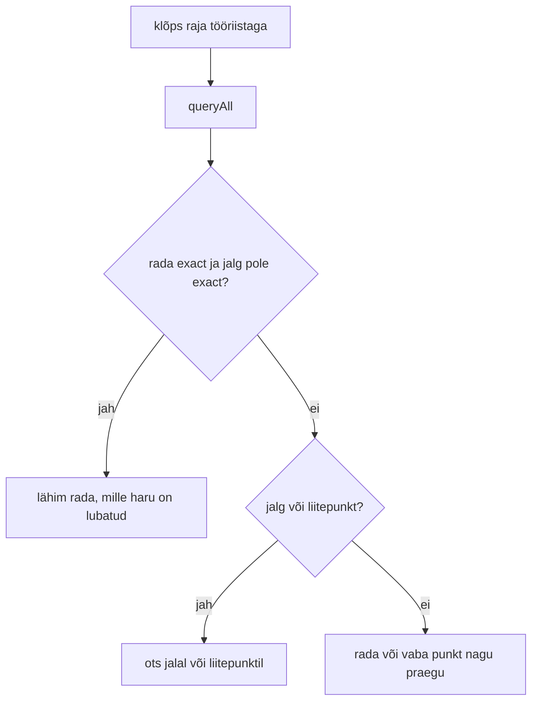

# M2-1-14 · Tööriista siht ja kasutajaliides

**Olek:** kirjutatud · **Rada:** A · **Haru:** `codex/m2-1` (tööpuu `C:/Users/TRUMPIT/.codex/worktrees/bb-m2-1/BB`) · **Alus:** `fa8e0e9` · **Allikas:** [Astra sõltumatu ülevaatus](../review/2026-11-20-m2-1-ulevaatus-8a2304d.md), leiud 03, 06 ja 08–12 · [plaan, Osa G ül. 14](../plans/M2-1-uhendused-ja-vorgud.md)

## Eesmärk
Tehnik peab nägema, mida tööriist teeb, ja saama sihtida täpselt. Astra leidis seitse kasutajaliidese viga.
- **03:** raja keskele klõpsamine ühendab kõrvalasuva jala, sest jala tabamisraadius on vähemalt 6 ekraanipikslit ja jala prioriteet on suurem. Nähtav padjand võib olla rajast 2,5 px kaugusel.
- **10:** kahe kihi radade ristumiskohas valib indeks esimese raja dokumendis, isegi kui see on vale kihi oma.
- **06:** klaviatuurimenüü (`Shift+F10`) „Alusta rada siit“ tabab uuesti osuti kohta, mitte menüü sihti ehk esimest valitud jalga.
- **08:** korpuse vahetus eemaldab ühendatud jala võrgusildi ja ühenduse ilma eelneva hoiatuseta.
- **09:** võrgu vaates puuduvad piiksu vastuolu ja lühistatud komponendi hoiatused, kuigi mootor need arvutab.
- **11:** „Ühenda võrguga…“ näitab kahte samanimelist võrku ühesuguste nuppudena.
- **12:** kaks eraldi GND-võrku annavad sama CSV-faili kui üks ühendatud GND-võrk.

## Loe (ainult need)
`bb_task` laiendab Loe-viited põhikaustast (vana kood), seega ava read tööpuus. Rea numbrid on `fa8e0e9` järgi.
- `packages/ui/src/canvas/hit-index.ts:155-216` (`query`; liides read 26-29)
- `packages/features/connections/ui/TraceTool.ts:112-142` (`findTarget`; `endpointHit` ja `drawingHit` on `trace-geometry.ts:34-82`)
- `packages/ui/src/canvas/use-canvas-context-menu.ts:113-175` (`openFromKeyboard`, `onContextMenu`; menüükäsk `packages/features/connections/ui/index.tsx:237-255`, liides `packages/ui/src/shell/UiRegistry.ts:28-36`)
- `packages/features/components/ui/footprint-impact.ts:1-27` (kutsuja `ChangeFootprint.tsx:69-84`, tekst `packages/features/components/ui/i18n/et.ts:234-245`)
- `packages/features/nets/ui/NetsTab.tsx:25-60` (`NetList`; hoiatused `NetView` read 168-185, eksport read 302-341, tekstid `packages/features/nets/ui/i18n/et.ts`)

## Muuda
- `packages/ui/src/canvas/hit-index.ts`: `queryAll` (otsus 1).
- `packages/features/connections/ui/TraceTool.ts` ja `trace-geometry.ts` (otsus 1).
- `packages/ui/src/shell/UiRegistry.ts`, `packages/ui/src/canvas/use-canvas-context-menu.ts` ja `packages/features/connections/ui/index.tsx` (otsus 2).
- `packages/features/components/ui/footprint-impact.ts`, `ChangeFootprint.tsx` ja `i18n/et.ts` (otsus 3).
- `packages/features/nets/ui/NetsTab.tsx` ja `i18n/et.ts` (otsused 4–6).
- Testid ja `pnpm api`, kui avalik liides muutub.

## Ära puutu
- Failivorming, mootori käsud ja domeenireeglid.
- CSV vorming: nelja veeru otsus O4 jääb. Uus veerg või püsiv eristaja vajab vormingu omaniku otsust.
- Valikutööriista tabamine (`Canvas` `event.hit` ja 6 px raadius jäävad samaks).
- Leiud 14–20 (M2.2).

## Otsused ja liidesed
1. **Raja tööriista siht (03, 10).**
   - `HitIndex` saab meetodi `queryAll(world, zoom): HitMatch[]`, kus `HitMatch = { item: HitItem; distance: number; exact: boolean }`.
   - `exact` on tõene, kui punkt on objekti enda kujus ilma minimaalse ekraaniraadiuseta: punkti raadius, ristkülik või joone laius. Tulemused on järjestatud prioriteedi ja kauguse järgi. `query` jääb muutmata.
   - Raja tööriist kasutab klõpsul `queryAll`-i.
     - Kui klõps on täpselt nähtaval rajal (`exact`) ja jala või liitepunkti tabamus pole `exact`, on siht rada.
     - Muidu on siht jalg või liitepunkt nagu praegu. Üksik väike padjand on 6 px raadiuse tõttu endiselt kerge tabada.
     - Mitme raja korral on siht lähim rada, mille haru `acceptsBranch` lubab. Kui ükski ei luba, kuvatakse lähim keelatud sihina.
   - Ristumine ilma lõpetava klõpsuta ei ühenda radu, nagu praegu.
2. **Menüü siht (06).**
   - `ContextMenuItemSpec.run` saab neljanda argumendi `target?: SelectionItem`: objekt, mille jaoks menüü avati.
   - Klaviatuurimenüü siht on esimene valitud objekt. Paremklõpsu siht on klõpsatud objekt.
   - `connections.startTrace` kasutab `target`-it, kui see on jalg, ega tee ise tabamuskontrolli. Muul juhul kasutab ta `selectedPin(selection)`-it.
3. **Korpuse vahetuse mõju (08).**
   - `footprintImpact` saab lisaks ühendused ja võrgusildid. Ta loeb kokku ühendused, mille ots on kaduval jalal, ja sildid, mille ankur on kaduval jalal.
   - Mõlemad loendid on `hasImpact`-is ja `key`-s.
   - Dialoogi tekst `impact` saab osad „{n} ühendus/ühendust“ ja „{m} võrgusilt/võrgusilti“. Kui ühendusi on, lisandub lause: „Ühenduste otsad jäävad liitepunktidena alles, võrgusildid eemaldatakse.“
4. **Võrgu hoiatused (09).** `NetView` näitab rollikonflikti kõrval kaht hoiatust (`role="alert"`, sama stiil):
   - kui `net.beepContradiction`, siis `netsEt.beepContradiction`: „Läbivusmõõtmine näitas katkestust jalgade vahel, mis on selles võrgus.“;
   - kui komponent `shortedComponents`-ist on selles võrgus, siis `netsEt.shorted(refs)`: „{R1, C3}: mõlemad jalad on selles võrgus. Kontrolli, kas see on lühis.“ Viited on komponentide tähised.
5. **Samanimelised võrgud ühendamisel (11).** „Ühenda võrguga…“ dialoogi iga rida näitab võrgu esimest jalga kujul `U1.1`, nähtavalt ja ligipääsetavas nimes. Ainult liitepunktidega võrgul on tekst „liitepunkt“. Võrkude põhiloend jääb samaks.
6. **CSV hoiatus (12).** Kui mitmel võrgul on sama nimi, on ekspordinupu juures teade `netsEt.duplicateNames(names)`: „Mitmel võrgul on sama nimi ({GND}). CSV-s neid võrke ei eristata.“ Teade on nähtav enne eksporti ega takista eksporti. CSV sisu ei muutu.

## Tõend
- TS:
  - `trace_click_targets_visible_pad_and_matching_trace` (`packages/features/connections/ui/trace-tool.test.tsx`): Astra 03. leiu olukord. Klõps rajale 2,5 px nähtava padjandi servast väljas jagab klõpsatud raja haruks ega loo jalaotsa. Klõps nähtavale padjandile loob jalaotsa. 10. leiu olukord: alumiselt liitepunktilt alustades jagab klõps ristumiskohas alumise raja.
  - `keyboard_menu_starts_trace_from_menu_target` (sama fail): valitud on U1.1 ja seejärel U1.2, osuti on U1.2 kohal. `Shift+F10`, „Alusta rada siit“ ja klõps U1.3-le loovad ühenduse U1.1–U1.3. Paremklõps U1.2-l alustab U1.2-st.
  - `footprint_change_lists_lost_connections_and_labels` (`packages/features/components/ui/change-footprint.test.tsx`): SOIC-14 jalg 14 on ühendatud ja sellel on võrgusilt. SOIC-8 valik näitab enne käsku teksti, kus on „1 ühendus“ ja „1 võrgusilt“. Käsk käivitub alles kinnituse järel.
  - `net_view_warns_beep_contradiction_and_shorted_component` (`packages/features/nets/ui/nets-tab.test.tsx`): R1 mõlemad jalad on ühes võrgus ja nende läbivusmõõtmine on negatiivne. Mõlemad hoiatused on nähtavad ja rollikonflikti teadet pole.
  - `same_name_nets_distinguishable_in_join_and_export` (sama fail): kahel eraldi võrgul on nimi GND. Ühendamise dialoogi nuppudel on erinevad ligipääsetavad nimed jalaviitega. Ekspordinupu juures on teade samast nimest ja CSV sisu on endine.
- Põhikaustast `pnpm bb-review-card M2-1-14` (rada A).

## Valmis kui
- [ ] Testid ja käsud läbivad, `docs/api` on vajadusel uuendatud.
- [ ] Üleandmises on ekraanipilt või DOM-i kirjeldus võrgu hoiatustest ja korpuse vahetuse dialoogist.
- [ ] Üleandmine on allpool, kuni 20 rida.

## Üleandmine
