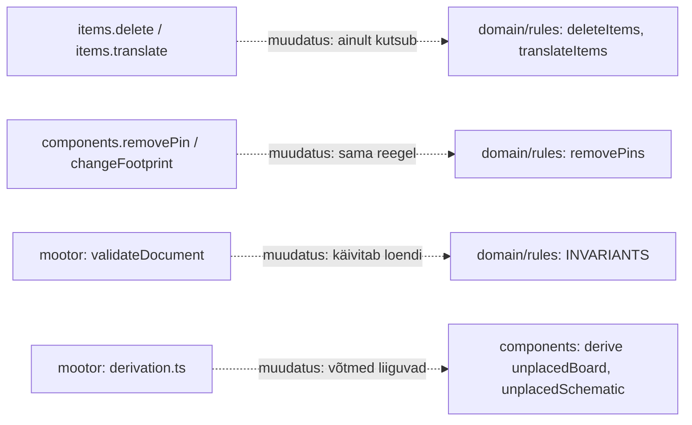

# M2-1-2 · Reeglid domeeni (ADR-005)

**Olek:** vastu võetud `8db131c` · **Rada:** B · **Haru:** `codex/m2-1` (tööpuu `C:/Users/TRUMPIT/.codex/worktrees/bb-m2-1/BB`) · **Alus:** `d0bf319` (M2-1-1) · **Plaan:** [M2.1 › Ülesanne 2](../plans/M2-1-uhendused-ja-vorgud.md#ülesanded) · **Otsus:** [ADR-005](../adr/ADR-005-tuuma-ja-moodulite-piir.md) § 1–3

## Eesmärk
Mootori tuumas ei ole enam komponentide ja mõõtmiste reegleid. Kustutamine, nihutamine, jalgade eemaldamine ja invariandid on domeeni puhtad funktsioonid, „paigutamata“ loendid arvutab moodul `components`. Kasutaja jaoks ei muutu midagi. M2-1-5 lisab ühenduste ja siltide reeglid samadesse funktsioonidesse ilma mootorit muutmata.

## Loe (ainult need)
Loe tööpuust (`d0bf319`). Rea numbrid on tööpuu järgi.
- `packages/engine/src/items.ts:1-41` (`items.delete`, `items.translate`)
- `packages/engine/src/invariants.ts:1-67` (`validateDocument`: ID eesliited, tähised, jalad, mõõtmised)
- `packages/engine/src/derivation.ts:1-46` (tuuma arvutatud `unplacedBoard` ja `unplacedSchematic`)
- `packages/engine/src/engine.ts:37-80` (`validation` ja vigade teisendus käsu tulemuseks)
- `packages/features/components/engine/commands.ts:190-280` (`removePin`, `changeFootprint`; `compatiblePadMap` on samas failis real 90)

## Muuda
- Loo `packages/domain/src/rules/`:
  - `items.ts`: `ItemRefSchema`, `ITEM_FIELDS`, `deleteItems`, `translateItems`, `removePins`;
  - `invariants.ts`: `Issue`, `Invariant`, `INVARIANTS`;
  - `errors.ts`: `RuleRejected`, `RuleTargetNotFound`;
  - `index.ts` ja testid.
- `packages/domain/package.json`: eksport `"./rules": "./src/rules/index.ts"`.
- `packages/engine/src/`: `items.ts`, `invariants.ts`, `derivation.ts` ja `engine.ts` (otsus 4), lisaks uus test `boundary.test.ts`.
- `packages/features/components/engine/`: `index.ts` (`derive`), uus `derive.ts` ja `commands.ts` (`removePin`, `changeFootprint`).
- Mootori testid, mis eeldavad tuuma arvutatud `unplaced*` võtmeid (otsus 5).
- `pnpm api`.

## Ära puutu
- Käskude id-d ja parameetrid, `@pcbk/contracts` (ka `Derived` liides: see kolib komponentide lepingusse M2-1-3-s, kui `SelectTool` seda enam ei loe), `CommandResult` kuju, veakoodid ja tekstid.
- `AppShell`, `SelectTool` ja valiku kehtivus (M2-1-3).
- Omandikontroll, registri järjestus ja failivorming.
- Ühenduste, liitepunktide ja siltide reeglid (M2-1-5). `items.*` jäävad praegu ainult komponentidele.

## Otsused ja liidesed
1. **Alamtee `@pcbk/domain/rules`.** Funktsioonid muudavad talle antud dokumenti kohapeal. Mootor annab Immeri mustandi; domeen Immerit ei impordi.
   ```ts
   export const ItemRefSchema = z.strictObject({ kind: z.literal('component'), id: z.string() });
   export type ItemRef = z.infer<typeof ItemRefSchema>;
   export const ITEM_FIELDS = ['components'] as const satisfies readonly DocKey[];
   export function deleteItems(doc: BoardDoc, ids: readonly string[]): void;
   export function translateItems(doc: BoardDoc, items: readonly ItemRef[], delta: Vec2): void;
   export function removePins(doc: BoardDoc, componentId: string, pinIds: readonly string[]): void;
   ```
   - `deleteItems`: käitub nagu praegu. Tundmatu id jäetakse vahele ja `doc.components` asendatakse ainult siis, kui midagi eemaldati, seega muutuseta käsk jääb muutuseta käsuks.
   - `translateItems`: puuduv id viskab `RuleTargetNotFound(id)`, paigutamata komponent `RuleRejected('component_not_placed')`. Telge, mille nihe on 0, ei kirjutata.
   - `removePins`: eemaldab jalad, nende `customPads` kirjed ja `padMap` kirjed, mis viitavad nendele jalgadele. Tundmatu jala id jäetakse vahele. M2-1-5 lisab siia ühenduste otsad ja sildid.
2. **Mootori üldkäsud.** `items.delete` ja `items.translate` jäävad mootorisse, kuid parameetrite skeem tuleb domeenist (`ItemRefSchema`), `alsoWrites` on `[...ITEM_FIELDS]` ja `run` kutsub ainult domeeni funktsiooni (`translateItems(doc, items, { x: dx, y: dy })`).
3. **Komponentide käsud.**
   - `components.removePin` jätab oma kontrollid (`not_found` ja `footprint_pin_locked`) samasse järjekorda ja kutsub siis `removePins(doc, id, [pinId])`.
   - `components.changeFootprint` arvutab kaduvad jalad (id pole uues korpuses ja jalg pole oma jalg) ning kutsub `removePins`-i enne uue jalaloendi koostamist. Siht `area` jalgu ei eemalda. Tulemus on sama mis praegu: `compatiblePadMap` jätab kaduvatele jalgadele viitavad kirjed niikuinii välja ja kaduval jalal pole `customPads` kirjet.
4. **Invariandid ja vead.**
   ```ts
   export interface Issue { path: (string | number)[]; code: string }
   export interface Invariant { id: string; inputs: readonly DocKey[]; check(doc: BoardDoc): Issue[] }
   export const INVARIANTS: readonly Invariant[];
   export class RuleRejected extends Error { constructor(readonly reason: string) }
   export class RuleTargetNotFound extends Error { constructor(readonly id: string) }
   ```
   - `INVARIANTS` järjekorras: `ids` (eesliide ja unikaalsus kõigis kogumites, `inputs` on need kogumid), `components` (tähis, jala id, `uid` ja selle eesliide) ja `measurements` (`overload_excludes_value`, `beep_requires_continuity`).
   - `validateDocument(input)` jääb mootorisse sama allkirjaga: `BoardDocSchema.parse`, siis kõik `INVARIANTS` järjest. `Issue` muutub `ZodIssue`-ks kujul `{ code: 'custom', path, message: code }`. Koodid, teed ja järjekord on samad mis praegu.
   - `inputs` on olemas, aga kõik reeglid käivituvad iga käsu järel nagu praegu (ADR-005 § 2, kiirendus pärast M2.1 mõõtmist).
   - `engine.ts` teisendab `RuleTargetNotFound`-i tulemuseks `{ code: 'not_found', id }` ja `RuleRejected`-i samaks `validation` tulemuseks nagu `CommandRejected(reason)`.
5. **„Paigutamata“ tuletis.**
   - `components` registreerib `derive`-is kirjed `unplacedBoard` ja `unplacedSchematic`: `inputs: ['components']`, skeem `z.array(z.string())`, algväärtus `[]`, arvutus sama mis praegu tuumas.
   - `derivation.ts` ei tea neid võtmeid: vaikeväärtused tulevad ainult registreeritud kirjetest.
   - Hetktõmmise võtmete nimed ja väärtused ei muutu. Uus on see, et komponentide muutuseta käsk jätab massiivid samaks objektiks (sama mis teistel tuletistel).
   - Mootori testid, mis eeldavad tuuma arvutatud võtmeid (`lifecycle.test.ts` umbes read 155–178 ja `engine.test.ts` tuletise külmutuse kontroll), kasutavad testi tuletist nagu `derivation.test.ts`. Muud olemasolevad testid läbivad muutmata; lubatud on ainult importide muutus. Kõik muudetud testid loetle üleandmises.



## Tõend
- TS:
  - `engine_source_has_no_object_rules` (`packages/engine/src/boundary.test.ts`): mootori lähtekood (testid ja `__tests__` välja arvatud) ei sisalda sõnu `components`, `connections`, `junctions`, `netLabels`, `measurements`, `.pins` ega `'component'`.
  - `invariants_come_from_domain_list` (domeen): kõigil `INVARIANTS` kirjetel on id ja mittetühi `inputs`. Dokument, kus on topelttähis, `pin_` eesliiteta `uid`, vale ID eesliide ja `overload` koos väärtusega, annab `validateDocument`-ist samad koodid ja teed samas järjekorras nagu enne. Iga koodi välja leidub selle andnud kirje `inputs`-is.
  - `unplaced_keys_come_from_components_module` (komponendid): ilma mooduli `components`-ita mootoris võtit `unplacedBoard` pole. Mooduliga on paigutamata ja skeemita komponentide loendid samad mis enne. Käsk, mis komponente ei muuda (näiteks `photo.setScale`), jätab mõlemad massiivid samaks objektiks.
  - `remove_pin_and_footprint_change_use_remove_pins` (domeen ja komponendid): `removePins` eemaldab jala, selle `customPads` ja `padMap` kirjed ning jätab tundmatu id vahele. `components.removePin` ja SOIC-14 → SOIC-8 korpuse vahetus annavad sama dokumendi mis enne, ka `Ctrl+Z` järel.
- Põhikaustast `pnpm bb-review-card M2-1-2` → `ok: true`, `missing: []`.

## Valmis kui
- [x] Testid ja käsud läbivad.
- [x] Mootori lähtekoodis pole objektireegleid. Olemasolevad testid läbivad ja muudetud testid on üleandmises loetletud.
- [x] `pnpm api` on uuendatud.
- [x] Üleandmine on allpool, kuni 15 rida.

## Üleandmine

- Tööpuu `C:/Users/TRUMPIT/.codex/worktrees/bb-m2-1/BB`, haru `codex/m2-1`, kontrollitud puhas alus `d0bf319`.
- RED-is ebaõnnestusid kõik neli kaarditesti. Mootoris oli 21 objektireeglitega rida, domeeni invariantide loend puudus, paigutamata võtmed tulid tuumast ning kumbki jalgu eemaldav käsk ei kutsunud domeenireeglit.
- GREEN-is kasutavad `items.delete`, `items.translate`, `components.removePin` ja `components.changeFootprint` domeenireegleid. Kontroll kinnitas samad veakoodid, veateed ja järjekorra ning sama dokumendi ka pärast tagasivõtmist.
- `components` arvutab mõlemad paigutamata loendid. `photo.setScale` järel on massiivid samad objektid. `pnpm api` lisas `@pcbk/domain/rules` API kirjelduse.
- Muudetud olemasolevad testid on `lifecycle.test.ts` · `derived placement lists stay coherent across commands and undo` ning `engine.test.ts` · `subscribers and host get the same deeply frozen snapshot document`. Mõlemad registreerivad testituletised.
- RED/GREEN-i logid tööpuus `output/playwright/m2-1-2/`. Rada B kokkuvõte põhikaustas `output/review-card/M2-1-2-gE8L4b/summary.json`.
- `pnpm bb-review-card M2-1-2` läbis (`ok: true`, `missing: []`). Vitest 1608/1608, E2E 42/42, Rust 103 läbis ja 2 päevikukatse abisisendit jooksevad lapseprotsessina. Kaardi tõendid 4/4.

## Arhitekti ülevaatus (2026-11-19)

- **Kontrollitud:**
  - Tööpuus on 10 muudetud ja 12 uut faili, neist 3 genereeritud `docs/api` faili. Võõraid faile pole, HEAD on `d0bf319`.
  - Diff: domeeni `rules/` (`items.ts`, `invariants.ts`, `errors.ts`, `index.ts`) ja `package.json` eksport; mootori `items.ts`, `invariants.ts`, `derivation.ts` ja `engine.ts`; komponentide `derive.ts`, `index.ts` ja `commands.ts`; neli uut testifaili ja kaks muudetud mootori testi.
  - Kokkuvõte `M2-1-2-gE8L4b/summary.json` (08:56) on uuem kui tööpuu viimane muudatus (08:50), seega käske uuesti ei käivitatud. Tulemused:
    - rada B, `missing: []`, `warnings: []`;
    - Vitest 1608/0, Playwright 42/0, Rust 103 läbis ja 2 jäeti vahele; check, api, format, coverage, e2e, diff ja cargo exit 0;
    - kõik 4 kaardi testi läbisid.
- **Otsused koodis:**
  - **Reeglid domeenis:**
    - `deleteItems`, `translateItems` ja `removePins` kordavad vana loogikat üks-ühele; domeen impordib ainult `zod`-i;
    - `translateItems` viskab `RuleTargetNotFound`-i või `RuleRejected('component_not_placed')` ega kirjuta nullnihkega telge;
    - `removePins` jätab tundmatu id vahele ega kirjuta midagi, kui ühtegi jalga ei eemaldatud.
  - **Mootor:** `items.*` kasutavad `ItemRefSchema`-t ja `alsoWrites: [...ITEM_FIELDS]`. `engine.ts` teisendab Rule-vead samamoodi nagu Command-vead. `boundary.test.ts` kinnitab, et mootori lähtekoodis objektireegleid pole.
  - **Invariandid:** `INVARIANTS` järjekord `ids` → `components` → `measurements` annab samad koodid, teed ja järjekorra mis vana `validateDocument`.
  - **Komponentide käsud:**
    - `removePin` kontrollib `not_found`-i ja `footprint_pin_locked`-i enne `removePins`-i;
    - `changeFootprint` eemaldab enne ümberehitust ainult jalad, mida uus korpus ei sisalda ja millel pole `customPads` kirjet; `area` väljub enne seda;
    - tulemus on sama, sest `compatiblePadMap` jätab nendele jalgadele viitavad `padMap` kirjed niikuinii välja ja `customPads` puhastus vaatab ainult alles jäänud jalgu.
  - **Tuletis:** `derivation.ts` võtab vaikeväärtused ainult registreeritud kirjetest. Komponentide `derive.ts` arvutab mõlemad loendid sisendiga `['components']`, seega `photo.setScale` jätab massiivid samaks objektiks.
- **Olemasolevad testid:** muutusid ainult `lifecycle.test.ts` › `derived placement lists stay coherent across commands and undo` ja `engine.test.ts` › `subscribers and host get the same deeply frozen snapshot document`. Mõlemas muutus ainult seadistus, mis registreerib testituletise; ootused jäid samaks.
- **UI:** ei muutunud.
- **Otsus: sobib.**
- **Mitteblokeerivad märkused:**
  1. `packages/domain/src/rules/invariants.test.ts` impordib `validateDocument`-i suhtelise teega mootori lähtekoodist. Depcruise jätab testid välja ja sama muster on juba failis `release-files.test.ts`, seega jääb see nii.
  2. `Snapshot['derived']` tüüp lubab `unplacedBoard`-i ja `unplacedSchematic`-u ka ilma komponentide moodulita. M2-1-3 viib `Derived` liidese komponentide lepingusse, nagu plaanis.
