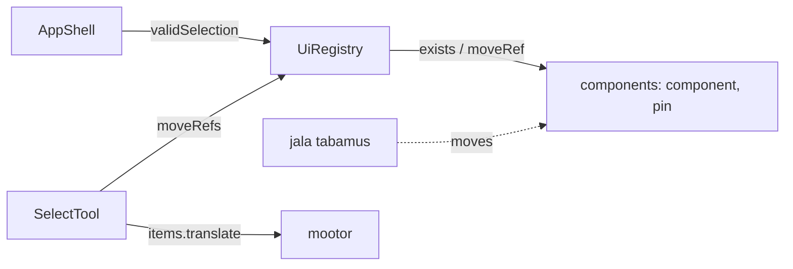

# M2-1-3 · Valiku kehtivus registrisse (ADR-005)

**Olek:** vastu võetud `f6c71d6` · **Rada:** A · **Haru:** `codex/m2-1` (tööpuu `C:/Users/TRUMPIT/.codex/worktrees/bb-m2-1/BB`) · **Alus:** `8db131c` (M2-1-2) · **Plaan:** [M2.1 › Ülesanne 3](../plans/M2-1-uhendused-ja-vorgud.md#ülesanded) · **Otsus:** [ADR-005](../adr/ADR-005-tuuma-ja-moodulite-piir.md) § 4

## Eesmärk
Kest ei tunne objektitüüpe. Valiku kehtivust ja liigutatavust küsivad `AppShell` ja `SelectTool` registrist ning moodul `components` registreerib komponendi ja jala. „Paigutamata“ tüübid kolivad komponentide lepingusse. Kasutaja jaoks ei muutu midagi. M2-1-5 lisab õhujoone ja liitepunkti samasse registrisse ilma kesta muutmata.

## Loe (ainult need)
Loe tööpuust (`8db131c`). Rea numbrid on tööpuu järgi.
- `packages/ui/src/shell/UiRegistry.ts:50-69` (`SelectionKindSpec`, `UiModule`; `selectionLabel` on samas failis real 184)
- `packages/ui/src/shell/AppShell.tsx:22-45` (`useSelection`: komponendi ja jala kontroll kestas)
- `packages/ui/src/canvas/SelectTool.ts:29-122` (`selectedBoardComponents`, jala lohistus, nooleklahvid)
- `packages/features/components/ui/index.tsx:149-163` (praegune `selectionKinds` ainult sildiga)
- `packages/contracts/src/snapshot.ts:13-17` (`Derived`; laienduse muster on `packages/features/measurements/contract.ts` real 27)

## Muuda
- `packages/ui/src/shell/UiRegistry.ts`: `MoveRef`, `SelectionKindSpec` (otsus 1), `validSelection`, `moveRefs` ja liigi unikaalsus registreerimisel.
- `packages/ui/src/canvas/hit-index.ts`: `HitItem.moves` (otsus 2).
- `packages/ui/src/canvas/SelectTool.ts`, `Canvas.tsx` (prop `moveRefs`) ja `packages/ui/src/app/Workbench.tsx` (annab `registry.moveRefs` edasi nagu `contextMenu`-i).
- `packages/ui/src/shell/AppShell.tsx` ja `packages/ui/src/shell/i18n/et.ts` (otsus 4).
- `packages/features/components/ui/index.tsx` (otsus 5) ja `ui/layers/hits.ts` (jala tabamusele `moves`).
- `packages/contracts/src/snapshot.ts`, `packages/features/components/contract.ts` ja `packages/contracts/src/contracts.test-d.ts` read 80–83 (otsus 6).
- Uued testifailid `packages/ui/src/shell/selection-kinds.test.tsx` ja `packages/features/components/ui/selection-kinds.test.ts`.
- `pnpm api`.

## Ära puutu
- Mootor, domeen, käsud, veakoodid ja failivorming.
- `DEFAULT_VIEW_STATE` ja vaate oleku salvestus (otsus 7).
- Kontekstimenüü (`use-canvas-context-menu.ts`) ja mitmikvalik (M2-1-4).
- Sildid ja tekstid, välja arvatud `et.shell.components` eemaldamine (otsus 4).

## Otsused ja liidesed
1. **Registri liides.**
   ```ts
   export type MoveRef = ParamsOf<'items.translate'>['items'][number];
   export interface SelectionKindSpec {
     kind: SelectionItem['kind'];
     label(snapshot: Snapshot, item: SelectionItem): string | null;
     exists(snapshot: Snapshot, item: SelectionItem): boolean;
     /** Viide, mille `items.translate` liigutab; `null`, kui objekt ei liigu. */
     moveRef?(snapshot: Snapshot, item: SelectionItem): MoveRef | null;
   }
   // UiRegistry
   validSelection(snapshot: Snapshot, selection: Selection): Selection;
   moveRefs(snapshot: Snapshot, items: readonly SelectionItem[]): MoveRef[];
   ```
   - `kind` on moodulite vahel unikaalne. Teine sama liigiga kirje viskab registreerimisel `Duplicate selectionKinds id: <kind>` (sama `uniqueIds` abiline). `selectionLabel` käitub nagu praegu.
   - `validSelection` eemaldab kirjed, mille liigi `exists` tagastab `false`. Registreerimata liigiga kirje jääb alles nagu praegu. Kui midagi ei eemaldatud, tagastab sama objekti.
   - `moveRefs` tagastab valiku järjekorras need `moveRef` väärtused, mis pole `null`, ilma kordusteta (`kind` + `id`). Registreerimata liik ja `moveRef`-ita liik ei liigu.
   - ADR-i visandist erinevad kaks asja. Argumentide järjekord on `(snapshot, item)` nagu olemasoleval `label`-il. `movable` asemel on `moveRef`, mis tagastab käsu viite, nii et kest ei pea tüüpi teisendama.
2. **Tabamuse omanik.** `HitItem.moves?: SelectionItem` tähendab, et selle tabamuse lohistamine liigutab teist objekti. Komponendi jala tabamus saab `moves: { kind: 'component', id }`. `componentId` jääb tabamusele, sest teised tööriistad kasutavad seda.
3. **Valikutööriist.** Allkiri on `createSelectToolSpec(getSelection, moveRefs)`. Käitumine on sama mis praegu:
   - `drag`-iga tabamus käitub nagu praegu;
   - `target`-ita tabamus, mis liigub ise (`moveRefs(snapshot, [hit])` pole tühi), valitakse vajutusel, kui see pole juba valitud; lohistus liigutab `moveRefs(snapshot, selection.items)`;
   - muul juhul liigutab `moves`-iga tabamuse lohistus `moveRefs(snapshot, [hit.moves])` ja valik vajutusel ei muutu;
   - klõps alla 3 px valib tabamuse, kui see ei saanud valituks juba vajutusel;
   - nooleklahvid liigutavad `moveRefs(snapshot, selection.items)`; tühja tulemuse korral tagastab `onKey` `false`, nii et valitud jalg ei liiguta komponenti nagu praegugi.
   - `Canvas` saab propi `moveRefs` (vaikimisi tagastab `[]`) ja `Workbench` annab `registry.moveRefs`-i seotuna nagu `contextMenu`-i.
4. **Kest.** `AppShell` arvutab kehtiva valiku `registry.validSelection(snapshot, selected)` abil ega loe `doc.components`-it. Tühja navigaatori pealkiri on `et.shell.navigator`. Kasutuseta võti `et.shell.components` eemaldatakse, `navigatorEmpty` tekst jääb samaks.
5. **Komponentide registreering.** Sildid jäävad samaks.
   - `component`: `exists`, kui dokumendis on sellise id-ga komponent; `moveRef` on `{ kind: 'component', id }` ainult siis, kui komponendil on `board`.
   - `pin`: `exists`, kui `item.componentId` komponendil on selle id-ga jalg; `moveRef`-i pole.
6. **„Paigutamata“ tüübid komponentide lepingusse.**
   - `@pcbk/contracts` `Derived` jääb tühjaks laienduspunktiks; kommentaar jääb, tühja liidese reegli võib keelata ühe rea kommentaariga.
   - `packages/features/components/contract.ts` laiendab `Derived`-i võtmetega `unplacedBoard: string[]` ja `unplacedSchematic: string[]` nagu mõõtmiste leping. Fail jääb ≤ 400 rea; kui ei mahu, läheb laiendus eraldi faili, mille `contract.ts` impordib.
   - `contracts.test-d.ts` read 80–83 kontrollivad sama kirjutuskaitset testisisese laienduse või kohaliku `DeepReadonly` tüübiga.
7. **Vaikevahekaart jääb.** Navigaator kasutab juba registri esimest vahekaarti, kui salvestatud vahekaarti pole registris (`tabs.find(...) ?? tabs[0]`). Väärtus `'components'` failis `DEFAULT_VIEW_STATE` on projekti salvestatud vaate olek. Selle muutmine puudutaks salvestust ja mitut adapteri testi ning uus projekt avaneks vahekaardil „Teek“. Seepärast see jääb ja plaani test `default_tab_is_first_registered_tab` jääb ära.
8. **Olemasolevad testid.** Muuta võib ainult seadistust:
   - `tools.test.ts` kutsub `createSelectToolSpec`-i koos testi `moveRefs`-iga;
   - `selection_cleared_when_selected_item_disappears` kolib samanimelisena faili `selection-kinds.test.tsx` ja registreerib testiliigi (`shell.test.tsx` ületaks muidu 400 rida);
   - `contracts.test-d.ts` read 80–83 (otsus 6).
   - Ootused jäävad samaks. Kõik muudetud testid loetle üleandmises.



## Tõend
- TS:
  - `selection_validity_comes_from_registry` (`packages/ui/src/shell/selection-kinds.test.tsx`): testimooduli registris kaob `AppShell`-i valikust kirje, mille `exists` on `false`. Registreerimata liigiga kirje jääb alles. Täiesti kehtiva valiku korral tagastab `validSelection` sama objekti. Sama liigi teine registreerimine viskab `Duplicate selectionKinds id: pin`.
  - `select_tool_moves_only_registry_movable_items` (`packages/ui/src/canvas/tools.test.ts`): testi `moveRefs`-iga ei käivita lohistus `items.translate`-i ega vali vajutusel objekti, mille `moveRef` on `null`. `moves`-iga tabamuse lohistus liigutab omanikku ja jätab valiku samaks. Nooleklahv liikumatu valikuga tagastab `false` ega käivita käsku. Valitud liikuva objekti lohistus saadab täpselt registri viited.
  - `shell_and_select_tool_have_no_component_kind` (`packages/ui/src/shell/selection-kinds.test.tsx`): `AppShell.tsx` ja `SelectTool.ts` lähtekood ei sisalda sõnu `'component'`, `'pin'`, `components` ega `unplaced`. `packages/contracts/src/snapshot.ts` ei sisalda sõna `unplaced`. (`componentId` on `SelectionItem`-i üldväli ja `selectionForHit` võib seda edasi kopeerida.)
  - `components_register_component_and_pin_kinds` (`packages/features/components/ui/selection-kinds.test.ts`): komponendi `exists` sõltub id-st ja `moveRef` paigutusest; paigutamata komponendil on see `null`. Jala `exists` sõltub komponendi jalast ning `moveRef`-i pole. Jala tabamusel on `moves` oma komponendile.
- Põhikaustast `pnpm bb-review-card M2-1-3` → `ok: true`, `missing: []`.

## Valmis kui
- [x] Testid ja `pnpm check` läbivad.
- [x] `AppShell` ja `SelectTool` ei viita komponentidele. Olemasolevate testide ootused on samad ja muudetud testid on üleandmises loetletud.
- [x] `pnpm api` on uuendatud.
- [x] Üleandmine on allpool, kuni 15 rida.

## Üleandmine

- Tööpuu `C:/Users/TRUMPIT/.codex/worktrees/bb-m2-1/BB`, haru `codex/m2-1`, kontrollitud puhas alus `8db131c`.
- Kõik neli kaarditesti ebaõnnestusid RED-is ja läbisid GREEN-is. Kest küsib valiku kehtivust registrist. Valikutööriist kasutab registri liigutamisviiteid ning jalatabamus viitab oma komponendile.
- Paigutamata loendite tüübid on komponentide lepingus. `pnpm api` uuendas lepingute, lõuendi ja kesta API kirjeldust. Muudetud failidest pikim on `contract.ts` (400 rida).
- `tools.test.ts` ja `Canvas.test.tsx` said ühisseadistuses liigutamisviited ja jala omaniku. `Canvas.scene.test.tsx` sai registri viite testis `arrow_key_nudges_follow_screen_axes_under_all_8_transforms`.
- `label-obstacles.test.tsx` sai registri viite testis `long_value_avoids_neighbour_component`. Mõõtmiste `__tests__/workspace.tsx` annab registri edasi testidele `reading_label_follows_drag_preview` ja `drag_preview_rerenders_only_dragged_readings`.
- `pad-shapes.test.tsx` (`component_pin_hits_keep_pad_shape_size_rotation_and_priority`) ja `oval-pads.test.tsx` (`oval_pad_hits_like_rect`) jätavad geomeetriavõrdluse ettevalmistuses välja ainult `moves`-välja. Seda välja kontrollib uus komponentide test.
- `selection_cleared_when_selected_item_disappears` kolis failist `shell.test.tsx` faili `selection-kinds.test.tsx` ja sai testiliigi. `contracts.test-d.ts` kasutab sama kirjutuskaitse kontrolliks kohalikku `DeepReadonly` tüüpi. Senised testiootused säilisid.
- RED/GREEN-i logid tööpuus `output/playwright/m2-1-3/`. Lõplik kontrolli kokkuvõte põhikaustas `output/review-card/M2-1-3-hcmF5O/summary.json`.
- `pnpm bb-review-card M2-1-3` läbis (`ok: true`, `missing: []`). Vitest 1612/1612, E2E 42/42, kaarditõendid 4/4.

## Arhitekti ülevaatus (2026-11-19)

- **Kontrollitud:**
  - Tööpuus on 23 muudetud ja 2 uut faili, neist 3 genereeritud `docs/api` faili. Võõraid faile pole, HEAD on `8db131c`.
  - Diff: `UiRegistry.ts`, `AppShell.tsx`, `et.ts`, `SelectTool.ts`, `hit-index.ts`, `Canvas.tsx`, `Workbench.tsx`, `snapshot.ts`, komponentide `contract.ts`, `ui/index.tsx` ja `hits.ts`; uued testifailid ja kõigi muudetud testide diff.
  - Kokkuvõte `M2-1-3-hcmF5O/summary.json` (20:04) on uuem kui tööpuu viimane muudatus (19:59), seega käske uuesti ei käivitatud. Tulemused:
    - rada A, `missing: []`, `warnings: []`;
    - Vitest 1612/0, Playwright 42/0; check, api, format, coverage, e2e ja diff exit 0;
    - kõik 4 kaardi testi läbisid.
- **Otsused koodis:**
  - **Register:**
    - `selectionKinds` liik on unikaalne (`Duplicate selectionKinds id: pin`);
    - `validSelection` jätab registreerimata liigi alles ja tagastab kehtiva valiku korral sama objekti;
    - `moveRefs` hoiab järjekorra ja eemaldab kordused; `selectionLabel` käitub unikaalse liigi tõttu samamoodi.
  - **Valikutööriist:**
    - ise liikuv tabamus valitakse vajutusel nagu varem komponent;
    - `moves`-iga jala tabamus liigutab omanikku ja jätab valiku samaks;
    - klõps valib ainult siis, kui vajutus ei valinud;
    - nooleklahv valitud jalaga tagastab `false`, sest jalal pole `moveRef`-i.
  - **Kest:** `AppShell` kasutab `registry.validSelection`-it. `Workspace` loeb nüüd kogu hetktõmmist, kuid joonistus uuenes ka varem iga hetktõmmisega, sest valija tagastas iga kord uue objekti.
  - **Komponendid:** `component` liigub ainult `board`-iga, `pin` kehtib ainult oma komponendi jalana, jala tabamusel on `moves`. Tüübid `unplacedBoard` ja `unplacedSchematic` on komponentide lepingus ja `Derived` on tühi laienduspunkt.
- **Olemasolevad testid:** ootused jäid samaks. `pad-shapes.test.tsx` ja `oval-pads.test.tsx` jätavad geomeetria võrdlusest välja ainult `moves`-välja, mida kontrollib uus komponentide test. Ülejäänud muutused on seadistus (`moveRefs` ja jala omanik). `selection_cleared_when_selected_item_disappears` kolis samanimelisena ja sai testiliigi.
- **UI:** nähtav muutus puudub. Tühja navigaatori pealkiri („Navigaator“) ilmub ainult registrita kestas, brauseris ei kontrollitud.
- **Otsus: sobib.**
- **Mitteblokeerivad märkused:**
  1. `packages/features/components/contract.ts` on täpselt 400 rida. M2-1-4 lisab sinna `components.duplicate`-i, seega peab see kaart faili osadeks jagama.
