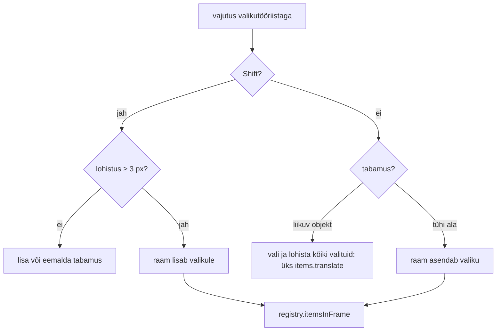

# M2-1-4 · Mitmikvalik, raamvalik ja dubleerimine

**Olek:** vastu võetud `75192c1` · **Rada:** A · **Haru:** `codex/m2-1` (tööpuu `C:/Users/TRUMPIT/.codex/worktrees/bb-m2-1/BB`) · **Alus:** `f6c71d6` (M2-1-3) · **Plaan:** [M2.1 › Ülesanne 4](../plans/M2-1-uhendused-ja-vorgud.md#ülesanded) · **Otsus:** O3

## Eesmärk
Kasutaja saab valida mitu objekti (`Shift`+klõps ja raam) ning pöörata, pöörata teisele poolele, eemaldada plaadilt, kustutada, nihutada ja dubleerida neid korraga. Iga selline toiming on üks käsk ja üks `Ctrl+Z`. Kest küsib raami sisu ja kustutatavaid id-sid registrist nagu M2-1-3 liikumist. Kiirühendus (M2-1-5) kasutab sama mitmikvalikut.

## Loe (ainult need)
Loe tööpuust (`f6c71d6`). Rea numbrid on tööpuu järgi. `bb_task` laiendab viited põhikaustast, kus on M2-1-2 ja M2-1-3 eelne kood; ava need read tööpuus.
- `packages/ui/src/canvas/SelectTool.ts:49-137` (vajutus, klõps, nooled, katkestus)
- `packages/ui/src/shell/UiRegistry.ts:19-60` (`KeySpec`, `ContextMenuItemSpec`, `SelectionKindSpec`; `validSelection` ja `moveRefs` on samas failis real 203)
- `packages/ui/src/canvas/use-canvas-keys.ts:32-87` (`Ctrl`/`Meta` klahvid jäetakse praegu vahele)
- `packages/features/components/ui/PlacementSection.tsx:132-175` (`forPlaced` käivitab iga komponendi jaoks eraldi käsu)
- `packages/features/components/engine/commands.ts:214-288` (`removeFromBoard`, `rotate`, `flipSide`)

## Muuda
- `packages/ui/src/shell/UiRegistry.ts`: `SelectionFrame`, `inFrame`, `deleteId`, `itemsInFrame`, `deleteIds`, `KeySpec.primary`, `shortcut.primary` (otsused 2, 3, 6).
- `packages/ui/src/canvas/SelectTool.ts`, `use-canvas-keys.ts`, `ContextMenu.tsx` (kiirklahvi silt), uus `SelectionFrameLayer.tsx` ja `Canvas.tsx` (propid `itemsInFrame`, `deleteIds`; fail jääb ≤ 400 rea).
- `packages/ui/src/app/Workbench.tsx` ja mõõtmiste `__tests__/workspace.tsx` annavad uued registri meetodid edasi nagu `moveRefs`-i.
- `packages/ui/src/shell/AppShell.tsx`, `keymap.ts` ja `i18n/et.ts` (otsused 3 ja 7).
- `packages/features/components/contract.ts` ja uus kaust `contract/` (otsus 8), `engine/commands.ts` (otsused 4 ja 5), `ui/PlacementSection.tsx`, `ui/index.tsx`, `ui/i18n/et.ts`, uus `ui/duplicate.ts`.
- `.dependency-cruiser.cjs` (otsus 8).
- Käsu kutsed `{ id }` → `{ ids: [id] }` olemasolevates testides (otsus 9).
- `pnpm api`.

## Ära puutu
- Mootor, domeen, `items.*` käsud, invariandid ja failivorming.
- Ühendused ja kiirühendus (M2-1-5), jalgade mitmikkustutamine.
- `packages/features/components/ui/layers/interaction.test.tsx` (435 rida). Kui seda on vaja muuta, jaga fail enne kaheks.

## Otsused ja liidesed
1. **Hiir valikutööriistas.** `Shift` tähendab valiku muutmist, mitte liigutamist.
   - `Shift`+klõps lisab tabamuse objekti (`selectionForHit(hit).items[0]`) valiku lõppu või eemaldab selle, kui sama `kind`, `id` ja `componentId` on juba valikus. `Shift`+klõps tühjal alal jätab valiku samaks.
   - `Shift`-iga vajutus ei vali ega alusta objekti lohistust, ka sildil (`drag`). `Shift`-iga lohistus joonistab raami alati, ka siis, kui see algas objektilt.
   - Lohistus tühjal alal joonistab raami. Vabastamisel asendab raami sisu valiku; `Shift`-iga lisatakse see valiku lõppu ilma kordusteta. Tühi raam ilma `Shift`-ita tühjendab valiku.
   - Kui vabastuspunkt on algusest alla 3 px (lohistus tuli tagasi), valik ei muutu. Nii jääb kehtima `dragging_empty_space_leaves_selection_unchanged`.
   - Raami eelvaade on `setPreview({ owner: 'select.frame', data: SelectionFrame })` maailma koordinaatides ja kaob vabastamisel ning `Esc`-iga. `SelectionFrameLayer` joonistab selle katkendliku ristkülikuna olemasolevate teemamuutujatega; joone paksus ei sõltu suumist.
   - `Shift`-ita klõps ja valitud objekti lohistus käituvad nagu praegu: lohistus liigutab kõiki valitud liikuvaid objekte ühe `items.translate`-iga.
2. **Raam registrist.**
   ```ts
   export type SelectionFrame = { min: Vec2; max: Vec2 }; // maailma koordinaadid, min ≤ max
   // SelectionKindSpec
   inFrame?(snapshot: Snapshot, frame: SelectionFrame): SelectionItem[];
   // UiRegistry
   itemsInFrame(snapshot: Snapshot, frame: SelectionFrame): SelectionItem[];
   ```
   - `itemsInFrame` liidab liikide tulemused registreerimise järjekorras.
   - `component`: plaadil paigutatud komponendid, mille kere hulknurk (`bodyOutline(board, doc.scale.pxPerMm)`) on tervikuna raamis. Kui hulknurk on tühi, kasutatakse keskpunkti. Osaliselt raamis olev komponent ei tule kaasa.
   - `pin` ei registreeri `inFrame`-i, seega raam jalgu ei vali.
3. **Kustutamine `Delete`-iga.**
   ```ts
   // SelectionKindSpec
   deleteId?(snapshot: Snapshot, item: SelectionItem): string | null;
   // UiRegistry
   deleteIds(snapshot: Snapshot, items: readonly SelectionItem[]): string[]; // valiku järjekorras, ilma kordusteta
   ```
   - `SHELL_KEYS.delete = { key: 'Delete' }`. Valikutööriista `onKey` kutsub `items.delete({ ids })` üks kord, kui `deleteIds` pole tühi, ja tagastab `true`. Tühja tulemuse, korduse ja muuteklahvidega tagastab `false`.
   - `component`: `deleteId` on komponendi id, kui see on olemas. `pin`-il seda pole, seega valitud jalg jääb alles.
   - Kustutatud objektid kaovad valikust `validSelection`-i kaudu. Mõõtmised jäävad ja näitavad „kontakt kustutatud“ nagu praegu.
4. **Plaaditoimingud loendiga.**
   - `ComponentListSchema = z.strictObject({ ids: z.array(IdSchema).min(1) })`.
   - `components.rotate`: `ComponentListSchema.extend({ deltaDeg })`; iga komponent pöörleb ümber oma keskpunkti nagu praegu.
   - `components.flipSide` ja `components.removeFromBoard`: `ComponentListSchema`.
   - Korduv id töödeldakse üks kord. Puuduv id annab `not_found` ja paigutamata komponent pööramisel või teisele poolele pööramisel sama vea mis praegu; siis ei muutu ükski komponent. `removeFromBoard` jätab paigutamata komponendi vahele nagu praegu.
   - `forPlaced` kogub valitud paigutatud komponentide id-d ja käivitab ühe käsu. Kiirklahvid, kontekstimenüü ja omaduste paani nupud (`[id]`) kasutavad sama käsku.
5. **Dubleerimine (O3).**
   ```ts
   export const DuplicateSchema = z.strictObject({
     items: z.array(z.strictObject({
       sourceId: IdSchema,
       id: IdSchema,
       pinUids: stringRecord(IdSchema, IdSchema),
     })).min(1),
   });
   // CommandMap: 'components.duplicate': DuplicateParams
   ```
   - Mootor töötleb kirjeid järjekorras. Puuduv allikas annab `not_found` (`sourceId`). Kui mõnel allika jalal pole `pinUids` kirjet, annab käsk `validation` põhjusega `missing_pin_uid`.
   - Koopia saab uue `id`, tähise `nextRef(doc, kind)` (arvutatud pärast eelmisi koopiaid) ja uued jalgade `uid`-d. Jalgade id, nimi ja `nc` jäävad.
   - Kopeeritakse `kind`, `marking`, `value`, `identified` ja kogu `board` (korpus, parameetrid, pööre, pool, mõõtkava, `customPads`, `padMap`, `labelOffset`). `board.center` nihkub mõlemal teljel `2 * doc.scale.pxPerMm` võrra.
   - Ei kopeerita: `note` (tühi), `dnp` (`false`), `schematic`, mõõtmised, ühendused ja sildid. Paigutamata allikast tuleb paigutamata koopia.
   - `ui/duplicate.ts` loob valitud komponentidest kirjed (`ids.newId('cmp')`, jalgadele `ids.newId('pin')`). Õnnestumisel asendab valiku koopiatega samas järjekorras. Valikuta või ainult jalgadega valikul käsku ei käivitata.
   - `Ctrl+D` (`KeySpec` võtmega `D`, `primary: true`) ja kontekstimenüü kirje „Dubleeri“ (`components.duplicate`, `appliesTo: ['component']`, `order: 35`, kiirklahv `Ctrl+D`).
6. **`Ctrl` kiirklahvid registris.** `KeySpec.primary?: boolean` ja `ContextMenuItemSpec.shortcut.primary?: boolean`.
   - `use-canvas-keys`: kui `Ctrl` või `Meta` on all, otsitakse ainult `primary` kirjet sama klahvi ja `Shift`-iga. Leitud kirje korral kutsutakse `preventDefault()` alati (brauseri `Ctrl+D` järjehoidja ei avane) ja kordus jäetakse vahele nagu teistel klahvidel. Muud `Ctrl` kombinatsioonid jäävad vahele nagu praegu.
   - Registreerimisel on unikaalsuse võti `Ctrl+` eesliitega ja reserveeritud kontroll kasutab `isShellShortcut('Ctrl+' + key, shift)`, seega `Ctrl+Z` ja `Ctrl+Y` on keelatud.
   - Kontekstimenüü näitab „Ctrl+D“ ja `aria-keyshortcuts` on `Control+D`.
7. **Omaduste paan mitme valikuga.** Kui valitud on üle ühe objekti, ei näidata moodulite jaotisi. Pealkiri on „Omadused · {n} valitud“ (`et.shell.selectedCount(n)`) ja paanis on tekst „Mitu objekti on valitud.“ (`et.shell.multipleSelected`). Ühe valiku käitumine ei muutu.
8. **Komponentide lepingu jagamine.** `contract.ts` on 400 rida.
   - Teegi kataloog (`LibraryCategory`, `ParamSpec`, `LibraryEntry`, `COMPONENT_LIBRARY` ja nende abifunktsioonid) kolib faili `packages/features/components/contract/library.ts`. `contract.ts` ekspordib selle edasi, nii et impordid ei muutu.
   - `.dependency-cruiser.cjs`: `contracts-no-impl` kehtib ka mooduli `contract/` kaustale ja lubab lepingul importida ainult sama mooduli `contract/` kausta. `shared-code-no-node` katab ka selle kausta. Teised moodulid impordivad endiselt ainult `contract.ts`-i (`feature-private-api`).
9. **Olemasolevad testid.**
   - `components.rotate`, `components.flipSide` ja `components.removeFromBoard` kutsed muutuvad kujule `{ ids: [id] }`; ootused jäävad samaks.
   - `Canvas` ja mõõtmiste töölaua seadistus saavad uued registri meetodid.
   - Uued testid lähevad uutesse failidesse, sest `tools.test.ts` on 307 rida. Kõik muudetud testid loetle üleandmises.



## Tõend
- TS:
  - `shift_click_toggles_component_and_pin` (`packages/ui/src/canvas/select-multi.test.ts`): `Shift`+klõps lisab komponendi ja seejärel jala; teine `Shift`+klõps samal komponendil eemaldab selle. `Shift`+klõps tühjal alal jätab valiku samaks. `Shift`-iga vajutus objektil ei vali ega liiguta midagi ning `Shift`-iga lohistus objektilt joonistab raami.
  - `frame_selects_components_fully_inside` (`packages/features/components/ui/frame-select.test.tsx`): päris komponentide registriga valib raam ainult tervikuna raamis olevad komponendid, mitte osaliselt raamis olevaid ega jalgu. `Shift`-iga raam lisab valikule. Raami eelvaade on lohistuse ajal nähtav ja kaob vabastamisel ning `Esc`-iga. Algusesse tagasi tulnud lohistus jätab valiku samaks.
  - `multi_selection_action_is_one_undo_step` (`packages/features/components/ui/multi-selection.test.tsx`): kolme valitud paigutatud komponendi ja ühe jalaga annavad lohistus, nooleklahv, `R`, `Shift+R`, `F`, „Eemalda plaadilt“ ja `Delete` igaüks täpselt ühe käsu ning üks `Ctrl+Z` taastab kõik kolm. `Delete` jätab jala komponendi alles ja mõõtmise ajalukku. Pealkiri on „Omadused · 4 valitud“.
  - `duplicate_ctrl_d_gives_new_ref_and_uids_without_measurements` (`packages/features/components/ui/duplicate.test.tsx`): `Ctrl+D` kahe valitud komponendiga (ühel on mõõtmine) käivitab ühe käsu. Koopiad saavad järgmised vabad tähised, uued `cmp_` id-d ja `pin_` `uid`-d ning sama tüübi, korpuse, parameetrid, pöörde, poole ja mõõtkava; keskpunkt on nihkunud 2 mm. `note` on tühi, `dnp` on `false`, skeemi paigutust pole ja mõõtmiste arv ei muutu. Valik on koopiad ja üks `Ctrl+Z` eemaldab mõlemad. Kontekstimenüü „Dubleeri“ näitab „Ctrl+D“ ja teeb sama. Ilma valitud komponendita `Ctrl+D` käsku ei käivita.
- Põhikaustast `pnpm bb-review-card M2-1-4` → `ok: true`, `missing: []`.

## Valmis kui
- [x] Testid ja `pnpm check` läbivad.
- [x] Iga mitme valiku toiming on üks käsk. Olemasolevate testide ootused on samad ja muudetud testid on üleandmises loetletud.
- [x] Kõik muudetud failid on ≤ 400 rea. `pnpm api` on uuendatud.
- [x] Üleandmine on allpool, kuni 15 rida.

## Arhitekti vastus ehitajale (2026-11-19)

Otsus 9 („ootused jäävad samaks“) oli liiga range: otsused 4, 5 ja 7 muudavad otse viit senist ootust. Muuta võib ainult neid ja ainult kaardi järgi:
- `context-menu.test.tsx` › `context_menu_items_run_same_commands_as_keys`: loendis on „F“ ja „Eemalda paigutus plaadilt“ vahel kirje „Dubleeri“ kiirklahviga `Ctrl+D` (`aria-keyshortcuts` `Control+D`). Kiirklahvi ja klahvi vastavuse kontroll võrdleb ka `primary` välja.
- `context-menu.test.tsx` › `escape_closes_menu_without_change` ja `shift_f10_opens_menu_for_selection`: menüüs on 5 kirjet.
- `context-menu.test.tsx` › `right_click_keeps_selected_components_and_skips_the_menu_during_tools_and_gestures`: kahe komponendi pööramine annab päevikusse ühe `components.rotate` kirje.
- `components-panel.test.tsx` › `properties_header_shows_selected_ref`: komponendi ja jala valikul on pealkiri „Omadused · 2 valitud“. Registreerimata liigi üksikvalik jääb „Omadused“.

Muid ootusi ei muudeta. Loetle need viis muudatust üleandmises.

## Üleandmine

- Tööpuu `C:/Users/TRUMPIT/.codex/worktrees/bb-m2-1/BB`, haru `codex/m2-1`, kontrollitud puhas alus `f6c71d6`.
- Neli kaarditesti andsid RED-i enne tootmiskoodi muutmist. GREEN-is kontrollivad need Shift-valikut, raami, seitsme mitmiktoimingu ühte käsku ja tagasivõtmist ning Ctrl+D ja kontekstimenüü dubleerimist.
- Raam ja Delete küsivad registrist. Koopia saab uue komponendi ID, vaba tähise ja jalgade UID-d. Mõõtmised säilivad ning üks `Ctrl+Z` eemaldab koopiad.
- Kataloog kolis `contract/library.ts`-i. Sünteetiline depcruise'i kontroll lubas oma `contract/` impordi ning tõrjus rakenduskoodi, teise mooduli privaatse lepingu ja Node’i impordid.
- Käsu kutse kuju muutus testifailides `board-commands.test.ts`, `own-pin-commands.test.ts`, `change-footprint.test.ts`, `place-tool.test.tsx`, `label-obstacles.test.tsx` ja `reading-labels.test.tsx`.
- Mõõtmiste `__tests__/workspace.tsx` testiseadistus annab raamivaliku ja kustutamise registrimeetodid edasi. `interaction.test.tsx` jäi puutumata.
- `pnpm api` läbis ja kõik muudetud failid on ≤ 400 rea. RED/GREEN-i ja sõltuvuskatse logid tööpuus `output/playwright/m2-1-4/`.
- `context_menu_items_run_same_commands_as_keys` kontrollib „Dubleeri“ kirjet F ja „Eemalda paigutus plaadilt“ vahel, silti `Ctrl+D`, atribuuti `Control+D` ja kiirklahvi vastavust koos `primary` väljaga.
- `escape_closes_menu_without_change` ootab viit menüükirjet.
- `shift_f10_opens_menu_for_selection` ootab viit menüükirjet.
- `right_click_keeps_selected_components_and_skips_the_menu_during_tools_and_gestures` ootab kahe komponendi pööramisel üht `components.rotate` päevikukirjet.
- `properties_header_shows_selected_ref` ootab komponendi ja jala valikul „Omadused · 2 valitud“. Registreerimata liigi üksikvalik ootab „Omadused“.
- Kordus `pnpm bb-review-card M2-1-4` läbis (`ok: true`, `missing: []`). Vitest 1621/1621, E2E 42/42 ja kaarditõendid 4/4. Kokkuvõte `output/review-card/M2-1-4-cZ8kx3/summary.json`.

## Arhitekti ülevaatus (2026-11-19)

- **Kontrollitud:**
  - Tööpuus on 27 muudetud ja 8 uut faili, neist 3 genereeritud `docs/api` faili. Võõraid faile pole, HEAD on `f6c71d6`.
  - Diff: `SelectTool.ts`, `UiRegistry.ts`, `use-canvas-keys.ts`, `keymap.ts`, `Canvas.tsx`, `SelectionFrameLayer.tsx`, `ContextMenu.tsx`, `AppShell.tsx`, `Workbench.tsx`, komponentide `contract.ts` ja `contract/library.ts`, `engine/commands.ts`, `PlacementSection.tsx`, `ui/index.tsx`, `duplicate.ts` ja `.dependency-cruiser.cjs`; kõigi muudetud testide diff.
  - Kokkuvõte `M2-1-4-cZ8kx3/summary.json` (21:28) on uuem kui tööpuu viimane muudatus (21:23), seega käske uuesti ei käivitatud. Tulemused:
    - rada A, `missing: []`, `warnings: []`;
    - Vitest 1621/0, Playwright 42/0; check, api, format, coverage, e2e ja diff exit 0;
    - kõik 4 kaardi testi läbisid.
- **Otsused koodis:**
  - **Hiir:**
    - `Shift`-iga vajutus ei vali ega lohista; klõps lülitab tabamuse ja lohistus joonistab raami;
    - lohistus tühjal alal asendab valiku raami sisuga, `Shift` lisab ilma kordusteta;
    - algusesse tagasi tulnud lohistus jätab valiku samaks;
    - `Esc` eemaldab raami olemasoleva `onCancel`-iga.
  - **Register:**
    - `itemsInFrame` ja `deleteIds` eemaldavad kordused;
    - `Ctrl` kirjed on unikaalsuse võtmes `Ctrl+` eesliitega ja reserveeritud kontroll keelab `Ctrl+Z`/`Ctrl+Y`;
    - `use-canvas-keys` kutsub leitud `primary` kirje korral alati `preventDefault()`-i, sisestusväljas mitte; muud `Ctrl` kombinatsioonid jäävad vahele.
  - **Käsud:**
    - `rotate`, `flipSide` ja `removeFromBoard` võtavad `ids` loendi, töötlevad korduse üks kord ja viga jätab kõik muutmata;
    - `forPlaced` käivitab ühe käsu;
    - `duplicate` kopeerib `board`-i sügavalt skeemi kaudu, nihutab `2 * pxPerMm` võrra, annab `nextRef`-i pärast eelmisi koopiaid ning jätab `note`, `dnp` ja `schematic` välja;
    - puuduv `uid` tühistab kogu käsu.
  - **Komponendid:** raam võtab ainult paigutatud komponendid, mille kere on tervikuna sees (kereta komponendil keskpunkt). `deleteId` on ainult komponendil. „Dubleeri“ (`order: 35`, `Ctrl+D`) ja klahv kasutavad sama `run`-i.
  - **Omaduste paan:** üle ühe valiku korral on pealkiri „Omadused · {n} valitud“ ja tekst „Mitu objekti on valitud.“.
  - **Leping:** kataloog on failis `contract/library.ts`, `contract.ts` ekspordib selle edasi ja on 175 rida. Depcruise lubab lepingul importida ainult sama mooduli `contract/` kausta.
- **Olemasolevad testid:**
  - muutusid ainult käsu kutse kuju (`{ ids: [id] }`) ja `workspace.tsx` seadistus;
  - lisaks muutusid viis arhitekti lubatud ootust, mis vastavad täpselt vastusele ehitajale.
- **UI:** muutusid raami ristkülik, mitme valiku pealkiri ja menüükirje. Neid kontrollivad testid DOM-ist (`[data-selection-frame]`, pealkirja tekst, menüü kirjed ja `aria-keyshortcuts`). Raam kasutab teemamuutujaid `--sel` ja `--sel-fill`. Brauseris ei kontrollinud.
- **Otsus: sobib.**
- **Mitteblokeerivad märkused:**
  1. Ehitaja lisas faili `batch-commands.test.ts` kaks nimeta testi (dubleerimise tagasipööramine ja sügav koopia), mida üleandmine ei nimeta. Need katavad otsuse 5 harusid ja jäävad alles.
  2. `Canvas.tsx` on 396 rida. Järgmine lõuendi muudatus (M2-1-5 õhujooned või M2-1-6 rada) peab faili enne jagama.
  3. `Delete` lohistuse ajal kustutab objekti ja vabastamise `items.translate` saab `not_found` vastuse. Viga kasutajale ei paista ja juhtum on harv.
  4. Mitme valiku korral on peidus ka kinnitatud jaotised (näiteks „Mõõda“). See sobib, sest mõõtmine vajab ühte jalga. M2-1-5 kiirühendus (`C`) töötab klahviga ega vaja omaduste paani.
