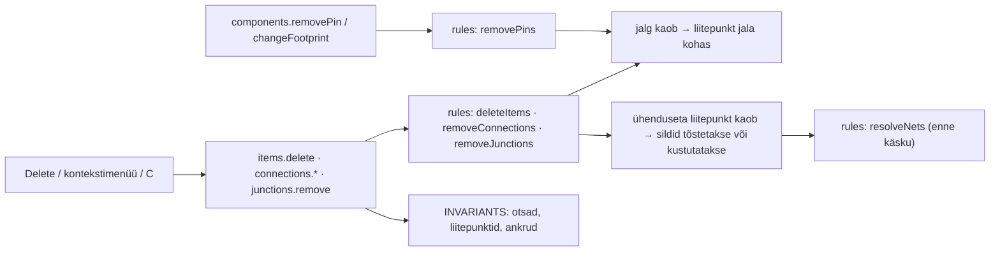

# M2-1-5 · Moodul `connections`, kiirühendus ja kustutamise reeglid

**Olek:** ehitamiseks · **Rada:** B · **Haru:** `codex/m2-1` (tööpuu `C:/Users/TRUMPIT/.codex/worktrees/bb-m2-1/BB`) · **Alus:** `75192c1` (M2-1-4) · **Plaan:** [M2.1 › Ülesanne 5](../plans/M2-1-uhendused-ja-vorgud.md#ülesanded) · **Otsus:** [ADR-005](../adr/ADR-005-tuuma-ja-moodulite-piir.md) § 1–2, O2

## Eesmärk
Kasutaja valib kaks või enam jalga ja vajutab `C`. Jalgade vahele tekivad oletatud ühendused, mis on fotol õhujoontena näha, ning õhujoonte kihi saab peita. Komponendi, jala, ühenduse või liitepunkti kustutamine järgib [04 › Kustutamise reegleid](../04-andmemudel.md#kustutamise-reeglid) ühe tagasivõetava käsuna. Reeglid ja invariandid on domeenis; mootor ei muutu.

## Loe (ainult need)
Loe tööpuust (`75192c1`). Rea numbrid on tööpuu järgi. `bb_task` laiendab viited põhikaustast, kus on M2.1 eelne kood; ava need read tööpuus.
- `packages/domain/src/rules/items.ts:1-52` (`ITEM_FIELDS`, `deleteItems`, `removePins`)
- `packages/domain/src/rules/invariants.ts:1-93` (`INVARIANTS`)
- `packages/features/engine.ts:1-22` (moodulite loend ja `RESERVED_FIELDS`)
- `packages/features/components/ui/index.tsx:166-200` (`selectionKinds` koos `inFrame` ja `deleteId`-ga)
- `packages/features/components/ui/layers/hits.ts:22-40` (jala tabamus `boardPads`-i järgi)

## Muuda
- `packages/domain/src/rules/`: uus `nets.ts` (`resolveNets`), uus `connections.ts` (otsus 3), `items.ts`, `invariants.ts`, `index.ts` ja testid.
- Uus moodul `packages/features/connections/`: `contract.ts`, `engine/` (käsud), `ui/` (kihid, valikuliigid, `C`, kihi lüliti, `i18n/et.ts`) ja testid.
- Uus moodul `packages/features/nets/engine/index.ts` ainult väljade omanikuna (otsus 6).
- `packages/features/engine.ts` ja `ui.ts` (registreerimine, `RESERVED_FIELDS`), komponentide `engine/commands.ts` (`alsoWrites`).
- Testide moodulite loend ja `RESERVED_FIELDS`-i ootused, kui need loetlevad mooduleid (otsus 9).
- `pnpm api`.

## Ära puutu
- Mootor (`packages/engine/`), käsk `items.translate`, `ItemRefSchema`, failivorming ja olemasolevad invariandid.
- Raja tööriist, joonistuse renderdus ja „Joonista rada fotol“ (M2-1-6), liitepunkti liigutamine (M2-1-7), võrkude tuletis ja sildi käsud (M2-1-8).
- `packages/ui/src/canvas/Canvas.tsx` (396 rida). Kui seda on vaja muuta, jaga fail enne.

## Otsused ja liidesed
1. **Võrgud domeenis (`rules/nets.ts`).**
   ```ts
   export const pinKey = (ref: PinRef) => `${ref.c}:${ref.p}`;
   export const endKey = (end: EndRef) => ('pin' in end ? pinKey(end.pin) : end.junction);
   export interface NetMembership { netOf: ReadonlyMap<string, string>; members: ReadonlyMap<string, readonly string[]> }
   export function resolveNets(doc: BoardDoc): NetMembership;
   ```
   - Union-find üle kõigi jalgade ja liitepunktide; ainult ühenduse otsad `a` ja `b` liidavad (04). Võrgu võti on väikseim liikme võti. Liikmed on võtmete järjekorras.
   - M2-1-8 ehitab sellele tuletise `nets`.
2. **Liitepunkt jala asemel.** Kui jalg kaob ja sellele viitab ühendus:
   - jala kohta tekib üks liitepunkt id-ga `jun_<komponendi id>_<jala id>`; kui see id on võetud, lisatakse `_2`, `_3` … Kõik selle jala ühenduse otsad viitavad nüüd sellele.
   - `board`: `at` on jala padjandi keskpunkt (`boardPads(board, [pinId], doc.scale.pxPerMm)`), `layer` on esimese sellise ühenduse `board.layer`, muidu komponendi `board.side`. Paigutamata komponendil `board`-i pole.
   - `schematic`: komponendi skeemipaigutuse korral `{ at: component.schematic.at }` (täpne jala koht tuleb M3 sümbolitega), muidu puudub.
   - Selle jala sildid kustutatakse. Mõõtmised jäävad.
3. **Kustutamise reeglid (`rules/connections.ts`, `rules/items.ts`).**
   ```ts
   export interface RuleReport { removedLabels: NetLabel[] }
   export function removeConnections(doc: BoardDoc, ids: readonly string[]): RuleReport;
   export function removeJunctions(doc: BoardDoc, ids: readonly string[]): RuleReport;
   export function deleteItems(doc: BoardDoc, ids: readonly string[]): RuleReport; // varem void
   export function removePins(doc: BoardDoc, componentId: string, pinIds: readonly string[]): RuleReport;
   export const ITEM_FIELDS = ['components', 'connections', 'junctions', 'netLabels'] as const;
   ```
   - `deleteItems` jagab id-d kogumi järgi: komponent (otsus 2 iga jala kohta, siis komponent kaob), ühendus (`removeConnections`), liitepunkt (`removeJunctions`). Tundmatu id jäetakse vahele; muutuseta käsk jääb muutuseta.
   - `removePins` lisab M2-1-2 käitumisele otsuse 2.
   - `removeConnections` eemaldab ühendused ja seejärel liitepunktid, millel ei jää ühtegi ühendust.
   - `removeJunctions` eemaldab liitepunktid koos kõigi nende ühendustega ja seejärel tekkinud ühenduseta liitepunktid.
   - **Sildid kaduval liitepunktil** (04 › Võrkude arvutus): enne käsku arvutatud võrgust valitakse esimene alles jääv liige, eelistatult jalg võtme järjekorras, siis liitepunkt id järjekorras, ja sildi `anchor` tõstetakse sinna. Kui sellist liiget pole, silt kustutatakse ja lisatakse `removedLabels`-isse.
   - Mootori `items.delete` jääb samaks: `alsoWrites: [...ITEM_FIELDS]` katab uued väljad ja tagastatud aruannet see ei kasuta. Kasutaja teade („Võrgusilt VBUS eemaldati · Ctrl+Z toob tagasi“) tuleb M2-1-8-s, kui silte saab luua.
4. **Invariandid.** `INVARIANTS` lõppu lisanduvad kolm kirjet:

   | id | `inputs` | kood ja tee |
   |---|---|---|
   | `connections` | `connections`, `components`, `junctions` | ots puudub → `dangling_connection_end` (`['connections', i, 'a' või 'b']`); otsad on samad → `connection_ends_equal` (`['connections', i, 'b']`) |
   | `junctions` | `junctions`, `connections` | ühenduseta liitepunkt → `orphan_junction` (`['junctions', i, 'id']`) |
   | `netLabels` | `netLabels`, `components`, `junctions` | ankur puudub → `dangling_label_anchor` (`['netLabels', i, 'anchor']`) |

   Olemasolevate kirjete koodid, teed ja järjekord ei muutu.
5. **Mooduli `connections` käsud** (`owns: ['connections', 'junctions']`).
   ```ts
   const EndInput = z.strictObject({ id: IdSchema, a: EndRefSchema, b: EndRefSchema });
   'connections.add': { items: EndInput[] (min 1); basis: 'assumed' | 'visual'; skipJoined: boolean }
   'connections.remove': { ids: string[] (min 1) }            // alsoWrites: ['netLabels']
   'connections.removeBoardDrawing': { ids: string[] (min 1) } // eemaldab ainult `board` välja
   'junctions.remove': { ids: string[] (min 1) }              // alsoWrites: ['netLabels']
   ```
   - `connections.add` lisab kirjed järjekorras. Puuduv ots annab `not_found` (id `cmp_x:4` või liitepunkti id), samad otsad `validation` põhjusega `connection_ends_equal`. `skipJoined: true` jätab vahele kirje, mille otsad on juba samas võrgus, arvestades ka sama käsu varasemaid kirjeid.
   - `remove`, `removeBoardDrawing` ja `junctions.remove` annavad puuduva id korral `not_found`. Need kutsuvad otsuse 3 reegleid.
   - Komponentide `components.removePin` ja `components.changeFootprint` saavad `alsoWrites: ['connections', 'junctions', 'netLabels']` (05 tabel).
6. **Moodul `nets` väljade omanikuna.** `{ id: 'nets', owns: ['netLabels', 'roles'] }` ilma käskudeta, et teised moodulid saaksid silte 05 tabeli järgi muuta. `RESERVED_FIELDS`-ist kaovad `connections`, `junctions`, `netLabels` ja `roles`. M2-1-8 lisab käsud ja tuletise.
7. **Kiirühendus ja õhujooned (UI).**
   - `C` (`KeySpec`, `id: 'connections.quickConnect'`): valiku jalad (`kind: 'pin'`) valiku järjekorras; vähemalt kaks jalga, muidu `false`. Ahel (O2): paarid 1–2, 2–3 … ühe `connections.add`-iga (`basis: 'assumed'`, `skipJoined: true`, uued id-d `ids.newId('con')`). Valik ei muutu.
   - Kiht `connections.airLines` (`z: 40`): ühendused ilma `board` joonistuseta, joon otste vahel, 1,5 px katkendjoon `6 4` värviga `--wire`, paksus ei sõltu suumist. Ots on jala padjandi keskpunkt või liitepunkti `board.at`; kui otsal pole plaadil kohta, joont ei joonistata.
   - Kiht `connections.junctions` (`z: 45`): liitepunkt täidetud täpina (raadius 2,5 px ekraanil), värv `--top` või `--bottom` kihi järgi.
   - Tabamused: õhujoon `segment` (laius 6 px ekraanil, `priority: 1`), liitepunkt `point` (`priority: 3`).
   - Lüliti „Õhujooned“ (`topBar` nupp, `aria-pressed`) peidab õhujoonte kihi ja selle tabamused. Olek on `setModuleView('connections', { airLines: boolean })` (vaikimisi nähtav) nagu foto juhtnuppudel.
8. **Valikuliigid ja menüü.**
   - `connection`: silt `„{ots A} – {ots B}“` (jalg `R1.2` nime või id-ga, liitepunkt „liitepunkt“), `exists`, `deleteId`. `moveRef`-i ja `inFrame`-i pole.
   - `junction`: silt „Liitepunkt · {n} ühendust“, `exists`, `deleteId`.
   - Kontekstimenüü: ühendusel „Kustuta ühendus“ (`connections.remove`), liitepunktil „Kustuta liitepunkt ({n} ühendust)“ (`junctions.remove`). Nii näeb kasutaja ühenduste arvu enne kustutamist. „Eemalda joonistus“ tuleb menüüsse M2-1-6-s koos joonistustega.
   - `Delete` kasutab M2-1-4 teed (`items.delete`).
9. **Olemasolevad testid.** Muuta võib ainult moodulite loendi ja `RESERVED_FIELDS`-i ootusi ning testiseadistust, kus uued moodulid tuleb registreerida. `invariants_come_from_domain_list` ootab uut `INVARIANTS` loendit. Kõik muudetud testid loetle üleandmises.



## Tõend
- TS:
  - `quick_connect_creates_assumed_air_lines_in_one_step` (`packages/features/connections/ui/quick-connect.test.tsx`): kolme valitud jalaga, millest kaks on juba ühendatud, loob `C` ühe käsuga ainult puuduva oletatud ühenduse ja üks `Ctrl+Z` eemaldab selle. Õhujoon on 1,5 px katkendjoon `6 4`. Lüliti „Õhujooned“ peidab kihi ja tabamused ning olek on mooduli vaate olekus. Ühe jalaga `C` käsku ei käivita.
  - `delete_component_turns_connection_ends_into_junctions` (`packages/domain/src/rules/connections.test.ts`): komponendi kustutamine teeb sama jala kahe ühenduse otstest ühe liitepunkti padjandi keskpunktis, õige kihi ja id-ga `jun_<cmp>_<pin>`; jala silt kaob ja mõõtmine jääb. `components.removePin` ja SOIC-14 → SOIC-8 korpuse vahetus annavad kaduvate jalgade jaoks sama tulemuse. Võetud id korral tuleb `_2`.
  - `remove_board_drawing_keeps_connection_as_air_line` (`packages/features/connections/connections.test.ts`): joonistusega ühenduse `connections.removeBoardDrawing` eemaldab ainult `board` välja; ühendus, otsad ja `basis` jäävad ning õhujoon on kihil näha.
  - `remove_connection_drops_orphan_junctions` (`packages/domain/src/rules/connections.test.ts`): `connections.remove` ja `items.delete` ühenduse id-ga eemaldavad ühenduseta jäänud liitepunkti, aga mitte liitepunkti, millel on veel ühendus. `junctions.remove` eemaldab liitepunkti, kõik selle ühendused ja tekkinud ühenduseta liitepunktid.
  - `orphan_junction_label_moves_or_is_removed` (`packages/domain/src/rules/connections.test.ts`): kaduva liitepunkti silt liigub enne käsku samas võrgus olnud jalale, kui see jääb alles (jalg võtme järjekorras enne liitepunkti). Kui alles jäävat liiget pole, silt kustutatakse ja `removedLabels` sisaldab seda.
  - `invariants_reject_dangling_end_and_label_anchor` (`packages/domain/src/rules/invariants.test.ts`): `validateDocument` annab `dangling_connection_end`, `connection_ends_equal`, `orphan_junction` ja `dangling_label_anchor` õigete teedega ning iga koodi väli on selle kirje `inputs`-is. `connections.add` puuduva otsaga annab `not_found`, samade otstega `connection_ends_equal`.
  - `delete_measured_connected_component_and_undo_stays_consistent` (`packages/features/connections/acceptance.test.ts`): kõigi moodulitega mootoris kustutab `items.delete` mõõdetud, ühendatud ja sildiga komponendi ühe ajaloosammuga. Mõõtmiste arv ei muutu, `Ctrl+Z` taastab dokumendi täpselt ja `Ctrl+Y` annab sama tulemuse mis kustutamine. `validateDocument` läbib igas olekus.
- Rada B täisring: põhikaustast `pnpm bb-review-card M2-1-5` → `ok: true`, `missing: []`.

## Valmis kui
- [ ] Testid, `pnpm check`, E2E ja Rusti testid läbivad.
- [ ] Mootori lähtekood ei muutunud. Olemasolevate testide ootused on samad, välja arvatud otsuses 9 nimetatud. Muudetud testid on üleandmises loetletud.
- [ ] Kõik muudetud failid on ≤ 400 rea. `pnpm api` on uuendatud.
- [ ] Üleandmine on allpool, kuni 15 rida.

## Üleandmine
