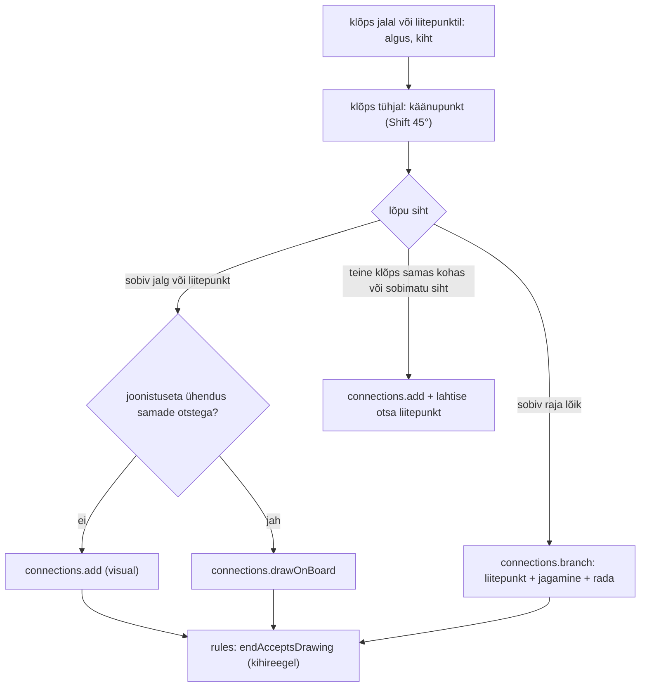

# M2-1-6 · Tööriist Rada

**Olek:** ehitamiseks · **Rada:** B · **Haru:** `codex/m2-1` (tööpuu `C:/Users/TRUMPIT/.codex/worktrees/bb-m2-1/BB`) · **Alus:** `3ab11ac` (M2-1-5) · **Plaan:** [M2.1 › Ülesanne 6](../plans/M2-1-uhendused-ja-vorgud.md#ülesanded) · **Otsus:** [04 › Võrkude arvutus](../04-andmemudel.md#võrkude-arvutus-resolvenets) (haru, kihid), leid 17

## Eesmärk
Kasutaja joonistab tööriistaga Rada (`T`) fotol nähtava raja jalast jalani, liitepunktini, teise raja peale (haru) või lahtise otsani. Rada on nähtud ühendus koos joonistusega. Kihireegel hoiab pealmise ja alumise raja lahus, kui neid ei ühenda läbiv padjand. Valitud õhujoonele saab raja joonistada. Joonistuse saab eemaldada nii, et ühendus jääb alles. Ristumine ega lähedus ei ühenda kunagi.

## Loe (ainult need)
Loe tööpuust (`3ab11ac`). Rea numbrid on tööpuu järgi. `bb_task` laiendab viited põhikaustast, kus on M2.1 eelne kood; ava need read tööpuus.
- `packages/features/connections/engine/index.ts:1-77` (käsud)
- `packages/features/connections/ui/index.tsx:1-98` (klahv `C`, valikuliigid, menüü)
- `packages/features/connections/ui/layers.tsx:1-114` (õhujooned, liitepunktid, tabamused)
- `packages/domain/src/geometry/board.ts:43-82` (`boardPads`; leid 17 real 80)
- `packages/features/components/ui/PlaceTool.ts:53-150` (tööriista muster: hõljumine, `overlay`, `onKey`, katkestus)

## Muuda
- `packages/domain/src/geometry/board.ts`: `boardPads` annab `through` ja kasutaja padjandi tegeliku kuju (otsus 1).
- `packages/domain/src/rules/`: uus `layers.ts` (`endAcceptsDrawing`) ja `branchConnection` failis `connections.ts` (otsused 2 ja 4), `index.ts` ja testid.
- `.dependency-cruiser.cjs`: `ui-domain-runtime-allowlist` lubab ka `packages/domain/src/rules/` (otsus 2).
- `packages/features/connections/`: `contract.ts` (otsus 3), `engine/index.ts` (otsus 4), `ui/` (tööriist, rajakiht, menüü, tekstid) ja testid.
- `packages/ui/src/shell/UiRegistry.ts` ja `packages/ui/src/canvas/use-canvas-context-menu.ts`: `ContextMenuItemSpec.available` (otsus 8).
- `pnpm api`.

## Ära puutu
- Mootor, failivorming ja olemasolevad invariandid.
- `packages/ui/src/canvas/Canvas.tsx` (396 rida); tööriist kasutab olemasolevat `overlay`-d ja hõljumist. Kui faili on siiski vaja muuta, jaga see enne.
- Käänupunktide muutmine ja liitepunkti liigutamine (M2-1-7), raja silt (M2-1-10), rollivärvid (M2-1-9), ühenduse tase „mõõdetud“ (M3).

## Otsused ja liidesed
1. **Padjandid (leid 17).** `boardPads` tagastab iga padjandi kohta lisaks `through: boolean`: korpuse padjandil `pad.through`, kasutaja padjandil `customPads[id].through`. Kasutaja padjandi `shape` tuleb andmetest (`circle` või `rect`), mitte alati `circle`. Joonistus (`ComponentShape`) ja tabamus (`componentPinHits`) kasutavad seda kuju juba praegu.
2. **Kihireegel domeenis (`rules/layers.ts`).**
   ```ts
   export type DrawingKind = 'trace' | 'wire';
   export function endAcceptsDrawing(doc: BoardDoc, end: EndRef, kind: DrawingKind, layer: Layer): boolean;
   ```
   - `wire` sobib iga plaadil asuva otsaga.
   - `trace` jalal: komponent on plaadil ja jala padjand on läbiv või `board.side === layer`. `trace` liitepunktil: `junction.board?.layer === layer`.
   - Plaadil asukohata ots (paigutamata komponent, `board`-ita liitepunkt) ei sobi kunagi.
   - Mootori käsud ja tööriista eelvaade kasutavad sama funktsiooni. Seepärast lubab depcruise kasutajaliidesel importida `@pcbk/domain/rules`-i (puhtad funktsioonid).
3. **Leping.**
   ```ts
   const BoardDrawingInput = z.strictObject({
     kind: z.enum(['trace', 'wire']), layer: LayerSchema, waypoints: z.array(Vec2Schema), widthMm: z.number().positive(),
   });
   const EndInput = z.strictObject({ id: IdSchema, a: EndRefSchema, b: EndRefSchema, board: BoardDrawingInput.optional() });
   const JunctionInput = z.strictObject({ id: IdSchema, board: z.strictObject({ at: Vec2Schema, layer: LayerSchema }) });
   'connections.add': { items: EndInput[]; basis; skipJoined; junctions?: JunctionInput[] }   // laiendus
   'connections.drawOnBoard': { id: string; board: BoardDrawingInput }
   'connections.branch': { target: string; segment: number; at: Vec2; junctionId: string; splitId: string; trace: EndInput }
   ```
   Vaikelaius on rajal `0.3` mm ja juhtmel `0.5` mm (`TRACE_WIDTH_MM`, `WIRE_WIDTH_MM`).
4. **Käsud.**
   - `connections.add`: kõigepealt luuakse `junctions` (lahtised otsad), siis kirjed. Kui kirjel on `board` ja mõni ots ei sobi (`endAcceptsDrawing`), annab käsk `validation` põhjusega `layer_mismatch`.
   - `connections.drawOnBoard`: puuduv id annab `not_found`, joonistusega ühendus `validation` põhjusega `already_drawn`. Otsad kontrollitakse nagu ülal. Käsk seab `board`-i ja `basis: 'visual'`.
   - `connections.branch` kutsub domeeni `branchConnection`-it:
     - sihtühendusel peab olema joonistus (`not_drawn`) ja `segment` peab olema vahemikus `0 … waypoints.length` (`invalid_segment`);
     - `trace.b` peab olema `{ junction: junctionId }` (`branch_end_mismatch`);
     - `trace` raja kiht peab võrduma sihi kihiga, välja arvatud juhtme korral (`layer_mismatch`), ja `trace.a` peab sobima.
   - `branchConnection` teeb järgmist:
     - loob liitepunkti `{ id: junctionId, board: { at, layer: sihi kiht } }`;
     - siht (sama id, `basis`, `kind`, laius, `labelOffset`) muutub `a → J`-ks käänupunktidega enne lõiku `segment`;
     - uus ühendus `splitId` on `J → b` ülejäänud käänupunktide, sama `basis`-e, `kind`-i, kihi ja laiusega;
     - lõpuks lisatakse `trace` (`basis: 'visual'`). Kõik on üks käsk.
   - Lõik `k` on täispunktide `[a, ...waypoints, b]` punktide `k` ja `k + 1` vahel. Kaheks jagamiseks pole otste asukohti vaja.
5. **Tööriist Rada** (`ToolSpec` `connections.trace`, klahv `T`, rühm `draw`).
   - **Algus:** klõps jalal või liitepunktil. Pinnajalal võtab rada selle poole kihi; läbiv jalg ja liitepunkt (oma kihiga) jätavad praeguse kihi. Muu klõps alguses ei tee midagi.
   - **Käänupunktid:** klõps tühjal kohal lisab käänupunkti. `Shift` hoiab lõigu suuna eelmisest punktist 45° sammuga.
   - **Lõpp:**
     - Sobival jalal või liitepunktil lõpetatakse. Kui samade otste vahel on joonistuseta ühendus, käivitub `connections.drawOnBoard`, muidu `connections.add` (`basis: 'visual'`).
     - Sobiva raja lõigul (`kind: 'connection'` joonistusega, sama kiht või juhe) käivitub `connections.branch`; `at` on klõpsu projektsioon lõigule.
     - Teine klõps eelmise käänupunkti kohal (≤ 3 px ekraanil) lõpetab lahtise otsaga: `connections.add` koos uue liitepunktiga selles kohas.
     - Sobimatu jala, liitepunkti või raja peal tekib 04 järgi samuti lahtine ots klõpsu kohas.
   - **Ainult joone tabamus haakub.** Raja lõik loeb ainult siis, kui klõps on joonistatud laiuse sees (pool laiust, vähemalt 0,7 px ekraanil). Tabamuse üldisem taluvus valikule jääb samaks. Ristumine, lähedus ja kattumine ei loo kunagi liitepunkti.
   - **Klahvid:**
     - `Backspace` eemaldab viimase käänupunkti; kui käänupunkte pole, katkestab joonistuse.
     - `L` vahetab: pealmine → alumine → juhe → pealmine.
     - `Esc` (lõuendi katkestus) jätab dokumendi ja eelvaate puhtaks.
     - Tööriist jääb aktiivseks järgmise raja jaoks.
   - **Eelvaade (`overlay`):**
     - joon algusest käänupunktide kaudu kursorini;
     - haakumise sihi esiletõst enne klõpsu (padjandi kuju, liitepunkt või lõik, värv `--sel`), sobimatu siht ei saa esiletõstu;
     - lõpetamata lõigu kohal pikkus kujul `„{n,nn} mm“` (`doc.scale.pxPerMm`, kümnendkoma);
     - kiht või juhe tööriista vihjes alumisel ribal („Rada · pealmine“, „Rada · alumine“, „Juhe“).
6. **Joonistus olemasolevale ühendusele.** Kontekstimenüü „Joonista rada fotol“ valitud õhujoonel aktiveerib tööriista nii, et algus on ühenduse ots `a` ja siht on see ühendus. Klõps otsal `b` või teine klõps viimase käänupunkti kohal lõpetab: `connections.drawOnBoard` käänupunktidega. Sobimatu kihi korral vahetab kasutaja kihti `L`-iga; käsk lükkab `layer_mismatch` tagasi ja tööriist näitab põhjust vihjes.
7. **Rajakiht ja liitepunktid.**
   - Kiht `connections.traces` (`z: 38`): joonistusega ühendus on murdjoon `[a, ...waypoints, b]`. Laius on `widthMm * pxPerMm`, vähemalt 1,4 px ekraanil. Värv on `--top` või `--bottom` kihi järgi, juhe `--wire` kumera kaarena (iga lõik ruutkõverana, kõrvalekalle 15 % lõigu pikkusest).
   - Vaadatava poole määrab aktiivse foto `side` (foto puudumisel `top`). Teise kihi rajad on `opacity: 0.3` (06: 70 % läbipaistvus).
   - Tabamused: iga lõik on `segment` raja laiusega maailma ühikutes (`priority: 1`, `data: { segment }`).
   - Liitepunkti täpp on 2,5 × suurim ühendatud raja laius, vähemalt 5 px ekraanil. Liitepunkt, millel on ainult üks ühendus ja see on joonistatud, on lahtine ots: tühi ring.
   - Õhujooned jäävad ainult joonistuseta ühendustele. Õhujoone tabamuse taluvus jääb ±3 px (M2-1-5 märkus 1): see ei võta klõpse komponendi kerelt.
8. **Menüü ja tekstid.**
   - `ContextMenuItemSpec.available?(snapshot, selection): boolean` peidab kirje, kui see tagastab `false`. Filter on `use-canvas-context-menu`-s mõlemas avamisviisis.
   - Ühendusel on „Joonista rada fotol“ (ainult joonistuseta) ja „Eemalda joonistus“ (`connections.removeBoardDrawing`, ainult joonistusega). „Kustuta ühendus“ jääb.
   - Ainsus: `junction(1)` = „Liitepunkt · 1 ühendus“, `deleteJunction(1)` = „Kustuta liitepunkt (1 ühendus)“; muu arv nagu praegu (M2-1-5 märkus 2).
9. **Olemasolevad testid.** Pinnapadjandi ootused, mis eeldavad, et kasutaja `rect` padjand on `circle`, muutuvad leiu 17 järgi; muud ootused jäävad samaks. `boardPads` uus väli `through` võib nõuda geomeetria võrdluste uuendamist ainult selle välja võrra. Kõik muudetud testid loetle üleandmises.



## Tõend
- TS:
  - `crossing_traces_do_not_connect` (`packages/features/connections/ui/trace-tool.test.tsx`): uus rada, mille lõik ristub olemasoleva rajaga (käänupunktid mõlemal pool, mitte raja peal), ei loo liitepunkti ega haru. Rajad jäävad eri võrkudesse (`resolveNets`).
  - `trace_end_1px_from_trace_does_not_join` (`packages/features/connections/ui/trace-tool.test.tsx`): teine klõps 1 px väljaspool olemasoleva raja joonistatud serva lõpetab lahtise otsaga. Olemasolev rada ei muutu ja võrgud jäävad eraldi. Esiletõstu enne klõpsu ei olnud.
  - `branch_on_trace_creates_junction_and_splits_in_one_step` (`packages/domain/src/rules/connections.test.ts`): lõpp raja lõigul `k` loob ühe käsuga liitepunkti projektsiooni punktis. Siht jaguneb `a → J` ja `J → b` õigete käänupunktidega, sama `basis`-e, kihi ja laiusega, ning uus rada lõpeb `J`-s. Üks `Ctrl+Z` taastab kõik. Vigane lõik annab `invalid_segment` ja joonistuseta siht `not_drawn`.
  - `top_trace_joins_bottom_only_through_pad` (`packages/domain/src/rules/layers.test.ts`): pealmine rada alumise poole pinnajalal annab tööriistas lahtise otsa ja käsus `layer_mismatch`. Läbiva jala korral ühendub. Juhe sobib mõlemale. Kihi vahetus `L`-iga ei ühenda midagi.
  - `trace_on_existing_connection_adds_only_drawing` (`packages/features/connections/connections.test.ts`): oletatud joonistuseta ühendusega jalgade vahel lisab rada ainult joonistuse. Ühenduste arv ei muutu ja `basis` on `visual`. „Joonista rada fotol“ valitud õhujoonel teeb sama. Joonistusega ühenduse `drawOnBoard` annab `already_drawn`.
  - `trace_tool_escape_leaves_no_trace` (`packages/features/connections/ui/trace-tool.test.tsx`): pärast algust ja kahte käänupunkti jätab `Esc` dokumendi ja eelvaate samaks ning käsku ei käivitu. `Backspace` eemaldab viimase käänupunkti. `L` vahetab vihjes kihi järjekorras pealmine → alumine → juhe. `Shift` annab 45° suuna ja pikkus on kujul „{n,nn} mm“.
  - `rect_custom_pad_keeps_shape_and_hit` (`packages/domain/src/geometry/board.test.ts`): `rect` kujuga kasutaja padjand annab `boardPads`-ist kuju `rect` ja õige `through`-i. Joonistus on ristkülik ja tabamus nurgas on padjandi sees.
  - `traces_render_by_layer_and_menu_offers_drawing_actions` (`packages/features/connections/ui/traces.test.tsx`): rada on kihi värviga ja laiusega vähemalt 1,4 px. Teise kihi rada on `opacity` 0,3. Lahtine ots on tühi ring ja haru täpp on 2,5 × raja laius. Menüüs on joonistuseta ühendusel „Joonista rada fotol“, joonistusega „Eemalda joonistus“. Ühe ühendusega liitepunkti silt on „Liitepunkt · 1 ühendus“.
- Rada B täisring: põhikaustast `pnpm bb-review-card M2-1-6` → `ok: true`, `missing: []`.

## Valmis kui
- [ ] Testid, `pnpm check`, E2E ja Rusti testid läbivad.
- [ ] Mootori lähtekood ja `Canvas.tsx` ei muutunud. Olemasolevate testide ootused on samad, välja arvatud otsuses 9 nimetatud. Muudetud testid on üleandmises loetletud.
- [ ] Kõik muudetud failid on ≤ 400 rea. `pnpm api` on uuendatud.
- [ ] Üleandmine on allpool, kuni 15 rida.

## Üleandmine
