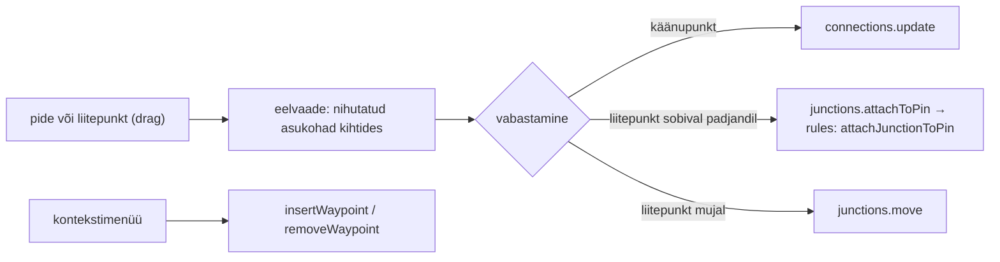

# M2-1-7 · Raja muutmine

**Olek:** vastu võetud `5ac0d20` · **Rada:** A · **Haru:** `codex/m2-1` (tööpuu `C:/Users/TRUMPIT/.codex/worktrees/bb-m2-1/BB`) · **Alus:** `f3a99c8` (M2-1-6) · **Plaan:** [M2.1 › Ülesanne 7](../plans/M2-1-uhendused-ja-vorgud.md#ülesanded) · **Otsus:** [04 › Võrkude arvutus](../04-andmemudel.md#võrkude-arvutus-resolvenets) (`junctions.attachToPin`)

## Eesmärk
Kasutaja parandab joonistatud rada valikutööriistaga. Ta saab lohistada käänupunkte, lisada ja eemaldada neid kontekstimenüüst ning liigutada liitepunkti. Liitepunkti saab lohistada jala padjandile ja kinnitada jalale; sildid liiguvad kaasa. Liigutamine muudab ainult paigutust, ühendatus jääb samaks. Lohistamise ajal järgivad rajad ja õhujooned liikuvat komponenti, käänupunkti ja liitepunkti.

## Loe (ainult need)
Loe tööpuust (`f3a99c8`). Rea numbrid on tööpuu järgi. `bb_task` laiendab viited põhikaustast, kus on M2.1 eelne kood; ava need read tööpuus.
- `packages/features/connections/engine/index.ts:1-126` (käsud)
- `packages/features/connections/ui/layers.tsx:1-200` (rajad, õhujooned, liitepunktid, tabamused)
- `packages/features/connections/ui/connection-geometry.ts:1-148` (otspunktid, murdjoon, projektsioon)
- `packages/features/components/ui/layers/hits.ts:43-92` (lohistatav tabamus: `drag.owner` ja `commit`)
- `packages/ui/src/canvas/SelectTool.ts:96-160` (lohistatava tabamuse tee: eelvaade `{ id, dx, dy }` ja `commit`)

## Muuda
- `packages/domain/src/rules/connections.ts`: `attachJunctionToPin` (otsus 2), `index.ts` ja testid.
- `packages/features/connections/contract.ts` ja `engine/index.ts`: viis käsku (otsus 1).
- `packages/features/connections/ui/`: käänupunktide pidemed ja liitepunkti lohistus kihtides, eelvaate nihked, menüükirjed, tekstid ning `TraceTool.ts` alguse kiht (otsus 6).
- `pnpm api`.

## Ära puutu
- Mootor, `items.*`, failivorming, invariandid ja `Canvas.tsx`.
- Valikutööriista loogika (`SelectTool.ts`), raamvalik ja mitmikvalik.
- Võrkude tuletis, sildi käsud ja raja silt (M2-1-8 kuni M2-1-10).

## Otsused ja liidesed
1. **Käsud** (moodul `connections`).
   ```ts
   'connections.update': { id: string; waypoints: Vec2[] }              // ainult joonistuse käänupunktid
   'connections.insertWaypoint': { id: string; index: number; at: Vec2 } // index 0 … waypoints.length
   'connections.removeWaypoint': { id: string; index: number }          // index 0 … waypoints.length - 1
   'junctions.move': { id: string; at: Vec2 }
   'junctions.attachToPin': { id: string; pin: PinRef }                 // alsoWrites: ['netLabels']
   ```
   - Puuduv ühendus või liitepunkt annab `not_found`. Joonistuseta ühendus annab `validation` põhjusega `not_drawn`, vale indeks `invalid_waypoint`. `board`-ita liitepunkti liigutamine annab `not_on_board`.
   - `update`, `insert`, `remove` ja `move` muudavad ainult `board.waypoints`-i või `junction.board.at`-i. Otsad, `basis`, kiht ja ühendused jäävad.
2. **Liitepunkt jalale (`rules/connections.ts`).**
   ```ts
   export function attachJunctionToPin(doc: BoardDoc, junctionId: string, pin: PinRef): RuleReport;
   ```
   - Puuduv liitepunkt või jalg viskab `RuleTargetNotFound`.
   - Iga liitepunkti joonistusega ühendus peab jalga lubama (`endAcceptsDrawing` oma `kind`-i ja kihiga), muidu `RuleRejected('layer_mismatch')`.
   - Ühendus liitepunkti ja sama jala vahel kustutatakse, sest selle otsad muutuksid samaks. Teiste ühenduste liitepunkti otsad viitavad nüüd jalale.
   - Liitepunkti sildid saavad ankruks jala (04). Liitepunkt kaob. `removedLabels` on tühi.
3. **Käänupunktid valikutööriistaga.**
   - Valitud joonistusega ühendusel (täpselt üks valitud ühendus) näitab kiht igal käänupunktil pidet: ruut 6 px ekraanil, raam `--sel`.
   - Pideme tabamus on `{ kind: 'waypoint', id: '<ühenduse id>:<indeks>', priority: 4, target: { kind: 'connection', id }, drag: { owner: WAYPOINT_DRAG_OWNER, commit } }`. `commit` käivitab `connections.update` nihutatud käänupunktiga. Klõps pidemel jätab valituks ühenduse.
   - Kontekstimenüü ühendusel:
     - „Lisa käänupunkt“ (`available`: üks valitud joonistusega ühendus): klõpsule lähima lõigu leiab `connectionPoints`, punkt on projektsioon sellele lõigule ja käsk on `connections.insertWaypoint` indeksiga = lõigu number;
     - „Eemalda käänupunkt“ (`available`: valitud ühendusel on vähemalt üks käänupunkt): eemaldab klõpsule lähima käänupunkti, kui see on kuni 8 px ekraanil, muidu `false`.
4. **Liitepunkti lohistus.**
   - Liitepunkti tabamus saab `drag: { owner: JUNCTION_DRAG_OWNER, commit }`. Klõps valib liitepunkti nagu praegu.
   - Vabastamisel on kukkumiskoht `junction.board.at + delta`. Kui see on mõne paigutatud jala padjandi sees (padjandi kuju järgi, esimene jala võtme järjekorras) ja `attachJunctionToPin` lubaks seda, käivitub `junctions.attachToPin`; muidu `junctions.move`.
   - Sobiv sihtpadjand on lohistamise ajal esile tõstetud (`--sel`). Sobimatut padjandit esile ei tõsteta ja seal vabastamine ainult liigutab.
5. **Eelvaade lohistamise ajal.** Rajakiht, õhujoonte kiht ja liitepunktide kiht saavad `previewOwners: ['select', WAYPOINT_DRAG_OWNER, JUNCTION_DRAG_OWNER]`. Joonistus kasutab nihutatud asukohti:
   - `select` (`TranslatePreviewData`): liikuvate komponentide jalgade otspunktid nihkuvad `dx, dy` võrra;
   - käänupunkt: ainult see käänupunkt;
   - liitepunkt: liitepunkt ja selle ühenduste otspunktid.
   Dokument ei muutu enne vabastamist; `Esc` jätab kõik nagu enne.
6. **M2-1-6 märkused.**
   - Teise kihi liitepunktilt alustatud rada võtab liitepunkti kihi, kui praegune režiim on rada (juhe jääb juhtmeks).
   - Juhe ei tuhmu teise poole vaates (06: juhe on plaadist kõrgemal); tuhmuvad ainult rajad.
7. **Tekstid:** „Lisa käänupunkt“, „Eemalda käänupunkt“.
8. **Olemasolevad testid.** Ootused jäävad samaks. Kui M2-1-6 test eeldas juhtme tuhmumist või liitepunktilt alustatud raja praegust kihti, muutub ainult see ootus otsuse 6 järgi. Kõik muudetud testid loetle üleandmises.



## Tõend
- TS:
  - `waypoint_drag_changes_only_drawing_in_one_step` (`packages/features/connections/ui/edit-traces.test.tsx`): valitud raja pideme lohistus näitab eelvaates nihutatud käänupunkti ja vabastamisel käivitub üks `connections.update`. Otsad ja `resolveNets` ei muutu ning üks `Ctrl+Z` taastab. Komponendi lohistamisel järgib selle jalaga raja otspunkt eelvaadet. `Esc` lohistuse ajal ei muuda midagi.
  - `insert_and_remove_waypoint` (`packages/features/connections/ui/edit-traces.test.tsx`): „Lisa käänupunkt“ lisab klõpsu projektsiooni lähimasse lõiku õige indeksiga. „Eemalda käänupunkt“ eemaldab kuni 8 px kaugusel oleva käänupunkti ja kaugemal ei tee midagi. Mõlemad on üks samm. Vale indeks annab `invalid_waypoint`, joonistuseta ühendus `not_drawn`.
  - `junction_move_keeps_connectivity` (`packages/features/connections/connections.test.ts`): liitepunkti lohistus liigutab ainult `junction.board.at`-i. Ühendused ja `resolveNets` on samad ning rajad järgivad nii eelvaates kui pärast. `board`-ita liitepunkt annab `not_on_board`.
  - `attach_junction_to_pin_moves_labels` (`packages/domain/src/rules/connections.test.ts`): kinnitamine suunab liitepunkti ühendused jalale, kustutab liitepunkti ja sama jala vahelise ühenduse, tõstab sildid jalale ja eemaldab liitepunkti. Sobimatu kiht annab `layer_mismatch`. Kasutajaliideses kinnitab sobival padjandil vabastamine ja sobimatul ainult liigutab. Üks `Ctrl+Z` taastab.
  - `trace_start_on_junction_takes_its_layer` (`packages/features/connections/ui/trace-tool.test.tsx`): pealmise režiimiga alustatud rada alumisel liitepunktil võtab alumise kihi ja vihjes pole veateadet. Juhe on teise poole vaates täie läbipaistmatusega.
- Põhikaustast `pnpm bb-review-card M2-1-7` → `ok: true`, `missing: []`.

## Valmis kui
- [x] Testid ja `pnpm check` läbivad.
- [x] Liigutamine ei muuda ühendatust. Olemasolevate testide ootused on samad, välja arvatud otsuses 8 nimetatud. Muudetud testid on üleandmises loetletud.
- [x] Kõik muudetud failid on ≤ 400 rea. `pnpm api` on uuendatud.
- [x] Üleandmine on allpool, kuni 15 rida.

## Üleandmine

- Tööpuu `C:/Users/TRUMPIT/.codex/worktrees/bb-m2-1/BB`, haru `codex/m2-1`, kontrollitud puhas alus `f3a99c8`. Muudatused on tööpuus.
- Valitud raja käänupunkte saab lohistada ja menüüst lisada või eemaldada. Käänupunkti või liitepunkti liigutamisel säilivad otsad, ühendatus, `basis` ja kiht. Iga muudatus on üks käsk ja üks `Ctrl+Z`.
- Eelvaade nihutab raja käänupunkti ning raja ja õhujoone liikuvaid otspunkte. `Esc` katkestab lohistuse enne muudatust.
- Liitepunkti kinnitamisel kasutavad eelvaade ja `attachJunctionToPin` sama kihikontrolli. Kukkumiskohta hinnatakse kuvatud padjandi kuju järgi ning sihtpadjand tõstetakse padjandikihi kohal esile. Kinnitamisel liiguvad sildiankrud jalale.
- Liitepunktilt alustades võtab rada selle kihi. Juhe säilitab režiimi ja on mõlemalt plaadipoolelt täisopaakne.
- Kõik viis kaarditesti andsid baaskoodil RED-i. Sihitud GREEN-is läbis 27 testi, sealhulgas `boundary.test.ts`. Tööpuu logid `output/playwright/m2-1-7/`.
- Teste lisati failidesse `packages/domain/src/rules/connections.test.ts`, `packages/features/connections/connections.test.ts` ja `packages/features/connections/ui/trace-tool.test.tsx`. Uus fail on `packages/features/connections/ui/edit-traces.test.tsx`. Olemasolevad ootused säilisid.
- `pnpm api` ja `api:check` läbisid. Pikim muudetud fail on 374 rida. Mootor, `items.*`, lõuendi kaitstud failid, failivorming, invariandid ja võrkude tuletis säilisid.
- `pnpm bb-review-card M2-1-7` läbis (`ok: true`, `missing: []`). Läbisid 1653 ühiktesti ja 42 E2E testi. Kokkuvõte `output/review-card/M2-1-7-vcjrGS/summary.json`.

## Arhitekti ülevaatus (2026-11-20)

- **Kontrollitud:**
  - Tööpuus on 14 muudetud ja 5 uut faili, neist 2 genereeritud `docs/api` faili. Võõraid faile pole, HEAD on `f3a99c8`.
  - `packages/engine` ja `packages/ui` on muutmata.
  - Diff: `attachJunctionToPin` ja `validateJunctionAttachment`, viis käsku ja leping, `connection-preview.ts`, `junction-attachment.ts`, `connection-editing-layer.tsx`, `layers.tsx`, `index.tsx` (menüü) ja `TraceTool.ts`. Olemasolevates testifailides muutusid ainult impordid ja lisandusid testid.
  - Kokkuvõte `M2-1-7-vcjrGS/summary.json` (09:46) on uuem kui tööpuu viimane muudatus (09:41), seega käske uuesti ei käivitatud. Tulemused:
    - rada A, `missing: []`, `warnings: []`;
    - Vitest 1653/0, Playwright 42/0; check, api, format, coverage, e2e ja diff exit 0;
    - kõik 5 kaardi testi läbisid.
- **Otsused koodis:**
  - **Käsud:** `update`, `insertWaypoint`, `removeWaypoint` ja `junctions.move` muudavad ainult käänupunkte või liitepunkti asukohta (`not_found`, `not_drawn`, `invalid_waypoint`, `not_on_board`).
  - **Jalale kinnitamine:**
    - `attachJunctionToPin` kontrollib kõigepealt sama funktsiooniga, mida kasutab eelvaade (`validateJunctionAttachment`: liitepunkt, jalg, joonistatud ühenduste kihid);
    - see kustutab samade otstega ühenduse, suunab teised jalale, tõstab sildid ja eemaldab liitepunkti;
    - `alsoWrites: ['netLabels']`.
  - **Pidemed:**
    - pidemed on ainult valikutööriistas ja ühe valitud ühenduse korral (`z: 55`, `priority: 4`);
    - tabamus on `target`-iga ühendusele, `drag.commit` käivitab ühe `connections.update`;
    - menüüs on „Lisa käänupunkt“ lähima lõigu projektsiooni ja „Eemalda käänupunkt“ kuni 8 px kaugusega.
  - **Liitepunkti lohistus:** sihtpadjand leitakse kuvatud padjandi kuju järgi jala võtme järjekorras. Sobiv siht on esile tõstetud ja vabastamine kinnitab, muidu `junctions.move`.
  - **Eelvaade:** `select`, pideme ja liitepunkti nihked liiguvad rajale, õhujoonele ja liitepunktile. Dokument ei muutu enne vabastamist.
  - **M2-1-6 märkused:** liitepunktilt alustatud rada võtab selle kihi ja juhe on mõlemalt poolt täis läbipaistmatusega.
- **Olemasolevad testid:** ootused säilisid.
- **UI:** pidemed, esiletõst ja menüü on kontrollitud testides DOM-ist. Brauseris ei kontrollinud.
- **Otsus: sobib.**
- **Mitteblokeerivad märkused:**
  1. Harude katvus langeb iga kaardiga (99,09 → 96,63 → 96,24 → 96,00 %). Läved said täidetud, aga M2-1-11 vastuvõtt vaatab katmata harud üle.
  2. „Eemalda käänupunkt“ on menüüs iga käänupunktidega ühenduse puhul. Kui paremklõps oli käänupunktist kaugemal kui 8 px, ei juhtu midagi ja kasutaja ei saa sellest teadet.
