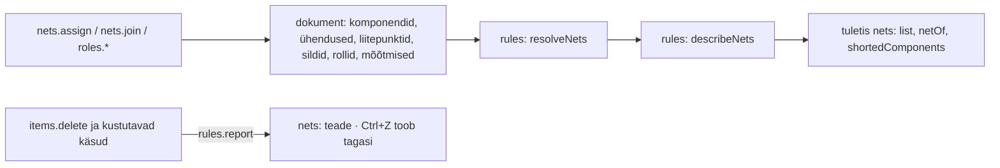

# M2-1-8 · Moodul `nets`: arvutus ja käsud

**Olek:** vastu võetud `dea9f0b` · **Rada:** B · **Haru:** `codex/m2-1` (tööpuu `C:/Users/TRUMPIT/.codex/worktrees/bb-m2-1/BB`) · **Alus:** `5ac0d20` (M2-1-7) · **Plaan:** [M2.1 › Ülesanne 8](../plans/M2-1-uhendused-ja-vorgud.md#ülesanded) · **Otsus:** [04 › Võrkude arvutus](../04-andmemudel.md#võrkude-arvutus-resolvenets), [04 › Kustutamise reeglid](../04-andmemudel.md#kustutamise-reeglid)

## Eesmärk
Võrgud on arvutatud andmed: liikmed, nimi, roll, rollikonflikt, piiksu vastuolu ja lühistatud kahejalgsed komponendid. Võrgule saab anda nime ja rolli sildina, kaks võrku saab ühendada ning rolle saab hallata. Kui käsk kustutab võrgusildi, näeb kasutaja teadet „… · Ctrl+Z toob tagasi“. Nimi ei liida kunagi võrke. M2-1-9 ehitab sellele vahekaardi „Võrgud“, värvid ja ekspordi.

Rada on B, sest kaart muudab mootori üldkäsku `items.delete` (teavitus) ja lisab ühendusi loova käsu (plaanis oli A).

## Loe (ainult need)
Loe tööpuust (`5ac0d20`). Rea numbrid on tööpuu järgi. `bb_task` laiendab viited põhikaustast, kus on M2.1 eelne kood; ava need read tööpuus.
- `packages/domain/src/rules/nets.ts:1-59` (`resolveNets`, `pinKey`, `endKey`)
- `packages/features/components/engine/derive.ts:1-21` (`DeriveSpec` mooduli tuletisena)
- `packages/features/measurements/contract.ts:15-30` (`Derived` laiendus lepingus)
- `packages/engine/src/items.ts:1-30` (`items.delete`)
- `packages/features/connections/engine/index.ts:168-213` (`connections.remove`, `junctions.remove`)

## Muuda
- `packages/domain/src/rules/`: uus `net-info.ts` (`describeNets`, otsus 1), `isEmptyReport` failis `connections.ts`, `index.ts` ja testid.
- Uus `packages/features/nets/contract.ts` (skeemid, `CommandMap`, `Derived`). `nets/engine/` saab tuletise ja käsud, `nets/ui/` teavituse.
- `packages/engine/src/items.ts`: `items.delete` teavitab (otsus 5). See on mootori ainus muudatus.
- `packages/features/connections/engine/index.ts` ja `packages/features/components/engine/commands.ts` (388 rida, jääb ≤ 400): teavitus kustutavates käskudes.
- `pnpm api`.

## Ära puutu
- Failivorming, invariandid, `items.translate` ja kustutamise reeglite sisu (M2-1-5).
- Vahekaart „Võrgud“, värvid, võrguloendi eksport ja nimetamise kasutajaliides (M2-1-9). Sildi asukoht ja raja silt (M2-1-10).
- Kest (`packages/ui`) ja `Canvas.tsx`.

## Otsused ja liidesed
1. **Tuletis `nets` (domeen + moodul).**
   ```ts
   export interface NetInfo {
     key: string;                 // väikseim liikme võti
     members: string[];           // jalad `cmp:pin` ja liitepunktid, võtmete järjekorras
     name: string;                // sildi nimi või N1, N2 …
     named: boolean;              // nimi tuleb sildist
     roleId?: string;             // ainult siis, kui siltidel on täpselt üks eri roll
     roleConflict: boolean;
     conflictingRoles: string[];  // eri rollid sorteeritult; konfliktita tühi
     beepContradiction: boolean;
   }
   export interface NetsDerived { list: NetInfo[]; netOf: Record<string, string>; shortedComponents: string[] }
   export function describeNets(doc: BoardDoc): NetsDerived; // rules/net-info.ts
   ```
   - Liikmesus tuleb `resolveNets`-ist. Loendis on võrgud, millel on vähemalt kaks liiget või vähemalt üks silt. `netOf` katab ainult nende võrkude liikmed. Üksik sildita jalg loendisse ei tule.
   - **Nimi:** esimene mitte-tühi `name` siltidest ankru võtme järjekorras. Kui seda pole, siis `N1`, `N2` … loendi sildita võrkude võtme järjekorras.
   - **Roll:** siltide eri `roleId`-de hulk. Üks roll annab `roleId`; mitu annab `roleConflict: true`, `roleId` puudub ja `conflictingRoles` loetleb need.
   - **Piiksu vastuolu:** mõõtmine `mode: 'continuity'`, `beep: false` ja `ref`, mille mõlemad otsad on sama võrgu jalad. Mõõtmise `uid` peab vastama jala praegusele `uid`-ile, nii et kustutatud kontakt ei loe.
   - **Lühistatud komponendid:** tüübid `resistor`, `capacitor`, `capacitor_polarized`, `inductor`, `diode`, `led`, `zener`, `fuse`, `crystal`, täpselt kaks jalga ja mõlemad samas võrgus. Väljund on id-d sorteeritult.
   - Moodul `nets` registreerib `DeriveSpec`-i võtmega `nets`: `inputs: ['components', 'connections', 'junctions', 'netLabels', 'roles', 'measurements']`, skeem nagu ülal, algväärtus `{ list: [], netOf: {}, shortedComponents: [] }`. Nets-i leping laiendab `Derived`-i.
2. **Käsud** (moodul `nets`, `owns: ['netLabels', 'roles']`).
   ```ts
   'nets.assign': { anchor: EndRef; labelId: string; name?: string; roleId?: string | null }
   'nets.join': { connectionId: string; a: EndRef; b: EndRef }        // alsoWrites: ['connections']
   'roles.add': { role: NetRole }
   'roles.update': { id: string; label?: string; kind?: NetRole['kind']; nominalV?: number | null; color?: string }
   'roles.remove': { id: string }
   ```
   - `nets.assign` töötab sildil, mille `anchor` on täpselt see liige. Kui sellist pole, luuakse silt id-ga `labelId` (`source: 'user'`).
     - `name` (tühikutest puhastatud; tühi eemaldab nime) ja `roleId` (`null` eemaldab rolli) muutuvad ainult siis, kui need on antud.
     - Kui `name` anti, eemaldub nimi sama võrgu teistelt siltidelt. Kui `roleId` anti, eemaldub roll sama võrgu teistelt siltidelt. Nii saab võrk täpselt määratud nime ja rolli. Silt, millel ei jää nime ega rolli, kustutatakse.
     - Puuduv ankur annab `not_found`, tundmatu roll `validation` põhjusega `unknown_role`.
   - `nets.join` loob ühenduse `{ id: connectionId, a, b, basis: 'assumed' }`. Otsad peavad olemas olema (`not_found`) ja olema eri võrkudes (`already_joined`). Sildid ei muutu; kahe eri rolliga võrgu liitmine annab konflikti.
   - `roles.add` annab olemasoleva id korral `duplicate_role`. `roles.update` puuduva id korral `not_found`. `roles.remove` keelab vaikerolli (`DEFAULT_ROLES` id, `default_role`) ja kasutusel oleva rolli (`role_in_use`).
3. **Nimi ei liida.** Kahele eraldi võrgule sama nime andmine jätab need eraldi võrkudeks, mõlema nimi on sama ja `key` erineb.
4. **Mõõtkava ei muuda võrke.** `photo.setScale` ei kuulu tuletise sisenditesse, seega jääb `nets` samaks objektiks.
5. **Teade sildi kustutamisest.**
   - Domeen ekspordib `isEmptyReport(report: RuleReport): boolean`.
   - Mootori `items.delete` ja moodulite käsud `connections.remove`, `junctions.remove`, `components.removePin` ja `components.changeFootprint` saadavad mittetühja aruande korral sündmuse `ctx.emit({ type: 'rules.report', payload: report })`. Mootor ei vaata aruande sisu.
   - Moodul `nets` registreerib `bottomBar` pesa `nets.notices`, mis kuulab `engine.events`-i ja näitab `Toast`-i (`packages/ui/src/kit`):
     - üks nimega silt: „Võrgusilt {nimi} eemaldati · Ctrl+Z toob tagasi“;
     - üks nimeta silt: „Võrgusilt eemaldati · Ctrl+Z toob tagasi“;
     - mitu silti: „{n} võrgusilti eemaldati · Ctrl+Z toob tagasi“.
   - Tagasivõtmine ja uuesti tegemine teadet ei näita.
6. **Olemasolevad testid.** Ootused jäävad samaks. `boundary.test.ts` peab läbima ka `items.ts` muudatusega. Kõik muudetud testid loetle üleandmises.



## Tõend
- TS:
  - `same_name_does_not_join_nets` (`packages/features/nets/nets.test.ts`): kahele eraldi võrgule `nets.assign` nimega „GND“ jätab kaks võrku eri võtmetega ja mõlema nimi on „GND“. Teise sildi nimi eemaldub sama võrgu teiselt sildilt, ning sildi nime ja rolli eemaldamine kustutab sildi. Sildita võrgud saavad nimed `N1`, `N2` võtme järjekorras.
  - `joining_gnd_and_5v_flags_conflict_and_undo_restores` (`packages/features/nets/nets.test.ts`): `nets.join` GND ja 5V rolliga võrgu vahel loob ühe oletatud ühenduse. Tuletis näitab `roleConflict: true`, rolli pole ja `conflictingRoles` on `['rol_5v', 'rol_gnd']`. `Ctrl+Z` taastab kaks võrku ja nende rollid. Sama võrgu liitmine annab `already_joined`.
  - `scale_change_leaves_nets_unchanged` (`packages/features/nets/nets.test.ts`): `photo.setScale` järel on `derived.nets` sama objekt.
  - `negative_beep_then_connect_flags_contradiction` (`packages/domain/src/rules/net-info.test.ts`): `beep: false` mõõtmine kahe jala vahel ja seejärel nende ühendamine annab võrgule `beepContradiction: true`. Vale `uid`-iga (kustutatud kontakt) mõõtmine seda ei anna.
  - `shorted_two_pin_component_is_reported` (`packages/domain/src/rules/net-info.test.ts`): takisti mõlemad jalad samas võrgus annavad `shortedComponents: [id]`. Kolmejalgne komponent ja mitte-kahejalgne tüüp sinna ei tule.
  - `label_removal_shows_notice_with_undo_hint` (`packages/features/nets/ui/notices.test.tsx`): nimega sildiga jala komponendi kustutamine `Delete`-iga näitab „Võrgusilt VBUS eemaldati · Ctrl+Z toob tagasi“. Kahe sildi korral on teade „2 võrgusilti eemaldati · Ctrl+Z toob tagasi“. Tagasivõtmine uut teadet ei näita. Rollide haldus: vaikerolli eemaldamine annab `default_role` ja kasutusel oleva rolli eemaldamine `role_in_use`.
- Rada B täisring: põhikaustast `pnpm bb-review-card M2-1-8` → `ok: true`, `missing: []`.

## Valmis kui
- [x] Testid, `pnpm check`, E2E ja Rusti testid läbivad.
- [x] Mootoris muutus ainult `items.delete` teavitus. Olemasolevate testide ootused on samad ja muudetud testid on üleandmises loetletud.
- [x] Kõik muudetud failid on ≤ 400 rea. `pnpm api` on uuendatud.
- [x] Üleandmine on allpool, kuni 15 rida.

## Üleandmine

- Tööpuu `C:/Users/TRUMPIT/.codex/worktrees/bb-m2-1/BB`, haru `codex/m2-1`, kontrollitud puhas alus `5ac0d20`. Muudatused on tööpuus.
- Domeeni `describeNets` kasutab `resolveNets`-i ja kirjeldab võrkude nimesid, rolle, rollikonflikte, piiksu vastuolusid ja lühistatud kahe jalaga komponente. Mõõtkava muutmisel säilib tuletise objekt.
- `Derived.nets` on tüübis valikuline, sest mootorit saab koostada ka ilma moodulita `nets`. Täiskooste registreerib tuletise koos algväärtusega.
- `nets.assign` muudab silte. `nets.join` loob ühe oletatud ühenduse eri võrkude vahel ja säilitab sildid. Rollikäsud kontrollivad vaikerolle ja kasutusel olevaid rolle.
- Viis kustutavat käsku saadavad esmasel täitmisel mittetühja `rules.report` aruande. Domeen kontrollib aruande tühjust ning `nets.notices` näitab eemaldatud siltide arvu või nime olemasoleva `Toast`-iga.
- Kõik kuus kaarditesti andsid enne teostust RED-i. Sihitud GREEN-is läbisid 23 testi, sealhulgas `boundary.test.ts`. Tööpuu logid `output/playwright/m2-1-8/`.
- Uued testifailid on `packages/domain/src/rules/net-info.test.ts`, `packages/features/nets/nets.test.ts`, `packages/features/nets/rules-report.test.ts` ja `packages/features/nets/ui/notices.test.tsx`. Olemasolevad testid säilisid.
- `pnpm api` ja `api:check` läbisid. Pikim muudetud fail on `packages/features/components/engine/commands.ts` (390 rida). Mootoris muutus üksnes `items.delete` teavitus. Kest, failivorming, invariandid ja kustutamisreeglid säilisid.
- Rada B täisring `pnpm bb-review-card M2-1-8` läbis (`ok: true`, `missing: []`). Läbisid 1664 ühiktesti, 42 E2E testi ja 103 Rusti testi. Kaks Rusti abijuhtu käivitatakse lapseprotsessina. Kokkuvõte `output/review-card/M2-1-8-y1i8Tp/summary.json`.

## Arhitekti ülevaatus (2026-11-20)

- **Kontrollitud:**
  - Tööpuus on 9 muudetud ja 9 uut faili, neist 2 genereeritud `docs/api` faili. Võõraid faile pole, HEAD on `5ac0d20`.
  - Diff: `rules/net-info.ts`, `isEmptyReport`, mootori `items.ts`, teavitus moodulites `connections` ja `components`, `nets` leping, tuletis, käsud ja `NetsNotices.tsx`.
  - Mootoris muutus ainult `items.delete`: mittetühi aruanne läheb sündmusena `rules.report` ja sisu mootor ei vaata.
  - Kokkuvõte `M2-1-8-y1i8Tp/summary.json` (11:06) on uuem kui tööpuu viimane muudatus (11:00), seega käske uuesti ei käivitatud. Tulemused:
    - rada B, `missing: []`, `warnings: []`;
    - Vitest 1664/0, Playwright 42/0, Rust 103 läbis ja 2 jäeti vahele; check, api, format, coverage, e2e, diff ja cargo exit 0;
    - kõik 6 kaardi testi läbisid.
- **Otsused koodis:**
  - **`describeNets`:**
    - loendis on võrgud, millel on vähemalt kaks liiget või silt, võtme järjekorras;
    - nimi on esimene nimega silt ankru järjekorras, muidu `N1`, `N2` …;
    - üks roll annab `roleId`, mitu rolli annavad konflikti sorteeritud loendiga;
    - piiksu vastuolu kontrollib jala praegust `uid`-i ja lühistus ainult loetletud kahejalgseid tüüpe.
  - **Tuletis:** `inputs` on kaardi järgi, seega `photo.setScale` jätab `nets` samaks objektiks.
  - **`nets.assign`:** muudab ainult antud välju. Kui nimi või roll on antud, eemaldub see sama võrgu teistelt siltidelt. Silt, millel ei jää nime ega rolli, kustutatakse. Uus silt saab `labelId`. Kontrollid: `not_found` ja `unknown_role`.
  - **`nets.join`:** loob ühe oletatud ühenduse (`already_joined`, `not_found`).
  - **Rollid:** käsud kontrollivad `duplicate_role`, `default_role` ja `role_in_use`.
  - **Teade:** viis kustutavat käsku saadavad `rules.report`-i ainult mittetühja aruande korral. `NetsNotices` näitab teadet sama seansi sündmustest; tagasivõtmine sündmust ei saada. Tekstid on kaardi järgi.
- **Olemasolevad testid:** ootused säilisid.
- **UI:** teade on kontrollitud testides DOM-ist. Brauseris ei kontrollinud.
- **Otsus: sobib.**
- **Mitteblokeerivad märkused:**
  1. `Derived.nets` on tüübis valikuline (`nets?`), erinevalt komponentide `unplacedBoard`-ist. M2-1-9 peab seda lugedes arvestama puuduva väärtusega (`?? tühi`).
  2. Ehitaja lisas faili `rules-report.test.ts` parametriseeritud testi, mis kontrollib nelja mooduli käsu teavitust (otsus 5). See katab kaardi otsust ja jääb alles, aga kaart seda ei nõudnud.
  3. Komponentide `engine/commands.ts` on 390 rida. Järgmine käsk sinna nõuab faili jagamist.
