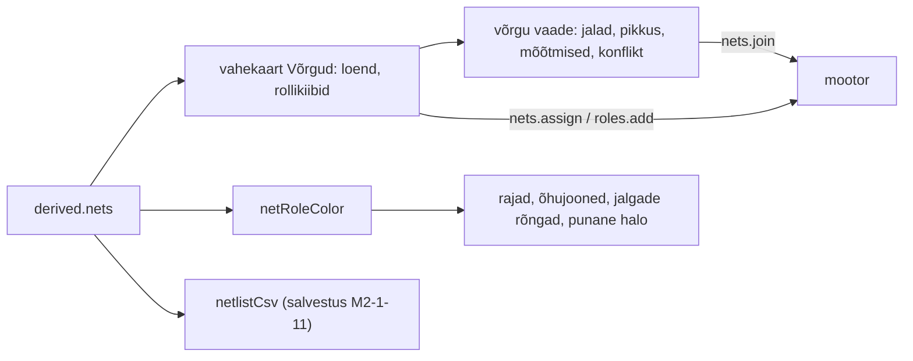

# M2-1-9 · Vahekaart „Võrgud“, värvid ja võrguloend

**Olek:** vastu võetud `dcd8425` · **Rada:** A · **Haru:** `codex/m2-1` (tööpuu `C:/Users/TRUMPIT/.codex/worktrees/bb-m2-1/BB`) · **Alus:** `dea9f0b` (M2-1-8) · **Plaan:** [M2.1 › Ülesanne 9](../plans/M2-1-uhendused-ja-vorgud.md#ülesanded) · **Otsus:** O4, leid 16

## Eesmärk
Navigaatoris on vahekaart „Võrgud“. Seal saab võrgule anda nime ja rolli, luua uue rolli, vaadata võrgu jalgu, rajade pikkust ja mõõtmisi ning ühendada võrgu teisega. Rajad, õhujooned ja ühendatud jalad on rolli värvi. Rollikonflikt on punase äärega ja hoiatusega. Võrguloend koostatakse O4 vormingus. Faili salvestamine tuleb M2-1-11-s, sest töölaual vajab see uut Rusti käsku (rada B).

## Loe (ainult need)
Loe tööpuust (`dea9f0b`). Rea numbrid on tööpuu järgi. `bb_task` laiendab viited põhikaustast, kus on M2.1 eelne kood; ava need read tööpuus.
- `packages/features/nets/contract.ts:1-62` (käsud, `NetsDerived`, valikuline `Derived.nets`)
- `packages/features/nets/ui/index.ts:1-12` (praegune moodul: ainult teated)
- `packages/features/connections/ui/layers.tsx:73-222` (raja, õhujoone ja liitepunkti värv)
- `packages/features/components/ui/layers/HoverLayer.tsx:1-51` (leid 16: kereta komponent)
- `packages/features/measurements/ui/index.tsx:47-55` (navigaatori vahekaardi registreerimine)

## Muuda
- `packages/features/nets/contract.ts`: värvi valija `netRoleColor` ja võrguloendi funktsioon `netlistCsv` (otsused 2 ja 6).
- `packages/features/nets/ui/`: vahekaart, võrgu vaade, rolli dialoog, ühendamise dialoog, jalgade rõngaste kiht, tekstid ja testid.
- `packages/features/connections/ui/layers.tsx` (või sealt eraldatud fail, kui see läheks üle 400 rea): raja ja õhujoone rollivärv ning konflikti halo.
- `packages/features/components/ui/layers/HoverLayer.tsx`: kereta komponendi esiletõst padjandite järgi (leid 16).
- `packages/ui/src/kit/tokens.css`: `--role-gnd` heledas ja tumedas teemas.
- `pnpm api`.

## Ära puutu
- Mootor, domeen (`describeNets` ja käsud jäävad samaks), failivorming, invariandid.
- `AppHost`, adapterid ja Rust (faili salvestus on M2-1-11-s), ekspordi aken (M4).
- Raja silt ja paremklõpsu menüü laiendused (M2-1-10). Kest (`AppShell`, `SelectTool`, `Canvas.tsx`).

## Otsused ja liidesed
1. **Vahekaart „Võrgud“** (`navigatorTabs`, `id: 'nets'`, `order: 2`, kokkuvõte „{n} võrku“).
   - Loendis on `derived.nets?.list` read; puuduv tuletis annab tühja loendi.
   - Igal real on nimi (`N1` jne kaldkirjas, kui `named: false`), liikmete arv, rolli kiip rolli värviga ja konflikti korral punane hoiatusikoon.
   - Rea valimine avab võrgu vaate samal vahekaardil („← Võrgud“ viib tagasi).
   - Rollide rida: kõik `doc.roles` kiipidena (vaikerollid ja kasutaja omad) ning „+ Uus roll“. Kiibi vajutus käivitab valitud võrgule `nets.assign({ anchor, labelId, roleId })`. Ankur on võrgu esimene jalg (liitepunkt, kui jalga pole), `labelId` on `ids.newId('lbl')`.
   - Nimi muutub võrgu vaate nimeväljas: `Enter` või fookuse kadu käivitab `nets.assign({ anchor, labelId, name })`, `Esc` taastab vana nime. Tühi nimi eemaldab sildi nime.
   - „+ Uus roll“ dialoog: nimi (kohustuslik), liik (`ground`, `power`, `signal`, `unknown`), nimipinge (valikuline, kümnendkoma) ja värv (`<input type="color">`). „Lisa“ käivitab `roles.add` (`id: ids.newId('rol')`). Topeltnimi on lubatud, sest id-d on eri.
2. **Rollivärv** (`netRoleColor(snapshot, memberKey): { color?: string; conflict: boolean }` nets-i lepingus).
   - Liikme võrk leitakse `netOf`-ist ja võrgu info `list`-ist. `roleId`-ga võrk annab rolli värvi, konfliktiga võrk annab `conflict: true` ja värvi pole.
   - Roll `rol_gnd` annab värvi `var(--role-gnd)`: heledas teemas `#1f2523` ja tumedas `#9aa5a0`. Teised rollid annavad oma `color`-i.
   - Rajad ja õhujooned kasutavad rolli värvi otsa `a` võrgu järgi; ilma rollita jääb senine kihi või juhtme värv.
   - Kiht `nets.pinRoles` (`z: 52`) joonistab rolliga võrgu jalgadele rõnga (1,5 px ekraanil) rolli värviga.
   - Konfliktiga võrgu rajad, õhujooned ja jalad saavad punase halo (`--danger`, 2 px laiem kui joon või rõngas).
3. **Rollikonflikt.** Võrgu vaate ülaosas on hoiatus „Võimalik lühis või vale ühendus: {roll A} + {roll B}“ (rollide nimed `conflictingRoles` järjekorras ` + `-ga). Kaks nuppu:
   - „Näita ühendust“ valib selle võrgu kõik ühendused (`kind: 'connection'`);
   - „Vali õige roll“ avab rolli kiibid; valik käivitab `nets.assign`-i rolliga, mis eemaldab teiste siltide rollid (M2-1-8) ja lahendab konflikti.
4. **Võrgu vaade.**
   - Jalad kujul `{tähis}.{nimi või id}` (`pin.name || pin.id`, M1.4 ühtne kuju) ja liitepunktide arv. Klõps jalal valib selle jala (`{ kind: 'pin', id, componentId }`).
   - Rajade kogupikkus millimeetrites: võrgu joonistusega ühenduste murdjoonte pikkuste summa, jagatud `doc.scale.pxPerMm`-ga, kahe komakohaga.
   - Võrgu mõõtmised: mõõtmised, mille `at` või `ref` on võrgu jalg ja `uid` vastab, uuemad eespool. Rida kujul „{väärtus} {režiim} · {paar}“, sama vorming mis mõõtmiste loendis.
   - „Ühenda võrguga…“ dialoog loetleb teised võrgud. Valik käivitab `nets.join`-i selle võrgu ankru ja valitud võrgu ankru vahel (`connectionId: ids.newId('con')`).
5. **Leid 16.** `HoverLayer`: kui `bodyOutline` on tühi, tõstetakse esile padjandite ümbris (`boardPads`, sama 3 px vahe). Testpunkt, via, padjand ja muud kereta komponendid on loendist leitavad.
6. **Võrguloend (O4).**
   ```ts
   export function netlistCsv(snapshot: Pick<Snapshot, 'doc' | 'derived'>): string;
   ```
   - Tulemus algab BOM-iga (`\uFEFF`), eraldaja on semikoolon ja reavahetus `\r\n`.
   - Päis on `Võrk;Roll;Tähis.jalg;Jala nimi`.
   - Read: iga loendi võrgu iga jalg (liitepunktid välja), võrgud nime järgi (`localeCompare('et')`) ja jalad võtme järjekorras. Roll on rolli nimi; konflikti korral rollide nimed ` + `-ga; muidu tühi.
   - Väli, milles on `;`, `"` või reavahetus, läheb jutumärkidesse ja `"` kahekordistub.
   - Selles kaardis on ainult funktsioon. Nupp „Ekspordi võrguloend (CSV)“ ja faili salvestus tulevad M2-1-11-s (`AppHost`, töölaual Rusti käsk).
7. **Tekstid:** „Võrgud“, „{n} võrku“, „← Võrgud“, „+ Uus roll“, „Lisa“, „Loobu“, „Nimi“, „Liik“, „Nimipinge (V)“, „Värv“, „Ühenda võrguga…“, „Näita ühendust“, „Vali õige roll“, „Rajad kokku {n,nn} mm“, „Mõõtmised“, „Võimalik lühis või vale ühendus: …“. Rolli liigid: „Maandus“, „Toide“, „Signaal“, „Teadmata“.
8. **Olemasolevad testid.** Ootused jäävad samaks, välja arvatud raja või õhujoone värv rolliga võrgus, kui mõni test eeldas kihi värvi. Kõik muudetud testid loetle üleandmises.



## Tõend
- TS:
  - `nets_tab_assigns_role_and_name` (`packages/features/nets/ui/nets-tab.test.tsx`): vahekaart loetleb nimega ja `N1` võrgud. Rolli kiip annab valitud võrgule rolli ja nimeväli nime (`Enter`), `Esc` taastab vana nime. „+ Uus roll“ lisab rolli, mis ilmub kiipide hulka. Iga muudatus on üks `Ctrl+Z` samm.
  - `role_color_reaches_traces_and_pins_in_both_themes` (`packages/features/nets/ui/role-colors.test.tsx`): 5V rolliga võrgu rada, õhujoon ja jala rõngas on värviga `#d9342b`. GND võrk kasutab `var(--role-gnd)`, mis on heledas teemas `#1f2523` ja tumedas `#9aa5a0`. Rollita võrk jääb kihi värvi.
  - `role_conflict_warning_shows_both_roles` (`packages/features/nets/ui/nets-tab.test.tsx`): GND ja 5V siltidega võrk näitab hoiatust „Võimalik lühis või vale ühendus: GND + 5V“ ja punast halo. „Näita ühendust“ valib võrgu ühendused. „Vali õige roll“ ja GND valik lahendavad konflikti.
  - `net_view_pin_click_focuses_pin_including_point_parts` (`packages/features/nets/ui/nets-tab.test.tsx`): võrgu vaade näitab jalgu kujul `R1.GND`, rajade kogupikkust „Rajad kokku 12,50 mm“ ja võrgu mõõtmist. Klõps testpunkti jalal valib selle. Testpunkti rida komponentide loendis tõstab plaadil esile padjandi ümbrise (leid 16). „Ühenda võrguga…“ liidab valitud võrgu.
  - `netlist_csv_lists_every_member` (`packages/features/nets/netlist.test.ts`): `netlistCsv` algab BOM-i ja päisega. Iga võrgu iga jalg on eraldi real ja liitepunkte pole. Järjekord on nime ja võtme järgi, konfliktiga roll on kujul „GND + 5V“ ning semikooloniga nimi on jutumärkides.
- Põhikaustast `pnpm bb-review-card M2-1-9` → `ok: true`, `missing: []`.

## Valmis kui
- [x] Testid ja `pnpm check` läbivad.
- [x] Mootor, domeen ja kesta komponendid säilisid. Kesta stiili ja olemasoleva testi muudatused järgivad arhitekti vastust ning on üleandmises loetletud.
- [x] Kõik muudetud failid on ≤ 400 rea. `pnpm api` on uuendatud.
- [x] Üleandmine on allpool, kuni 15 rida.

## Arhitekti vastus ehitajale (2026-11-20)

1. **Navigaatori vahekaartide rida.** Lubatud on kaks kitsast muudatust:
   - `apps/web/e2e/m1-3-navigator.spec.ts` testis `navigator_tabs_fit_one_row_at_240_and_300px` on oodatud loend `['Teek', 'Komponendid', 'Võrgud', 'Mõõtmised']`, nii nähtavuse kontrollis kui ka täissiltide kontrollis. Muud ootused (üks rida, kõrgus ≤ 45 px, silt ei kärbu) jäävad samaks.
   - `packages/ui/src/shell/shell.css`: kui real on vähemalt neli vahekaarti (`.pcbk-tabs:has(> button:nth-child(4))`), on nupu külgvahe 2 px, vahekaartide vahe 0 ja kirja suurus 12 px. Kolme vahekaardiga rida jääb samaks. `AppShell.tsx` ei muutu.
   - Kui ka see ei mahu 240 px laiusesse ilma kärpimiseta, küsi enne edasist muutmist.
2. **Konflikti tekst.** Rollide järjekord tuleb `conflictingRoles`-ist (otsus 3), vaikerollidega seega „5V + GND“. Kaardi testikirjelduse „GND + 5V“ oli minu näide; testid järgivad otsust 3.

## Üleandmine

- Tööpuu `C:/Users/TRUMPIT/.codex/worktrees/bb-m2-1/BB`, haru `codex/m2-1`, kontrollitud puhas alus `dea9f0b`. Muudatused on tööpuus.
- „Võrgud“ vahekaardil saab võrke nimetada ja ühendada, rolle määrata ja lisada ning vaadata jalgu, rajapikkust ja mõõtmisi. Puuduva tuletise korral on võrguloend tühi.
- Rajad, õhujooned ja jalarõngad kasutavad `netRoleColor`-it ning konflikt saab punase halo. GND kasutab `--role-gnd`-d. Hoiatus ja CSV järgivad `conflictingRoles`-i järjekorda, mis vaikerollide puhul kuvab „5V + GND“.
- Kereta komponendi esiletõst ümbritseb padjandeid. `netlistCsv` annab BOM-iga CSV-teksti.
- Esimese täisringi moodulisõltuvuse vea lahendab kooste, mis annab moodulitele `netRoleColor`-i ja `connectionPoints`-i. Mootori deklaratsioonid säilisid. Esimese jooksu logi `output/review-card/M2-1-9-9R1XJM/check.log`.
- Täpselt viis kaarditesti andsid enne teostust RED-i. Sihitud GREEN-is läbisid 68 testi. Tööpuu logid `output/playwright/m2-1-9/`.
- Uued testifailid on `packages/features/nets/netlist.test.ts`, `packages/features/nets/ui/nets-tab.test.tsx` ja `packages/features/nets/ui/role-colors.test.tsx`.
- Kinnitatud E2E muudatus failis `apps/web/e2e/m1-3-navigator.spec.ts` lisab „Võrgud“ nähtavuse ja täissiltide kontrolli. Ühe rea, kõrguse ja kärpimise ootused säilisid.
- Kinnitatud `packages/ui/src/shell/shell.css` reegel seab vähemalt nelja vahekaardi korral nupu külgvaheks 2 px, vahekaartide vaheks 0 ja kirja suuruseks 12 px. Kolme vahekaardi stiil ja `AppShell.tsx` säilisid. Sihitud E2E logi `output/playwright/m2-1-9/navigator-layout-green.log`.
- `pnpm api`, `api:check`, `pnpm check` ja katvus läbisid. Pikim muudetud fail on 360 rida. `connections/ui/layers.tsx` on 255 rida.
- Lõplik täisring `pnpm bb-review-card M2-1-9` läbis (`ok: true`, `missing: []`). Läbisid 1669 ühiktesti ja 42 E2E testi. Kokkuvõte `output/review-card/M2-1-9-ccGDVo/summary.json`.

## Arhitekti ülevaatus (2026-11-20)

- **Kontrollitud:**
  - Tööpuus on 12 muudetud ja 8 uut faili, neist 2 genereeritud `docs/api` faili. Võõraid faile pole, HEAD on `dea9f0b`.
  - Mootor, domeen, `AppShell.tsx` ja lõuend on muutmata.
  - Diff: nets leping (`netRoleColor`, `roleSwatchColor`, `netlistCsv`), `NetsTab.tsx`, `NetRoleDialog.tsx`, `net-details.ts`, `pin-roles-layer.tsx`, connections kihtide rollivärv, kooste `features/ui.ts`, `HoverLayer.tsx`, `tokens.css`, `shell.css` ja navigaatori E2E test.
  - Kokkuvõte `M2-1-9-ccGDVo/summary.json` (12:07) on uuem kui tööpuu viimane muudatus (12:01), seega käske uuesti ei käivitatud. Tulemused:
    - rada A, `missing: []`, `warnings: []`;
    - Vitest 1669/0, Playwright 42/0; check, api, format, coverage, e2e ja diff exit 0;
    - kõik 5 kaardi testi läbisid ja lisateste pole.
- **Otsused koodis:**
  - **Vahekaart:**
    - `order: 2`, puuduv tuletis annab tühja loendi;
    - rollikiip ja nimi käivitavad `nets.assign`-i võrgu ankruga (`labelId` uus), `Esc` taastab nime;
    - „+ Uus roll“ käivitab `roles.add`-i, „Ühenda võrguga…“ `nets.join`-i;
    - jala klõps valib jala.
  - **Värv:**
    - `netRoleColor` annab rolli värvi ja GND-le `var(--role-gnd)` (`#1f2523` / `#9aa5a0`); konfliktiga võrk annab `conflict`;
    - rajad ja õhujooned kasutavad värvi otsa `a` järgi ja konfliktiga saavad punase halo;
    - jalgade rõngad joonistab kiht `nets.pinRoles`.
  - **Kooste:** `features/ui.ts` annab `netRoleColor`-i connections kasutajaliidesele ja `connectionPoints`-i nets kasutajaliidesele. Nii ei impordi moodulid teineteise sisemust. See on kaardist erinev, aga sõltuvuse suund on selge.
  - **CSV:** BOM, päis `Võrk;Roll;Tähis.jalg;Jala nimi`, ainult jalad. Võrgud on nime järgi (`et`) ja jalad võtme järgi, konflikti roll on kujul „5V + GND“ ja väljad on vajadusel jutumärkides.
  - **Leid 16:** kereta komponendi esiletõst ümbritseb padjandeid (vähemalt 2,5 px poollaiusega).
  - **Vahekaartide rida:** vähemalt nelja vahekaardi korral on külgvahe 2 px, vahe 0 ja kiri 12 px; kolme vahekaardi stiil jäi samaks.
- **Olemasolevad testid:** muutus ainult navigaatori E2E testi oodatud loend (vastus ehitajale 1). Teised ootused jäid samaks.
- **UI:** vahekaart, värvid, hoiatus ja tabirida on kontrollitud testides DOM-ist ning E2E paigutustestis 240 ja 300 px juures. Brauseris ei kontrollinud; seda saab vaadata `v0.5.0` suitsukatses.
- **Otsus: sobib.**
- **Mitteblokeerivad märkused:**
  1. Võrguloendi nupp ja faili salvestus on plaani järgi M2-1-11-s; `netlistCsv` on valmis.
  2. Konflikti tekstis on rollid id järjekorras („5V + GND“). Kui kasutaja eelistab maandust ees, saab järjekorra hiljem muuta rolli liigi järgi.
