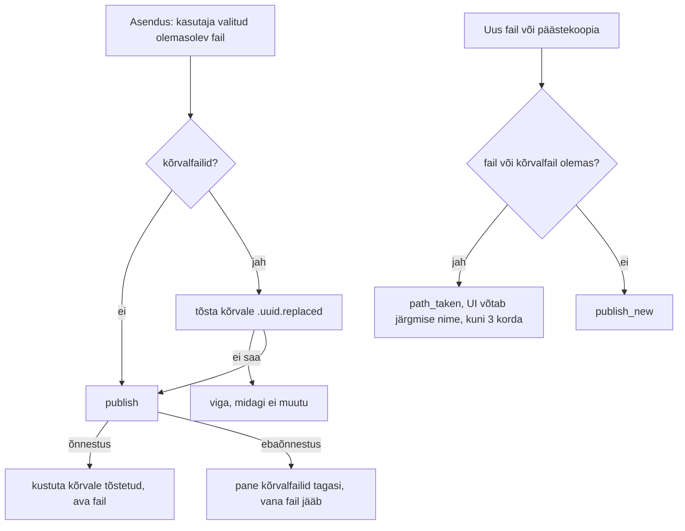

# M2-1-H · Projektifaili terviklus ja päästekoopia

**Olek:** ehitamiseks · **Rada:** B · **Haru:** `codex/m2-1` (uus tööpuu `C:/Users/TRUMPIT/.codex/worktrees/bb-m2-1/BB`) · **Alus:** `main` selle kaardi commit · **Allikas:** [koodiülevaatus 2026-11-19](../review/2026-11-19-koodiulevaatus-00a424e.md), leiud 01, 02, 03, 07 ja 08 (M2.1 ainus hooldusvoor)

## Eesmärk
Tehniku projektifail ei tohi saada võõrast sisu ega kirjutada üle teist projekti. Koodiülevaatus kinnitas katses kahte viga.
- **01:** sihtfaili kõrvale jäi katkestatud kirjutusest SQLite'i taastepäevik (`-journal`). Kui uus projekt loodi vana asemele või kasutati „Salvesta mujale“, teatas äpp edust. Uuesti avades oli projekti ID uus, aga dokument osaliselt vana plaadi oma, sest SQLite rakendas vana päeviku uuele failile.
- **02:** automaatne päästekoopia valis vaba nime. Kui samale teele tekkis vahepeal teine projekt, kirjutas koopia selle kinnitust küsimata üle.

Samas kohas on kolm seotud viga:
- **03:** kui algne ketas on täis või eemaldatud, ei paku kokkujooksu järel avanev päästevaade teist asukohta;
- **07:** sulgemisdialoog näitab koopia uut veapõhjust dialoogist väljaspool;
- **08:** sama identiteediga koopia kustutab `copied_from_project_id` väärtuse.

Taastamine kontrollib kõrvalfaile juba (`check_sidecars`). See kaart teeb sama reegli kõigile kirjutusteedele.

## Loe (ainult need)
Loe tööpuust (`main` selle kaardi commit). Rea numbrid on `00a424e` järgi.
- `apps/desktop/src-tauri/src/storage/mod.rs:62-120` (`PendingFile`, `publish`, `publish_new`, `replace_file`)
- `apps/desktop/src-tauri/src/storage/mod.rs:215-300` (`create_with_exclusive`, `copy`)
- `apps/desktop/src-tauri/src/storage/restore.rs:15-45` (`SIDECARS`, `check_sidecars`; taastamise `publish` on samas failis real 155)
- `apps/desktop/src-tauri/src/storage/copy.rs:74-132` (`write`)
- `packages/ui/src/app/use-workbench.ts:255-300` (päästekoopia `copy`; uue projekti kordusmuster on `packages/adapters/src/storage-tauri.ts:119-150`)

## Muuda
- `apps/desktop/src-tauri/src/storage/`:
  - uus `sidecars.rs` (otsus 1);
  - `mod.rs`, `copy.rs` ja `restore.rs` (`SIDECARS` liigub ühisesse moodulisse);
  - testid.
- `apps/desktop/src-tauri/src/desktop_paths.rs` (vaba nime otsing) ja `ipc.rs` (`project_copy` saab `exclusive`-i).
- `packages/contracts/src/project-service.ts` (`CopyReq.exclusive`), `packages/engine/src/project-service.ts`, `packages/adapters/src/storage-tauri.ts` ja mäluadapter.
- `packages/ui/src/app/use-workbench.ts`, `Workbench.tsx`, `packages/ui/src/shell/ErrorBoundary.tsx`, `CloseDialog.tsx` ja tekstid `et`-s.
- `pnpm api`.

## Ära puutu
- Failivorming ja skeem (`format_version` ei muutu).
- Faili avamine (`storage/mod.rs` funktsioon `open`). Oma päevikuga faili avamine on SQLite'i tavaline taastus ja jääb samaks.
- Veebiadapteri vead 06 ja 22 ning muud ülevaatuse leiud. Need lähevad M2.1 plaani.
- Kasutaja päris projektid ja fotod: ainult sünteetilised failid.

## Otsused ja liidesed
1. **Kõrvalfailide reegel** (`storage/sidecars.rs`).
   - `SIDECARS = ["-journal", "-wal", "-shm"]` liigub siia. Restore kasutab sama konstanti.
   - **Uus fail** (`publish_new`: uus projekt vaiketeele ja eksklusiivne koopia): kui sihtfaili kõrval on mõni kõrvalfail, on tee hõivatud, tulemus `Reason::PathTaken`. Eksklusiivne avaldamine kõrvalfaile ei kustuta ega liiguta.
   - **Asendus** (`publish`: kasutaja valis failivalijas olemasoleva faili):
     - enne ümbernimetamist tõstetakse olemasolevad kõrvalfailid ajutise nimega kõrvale (`<siht><sufiks>.<uuid>.replaced`);
     - kui avaldamine õnnestub, kustutatakse kõrvale tõstetud failid;
     - kui avaldamine ebaõnnestub, pannakse need tagasi ja vana fail jääb täpselt endiseks;
     - kui kõrvalfaili ei saa liigutada (näiteks lukus), katkestatakse enne avaldamist vastava veaga ja midagi ei muutu.
   - Pärast avaldamist avatakse fail (`ProjectDb::open`) alles siis, kui ükski vana kõrvalfail ei saa sellele mõjuda.
   - `desktop_paths::available_project_path` loeb nime hõivatuks, kui sellel on fail või mõni kõrvalfail.
2. **Eksklusiivne koopia.**
   - `CopyReq` saab välja `exclusive?: boolean`. Rust saab `project_copy` argumendi `exclusive: bool` ja `CopyRequest` välja `exclusive: bool`.
   - Kui `exclusive` on tõene, avaldab `copy::write` faili `publish_new`-iga ega asenda kunagi olemasolevat faili. Hõivatud tee annab `path_taken` (adapteris `exists`).
   - Päästekoopia (`copy('reload')` vaiketeega `recoveryCopyPath`) on alati eksklusiivne. Hõivatud tee korral küsib UI uue vaba nime ja proovib uuesti, kokku kuni 3 korda, nagu uue projekti loomine (`storage-tauri.ts` `create`).
   - Failivalijaga „Salvesta mujale“ jääb asenduseks, sest kasutaja kinnitas asenduse failivalijas. Sellele kehtib otsus 1.
3. **Päästevaade (03).**
   - Kokkujooksu vaatel (`RootErrorBoundary`) on lisaks nupule „Salvesta koopia ja laadi uuesti“ nupp „Vali koopia koht…“, kui host pakub `pickSavePath`-i.
   - Valitud teele tehakse sama koopia ja uuesti laadimine nagu vaiketeele.
   - Kui vaiketee koopia ebaõnnestub, jääb päästevaade alles ja uus nupp on kasutatav.
4. **Sulgemisdialoog (07).** Kui „Salvesta mujale“ ebaõnnestub avatud sulgemisdialoogis, näitab dialoog ise rida „Koopia salvestamine ebaõnnestus: {põhjus}“. Esialgne salvestuse põhjus jääb pealkirja. Dialoogist väljaspool olevat teadet sel juhul ei näidata.
5. **Päritolu (08).** Sama identiteediga koopia säilitab lähtefaili `copied_from_project_id` väärtuse, kui see on olemas. Uue identiteediga koopia kirjutab sinna lähteprojekti ID nagu praegu. Mäluadapter käitub samamoodi.
6. **Tekstid.**
   - `et.error.copyElsewhere`: „Vali koopia koht…“;
   - `et.save.copyFailed(reason)`: „Koopia salvestamine ebaõnnestus: {põhjus}“, kus põhjus tuleb `et.reason`-ist.

## Tõend
Iga Rusti test avab tulemuse pärast sulgemist uuesti ja kontrollib projekti ID-d, dokumendi sisu ning kõrvalise faili säilimist. Katkestatud kirjutus tehakse päris SQLite'i tehinguga, nagu ülevaatuse katses.
- Rust:
  - `create_replace_ignores_stale_journal_of_replaced_file`: sihtfailis on projekt A ja selle katkestatud tehingu `-journal`. Uue projekti B loomine sama tee asemele annab pärast taasavamist B ID ja B dokumendi. Vana päevik pole failile mõjunud ja kõrvale tõstetud failid on kustutatud.
  - `copy_replace_ignores_stale_journal_of_replaced_file`: sama „Salvesta mujale“ asendusega.
  - `failed_replace_puts_sidecars_back`: kui avaldamine ebaõnnestub (testikonks nagu `restore.rs` testides), on vana fail ja selle kõrvalfailid baidi täpsusega endised.
  - `exclusive_publish_treats_sidecar_as_taken`: tee kõrval on ainult orvuks jäänud `-journal`. Nii uus projekt kui ka eksklusiivne koopia annavad `PathTaken` ja `available_project_path` valib järgmise nime.
  - `rescue_copy_never_replaces_late_file`: vaba nime valiku ja avaldamise vahel tekib samale teele projekt C (testikonks). Eksklusiivne koopia annab `PathTaken` ja C ID ning sisu on pärast taasavamist samad.
  - `same_identity_copy_keeps_copied_from_project_id`: lähtefailil on `copied_from_project_id`. Sama identiteediga koopias on see alles, uue identiteediga koopias on see lähteprojekti ID.
- TS:
  - `rescue_copy_retries_next_name_when_path_taken`: esimene vaiketee annab `exists`. UI küsib uue tee ja teine katse õnnestub. Kolme hõivatud tee järel näidatakse viga ja midagi ei asendata.
  - `crash_view_offers_picker_after_failed_rescue`: vaiketee koopia ebaõnnestub täis ketta tõttu. Päästevaade jääb alles ja „Vali koopia koht…“ avab failivalija. Valitud teele tehtud koopia laadib äpi uuesti.
  - `close_dialog_shows_copy_error_inside_dialog`: algne salvestus ebaõnnestus täis ketta tõttu ja valitud koopia koht on kirjutuskaitstud. Dialoogis on rida „Koopia salvestamine ebaõnnestus: …“ ja dialoogist väljaspool teadet pole.
- Põhikaustast `pnpm bb-review-card M2-1-H` (rada B: lisaks `cargo test` ja `pnpm tauri build --debug`).

## Valmis kui
- [ ] Testid ja käsud läbivad, `docs/api` on uuendatud.
- [ ] Üleandmises on iga Rusti testi taasavamise tulemus (projekti ID, dokumendi nimi, kõrvalise faili ID).
- [ ] Üleandmine on allpool, kuni 20 rida.

## Üleandmine
