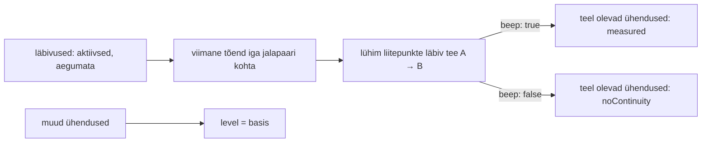

# M2-2-2 · Ühenduse tase (`connectionLevels`)

**Olek:** kirjutatud · **Rada:** B · **Haru:** `codex/m2-2` (tööpuu `C:/Users/TRUMPIT/.codex/worktrees/bb-m2-2/BB`) · **Alus:** `2c39900` · **Allikas:** [M2.2 plaan](../plans/M2-2-piiksumisreziim.md), ül. 2 · [04 › Ühenduse tase](../04-andmemudel.md#ühenduse-tase-connectionlevels)

## Eesmärk
Ühendus, mille piiks kinnitab, on **mõõdetud**. Mootor arvutab taseme mõõtmistest ja dokumenti seda ei salvestata.
- Haruks jagatud mõõdetud ühendus jääb mõõdetuks.
- Kui mõõtmine kustutatakse, aegub või selle kontakt kaob, langeb tase kohe tagasi.
- Kui viimane läbivus ütles „ei piiksu“, saab ühendus hoiatuse.

See kaart teeb ainult arvutuse ja tuletise. Kuvamine (✓, „Mõõda uuesti“) on ül. 5 ja piiksu käsk ül. 3.

## Loe (ainult need)
Rea numbrid on `2c39900` järgi. Need failid on `main`-is ja tööpuus samad.
- `docs/04-andmemudel.md:202-212` (ühenduse taseme reeglid)
- `packages/domain/src/rules/nets.ts:1-28` (`pinKey`, `endKey`, `endRefsByKey`)
- `packages/domain/src/measure/pin-readings.ts:34-63` (aktiivne kontakt, viimane näit aja järgi)
- `packages/features/nets/engine/derive.ts:1-15` (`DeriveSpec`-i muster; tuletise laiendus `packages/features/nets/contract.ts:117-131`)
- `packages/features/connections/engine/index.ts:212-230` (`connectionsEngine`)

## Muuda
- Uus `packages/domain/src/rules/levels.ts` ja eksport `rules/index.ts`-is (otsused 1–3).
- `packages/features/connections/contract.ts`: skeem `ConnectionLevelsSchema` ja `Derived`-i laiendus (otsus 4).
- Uus `packages/features/connections/engine/derive.ts` ja `connectionsEngine.derive` (otsus 4).
- Testid: uus `packages/domain/src/rules/levels.test.ts` ja `packages/features/connections/connections.test.ts`.
- `pnpm api`.

## Ära puutu
- Failivorming. Taset ei salvestata ühenduse külge.
- Võrgu tuletis `nets` ja selle `beepContradiction` jäävad, nagu on.
- Mõõtmise ja ühenduse käsud. `beep.record` on ül. 3.
- Kuvamine lõuendil ja kontekstis (ül. 5).

## Otsused ja liidesed
1. **Jalapaari tõend.**
   - Arvesse läheb läbivus (`mode: 'continuity'`), millel on `ref` ja `beep` ning puudub `staleByRepairId`.
   - Mõlemad kontaktid peavad olema aktiivsed: komponent on olemas, sama id-ga jalg on olemas ja `uid` on sama.
   - Paar on järjestamata: `(A, B)` ja `(B, A)` on sama paar. Võti on kahe `pinKey` sorteeritud massiivi `JSON.stringify`.
   - Paari tõend on viimane selline mõõtmine `takenAt` järgi. Võrdse aja korral on uuem see, mis on `doc.measurements`-is hiljem ([M2-2-1](M2-2-1.md) otsus 5).
2. **Tee paari vahel.**
   - Graafi tipud on jalad ja liitepunktid, servad on ühendused.
   - Tee algab jalalt A, lõpeb jalal B ja selle vahepealsed tipud on ainult liitepunktid. Teist jalga tee läbida ei tohi.
   - Valitakse lühim tee servade arvu järgi. Võrdse pikkuse korral valitakse tee, mille ühenduste id-de jada A poolt vaadates on leksikograafiliselt väikseim. Seda annab näiteks laiuti otsing, mille naabrid on sorteeritud ühenduse id järgi.
   - Kui teed pole, ei mõjuta paar ühtegi ühendust.
3. **Ühenduse tase.**
   - `ConnectionLevel = { level: 'measured' | 'visual' | 'assumed'; noContinuity?: true }`.
   - `measured`: ühendus on mõne paari teel ja selle paari viimane tõend on `beep: true`.
   - Muidu on tase ühenduse `basis` (`'visual'` või `'assumed'`). Plaanis nimetatud „nähtud“ on `visual`.
   - `noContinuity: true`: ühendus on mõne paari teel ja selle paari viimane tõend on `beep: false`. Hoiatus võib olla ka mõõdetud ühendusel, kui sama ühendus on kahe eri paari teel.
   - Funktsioon on `connectionLevels(doc): Record<string, ConnectionLevel>`, kus võti on ühenduse id. Kirje on olemas iga ühenduse kohta.
   - A → B ja B → C tõend ei tee A → C ühendust mõõdetuks. Märki ei laiendata kogu võrgule.
4. **Tuletis.**
   - Moodul `connections` registreerib `DeriveSpec`-i:
     - võti `connectionLevels`;
     - `inputs: ['components', 'connections', 'junctions', 'measurements']`;
     - skeem `ConnectionLevelsSchema`;
     - algväärtus `{}`.
   - `Derived`-i laiendus on `connectionLevels?: Record<string, ConnectionLevel>`, valikuline nagu `nets`.
5. **Jõudlus.** Plaat on 300 komponenti, 3000 jalga, 1000 rada ja 1500 mõõtmist, millest 500 on läbivused.
   - `connectionLevels` mediaan Node'is on kuni 3 ms, sest tuletised arvutatakse ka lohistuse käsul.
   - M2.1 käsu eelarve (valideerimine ja tuletised kokku ≤ 16 ms) peab jääma täidetuks.
   - Aeg pannakse üleandmisse. Ajapiiriga testi ei tehta.

## Tõend
Iga test ehitab sünteetilise dokumendi ja võrdleb kogu `connectionLevels` tulemust.
- TS:
  - `branch_keeps_measured_path_through_junctions` (`packages/domain/src/rules/levels.test.ts`): A–B ühendusel on piiksuv läbivus. Pärast haru on A–J ja J–B mõõdetud, haru J–C pole.
  - `measured_pair_does_not_spread_across_pins` (sama fail): ühendused A–B ja B–C on mõõdetud, sest A → B ja B → C piiksuvad. Ühendus A–C, mille ainus tee läbiks jala B, jääb oma `basis` tasemele.
  - `latest_continuity_decides_level` (sama fail): viimane `beep: false` annab `basis` ja `noContinuity`. Uuem `beep: true` annab `measured`. Võrdse aja korral otsustab hilisem kirje. Mõõtmise eemaldamine, `staleByRepairId` ja kustutatud kontakt (muutunud `uid`) annavad `basis`.
  - `shortest_junction_path_tie_breaks_by_connection_id` (sama fail): A ja B vahel on kaks võrdse pikkusega liitepunktide teed. Mõõdetud on ainult väiksemate ühenduse id-dega tee. Pikem tee jääb mõõtmata.
  - `connection_levels_derive_in_snapshot` (`packages/features/connections/connections.test.ts`): mootori hetktõmmise `derived.connectionLevels` muutub pärast `measurements.add` läbivust, `measurements.remove`-i ja tagasivõtmist.
- Põhikaustast `pnpm bb-review-card M2-2-2` (rada B: lisaks `cargo test` ja `pnpm tauri build --debug`).

## Valmis kui
- [ ] Testid ja käsud läbivad, `docs/api` on uuendatud.
- [ ] Üleandmises on otsuse 5 jõudlusmõõt: plaat, jooksude arv ja mediaan.
- [ ] Üleandmine on allpool, kuni 20 rida.

## Üleandmine
