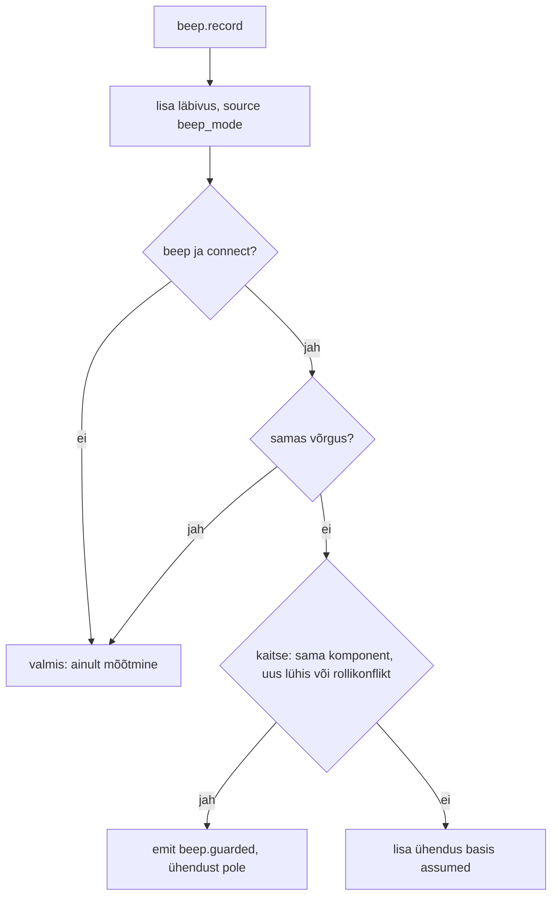

# M2-2-3 · Käsk `beep.record` ja kaitsed

**Olek:** vastu võetud `3ed369f` · **Rada:** B · **Haru:** `codex/m2-2` (tööpuu `C:/Users/TRUMPIT/.codex/worktrees/bb-m2-2/BB`) · **Alus:** `e30b5cd` · **Allikas:** [M2.2 plaan](../plans/M2-2-piiksumisreziim.md), ül. 3 (O3) · [04 › Piiks ei tõenda sama vaskrada](../04-andmemudel.md#piiks-ei-tõenda-sama-vaskrada)

## Eesmärk
Piiksumisrežiimi „Piiksub ja ühenda“ salvestab läbivuse mõõtmise ja ühendab jalad **ühe tagasivõetava sammuna**. Piiks võib tulla läbi väikese takisti. Seepärast ei ühenda käsk kolmel juhul, vaid salvestab ainult mõõtmise ja teatab põhjuse:
- jalad on sama kahejalgse passiivkomponendi otsad;
- ühendus lühistaks mõne kahejalgse komponendi;
- ühendus liidaks kaks eri rolliga võrku.

Kasutaja küsimus „Ühendan ikkagi?“ ja tööriist `B` tulevad ül. 4. See kaart teeb käsu, domeenireegli ja teate.

## Loe (ainult need)
`bb_task` laiendab Loe-viited põhikaustast. `contract.ts` on tööpuus [M2-2-1](M2-2-1.md) järel teistsugune, seega ava see tööpuus. Rea numbrid on `e30b5cd` järgi.
- `packages/features/measurements/engine/commands.ts:1-46` (`measurements.add`, `pinLabel`)
- `packages/features/measurements/contract.ts:1-38` (läbivuse skeem ja `CommandMap`; ainult tööpuus)
- `packages/domain/src/rules/net-info.ts:23-77` (`shortableKinds`, `labelsByAnchor`, `shortedComponents`)
- `packages/domain/src/rules/nets.ts:46-89` (`createNetConnectivity`, `resolveNets`)
- `packages/features/nets/ui/NetsNotices.tsx:24-38` (sündmuse kuulamine `engine.events`; saatmine `ctx.emit` on `packages/engine/src/items.ts:19`)

## Muuda
- Uus `packages/domain/src/rules/beep.ts` ja eksport `rules/index.ts`-is (otsused 2 ja 3).
- `packages/domain/src/rules/net-info.ts`: lühistuse abifunktsioon eksporditakse ühiseks kasutuseks (otsus 3). `describeNets` käitumine ei muutu.
- `packages/features/measurements/contract.ts` ja `engine/commands.ts`: käsk `beep.record` (otsus 1).
- Testid: uus `packages/features/measurements/beep-record.test.ts`. `measurements.test.ts` on 254 rida.
- `pnpm api`.

## Ära puutu
- Failivorming. Piiksu ühendus on tavaline `Connection` (`basis: 'assumed'`, fotojoonistuseta) ja mõõtmine tavaline `Measurement`.
- `measurements.add`. Tavaline läbivus ei ühenda kunagi.
- `connectionLevels` (M2-2-2). Mõõdetud tase tuleb tuletisest ise.
- Tööriist, nupud ja küsimus (ül. 4).

## Otsused ja liidesed
1. **Käsk `beep.record`** (moodul `measurements`, `alsoWrites: ['connections']`).
   - Parameetrid:
     ```ts
     {
       measurementId: string;
       connectionId: string;
       anchor: MeasuredPin; // must sond
       pin: MeasuredPin; // punane sond
       beep: boolean;
       connect: boolean;
       takenAt: string;
     }
     ```
   - Mõõtmine on `{ id: measurementId, mode: 'continuity', at: pin, ref: anchor, beep, power: 'unknown', takenAt, atLabel, refLabel, source: 'beep_mode' }`. Sildid ja aktiivsuse kontroll (`pin_not_active`) tulevad `pinLabel`-ist. Sama jalg kaks korda annab `same_probe_twice`.
   - Kui `beep && connect`, kutsub käsk otsuse 2 reeglit. Muidu lisab käsk ainult mõõtmise.
   - Kui reegel tagastab kaitse, saadab käsk sündmuse `beep.guarded` (otsus 4).
   - Kõik toimub ühes käsus, seega üks `Ctrl+Z` eemaldab nii mõõtmise kui ka ühenduse.
2. **Domeenireegel `connectBeepPins(doc, { anchor, pin, connectionId }): BeepOutcome`** (`rules/beep.ts`).
   - `anchor` ja `pin` on `PinRef`-id.
   - `BeepOutcome` on üks järgmistest:
     - `{ kind: 'connected' }`;
     - `{ kind: 'same_net' }`;
     - `{ kind: 'guarded'; reason: 'same_component' | 'shorts_component' | 'role_conflict'; components: string[]; roles: string[] }`.
   - Kui jalad on juba samas võrgus, on tulemus `same_net` ja midagi ei lisata.
   - Kaitsed kontrollitakse selles järjekorras ja tulemuseks on esimene sobiv:
     1. `same_component`: mõlemad jalad on sama komponendi omad ning komponendil on kaks jalga ja liik on `resistor`, `inductor`, `fuse`, `capacitor`, `capacitor_polarized`, `diode`, `led`, `zener`, `crystal` või `switch` ([04](../04-andmemudel.md#piiks-ei-tõenda-sama-vaskrada)). `components` on selle komponendi tähis.
     2. `shorts_component`: kavandatud ühendus lisab lühistatud komponentide hulka uue komponendi. Hulk arvutatakse enne ja pärast `union`-it sama reegliga nagu `describeNets`-i `shortedComponents`. `components` on uute lühistatud komponentide tähised tähestiku järjekorras.
     3. `role_conflict`: mõlemal võrgul on vähemalt üks roll ja nende rollide ühend sisaldab üle ühe rolli. Võrgu rollid on selle liikmete siltide `roleId`-d. `roles` on rollide sildid (`Role.label`) tähestiku järjekorras.
   - Kui ükski kaitse ei rakendu, lisab reegel ühenduse `{ id: connectionId, a: { pin: anchor }, b: { pin }, basis: 'assumed' }` ja tagastab `connected`.
3. **Ühine lühistuse loogika.**
   - `net-info.ts` ekspordib abifunktsiooni lühistatud komponentide leidmiseks. See võtab komponendid ja võrgu leidmise funktsiooni, mis sobib nii `netOf.get`-i kui ka ühendamisstruktuuri `find`-iga.
   - `describeNets` kasutab sama funktsiooni. Liikide loendit ei kopeerita.
4. **Sündmus `beep.guarded`.**
   - Sisu on `{ measurementId, anchor, pin, reason, components, roles }`, kus `anchor` ja `pin` on `MeasuredPin`-id.
   - Sündmus tuleb ainult kaitse korral. Ül. 4 tööriist näitab selle põhjal küsimust. „Ühenda ikkagi“ lisab seejärel ühenduse `connections.add`-iga eraldi sammuna (O3).



## Tõend
Iga test kontrollib dokumendi mõõtmisi ja ühendusi ning sündmusi käsu järel.
- TS:
  - `beep_record_connects_in_one_undo_step` (`packages/features/measurements/beep-record.test.ts`): `beep: true, connect: true` lisab läbivuse (`source: 'beep_mode'`, `at` on punane, `ref` on must sond) ja ühenduse (`basis: 'assumed'`, ilma `board`-ita). `derived.connectionLevels` näitab sellele ühendusele `measured`. Üks tagasivõtmine eemaldab mõlemad.
  - `beep_record_without_connect_or_beep_adds_only_measurement` (sama fail): `connect: false` ja `beep: false` lisavad kumbki ainult mõõtmise. Ühendusi ega sündmust ei teki.
  - `beep_record_same_net_adds_only_measurement` (sama fail): juba samas võrgus olevate jalgade piiks lisab ainult mõõtmise ja sündmust ei teki.
  - `beep_guard_blocks_passive_ends_and_new_shorts` (sama fail): R5.1 ja R5.2 piiks annab ainult mõõtmise ja sündmuse `same_component` ning `components` on `['R5']`. J1.1 on ühendatud R5.1-ga ja piiks J1.1 → R5.2 annab `shorts_component` ning `['R5']`. Kummalgi juhul ühendust ei teki.
  - `beep_guard_blocks_role_merge` (sama fail): GND-rolliga ja 5V-rolliga võrgu jalgade piiks annab ainult mõõtmise ja sündmuse `role_conflict`. `roles` on `['5V', 'GND']`.
- Põhikaustast `pnpm bb-review-card M2-2-3` (rada B: lisaks `cargo test` ja `pnpm tauri build --debug`).

## Valmis kui
- [x] Testid ja käsud läbivad, `docs/api` on uuendatud.
- [x] Kaart ei lisa uusi tuletisi ([M2-2-2](M2-2-2.md) märkus 1). Kui lahendus vajab uut tuletist, peatub ehitaja ja küsib.
- [x] Üleandmine on allpool, kuni 20 rida.

## Üleandmine

- Puhas tööpuu `C:/Users/TRUMPIT/.codex/worktrees/bb-m2-2/BB`, haru `codex/m2-2`, alus `e30b5cd`.
- RED alusel 5/5. Kõik viis testi jõudsid mootori vastuseni `{code: 'not_found', id: 'beep.record'}`. Logi tööpuus `output/playwright/m2-2-3/beep-red.log`.
- GREEN 5/5 kaarditesti ja 136/136 sihitud testi. Logid tööpuus `output/playwright/m2-2-3/beep-green.log` ja `output/playwright/m2-2-3/targeted-green.log`.
- `beep.record` salvestab läbivuse `source: 'beep_mode'` väärtusega. Käsk deklareerib `alsoWrites: ['connections']` ja saab samas sammus lisada joonistuseta `assumed` ühenduse. Üks tagasivõtmine eemaldab mõlemad.
- Sama võrgu puhul salvestub mõõtmine. Kaitse korral salvestub mõõtmine ja saadetakse `beep.guarded` koos põhjuse, sondide ning komponendi- või rollitähistega.
- Kaitsete järjekord on `same_component`, `shorts_component`, `role_conflict`. Uut lühist kontrollib `describeNets`-iga ühine abifunktsioon. Kahejalgne lüliti kuulub sama komponendi kaitse alla.
- Ühenduse mõõdetud taseme annab olemasolev `connectionLevels`. Viis uut testi on failis `beep-record.test.ts`.
- `pnpm api` uuendas `docs/api/domain-rules.md` ja `docs/api/features-measurements-contract.md`.
- Rada B täisring `ok: true`, `missing: []`. Vitest 1699/1699, E2E 43/43, Rust 107 läbis ja 2 jäeti vahele. Tauri debug-järk läbis. Põhikausta raport `output/review-card/M2-2-3-xLtSpN/summary.json`.

## Arhitekti ülevaatus (2026-11-21)

Kontrollisin tööpuu diffi alusel `e30b5cd`: 6 muudetud ja 2 uut faili. Ehitaja kokkuvõte `output/review-card/M2-2-3-xLtSpN/summary.json` on uuem kui tööpuu viimane muudatus, seega käske uuesti ei käivitanud.

- **Otsus 1:**
  - `beep.record` kontrollib mõlemat sondi `pinLabel`-iga ja keelab sama jala kaks korda.
  - Käsk salvestab läbivuse (`at` on punane, `ref` on must sond, `power: 'unknown'`, `source: 'beep_mode'`). Domeenireeglit kutsub see ainult siis, kui `beep && connect`.
  - `alsoWrites: ['connections']` on deklareeritud. Kõik toimub ühes käsus.
- **Otsus 2:**
  - `connectBeepPins` tagastab `same_net`, kui jalad on juba samas võrgus.
  - Kaitsed on kaardi järjekorras: `same_component`, `shorts_component`, `role_conflict`. `same_component` kaitse hõlmab kahejalgset lülitit, uue lühise kontroll mitte, nagu kaart ette nägi.
  - Võrkude rollid loetakse enne katselist `union`-it. Uue lühise kontroll võrdleb lühistatud komponentide hulka enne ja pärast.
  - Ühendus lisatakse ainult siis, kui ükski kaitse ei rakendu.
- **Otsus 3:** `net-info.ts` ekspordib `isShortableKind` ja `shortedComponents(components, findNet)`. `describeNets` kasutab sama funktsiooni, seega liikide loendit ei kopeeritud.
- **Otsus 4:** `beep.guarded` saadetakse ainult kaitse korral. Sisu on `{ measurementId, anchor, pin, reason, components, roles }`.
- **Ulatus:**
  - Uusi tuletisi pole ([M2-2-2](M2-2-2.md) märkus 1).
  - `measurements.add` ja UI jäid muutmata.
  - Seniste testide ootused ei muutunud.
- **Kokkuvõte:**
  - `ok: true`, `missing: []`, kaardi testid 5/5 läbisid;
  - Vitest 1699/1699, E2E 43/43;
  - Rust 107 läbis ja 2 lapseprotsessi sisendpunkti jäid vahele;
  - Tauri silumisjärk ja `pnpm api` läbisid.

**Otsus: sobib.**

Mitteblokeerivad märkused:
1. Kaitse korral lisab ül. 4 küsimuse „Ühenda ikkagi“ ühenduse `connections.add`-iga. See on eraldi samm (O3). Ühendus saab ✓-märgi, sest mõõtmine on juba olemas.
