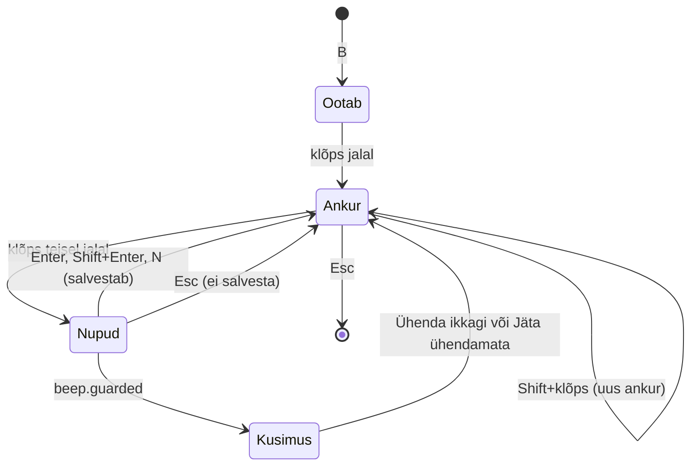

# M2-2-4 · Tööriist Piiks (`B`)

**Olek:** kirjutatud · **Rada:** A · **Haru:** `codex/m2-2` (tööpuu `C:/Users/TRUMPIT/.codex/worktrees/bb-m2-2/BB`) · **Alus:** `3ed369f` · **Allikas:** [M2.2 plaan](../plans/M2-2-piiksumisreziim.md), ül. 4 (O3) · [02 § 8.3](../02-kasutaja-teekond.md#83-piiksumisrežiim-mõõdetud-kõige-kiirem-kaardistus)

## Eesmärk
Tehnik kaardistab plaadi piiksuga ilma hiirega nuppe otsimata.
1. Ta vajutab `B` ja klõpsab jalal, kus on must sond. Jalast saab ankur.
2. Ta klõpsab järgmisel jalal, mida punane sond puudutab. Selle jala juurde ilmuvad kolm nuppu.
3. `Enter` salvestab piiksu ja ühendab jalad. Ankur jääb paigale ja tehnik jätkab järgmise jalaga.

Käsk `beep.record` ja kaitsed on valmis ([M2-2-3](M2-2-3.md)). See kaart teeb tööriista, nupud ja kaitse küsimuse.

## Loe (ainult need)
Rea numbrid on `3ed369f` järgi. Need failid on `main`-is ja tööpuus samad.
- `packages/ui/src/canvas/tools.ts:9-45` (`CanvasTool`, `ToolSpec`, `ToolApi`)
- `packages/ui/src/canvas/use-canvas-keys.ts:32-86` (klahvide järjekord: `Esc` enne tööriista `onKey`-d)
- `packages/ui/src/canvas/Canvas.tsx:355-395` (tööriista `overlay` SVG-s ja `ContextMenu` HTML-ina lõuendi kohal)
- `packages/features/measurements/ui/PickRefTool.ts:1-50` (jala klõpsu tööriist, `contactFromItem`)
- `packages/features/nets/ui/NetsNotices.tsx:24-38` (sündmuste kuulamine `engine.events`)

## Muuda
- `packages/ui/src/canvas/tools.ts` ja `Canvas.tsx`: `CanvasTool.hud` (otsus 1).
- `packages/ui/src/canvas/use-canvas-keys.ts`: `Esc` pakutakse enne aktiivsele tööriistale (otsus 1).
- Uued `packages/features/measurements/ui/BeepTool.tsx` ja `beep-store.ts`. `measurements/ui/index.tsx` registreerib tööriista ja alumise riba vihje (otsused 2–5).
- `packages/features/measurements/ui/i18n/et.ts` (otsus 6).
- Testid: uus `packages/features/measurements/ui/beep-tool.test.tsx`.
- `pnpm api`.

## Ära puutu
- Käsud `beep.record`, `measurements.add` ja `connections.add`. Kasuta neid nagu on.
- `connectionLevels` ja ✓-märgi kuvamine (ül. 5).
- Mõõda-plokk ja selle läbivuse režiim ([M2-2-1](M2-2-1.md)).
- Teiste tööriistade käitumine. `Esc` muutus ei tohi muuta raja tööriista ega valikut.

## Otsused ja liidesed
1. **Lõuendi HUD ja `Esc`.**
   - `CanvasTool` saab valikulise meetodi `hud?(api: ToolApi): JSX.Element | null`.
   - `Canvas` joonistab selle HTML-kihina lõuendi kohale, nagu `ContextMenu`: ekraani koordinaatides, nähtava lõuendiala piires (`visibleCanvasBounds`). Suum ja pööre seda ei skaleeri.
   - `use-canvas-keys`: `Esc` pakutakse enne aktiivse tööriista `onKey`-le. Kui tööriist tagastab `true`, siis lõpp. Muidu käitub `Esc` nagu praegu (valikutööriist, valik tühjaks).
   - Tööriist, mis `Esc`-i ei käsitle, ei märka muutust.
2. **Tööriist `measurements.beep`** (`ToolSpec`: `label` „Piiks“, `icon` `beep`, `key` `B`, `group` `measure`).
   - Olek on poes `beep-store.ts`: `anchor: MeasuredPin | null`, `target: MeasuredPin | null` ja `guard`, mis on kaitse küsimuse andmed või `null`.
   - Jala klõps (`contactFromItem`, klõpsu lävi nagu `PickRefTool`-il):
     - kui ankrut pole, saab jalast ankur;
     - kui ankur on olemas ja jalg on teine, saab jalast `target` ja nupud avanevad. Uus klõps vahetab `target`-i ilma salvestamata;
     - klõps ankru enda peal ei tee midagi;
     - `Shift`+klõps jalal teeb uue ankru ja sulgeb nupud.
   - Tööriistalt lahkumine (`onCancel`, `onSessionReset`) tühjendab poe.
3. **Joonis ja nupud.**
   - `overlay` (SVG, stseenis): ankru jala ümber on sinine 3 px rõngas ja selle kõrval silt „Must sond · U1.4“. Kui `target` on valitud, on selle ümber punane 2 px rõngas.
   - `hud`: kolm nuppu `target` jala kõrval ekraanil. Nuppudel on klahvid kirjas:
     - „Piiksub ja ühenda“ (`Enter`);
     - „Ainult mõõtmine“ (`Shift+Enter`);
     - „Ei piiksu“ (`N`).
   - Nupud jäävad nähtavale alale ka jala liikumisel ekraani servale.
4. **Klahvid ja salvestamine** (`onKey`).
   - Nuppude avamise ajal:
     - `Enter` käivitab `beep.record` `{ beep: true, connect: true }`;
     - `Shift+Enter` käivitab `{ beep: true, connect: false }`;
     - `N` käivitab `{ beep: false, connect: false }`.
   - Käsu andmed: `measurementId = ids.newId('msr')`, `connectionId = ids.newId('con')`, `takenAt` on praegune aeg, `anchor` ja `pin = target`.
   - Pärast õnnestumist sulguvad nupud ja `target` tühjeneb, ankur jääb. Vea korral jäävad nupud lahti ja viga on vihjes.
   - Üks klahvivajutus või klõps salvestab ühe mõõtmise. Kordusklahvi (`repeat`) ei arvestata.
   - `Esc`:
     - nupud või küsimus avatud: need sulguvad ilma salvestamata ja ankur jääb. Tööriist tagastab `true`;
     - ainult ankur: tööriist tühjendab poe ja tagastab `false`, nii et `Esc` lõpetab režiimi tavapäraselt.
5. **Kaitse küsimus** (O3).
   - HUD kuulab `engine.events`-i ja reageerib sündmusele `beep.guarded`, mille `measurementId` on viimati saadetud käsu oma.
   - Kuvatakse küsimus `target` jala juures. Nupud on „Ühenda ikkagi“ (`Enter`) ja „Jäta ühendamata“ (`Esc`).
   - „Ühenda ikkagi“ käivitab `connections.add` `{ items: [{ id: ids.newId('con'), a: { pin: anchor }, b: { pin: target } }], basis: 'assumed' }`. See on eraldi tagasivõetav samm. Mõõtmine on juba salvestatud.
6. **Tekstid** (`beepEt` failis `measurements/ui/i18n/et.ts`):
   - `tool`: „Piiks“;
   - `anchorLabel(ref)`: „Must sond · {ref}“;
   - `hintStart`: „Klõpsa jalal, kus on must sond“;
   - `hintNext`: „Klõpsa jalal, mida punane sond puudutab · Shift+klõps: uus must sond · Esc lõpetab“;
   - `connect`: „Piiksub ja ühenda“, `measureOnly`: „Ainult mõõtmine“, `noBeep`: „Ei piiksu“;
   - `throughComponent(refs)`: „Piiksub läbi komponendi {R5}. Ühendan ikkagi?“ (`same_component`, `shorts_component`; mitu tähist komadega);
   - `roleMerge(roles)`: „Ühendamine liidaks võrgud {GND ja 5V}. Ühendan ikkagi?“;
   - `connectAnyway`: „Ühenda ikkagi“, `keepApart`: „Jäta ühendamata“.

   Alumise riba vihje on nähtav ainult siis, kui tööriist on aktiivne, nagu `TraceHint`.

## Tõend
- TS:
  - `beep_tool_anchor_then_enter_connects` (`packages/features/measurements/ui/beep-tool.test.tsx`): `B` valib tööriista. Klõps U1.4-l näitab silti „Must sond · U1.4“. Klõps U1.3-l avab nupud ja `Enter` lisab läbivuse (`source: 'beep_mode'`) ja ühenduse. Nupud sulguvad, ankur jääb. Järgmine klõps U1.5-l ja `Enter` loob teise ühenduse samast ankrust.
  - `beep_tool_shift_enter_and_n_record_only` (sama fail): `Shift+Enter` lisab `beep: true` ja `N` lisab `beep: false` mõõtmise. Kummalgi juhul ühendust ei teki.
  - `beep_tool_escape_saves_nothing_then_exits` (sama fail): `Esc` avatud nuppudega ei lisa midagi ja ankur jääb. Teine `Esc` viib valikutööriista ja ankrut pole. Raja tööriista `Esc` käitub endiselt nagu varem.
  - `beep_tool_shift_click_sets_new_anchor` (sama fail): `Shift`+klõps U2.1-l teeb sellest ankru ja nupud on suletud.
  - `beep_tool_guard_asks_before_connecting` (sama fail): ankur R5.1, klõps R5.2 ja `Enter` näitavad küsimust „Piiksub läbi komponendi R5. Ühendan ikkagi?“. „Jäta ühendamata“ jätab alles ainult mõõtmise. Kordus koos „Ühenda ikkagi“-ga lisab ühenduse. Üks tagasivõtmine eemaldab ainult ühenduse ja mõõtmine jääb.
- Põhikaustast `pnpm bb-review-card M2-2-4` (rada A).

## Valmis kui
- [ ] Testid ja käsud läbivad, `docs/api` on uuendatud.
- [ ] Üleandmises on ekraanipilt või DOM-i kirjeldus: ankru silt, nupud jala juures ja kaitse küsimus.
- [ ] Üleandmine on allpool, kuni 20 rida.

## Üleandmine
