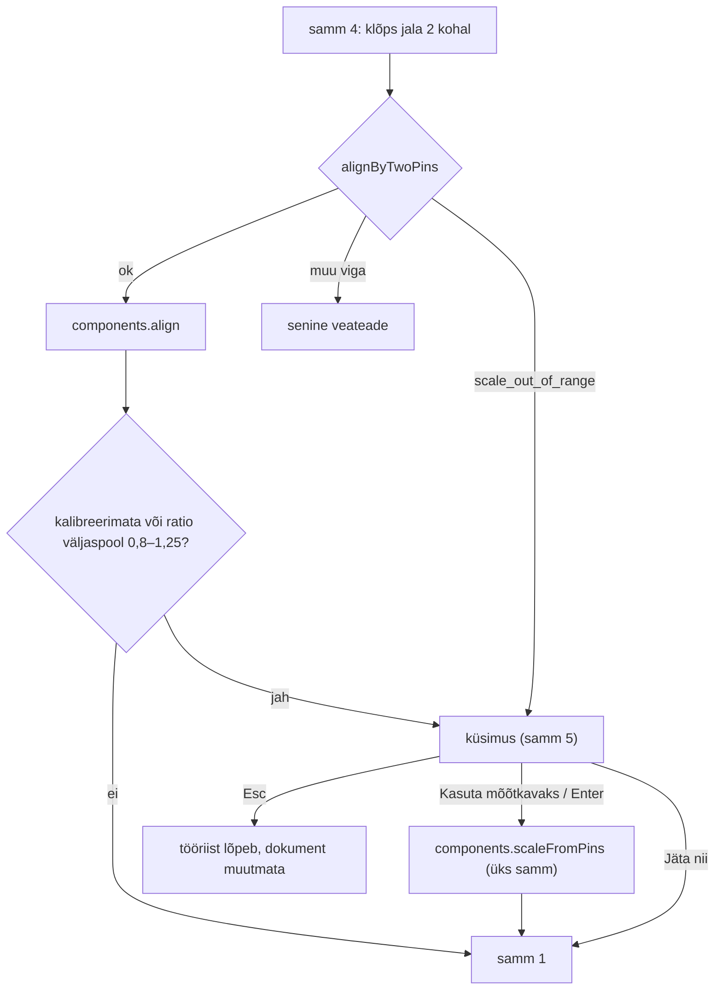

# M2-2b-2 · Mõõtkava korpuse joondusest

**Olek:** vastu võetud `0b8fde1` · **Rada:** B · **Haru:** `codex/m2-2b` (tööpuu `C:/Users/TRUMPIT/.codex/worktrees/bb-m2-2b/BB`) · **Alus:** `4633242` · **Allikas:** [M2.2b plaan](../plans/M2-2b-korpused-ja-mootkava.md), ül. 2, O2 · [02 § 5 Mõõtkava](../02-kasutaja-teekond.md#5-mõõtkava)

## Eesmärk
Kui mõõtkava on vale, „parandab“ kasutaja praegu iga komponendi eraldi joondusega ja suurused jäävad valeks. 5-kordse vea korral annab joondus ainult vea „Joondus viiks mõõtkava lubatud vahemikust (0,2–5) välja“. Pärast seda kaarti küsib kahe jalaga joondus „Kas kasutada seda korpust mõõtkava aluseks?“, kui foto on kalibreerimata või korpus erineb praegusest mõõtkavast rohkem kui 0,8–1,25 korda. „Kasuta mõõtkavaks“ seab foto mõõtkava korpuse jalgade vahe järgi ja paneb komponendi jalad klõpsatud kohtadesse teguriga 1. Teised komponendid saavad õige suuruse.

Rada B: käsk muudab mõõtkava, mis mõjutab kogu plaati. Failivorming ei muutu: `scale` ja `calib` on juba olemas.

## Loe (ainult need)
Loe tööpuust; rea numbrid on `4633242` järgi.
- `packages/features/components/ui/AlignTool.ts:16-126` (`alignClick` samm 4, tööriista spetsifikatsioon)
- `packages/features/components/ui/align.ts:41-126` (`alignPinPosition`, `alignByTwoPins`: pöörde ja keskpunkti arvutus)
- `packages/domain/src/geometry/board.ts:10-93` (`padToBoard`, `boardPads`; ka `customPads.local` on millimeetrites)
- `packages/features/measurements/ui/BeepTool.tsx:246-363` (lõuendi küsimuse muster: `CanvasHudAnchor`, `role="dialog"`, `onKey` Enter)
- `packages/features/components/ui/layers/interaction.test.tsx:25-198` (`mount`, `beginAlignment`, senised joondustestid)

## Muuda
- Uus `packages/domain/src/rules/scale-from-pins.ts`, eksport failist `rules/index.ts`, test `scale-from-pins.test.ts` (otsus 1).
- `packages/features/components/contract.ts`: `PhysicalPinSchema`, `ScaleFromPinsSchema`, `ScaleFromPinsParams`, käsu kirje (otsus 2).
- Uus `packages/features/components/engine/scale-from-pins.ts`, registreeritud `engine/index.ts`-is (`commands: [...commands, scaleFromPins]`). `commands.ts` on 388 rida, seega käsk sinna ei mahu.
- `packages/features/components/ui/`: `align-store.ts`, `AlignTool.ts`, uus `AlignScaleQuestion.tsx`, `layers/AlignLayer.tsx`, `errors.ts`, `i18n/et.ts`, `components.css` (otsused 3–5).
- Testid: uus domeenitest, `packages/features/components/board-commands.test.ts`, `packages/features/components/ui/layers/interaction.test.tsx`.
- `docs/api` käsuga `pnpm api` (domeeni reeglid ja komponentide leping muutuvad).

## Ära puutu
- `photo.setScale`, kalibreerimisaken ja M2-2b-1 failid.
- Käsk `components.align`, funktsioon `alignByTwoPins` ja komponendi teguri piirid `COMPONENT_SCALE_MIN/MAX` (0,2–5).
- Mõõtkava skeem ja failivorming.

## Otsused ja liidesed
1. **Reegel on domeenis** ([ADR-005](../adr/ADR-005-tuuma-ja-moodulite-piir.md#1-moodulitevahelised-reeglid-on-puhtad-funktsioonid-domeenis)), sest see kirjutab kahe mooduli välju.
   - `export type PhysicalPin = { id: string; padIndex: number }` (sama kuju nagu `SelectedAlignPin`).
   - `pinSpacingMm(board, pinA, pinB): number | undefined`. See on kahe füüsilise jala vahe korpuse millimeetrites teguriga 1: `boardPads({ ...board, scaleX: 1, scaleY: 1 }, [pin.id], 1)[pin.padIndex]?.at`. Kui jalg puudub, on tulemus `undefined`.
   - `scaleFromPins(doc, { componentId, pinA, pinB, targetA, targetB }): void` muudab dokumenti kohapeal. **Kõik kontrollid tehakse enne esimest muudatust:**
     - komponenti pole → `RuleTargetNotFound(componentId)`;
     - komponent pole plaadil → `RuleRejected('not_placed')`;
     - sama jala `id` või vahe puudub või on 0 → `RuleRejected('pins_coincide')`;
     - `d = |targetB − targetA|`, `pxPerMm = d / mm`; kui `d < 5` või `pxPerMm` on väljaspool 0,1–1000 → `RuleRejected('scale_from_pins_out_of_range')`.
   - Seejärel:
     - `doc.scale = { pxPerMm, calibrated: true, calib: { a: targetA, b: targetB, mm } }`;
     - `board.scaleX = board.scaleY = 1`;
     - jalgade asukohad `a0`, `b0` arvutatakse uue `pxPerMm`-iga;
     - `rotation = atan2(targetB − targetA) − atan2(b0 − a0)`;
     - `board.rotationDeg` = vana nurk + `rotation` kraadides, normaliseeritud vahemikku [0, 360);
     - `board.center = targetA + R(rotation)·(center − a0)`.
     Nii on jalad täpselt sihtpunktides; pööre ja peegeldus käituvad nagu `alignByTwoPins`-is.
2. **Käsk on komponentide moodulis.**
   - `components.scaleFromPins`, parameetrid `ScaleFromPinsSchema = ComponentTargetSchema.extend({ pinA: PhysicalPinSchema, pinB: PhysicalPinSchema, targetA: Vec2Schema, targetB: Vec2Schema })`, kus `PhysicalPinSchema = z.strictObject({ id: IdSchema, padIndex: z.number().int().nonnegative() })`.
   - `alsoWrites: ['scale']`, `run` kutsub ainult `scaleFromPins`-i. Üks käsk on üks ajaloo samm.
   - Teiste komponentide keskpunktid ja tegurid ei muutu. Nende suurus järgib uut mõõtkava, sest joonistus kasutab `pxPerMm`-i (02 § 5).
3. **Millal küsida** (`AlignTool` samm 4, enne käsku).
   - Arvutatakse `mm = pinSpacingMm(board, pinA, pinB)`, `d = |world − targetA|`, `ratio = d / (mm · pxPerMm)` ja `proposed = d / mm`.
   - Küsimus on võimalik ainult siis, kui `mm > 0`, `d ≥ 5` ja `proposed` on vahemikus 0,1–1000.
   - **Joondus õnnestub** (`pose.ok`): `components.align` rakendub nagu praegu. Kui foto on kalibreerimata (`doc.scale.calibrated === false`) või `ratio < 0,8` või `ratio > 1,25`, avaneb küsimus. Muidu lõpeb joondus nagu praegu.
   - **Joondus ei õnnestu põhjusel `scale_out_of_range`:** dokumenti ei muudeta ja senise vea asemel avaneb küsimus.
   - Muud vead (`same_pin`, `pins_coincide`, `targets_coincide`, `proposed` vahemikust väljas) jäävad senisteks veateadeteks.
   - Küsimuse olek on poes uus samm: `{ step: 5; id; pinA; pinB; targetA; targetB; ratio: number; uncalibrated: boolean }`.
4. **Küsimus lõuendil** (`AlignScaleQuestion.tsx`, tööriista `hud`).
   - `CanvasHudAnchor at={targetB}` sees on `role="dialog"`, `data-align-question` ja `aria-labelledby` pealkirjale.
   - Read:
     - pealkiri `scaleQuestion`;
     - kalibreerimata fotol `scaleUncalibrated`, muidu `ratio < 1` korral `scaleSmaller(1 / ratio)` ja `ratio > 1` korral `scaleLarger(ratio)`, kordaja ühe komakohaga;
     - `scaleResult(proposed)` kahe komakohaga.
   - Nupud:
     - „Kasuta mõõtkavaks“ on põhinupp ja saab avamisel fookuse;
     - „Jäta nii“ ainult sulgeb küsimuse, tööriist jääb sammule 1.
   - Paneel on väike nagu piiksu kaitseküsimus (`var(--panel)`, ääris, vari) ega kata komponenti.
   - **Kasuta:** `api.execute('components.scaleFromPins', { id, pinA, pinB, targetA, targetB })`. Õnnestumisel `reset()` ja komponent valitakse. Vea korral `reset()` ja seejärel `setError(commandError(error))`.
5. **Klahvid ja klõpsud.**
   - `onKey` sammul 5:
     - `Enter` (ilma muuteklahvita, mitte kordus) käivitab „Kasuta mõõtkavaks“, välja arvatud siis, kui sündmuse siht on `[data-align-question] button` sees (siis vajutab nupp ise).
     - `Esc`-i `onKey` ei käsitle: tööriist lõpeb nagu praegu ja `onCancel` tühjendab küsimuse. Dokument jääb muutmata peale juba rakendunud joonduse. Nii jääb E2E samm „joondus → Esc → käepide“ samaks.
   - Lõuendi klõps sammul 5 tähendab „Jäta nii“ ja sama klõps alustab uut joondust (samm 1).
   - `AlignLayer` näitab sammul 5 jala 2 juhtjoont `targetB`-ni (kursori asemel).
   - Olekurea tekst `steps[5]`.

Tekstid (`alignEt`):
- `steps[5]: 'Joonda: kas kasutada korpust mõõtkavaks? · Enter kasutab · Esc katkestab'`
- `scaleQuestion: 'Kas kasutada seda korpust mõõtkava aluseks?'`
- `scaleUncalibrated: 'Foto on kalibreerimata.'`
- `scaleSmaller: (n: string) => \`Korpus on fotol ${n} korda väiksem kui praeguse mõõtkava järgi.\``
- `scaleLarger: (n: string) => \`Korpus on fotol ${n} korda suurem kui praeguse mõõtkava järgi.\``
- `scaleResult: (pxPerMm: string) => \`Uus mõõtkava: ${pxPerMm} px/mm\``
- `useAsScale: 'Kasuta mõõtkavaks'`
- `keepAsIs: 'Jäta nii'`
- `scaleOutOfRange: 'Selle korpuse järgi jääks mõõtkava lubatud vahemikust (0,1–1000 px/mm) välja.'`

`errors.ts` seob sõnumi `scale_from_pins_out_of_range` tekstiga `alignEt.scaleOutOfRange` ja sõnumi `pins_coincide` tekstiga `alignEt.errors.pins_coincide`.

**Senised testid.** `interaction.test.tsx`-is muuda ainult järgmist:
- `mount` teeb foto vaikimisi kalibreerituks (`doc.scale.calibrated = true`) ja saab valiku kalibreerimata foto jaoks.
- `align_is_one_undo_step` teine sihtpunkt muutub (180, 150) → (180, 140) ja jala 2 ootus samuti, sest tegur 1,5 tooks nüüd küsimuse.
- `align_rejects_scale_outside_limits` kirjeldab vana käitumist; selle asendab `align_question_replaces_out_of_range_error`.

Kui mõni muu senine test kukub, kirjuta üleandmisse, miks.

## Tõend
- TS:
  - `scale_from_pins_sets_scale_and_places_component` (`packages/domain/src/rules/scale-from-pins.test.ts`): chip 0805 keskpunktiga (100, 80), `scaleX` 0,3, `scaleY` 0,4, mõõtkava 10 px/mm kalibreerimata; `pinSpacingMm` jalgadele 1 ja 2 on 2; sihtpunktid (200, 200) ja (200, 240) annavad `scale` = `{ pxPerMm: 20, calibrated: true, calib: { a: (200, 200), b: (200, 240), mm: 2 } }`, teguri 1 mõlemal teljel, `rotationDeg` 90, keskpunkti (200, 220) ja `boardPads(…, 20)` jalad sihtpunktides; `side: 'bottom'` korral on jalad samuti sihtpunktides; sama jalg annab `RuleRejected('pins_coincide')`; sihtpunktid 4 px ja 3000 px vahega annavad `RuleRejected('scale_from_pins_out_of_range')`; puuduv komponent annab `RuleTargetNotFound`; pärast iga keeldumist on dokument muutmata.
  - `scale_from_pins_command_is_one_undo_step` (`packages/features/components/board-commands.test.ts`): chip 0805 keskpunktiga (100, 80), mõõtkava 10 px/mm ja teine chip keskpunktiga (300, 300) ja `scaleX` 1,5; `components.scaleFromPins` jalgadele 1 ja 2 sihtpunktidega (200, 200) ja (200, 240) annab `doc.scale.pxPerMm` 20 ja esimese komponendi teguri 1, teise keskpunkt ja tegur jäävad samaks; üks `undo` taastab dokumendi (`rev` kahe võrra suurem); sama jalg annab `validation` vea sõnumiga `pins_coincide` ja dokument ei muutu.
  - `align_question_after_applied_alignment` (`packages/features/components/ui/layers/interaction.test.tsx`): kalibreeritud 10 px/mm, joondus sihtpunktidega (180, 120) ja (180, 130), tegur 0,5; `components.align` rakendub ja dialoog „Kas kasutada seda korpust mõõtkava aluseks?“ näitab ridu „Korpus on fotol 2,0 korda väiksem kui praeguse mõõtkava järgi.“ ja „Uus mõõtkava: 5,00 px/mm“; „Kasuta mõõtkavaks“ kutsub `components.scaleFromPins`, mõõtkava on 5 px/mm, tegur 1, jalad punktides (180, 120) ja (180, 130), dialoog kaob ja olekureal on „vali jalg 1“; esimene `Ctrl+Z` taastab 10 px/mm ja teguri 0,5, teine algse dokumendi.
  - `align_question_replaces_out_of_range_error` (sama fail): sihtpunktid (180, 120) ja (330, 120), tegur 7,5; veateadet pole, `execute` pole kutsutud, dokument on muutmata ja dialoog näitab ridu „Korpus on fotol 7,5 korda suurem kui praeguse mõõtkava järgi.“ ja „Uus mõõtkava: 75,00 px/mm“; `Esc` sulgeb dialoogi ja dokument jääb muutmata; sama joondus uuesti ja `Enter` kutsub ainult `components.scaleFromPins`, mõõtkava on 75 px/mm, jalad on sihtpunktides ja üks `Ctrl+Z` taastab algse dokumendi.
  - `align_question_on_uncalibrated_photo` (sama fail): kalibreerimata foto 10 px/mm, sihtpunktid (180, 120) ja (180, 140), tegur 1; `components.align` rakendub ja dialoog näitab ridu „Foto on kalibreerimata.“ ja „Uus mõõtkava: 10,00 px/mm“ ilma kordade reata; „Jäta nii“ sulgeb dialoogi, olekureal on „vali jalg 1“, komponent on joondatud ja foto kalibreerimata; kalibreeritud fotol sihtpunktiga (180, 142) (tegur 1,1) dialoogi ei tule.
- Põhikaustast `pnpm bb-review-card M2-2b-2` (rada B, täisring koos E2E-ga).

## Valmis kui
- [x] Testid ja käsud läbivad.
- [x] Üleandmine on allpool, kuni 20 rida.

## Üleandmine

- Puhas algseis `4633242`, haru `codex/m2-2b`, tööpuu `C:/Users/TRUMPIT/.codex/worktrees/bb-m2-2b/BB`.
- RED 5/5. Alusel puudus `pinSpacingMm`, käsk tagastas `not_found` ja kolm UI-testi ei leidnud dialoogi. Tööpuu logid `output/playwright/m2-2b-2/domain-red.log`, `output/playwright/m2-2b-2/command-red.log` ja `output/playwright/m2-2b-2/align-ui-red.log`.
- GREEN 5/5. Reegel mõõdab füüsiliste padjandite vahe ühikteguriga korpuse koordinaatides. Kinnitus muudab mõõtkava ja paigutab jalad sihtpunktidesse ühe tagasivõetava käsuga `components.scaleFromPins`.
- Joondus pakub küsimust kalibreerimata foto või suure mõõtkavaerinevuse korral. Üle teguripiiri avaneb küsimus dokumendimuutuseta. Esc lõpetab tööriista ja jätab juba rakendunud joonduse alles.
- Senises `interaction.test.tsx`-is on `mount` vaikimisi kalibreeritud, `align_is_one_undo_step` teine siht ja ootus on (180, 140) ning `align_rejects_scale_outside_limits` asendus testiga `align_question_replaces_out_of_range_error`.
- `pnpm api` uuendas `docs/api/domain-rules.md` ja `docs/api/features-components-contract.md`. Tööpuu `pnpm check` läbis 1736 testi. Pikkusehoiatused hõlmasid kaardis määratud interaktsioonitesti ja genereeritud komponendilepingut.
- Põhikausta `pnpm bb-review-card M2-2b-2` läbis raja B täisringi (`ok: true`, `missing: []`). Vitest 1736/1736, E2E 44/44, Rust 108/110 (2 vahele jäetud). Raport `output/review-card/M2-2b-2-qNVm1P/summary.json`.
- Katsed kasutasid sünteetilisi andmeid. Muudatused on ülevaatuseks tööpuus, HEAD `4633242`.

## Arhitekti ülevaatus (2026-11-25)

- Tööpuus on 17 faili: 13 muudetud ja 4 uut. Need on kaardi failid ning `docs/api/domain-rules.md` ja `features-components-contract.md`. Võõraid faile pole.
- **Andmed ja ajalugu:**
  - `scaleFromPins` teeb kõik kontrollid (`RuleTargetNotFound`, `not_placed`, `pins_coincide`, `scale_from_pins_out_of_range`) enne esimest kirjutust.
  - Käsk `components.scaleFromPins` deklareerib ainult `alsoWrites: ['scale']` ja on üks samm.
  - Failivorming ei muutunud.
  - Sõltuvuse suund on domeen → leping/mootor/UI (`@pcbk/domain/rules` on UI lubatud alamtee).
- **Erinevus kaardist:** reegel mõõdab jalad korpuse enda raamis (keskpunkt 0, nurk 0, tegur 1, sama külg) ja seab nurga absoluutselt, mitte „vana nurk + pööre“. Kontrollisin arvutuse: jalg A on `targetA`-s, jalg B kaugusel `mm · pxPerMm` sihtnurgas, peegeldus säilib. See on samaväärne ja numbriliselt stabiilsem. **Sobib.**
- **UI:**
  - Küsimus tuleb ainult siis, kui `mm > 0`, `d ≥ 5` ja uus mõõtkava on vahemikus 0,1–1000.
  - Rakendunud joondus küsib kalibreerimata fotol või teguri korral väljaspool 0,8–1,25. `scale_out_of_range` avab küsimuse ilma muudatuseta.
  - `Esc`-i `onKey` ei püüa. `Enter` küsimuse nupul jääb nupule.
  - Klõps küsimuse ajal alustab uut joondust. Vea korral `reset()` ja siis `setError`.
- **Testid:**
  - Kaardi viis testinime on olemas (iga üks kord).
  - Senistes testides muutusid ainult kaardil nimetatud kolm kohta: `mount` kalibreeritud, `align_is_one_undo_step` siht (180, 140), `align_rejects_scale_outside_limits` asendatud.
  - Ehitaja `summary.json` (09:26) on uuem kui tööpuu viimane muudatus (09:16). Seal on rada B, `ok: true`, `missing: []`, hoiatusi pole. Läbisid check, api, format, coverage, E2E 44/44, `git diff --check` ja cargo 108/110 (2 vahele jäetud), ühiktestid 1736/1736. Kontrolle uuesti ei käivitatud.
- **Brauseris:** ühekordne Playwrighti vaade tööpuu veebiäpist (Chromium 1440 × 900), fail kustutati pärast käivitamist. Sünteetilisel kalibreerimata fotol oli „Takisti SMD“ ja joonduse tegur 8, mis on üle piiri 5.
  - Dialoog näitas „Foto on kalibreerimata.“ ja „Uus mõõtkava: 80,00 px/mm“. Fookus oli nupul „Kasuta mõõtkavaks“. Paneel oli 272 × 145 px ega katnud komponenti.
  - Pärast kinnitust oli kiibil 80,00 px/mm ja mõlemad jalad olid sihtpunktides (0 px kõrvalekalle). Üks `Ctrl+Z` andis „Kalibreerimata“ ja korpus oli algkohas (0 px).
  - Ekraanipildid näitasid juhtjooni sihtpunktideni ja paneeli jala 2 sihtpunkti kõrval.
- **Otsus: sobib.**
- Mitteblokeerivad märkused:
  - `interaction.test.tsx` oli juba enne kaarti üle 400 rea (406 → 509 mittetühja rida). Järgmine seda faili muutev kaart võib joondustestid eraldi faili tõsta.
  - `AlignScaleQuestion` arvutab uue mõõtkava renderdamisel `api.snapshot()`-ist, kuigi `ratio` on poes. Tulemus on sama, sest jalgade vahe ei sõltu tegurist.
