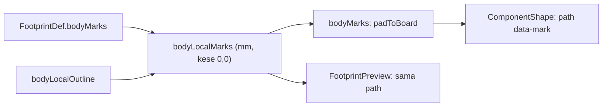

# M2-2b-4 · Polaarsuse ja suuna märgid korpusel

**Olek:** kirjutatud · **Rada:** A · **Haru:** `codex/m2-2b` (tööpuu `C:/Users/TRUMPIT/.codex/worktrees/bb-m2-2b/BB`) · **Alus:** `b47d346` · **Allikas:** [M2.2b plaan](../plans/M2-2b-korpused-ja-mootkava.md), ül. 4, O4

## Eesmärk
Pärast M2-2b-3 on korpusel õige kuju, aga polaarsust ja suunda pole näha. Elektrolüüdil pole `+`-i ega triipu, dioodil pole katoodi triipu, mikroskeemil on ainult 1. jala punkt ja TO-220-l pole plaati. Pärast seda kaarti on need märgid lõuendil ja teegi eelvaates samas kohas, kus tehnik neid fotol või plaadi trükis näeb:
- elektrolüüdil on `+` jala `+` juures ja triip `−` poolel, nagu purgil;
- dioodil ja LED SMD-l on triip `K` poolel ning tantaalil `+` poolel;
- DIP-, SOIC- ja TSSOP-korpusel on sälk 1. jala otsas, QFP- ja QFN-korpusel on 1. jala nurk lõigatud;
- TO-220-l on metallplaat tagaküljel.

Märgid pöörlevad ja peegelduvad koos korpusega.

## Loe (ainult need)
Loe tööpuust; rea numbrid on `b47d346` järgi.
- `packages/domain/src/footprints/types.ts:23-64` (`BodyShapeSpec`, `FootprintDef`, `defineFootprint`)
- `packages/domain/src/footprints/body-outline.ts:49-76` (`outline`, `bodyLocalOutline`; triip ja plaat lõigatakse sellest kontuurist)
- `packages/domain/src/geometry/board.ts:95-101` (`bodyOutline`; `bodyMarks` järgib sama mustrit)
- `packages/features/components/ui/layers/ComponentShape.tsx:31-74` (`Body`: halo, kontuur, 1. jala punkt)
- `packages/features/components/ui/FootprintPreview.tsx:54-138` (`previewBody`, `FootprintPreview`)

## Muuda
- `packages/domain/src/footprints/types.ts`, uus `footprints/body-marks.ts` ja eksport failist `footprints/index.ts` (otsused 1–2).
- Korpused (otsus 3): `footprints/passives.ts` (`radial`, `el_smd`, `chip_tant`, `chip_diode`, `axial`), `footprints/chip-led.ts`, `footprints/integrated.ts` (`sop`, `dip`, `qfp`, `qfn`), `footprints/soic.ts`, `footprints/to220.ts`.
- `packages/domain/src/geometry/board.ts` (`bodyMarks`, otsus 2).
- Uus `packages/features/components/ui/mark-path.ts`, `layers/ComponentShape.tsx` ja `FootprintPreview.tsx` (otsus 4).
- Testid: uus `packages/domain/src/footprints/body-marks.test.ts`, uus `packages/features/components/ui/layers/body-marks.test.tsx`, `packages/features/components/ui/library-preview.test.tsx`.
- `docs/api` käsuga `pnpm api`.

## Ära puutu
- `FootprintGeom` ja fikstuur `__fixtures__/pre-m1-3-7.json`. Test `existing_footprints_geometry_unchanged` peab läbima muutmata.
- Korpuse kontuur ja kuju (M2-2b-3), tabamus, hõljumine, sildid, paigutuse kummitus (`ComponentsLayer`) ja teegi loendi siluett (28 × 18 px on märkide jaoks liiga väike).
- 1. jala punkt jääb lõuendile ja eelvaatesse nagu praegu.
- Failivorming ja tekstid; uusi tekste pole.

## Otsused ja liidesed

1. **Märgid on korpuse definitsioonis**, samal põhjusel nagu kuju (geomeetria fikstuur ei tohi muutuda).
   - `types.ts`:
     - `export type BodyMarkKind = 'plus' | 'band' | 'notch' | 'tab'`;
     - `export type BodyMarkSpec = { kind: 'plus'; pin: string } | { kind: 'band'; pin: string } | { kind: 'notch'; at: 'edge' | 'corner' } | { kind: 'tab' }`.
   - `FootprintDef` saab välja `bodyMarks?: readonly BodyMarkSpec[]`.
   - `withBodyMarks(def: FootprintDef, marks: readonly BodyMarkSpec[]): FootprintDef` tagastab `{ ...def, bodyMarks: marks }`. `defineFootprint`-i allkiri ei muutu.
   - `footprints/index.ts`: `footprintBodyMarks(key: string): readonly BodyMarkSpec[]` tagastab definitsiooni `bodyMarks` või `[]`.
2. **Üks märgifunktsioon.**
   - `body-marks.ts`: `export interface BodyMark { kind: BodyMarkKind; lines: Vec2[][]; filled: boolean }`. `filled: true` on suletud ja täidetud ala (triip, plaat), `false` avatud joon (`+`, sälk).
   - `bodyLocalMarks(geometry: FootprintGeom, shape: BodyShapeSpec, specs: readonly BodyMarkSpec[]): BodyMark[]` annab märgid korpuse millimeetrites, keskpunkt (0, 0), loendi järjekorras. Tühi massiiv, kui `w ≤ 0` või `h ≤ 0`.
   - Jalaga seotud märk (`plus`, `band`):
     - jalg on `geometry.pads`-is see, mille `name === spec.pin`; kui sellist pole või see on punktis (0, 0), märk jääb ära;
     - telg on see, kus jala koordinaat on absoluutväärtuselt suurem (võrdsuse korral x), ja s on jala koordinaadi märk sellel teljel;
     - L on korpuse mõõt sellel teljel ja A risti-mõõt.
   - `band`: kontuuri `bodyLocalOutline(body, shape)` osa, kus s · (teljekoordinaat) ≥ 0,35 · L, ehk 15 % korpuse pikkusest jala poolses otsas. Kontuur on kumer, nii et piisab ühest pooltasandi lõikest (Sutherland–Hodgman). `lines` = [lõigatud hulknurk], `filled: true`.
   - `plus`: keskpunkt on teljel s · L/4 ja teisel teljel −A/4, haru pikkus a = 0,1 · min(w, h). `lines` = kaks lõiku: esimene x-teljel (cx − a, cy) → (cx + a, cy), teine y-teljel (cx, cy − a) → (cx, cy + a); `filled: false`.
   - `notch` `at: 'edge'`:
     - poolring −y serva keskel, raadius r = min(1, w/6);
     - 13 punkti nurkadel θₖ = π − k · π/12, punkt (r · cos θₖ, −h/2 + r · sin θₖ);
     - esimene punkt on (−r, −h/2), keskmine (0, −h/2 + r), viimane (r, −h/2); `filled: false`.
     - Kõigis kolmes korpuses on jalaread y-teljel ja 1. jalg on −y otsas.
   - `notch` `at: 'corner'`: lõige −x −y nurgas, c = 0,1 · min(w, h). `lines` = [[(−w/2 + c, −h/2), (−w/2, −h/2 + c)]], `filled: false`. 1. jala punkt jääb lõikest eemale.
   - `tab`: kontuuri osa, kus y ≤ −h/2 + 1,3 (plaadi paksus 1,3 mm tagaküljel, jalgadest kaugemal), `filled: true`.
   - `geometry/board.ts`: `bodyMarks(placement, pxPerMm): BodyMark[]`.
     - Kui `footprintBodyMarks(placement.footprint)` on tühi, tagastab `[]` geomeetriat arvutamata.
     - Muidu kutsub `bodyLocalMarks(footprintGeometry(…), footprintBodyShape(…), …)` ja teisendab iga punkti `padToBoard`-iga.
     - Puhvrit pole; jõudlust mõõdab ülesanne 5.
3. **Korpused (O4).**
   - `radial`, `el_smd` → `[{ kind: 'plus', pin: '+' }, { kind: 'band', pin: '−' }]`. `−` on jala nimes U+2212.
   - `chip_tant` → `[{ kind: 'band', pin: '+' }]`.
   - `axial`, `chip_diode`, `chip_led` → `[{ kind: 'band', pin: 'K' }]`. Takisti (`band: 'ei'`) jalal nime `K` pole, seega triipu ei teki.
   - `dip`, `soic`, `sop` → `[{ kind: 'notch', at: 'edge' }]`; `qfp`, `qfn` → `[{ kind: 'notch', at: 'corner' }]`.
   - `to220` → `[{ kind: 'tab' }]`.
   - Plaanist erinevalt:
     - `led_tht` märki ei saa, sest lame külg on tema `K` märk (M2-2b-3).
     - `chip_tant` saab ainult triibu `+` poolel. `+` märk ei mahu B-korpusel jalgade kõrvale, ja päris tantaalil on `+` poole märk triip.
4. **Joonistus.**
   - `mark-path.ts`: `markPath({ lines, filled }: BodyMark): string` annab iga joone kujul `M x y L x y …`, täidetud märgil lisandub `Z`.
   - `ComponentShape` `Body` joonistab märgid pärast kontuuri ja enne 1. jala punkti. Iga märk on üks element: `<path data-mark={kind} d=… vectorEffect="non-scaling-stroke">`.
     - Värv on sama mis kontuuril: `var(--body)`, valitud korral `var(--sel)`.
     - Täidetud märgil on `fill` sama värviga, `fillOpacity={0.35}` ja `strokeWidth={1}`. Avatud märgil on `fill="none"`, `strokeWidth={1.4}` ja `strokeLinecap="round"`.
     - Alumisel poolel on `strokeDasharray` sama mis kontuuril (`'4 3'`).
     - Eraldi halo-elementi pole: kontuuri halo ja täidis on all ning korpusele lisandub kuni kaks elementi.
   - `FootprintPreview` joonistab `bodyLocalMarks`-i märgid pärast korpust ja enne jalgu sama `markPath`-i ja värviga, ilma punktiirita.

## Tõend
- TS:
  - `body_marks_follow_polarity_pins` (`packages/domain/src/footprints/body-marks.test.ts`): `radial` D 6,3 samm 2,5 annab järjekorras `plus` ja `band`. `plus` jooned on [(−2,205; −1,575), (−0,945; −1,575)] ja [(−1,575; −2,205), (−1,575; −0,945)], `filled: false`. `band` on täidetud, 15 punktiga, iga punkt x ≥ 2,205 ja kaugusel ≤ 3,15 punktist (0, 0), täpselt kaks punkti sirgel x = 2,205 (|y| = 2,25 ± 0,01). `chip_tant` B annab ainult `band`-i, 4 punkti, x ∈ {−1,75; −1,225} ja y = ±1,4. `chip_diode` SOD-123 annab `band`-i x ∈ {−1,35; −0,945} ja y = ±0,8. `axial` `{ pitch: 10,16, bl: 5,2, bd: 2,7, band: 'jah' }` annab `band`-i x ∈ {−2,6; −1,82} ja y = ±1,35. `axial` `band: 'ei'` ja `led_tht` D 5 annavad `[]`.
  - `body_marks_notch_and_tab` (sama fail): `soic` 8 jalga 3,9 mm annab ühe `notch`-i 13 punktiga, esimene (−0,65; −2,44), seitsmes (0; −1,79), viimane (0,65; −2,44), kõik kaugusel 0,65 punktist (0; −2,44). `dip` 8 jalga 7,62 annab esimese punkti (−1; −5,23) ja seitsmenda (0; −4,23). `qfp` 44 jalga samm 0,8 annab `notch`-i jooned [[(−4; −5), (−5; −4)]]. `to220` annab täidetud `tab`-i 4 punktiga, x = ±5,1 ja y ∈ {−2,3; −1}. chip 0805 annab `[]`.
  - `body_marks_draw_on_canvas` (`packages/features/components/ui/layers/body-marks.test.tsx`), 10 px/mm: `radial` D 6,3 keskpunktiga (100, 100), nurgaga 90° ja alumisel poolel. Korpuse grupis on üks `path[data-mark="plus"]` ja üks `path[data-mark="band"]`, mõlemal `stroke-dasharray` „4 3“. Iga `band`-i punkt on lähemal jala `2` (`−`) kui jala `1` kohale ja `plus`-i punktide keskmine on lähemal jalale `1`; jalgade kohad annab `boardPads`. `soic` 8 jalga ülemisel poolel: `notch` ilma `stroke-dasharray`-ta ja 1. jala `circle` on alles. Chip 0805 korpuse grupis pole `[data-mark]`-i.
  - `library_preview_draws_marks` (`packages/features/components/ui/library-preview.test.tsx`): „Elektrolüüt THT“ eelvaates on `[data-mark="plus"]` ja `[data-mark="band"]`, „Diood THT“ eelvaates `band`, „SOIC“ eelvaates `notch` ja `[data-pin1]`, „TO-220“ eelvaates `tab`. „Takisti SMD“ eelvaates `[data-mark]`-i pole. Loendi siluettides (`svg[data-silhouette]`) pole ühtki `[data-mark]`-i.
- Põhikaustast `pnpm bb-review-card M2-2b-4` (rada A).

## Valmis kui
- [ ] Testid ja käsud läbivad.
- [ ] Üleandmine on allpool, kuni 20 rida.
