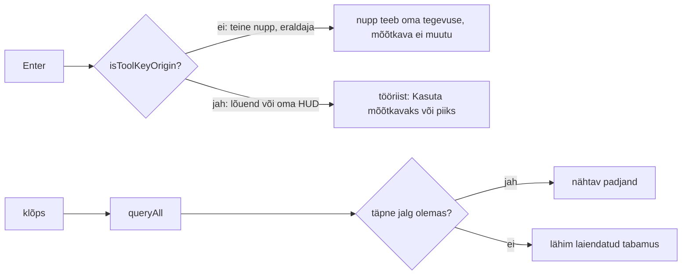

# M2-2b-6 · Ühine jalavalik ja klahvifookus (Joonda ja Piiks)

**Olek:** vastu võetud `2a083fa` · **Rada:** B · **Haru:** `codex/m2-2b` (tööpuu `C:/Users/TRUMPIT/.codex/worktrees/bb-m2-2b/BB`) · **Alus:** `2eb1a1c` · **Allikas:** [M2.2b plaan](../plans/M2-2b-korpused-ja-mootkava.md), ül. 6 ja [Astra audit](../review/2026-11-25-m2-2b-ulevaatus-2eb1a1c.md), leiud 01, 03 ja 05

## Eesmärk
Joonda ja Piiks salvestavad ainult selle jala, mida kasutaja nägi ja klõpsas, ning reageerivad `Enter`-ile ainult lõuendi või oma nuppude fookusest:
- Teisel nupul või paneeli eraldajal vajutatud `Enter` ei kinnita enam kogu plaadi mõõtkava (leid 01).
- Tihedal plaadil ei võta joondus mõõtkava aluseks kõrvaljalga, kui klõps on nähtava padjandi sees (leid 03).
- Ovaalse või elliptilise padjandi tühi nurk ei ole selle padjandi tabamus. Naaberjala sees tehtud klõps salvestab piiksu naaberjalale (leid 05, olemas juba `v0.6.0`-s).

Joonda kordas M2.2-s Piiksus parandatud vigu ([M2.2 ül. 8](../plans/M2-2-piiksumisreziim.md)). Seepärast on reegel nüüd üks ja asub `@pcbk/ui`-s.

## Loe (ainult need)
Esimene viide on põhikaustas, teised loe tööpuust (`2eb1a1c`). `bb_task` näitab `main`-i koodi, kus M2.2b muudatusi veel pole.
- `docs/review/2026-11-25-m2-2b-ulevaatus-2eb1a1c.md:32-60` (leiud 01, 03 ja 05 koos kordusjuhtumitega)
- `packages/ui/src/canvas/hit-index.ts:120-237` (`shapeDistance`, `query`, `queryAll` ja `exact`)
- `packages/features/components/ui/layers/hits.ts:21-41` (jala tabamiskuju; joonistus `PinMarker.tsx:17-46`)
- `packages/features/components/ui/AlignTool.ts:29-135` (`alignClick` ja `onKey`)
- `packages/features/measurements/ui/BeepTool.tsx:300-355` (Piiksu jalavalik ja `onKey`; `isBeepKeyOrigin` real 128)

## Muuda
- `packages/ui/src/canvas/hit-index.ts`: `pickHit` ja `HitShape`-i `corner` (otsused 1 ja 2). Eksport `@pcbk/ui` kaudu.
- `packages/ui/src/canvas/`: `isToolKeyOrigin` (otsus 3). Eksport `@pcbk/ui` kaudu.
- `packages/features/components/ui/layers/hits.ts`: jala tabamiskuju `corner` (otsus 2).
- `packages/features/components/ui/AlignTool.ts`: `pickHit` ja `isToolKeyOrigin`.
- `packages/features/measurements/ui/BeepTool.tsx`: `pickHit` ja `isToolKeyOrigin`, kohalik `isBeepKeyOrigin` kaob.
- Testid jaotisest „Tõend“. Olemasolev `oval_pad_hits_like_rect` asendub testiga `oval_pad_hits_like_drawn_shape`; see on ainus muudetud ootus.
- `pnpm api` (`@pcbk/ui` avalik liides muutub).

## Ära puutu
- Domeen, mootor, lepingud ja käskude skeemid. Mõõtkavapakkumise kehtivus, käsitsi lisatud jalad, lubamatu pakkumise teade ja märkide kontrast kuuluvad kaardile M2-2b-7.
- `query` käitumine ja selle test `pin_hit_picks_nearest_center_between_neighbours`. Valiku-, jala- ja võrgutööriist kasutavad `query`-t edasi.
- Padjandite ja korpuste joonistus, failivorming, versioon, liitmine ja sildid.
- Kasutaja fotod ja projektid: ainult sünteetilised andmed.

## Otsused ja liidesed
1. **Ühine jalavalik.**
   - `export function pickHit(index: HitIndex, world: Vec2, zoom: number, kind: string): HitItem | undefined`.
   - Valib `index.queryAll(world, zoom)` tulemustest ainult `item.kind === kind` kirjed. Tagastab esimese `exact` kirje, selle puudumisel esimese kirje. `queryAll` järjestab juba prioriteedi ja kauguse järgi.
   - Joonda (`alignClick` sammud 1 ja 3) ja Piiks (`onPointerDown`) kasutavad `pickHit(api.hitIndex, world, zoom, 'pin')`-i. Joonda veateated jäävad: kui jalga pole, kuvatakse `alignEt.pickPin`; kui jalal pole `at`-i, kuvatakse `alignEt.pinPosition`.
2. **Padjandi tabamiskuju vastab joonistusele.**
   - `HitShape`-i `rect` saab valikulise välja `corner?: 'round' | 'ellipse'`.
   - `'round'` on ümarate otstega ristkülik, mille nurga raadius on `min(hx, hy)` nagu `PadOutline`-i `rx`. `'ellipse'` on ristküliku sisse joonistatud ellips.
   - `hx` ja `hy` arvestavad senist `rectMinHalf`-i. Kuju sees on kaugus endiselt kaugus keskpunktist, väljas `Infinity`. `exact` kasutab sama kuju ilma `rectMinHalf`-ita.
   - `componentPinHits`:
     - `oval` → `corner: 'round'`;
     - `circle`, mille `halfPx.x ≠ halfPx.y`, → `corner: 'ellipse'`;
     - võrdsete poolmõõtudega `circle` jääb `point`-iks;
     - `rect` jääb ilma `corner`-ita.
3. **Tööriista klahvi lähtekoht.**
   - `export function isToolKeyOrigin(origin: EventTarget | null, hudSelector: string): boolean`.
   - Tagastab `true`, kui `origin` on `document.body`, stseeni `svg` (sisaldab `[data-scene]`-i) või element `hudSelector`-i sees. Muudel juhtudel tagastab `false`.
   - Piiks kasutab seda `'[data-beep-hud]'`-iga kõigis senistes kohtades. Käitumine jääb samaks.
   - Joonda `onKey` sammul 5: kui `isToolKeyOrigin(event.target, '[data-align-question]')` on `false`, tagastab tööriist `false`. Sündmust ei tühistata ja fookuses olev nupp või eraldaja teeb oma tegevuse. Senine erand `[data-align-question] button` jääb: küsimuse nupp vajutab ise.

## Tõend
- TS:
  - `oval_pad_hits_like_drawn_shape` (`packages/features/components/ui/layers/oval-pads.test.tsx`, asendab testi `oval_pad_hits_like_rect`): TO-92 jalg 2, 10 px/mm, keskpunkt (100, 80). Tabamiskuju on `{ type: 'rect', at: (100, 80), half: (5,25; 7,5), angleDeg: 0, corner: 'round' }`. `query` annab jala punktides (100, 86) ja (104, 81). Punkt (105, 87) jääb ristküliku nurka, joonistatud ovaalist välja ja jääb tabamata. Komponendi nurgaga 90° annab punkt (107, 80) tabamuse, punkt (107, 85) ei anna. Radiaali ringjalg komponendil `scaleX: 2, scaleY: 1` annab `corner: 'ellipse'`. Punkt (0,9·hx; 0,9·hy) keskpunktist jääb tabamata, punkt (0,9·hx; 0) annab tabamuse.
  - `align_scale_uses_clicked_pad_on_dense_board` (`packages/features/components/ui/layers/interaction.test.tsx`): foto on kalibreerimata, 10 px/mm, suum 0,25, QFN 32 jalga koos EP-ga keskpunktis (400, 300), nurk 0. Jala 1 klõps (387; 302,5) on EP sees ja jala 5 laiendatud tabamisalas ning jala 5 keskpunktile lähemal; valitakse EP (padjand 33). Jala 2 klõps on jala 17 keskpunktis (422,5; 317,5), sihid on (100, 100) ja (157,01; 100), küsimus ilmub. `keyDown` `Enter` lõuendi välise nupu sihiga jätab mõõtkava 10-ks ja sündmust ei tühistata. `keyDown` `Enter` stseeni `svg`-l annab `scale.pxPerMm` = 20 ± 0,01, `calib.mm` = 2,850 ± 0,005 ja EP keskpunkti (100, 100) ± 0,01. Vana valikuga oleks mõõtkava tulnud jala 5 järgi (≈ 12,02).
  - `beep_oval_corner_records_neighbour_pin` (`packages/features/measurements/ui/beep-targeting.test.tsx`): 20 px/mm, TO-92 jala Q1.3 keskpunkt (175,4; 200), poolmõõdud 10,5 ja 15 px. P1.1 on ümmargune padjand raadiusega 20 px; selle keskpunkt on punktist (185,6; 214,7) 18,4 px kaugusel ovaalist eemale. Punkt on P1.1 sees ja Q1.3 ristküliku sees, aga joonistatud ovaalist väljas ning Q1.3 keskpunktile lähemal kui P1.1 omale. Ankur U1.1, klõps (185,6; 214,7) ja `Enter` annavad mõõtmise `at` = P1.1 UID ja ühenduse U1.1 → P1.1. Klõps (175,4; 210) ovaali sees ja `Enter` annavad mõõtmise Q1.3-l.
- E2e:
  - `align_enter_on_other_button_keeps_scale` (`apps/web/e2e/m2-2b-scale.spec.ts`): ettevalmistus on sama mis `scale_from_footprint_end_to_end`-is (vale kalibreerimine 25,4 mm, DIP, `A` jalaga 1 → A ja jalaga 8 → B), küsimus on nähtaval. Fookus vasaku paneeli valimata sakil ja päris `Enter` teevad saki valituks; kiibil on endiselt „29,92 px/mm“ ja küsimus on nähtaval. Fookus paneeli laiuse eraldajal (`role="separator"`) ja `Enter` jätavad kiibile „29,92 px/mm“. „Jäta nii“ sulgeb küsimuse ja kiip jääb „29,92 px/mm“.
- Rada B täisring: põhikaustast `pnpm bb-review-card M2-2b-6` (koos `cargo test`-iga) → `ok: true`, `missing: []`. Olemasolevad `beep_enter_ignored_when_focus_is_elsewhere`, `beep_click_prefers_visible_pad`, `pin_hit_picks_nearest_center_between_neighbours` ja `scale_from_footprint_end_to_end` läbivad muutmata.

## Valmis kui
- [x] Testid ja täisring läbivad.
- [x] Ainus muudetud olemasolev ootus on `oval_pad_hits_like_rect` → `oval_pad_hits_like_drawn_shape`. Kasutaja lubatud Enteri sihtmärgi erand on üleandmises.
- [x] `docs/api` on uuendatud.
- [x] Üleandmine on allpool, kuni 20 rida.

## Üleandmine

- Puhas algseis `2eb1a1c`, haru `codex/m2-2b`, tööpuu `C:/Users/TRUMPIT/.codex/worktrees/bb-m2-2b/BB`.
- RED 4/4. Alusel võttis ovaal tühja nurga tabamuseks, Piiks salvestas Q1.3, Joonda valis EP asemel jala 5 ning Enter kinnitas mõõtkava kõrvalise juhtnupu fookusest. Logid tööpuus `output/playwright/m2-2b-6/` failides `oval-red.log`, `beep-red.log`, `align-unit-red.log` ja `align-e2e-red.log`.
- GREEN 4/4. Joonda ja Piiks kasutavad `pickHit`-i ja `isToolKeyOrigin`-i. Joonda kasutab tihedas näites EP-d ja annab 20 px/mm. Piiks salvestab naaberjala P1.1. E2E-s jääb saki ja eraldaja Enteri järel mõõtkava 29,92 px/mm.
- `query` ja `queryAll` järjestus säilis. Ovaali ja ellipsi täpne ning laiendatud tabamisala kasutavad sama kuju. `pin_hit_picks_nearest_center_between_neighbours`, Piiksu senised fookuse ja tabamise testid ning `scale_from_footprint_end_to_end` läbisid.
- Vana `oval_pad_hits_like_rect` asendus kaarditesti nimega. Kasutaja loal muutus testis `align_question_replaces_out_of_range_error` ainult Enteri siht `window` → `svg`. Assertioonid säilisid. Tõrkelogi `output/playwright/m2-2b-6/legacy-align-target-red.log`, lõppjooks `output/playwright/m2-2b-6/align-suite-green.log`.
- `pnpm api` uuendas `docs/api/ui-canvas.md`. Tööpuu `pnpm check` läbis 1746 testi. Katsed kasutasid sünteetilisi andmeid.
- Põhikausta `pnpm bb-review-card M2-2b-6` läbis raja B täisringi (`ok: true`, `missing: []`). Vitest 1746/1746, E2E 46/46, Rust 108/110 (2 vahele jäetud). Raport `output/review-card/M2-2b-6-Nq2wiJ/summary.json`.

## Arhitekti ülevaatus (2026-11-26)

- Tööpuus on 11 faili (10 muudetud, 1 uus), kõik kaardi loendist. Võõraid faile pole.
- Otsused koodis:
  - (1) `pickHit` filtreerib `queryAll`-i liigi järgi ja võtab esimese täpse tabamuse, selle puudumisel esimese tabamuse. Joonda ja Piiks kasutavad seda. Joonda annab jala puudumisel `pickPin`-i ja `at`-i puudumisel `pinPosition`-i.
  - (2) `rect` saab välja `corner`. `'round'` lõikab nurgad raadiusega `min(hx, hy)`, `'ellipse'` kontrollib ellipsi võrrandit. Mõlemad kehtivad nii täpse kui ka laiendatud tabamuse korral. `componentPinHits` annab ovaalile `round`-i ja ebavõrdsete poolmõõtudega ringile `ellipse`-i.
  - (3) Uus `isToolKeyOrigin` (`tool-key-origin.ts`) on Piiksu senise kontrolli üldistus. Joonda kontrollib seda enne kordusklahvi ja oma nupu erandit. `query` jäi muutmata.
- Muudetud olemasolevad testid:
  - `oval_pad_hits_like_rect` asendus kaardi järgi.
  - `align_question_replaces_out_of_range_error`-is muutus `Enter`-i siht `window` → `svg`. Brauseris pole `window` kunagi klahvisündmuse siht, seega on muutus uue reegli otsene tagajärg ja ootused jäid samaks. Ehitaja sõnul andis kasutaja selleks loa. Kaart jättis selle välja.
- Testid:
  - kõik neli nime on failides, igaüks üks kord;
  - EP test kontrollib käsu paari `'33'`/`'17'`, mõõtkava 20 ja EP asukohta;
  - Piiksu test kontrollib naaberjala UID-d ja ühendust;
  - E2E vajutab päris `Enter`-it „Komponendid“ sakil ja „Navigaatori laius“ eraldajal.
  - Ehitaja RED-logid näitavad, et alusel läbikukkusid kõik neli.
- Kontrollid: ehitaja `summary.json` (01:55) on uuem kui tööpuu viimane muudatus (01:47). Tulemused: rada B, `ok: true`, `missing: []`, Vitest 1746/1746, E2E 46/46 ja Rust 108/110. Kõigi seitsme kontrolli väljumiskood on 0. Täisringi uuesti ei käivitatud.
- Brauseris: käivitasin `m2-2b-scale.spec.ts`-i eraldi Chromiumis oma seadistusega (port 5191). Mõlemad testid läbisid (2/2, 4,3 s). Ajutine kaust kustutati.
- Ovaali tabamist eraldi brauseris ei kontrollinud. Seda katavad päris `createHitIndex`-iga ühiktest ja `BeepTool`-i test.
- **Otsus: sobib.**
- Mitteblokeeriv märkus: Piiksu testis kattub P1.1 ring joonistatud ovaaliga umbes 0,1 px. Klõpsupunkt on siiski ovaalist 3,9 px väljas ja P1.1 sees, nii et test tõendab leidu 05.
