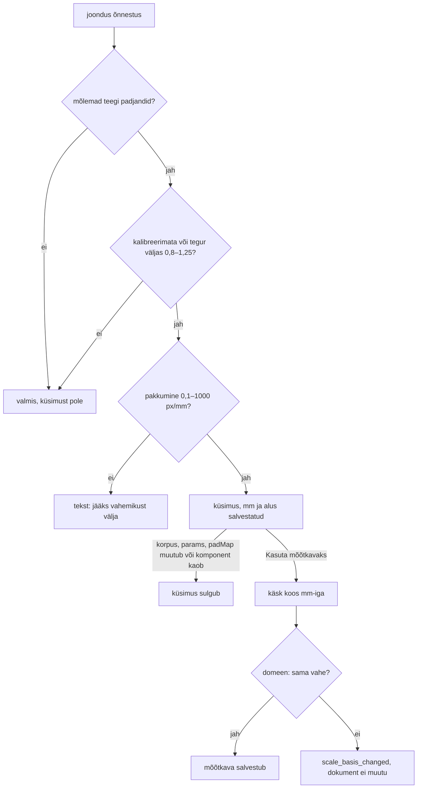

# M2-2b-7 · Mõõtkavapakkumise kehtivus, märkide kontrast ja näidisfailid

**Olek:** vastu võetud `5e27a2b` · **Rada:** B · **Haru:** `codex/m2-2b` (tööpuu `C:/Users/TRUMPIT/.codex/worktrees/bb-m2-2b/BB`) · **Alus:** `2a083fa` · **Allikas:** [M2.2b plaan](../plans/M2-2b-korpused-ja-mootkava.md), ül. 7 ja [Astra audit](../review/2026-11-25-m2-2b-ulevaatus-2eb1a1c.md), leiud 02, 04, 06 ja 07

## Eesmärk
„Kasuta mõõtkavaks“ salvestab täpselt selle mõõtkava, mida küsimus näitas, ja ainult teadaoleva korpuse jalgadest:
- Kui korpus, parameetrid või jalgade kaart muutub või komponent kaob, küsimus sulgub. Käsk lükkab muutunud aluse tagasi (leid 02).
- Käsitsi lisatud jalgadega joondus töötab nagu praegu, aga mõõtkava ei pakuta (leid 04).
- Kui joondus õnnestus, aga pakkumine jääks lubatud vahemikust välja, ütleb tööriist seda (leid 06).
- Pluss ja triip on loetavad igal fotol mõlemas teemas (leid 07).
- Lisaks tulevad näidisfailid `v0.6.0` ja `v0.7.0` (03 § 9).

## Loe (ainult need)
Esimene viide on põhikaustas, teised loe tööpuust (`2a083fa`).
- `docs/review/2026-11-25-m2-2b-ulevaatus-2eb1a1c.md:38-73` (leiud 02, 04, 06 ja 07 koos kordusjuhtumitega)
- `packages/domain/src/rules/scale-from-pins.ts:1-75` (`pinPairInMm`, `pinSpacingMm`, `scaleFromPins`; padjandid `geometry/board.ts:89-97`)
- `packages/features/components/ui/AlignTool.ts:19-118` (`applyComponentScale` ja `alignClick`)
- `packages/features/components/ui/AlignScaleQuestion.tsx:22-57` (küsimus; `hud`-i kutse `packages/ui/src/canvas/Canvas.tsx:205-215` ja `382-383`)
- `packages/features/components/ui/layers/ComponentShape.tsx:43-85` (`Body`: kontuur, märgid, 1. jala punkt)

## Muuda
- `packages/domain/src/rules/scale-from-pins.ts`: otsused 1 ja 2.
- `packages/features/components/contract.ts`: `ScaleFromPinsSchema` väli `mm` (otsus 2).
- `packages/features/components/ui/`:
  - `align.ts`: `scaleBasisKey`;
  - `align-store.ts`: `mm` ja `basis`;
  - `AlignTool.ts`: otsused 1, 3 ja 4;
  - `AlignScaleQuestion.tsx`: otsus 3;
  - `errors.ts` ja `i18n/et.ts`: otsus 2.
- `packages/ui/src/canvas/tools.ts` ja `Canvas.tsx`: `hud`-i teine argument (otsus 3).
- `packages/features/components/ui/layers/ComponentShape.tsx`: otsus 5.
- Näidisfailid (otsus 6).
- Testid jaotisest „Tõend“. Olemasolevaid ootusi ei muudeta. Muuta võib ainult kahte sisendit ja ühte abifunktsiooni:
  - `scale_from_pins_sets_scale_and_places_component` ja `scale_from_pins_command_is_one_undo_step` saavad sisendisse `mm: 2`;
  - `interaction.test.tsx`-i `mount` saab valikulise `pxPerMm` (vaikimisi 10).
- `pnpm api` (`@pcbk/ui` ja components liides muutuvad).

## Ära puutu
- `alignByTwoPins`, joonduse piir 0,2–5, `pickHit`, `query` ja Enteri reegel M2-2b-6-st.
- Failivorming (`format_version`, skeemifail), versioon, liitmine ja sildid. Olemasolevad näidisfailid `v0.1.0`–`v0.5.0`.
- Leiud 08–14 (M2.3 plaan ja salvestuse kaart).
- Kasutaja fotod ja projektid: ainult sünteetilised andmed.

## Otsused ja liidesed
1. **Mõõtkava alus on ainult korpuse teegi padjandid** (leid 04).
   - `pinSpacingMm(board, pinA, pinB)` tagastab vahe ainult siis, kui mõlemad füüsilised padjandid tulevad korpuse geomeetriast. Käsitsi lisatud (`customPads`) või puuduva padjandi korral tagastab see `undefined`.
   - `boardPads` paneb jala korpuse padjandid enne käsitsi lisatuid. Seega on padjand teegi oma, kui `padIndex` on väiksem kui selle jala korpuse padjandite arv.
   - Joonda: kui `pinSpacingMm` on `undefined`, käib joondus nagu praegu, aga küsimust ega mõõtkava teksti ei tule. Ebaõnnestunud joonduse veateade jääb samaks.
2. **Käsk kontrollib kuvatud alust** (leid 02).
   - `ScaleFromPinsSchema` ja domeeni `scaleFromPins` sisend saavad välja `mm: z.number().positive()`, mis on küsimuses kuvatud jalgade vahe.
   - Kontrollide järjekord:
     1. komponent puudub → `RuleTargetNotFound`;
     2. `not_placed`;
     3. sama jalg või puuduv padjand → `pins_coincide`;
     4. käsitsi lisatud padjand → `RuleRejected('scale_needs_library_pads')`;
     5. `|praegune vahe − mm| > 1e-6` → `RuleRejected('scale_basis_changed')`;
     6. senine vahemiku kontroll.
   - Tagasilükatud käsk dokumenti ei muuda.
   - `commandError`:
     - `scale_basis_changed` → `alignEt.scaleBasisChanged` = „Korpus või jalad muutusid. Joonda uuesti.“;
     - `scale_needs_library_pads` → `alignEt.scaleNeedsLibraryPads` = „Mõõtkava saab võtta ainult korpuse teegi jalgadest.“
3. **Küsimus hoiab oma alust ja sulgub selle muutumisel** (leid 02).
   - `AlignScaleStage` saab kaks välja:
     - `mm: number` on küsimuse avamisel arvutatud `pinSpacingMm`;
     - `basis: string` on `scaleBasisKey(board)` = `JSON.stringify([board.footprint, board.params, board.padMap ?? null])` (`align.ts`).
   - Küsimuse „Uus mõõtkava“ arvutatakse `stage.mm` järgi ja `applyComponentScale` saadab käsule `stage.mm`. Kuvatud ja salvestatud mõõtkava on sama arv.
   - `CanvasTool` saab `hud?(api: ToolApi, snapshot: Snapshot): JSX.Element | null` ja `Canvas` annab sellele oma praeguse `snapshot`-i. Põhjus: `api.snapshot()` loeb viidet, mida `Canvas` uuendab alles efektis, nii et renderdamise ajal on see ühe sammu vana. Piiks võib argumendi kasutamata jätta.
   - `AlignScaleQuestion` saab `snapshot`-i. Küsimus ei renderdu ja efekt kutsub `reset()`, kui komponenti või selle `board`-i pole või kui `scaleBasisKey` erineb `stage.basis`-ist. Paigutuse muutus (keskpunkt, nurk, tegur) küsimust ei sulge.
   - `applyComponentScale` kontrollib sama tingimust `api.snapshot()` järgi. Kui alus muutus, kutsub see `reset()` ja käsku ei käivita.
4. **Lubamatu pakkumine saab selgituse** (leid 06).
   - Pärast õnnestunud joondust tuleb pakkumine siis, kui teegi vahe on olemas, `distance >= 5` ja foto on kalibreerimata või tegur on väljaspool 0,8–1,25:
     - pakkumine 0,1–1000 px/mm piires → küsimus nagu praegu;
     - pakkumine väljaspool → tööriist läheb sammule 1 ja näitab teksti `alignEt.scaleOutOfRange`, joondus ja selle `Ctrl+Z` jäävad alles.
   - Ebaõnnestunud joonduse haru (`scale_out_of_range`, küsimus asendab vea) jääb samaks.
5. **Plussi ja triibu alusjoon** (leid 07).
   - `Body` joonistab iga `plus` ja `band` märgi alla sama `d`-ga tee. Selle omadused on `data-mark-halo={kind}`, `fill="none"`, `stroke="var(--halo)"`, `strokeWidth={3.6}` ja `strokeLinecap="round"`; `vectorEffect` ja `strokeDasharray` on samad mis märgil.
   - Järjekord: kontuuri halo → märkide halod → kontuuri joon → märgid → 1. jala punkt. Nii ei kata märgi halo kontuuri joont. `notch` ja `tab` halo ei saa.
6. **Näidisfailid 03 § 9 järgi.**
   - Failid:
     - `apps/desktop/src-tauri/tests/fixtures/v0.6.0.pcbk` ja `packages/domain/src/__fixtures__/releases/v0.6.0.document.json`;
     - `v0.7.0.pcbk` ja `v0.7.0.document.json` samades kaustades.
   - `v0.6.0` luuakse sildi `v0.6.0` kasutajaliidesest sünteetilise fotoga ajutises tööpuus `%TEMP%\bb-m2-2b-7\v0.6.0-worktree` (`git worktree add --detach … v0.6.0`), nagu [M2-2-11](M2-2-11.md) tegi `v0.5.0`-ga. Hiljem eemaldatakse ajutine tööpuu. `v0.7.0` luuakse selle haru koodiga.
   - Mõlemas on R1 ja U1 (SOIC-8, jala 3 nimi „FB“, jalg 8 NC), sest seda kontrollivad olemasolevad üldtestid.
   - `v0.6.0`: kalibreering ja kaks Piiksu läbivust (üks piiksub ja ühendab, teine ei piiksu). Lisaks ühendus ja võrk rolliga `kind: 'ground'`.
   - `v0.7.0`: mõõtkava „Kasuta mõõtkavaks“ kaudu U1 jalgadest 1 ja 4 (3,81 mm), radiaalne elektrolüüt C1 (ümar, pluss ja triip) ning U1 sälk.
   - Dokumendi JSON võetakse sama `.pcbk` faili dokumendist. Haru failis on `app_version` `0.6.0`, sest versioon tõuseb liitmisel. Suurus ja SHA-256 lähevad üleandmisse.

## Tõend
- TS:
  - `scale_from_pins_rejects_changed_basis_and_own_pads` (`packages/domain/src/rules/scale-from-pins.test.ts`): R1 on 0805 nagu senises testis, sihid (200, 200) ja (200, 240). Kui R1 `params` on enne käsku `{ size: '1206' }` ja sisend on endiselt `mm: 2`, visatakse `scale_basis_changed` ja dokument ei muutu. Komponendil `footprint: 'area'` on käsitsi padjandid `'1'` (−2; 0) ja `'2'` (2; 0) mm (`sizeMm: 1`, `circle`, `through: false`). `pinSpacingMm` annab `undefined`, `scaleFromPins` `mm: 4`-ga viskab `scale_needs_library_pads` ja dokument ei muutu.
  - `scale_question_closes_when_basis_changes` (`packages/features/components/ui/layers/interaction.test.tsx`): iga alamjuhtum algab eraldi `mount()`-iga (0805, 10 px/mm, kalibreeritud). Pärast seda `beginAlignment` ja klõps (180, 160): joondus rakendub ja küsimus näitab „Uus mõõtkava: 20,00 px/mm“. `act`-is `components.rotate` `{ ids: [id], deltaDeg: 90 }` jätab küsimuse ja sama teksti; „Kasuta mõõtkavaks“ kutsub `components.scaleFromPins`-i `mm: 2`-ga ja mõõtkava on 20. `act`-is `components.changeFootprint` `{ id, footprint: 'chip', params: { size: '1206' }, newPinUids: {} }` sulgeb küsimuse; `Enter` stseeni `svg`-l ei kutsu `components.scaleFromPins`-i ja mõõtkava jääb 10-ks. `act`-is `items.delete` `{ ids: [id] }` sulgeb küsimuse ja veateadet ei tule.
  - `align_own_pins_offer_no_scale_question` (`interaction.test.tsx`): `mount({ footprint: 'area', params: {}, center: (170, 100), customPads }, 1, 'none', false)`; `customPads` jaoks on `'1'` (−2; 0) ja `'2'` (2; 0) mm, `sizeMm: 1`, `circle`. Jalg 1 (150, 100) läheb sihti (300, 300) ja jalg 2 (190, 100) sihti (380, 300). `components.align` rakendub üks kord. Küsimust ega veateadet pole. `components.scaleFromPins`-i ei kutsuta. Mõõtkava jääb 10 px/mm ja `calibrated: false`.
  - `align_out_of_range_proposal_explains_and_keeps_alignment` (`interaction.test.tsx`): `pxPerMm: 800`, suum 0,1, 0805 keskpunkt (1000, 1000), jalad maailmas (200, 1000) ja (1800, 1000). Ekraaniklõpsud: jalg 1 (20, 100) → siht (50, 300) ja jalg 2 (180, 100) → siht (290, 300). Joondus rakendub (`rev` + 1, `scaleX` ≈ 1,5), küsimust pole, tekst „Selle korpuse järgi jääks mõõtkava lubatud vahemikust (0,1–1000 px/mm) välja.“ on nähtav ja mõõtkava on 800. `engine.undo()` taastab keskpunkti (1000, 1000) ja `scaleX: 1`.
  - `component_marks_have_halo_underlay` (`packages/features/components/ui/layers/body-marks.test.tsx`): andmed on samad mis `body_marks_draw_on_canvas`-is. C1 `[data-mark="plus"]` ja `[data-mark="band"]` all on kummalgi üks `[data-mark-halo]` sama `d`-ga, `stroke="var(--halo)"`, `stroke-width="3.6"` ja `fill="none"`. Dokumendi järjekord on kontuuri halo polügon, märkide halod, kontuuri joone polügon, märgid. SOIC-il pole ühtegi `[data-mark-halo]`-d.
  - `release_documents_v060_v070_keep_their_content` (`packages/domain/src/release-files.test.ts`): kontroll tehakse pärast `migrateDoc`-i, `BoardDocSchema.parse`-i ja `validateDocument`-i. `v0.6.0`-s on vähemalt kaks mõõtmist `mode: 'continuity'` ja `source: 'beep_mode'`, üks `beep: true` ja üks `beep: false`. Seal on ka vähemalt üks ühendus `basis: 'assumed'` ja `roles`-is roll `kind: 'ground'`. `v0.7.0`-s on `scale.calibrated` `true` ja `scale.calib.mm` 3,81 ± 0,001. C1 `board.footprint` on `'radial'` ja U1 oma `'soic'`.
- Ekraanipildid `output/playwright/m2-2b-7/`: radiaal D 6,3 20 px/mm juures heledas ja tumedas teemas, kumbki valge ja musta sünteetilise foto peal (4 pilti). Failinimed lähevad üleandmisse.
- Rada B täisring: põhikaustast `pnpm bb-review-card M2-2b-7` (koos `cargo test`-iga) → `ok: true`, `missing: []`.
  - `every_release_pcbk_opens_without_modifying_source` avab ka uued failid.
  - `every_release_document_migrates_and_validates`, `scale_from_footprint_end_to_end`, `align_enter_on_other_button_keeps_scale` ja `align_question_replaces_out_of_range_error` läbivad muutmata.

## Valmis kui
- [x] Testid ja täisring läbivad.
- [x] Muudetud on ainult jaotises „Muuda“ nimetatud sisendid ja `mount`-i parameeter, olemasolevad ootused on samad.
- [x] Näidisfailid on lisatud, suurus ja SHA-256 on üleandmises ning ajutine `v0.6.0` tööpuu on eemaldatud.
- [x] `docs/api` on uuendatud.
- [x] Üleandmine on allpool, kuni 20 rida.

## Üleandmine

- Puhas algseis `2a083fa`, haru `codex/m2-2b`, tööpuu `C:/Users/TRUMPIT/.codex/worktrees/bb-m2-2b/BB`.
- RED 6/6 alusel. Logid tööpuus `output/playwright/m2-2b-7/` failides `domain-red.log`, `align-red.log`, `halo-red.log` ja `release-red.log`.
- GREEN 6/6. Pakkumine hoiab vahet ja alust, käsitsi lisatud padjandid sobivad paigutuse joondamiseks ning üle piiri jääv pakkumine saab selgituse. Plussil ja triibul on kontrastne alusjoon.
- Kahele vanale sisendile lisandus `mm: 2` ja `mount`-ile valikuline `pxPerMm`. Failipikkuse piiri tõttu kolis ühine seadistus faili `interaction-fixture.tsx`. Võrdlus kinnitas kõigi 20 varasema interaktsioonitesti keha samasuse.
- Näidisprojektid salvestati sünteetiliste fotodega eraldatud töölaualiidestes. `v0.6.0` tuli sildi tööpuust, mis on nüüd eemaldatud. Haru näidis salvestas U1.1–U1.4 vahe 3,81 mm ning selle `app_version` on `0.6.0`.
- `.pcbk`-failid on `apps/desktop/src-tauri/tests/fixtures/`, JSON-id `packages/domain/src/__fixtures__/releases/`. SQLite `quick_check` ja JSON-i vastavus on tõendis `output/playwright/m2-2b-7/fixtures-verified.json`.
- `v0.6.0.pcbk` 53 248 baiti, SHA-256 `6797fcb5faad2e7c33cd1d3997743fccce0b04b332d9bd8d48021ead0ca2d078`.
- `v0.6.0.document.json` 5 179 baiti, SHA-256 `365b199dec7a6de1cc09015c1b4ef613a409c1e495a235341ac94840ab776360`.
- `v0.7.0.pcbk` 53 248 baiti, SHA-256 `3b7d904be92fcca537753aaa8224b2297cc623a4114b5171bcf64bdac7f0bfff`.
- `v0.7.0.document.json` 4 625 baiti, SHA-256 `6179b3e7c1cd48932b3f1435c57959ee0805450558107474ebd7baa540b12eb7`.
- Ekraanipildid `output/playwright/m2-2b-7/` kaustas on `radial-light-white.png`, `radial-dark-white.png`, `radial-light-black.png` ja `radial-dark-black.png`.
- `pnpm api` uuendas domeeni reeglite, komponentide ja lõuendi API-väljavõtteid. Uued näidisfailid läbisid olemasolevad TS- ja Rusti ühilduvustestid.
- `pnpm bb-review-card M2-2b-7` läbis raja B täisringi (`ok: true`, `missing: []`). Vitest 1752/1752, E2E 46/46, Rust 108/110 (2 vahele jäetud). Raport `output/review-card/M2-2b-7-Kh41hS/summary.json`.

## Arhitekti ülevaatus (2026-11-26)

- Tööpuus on 24 faili (19 muudetud, 5 uut), kõik kaardi loendist, lisaks testide abifail `__tests__/interaction-fixture.tsx`. Võõraid faile pole.
- Otsused koodis:
  - (1) `pinSpacingMm` tagastab vahe ainult teegi padjanditele. Padjand on teegi oma, kui `padIndex` on väiksem kui selle jala korpuse padjandite arv. `pinPairInMm` loeb nüüd mõlemad jalad ühe `boardPads`-i kutsega ja filtreerib jala järgi. Jala sees on järjestus sama, nii et `padIndex` tähendab sama mis enne.
  - (2) Skeemis on `mm: z.number().positive()`. Domeeni järjekord vastab kaardile: `pins_coincide`, siis `scale_needs_library_pads`, siis `scale_basis_changed` (piir 1e-6) ja lõpuks vahemik. Mõlemad uued koodid on `commandError`-is kaardi tekstidega.
  - (3) Küsimus hoiab `mm`-i ja `basis`-t. Kuvatud väärtus tuleb `stage.mm`-ist ja sama arv läheb käsule. `hud(api, snapshot)` annab paneelile praeguse dokumendi. Aluse muutumisel paneel ei renderdu ja `useLayoutEffect` kutsub `reset()`. Ka `applyComponentScale` kontrollib alust enne käsku.
  - (4) Õnnestunud joonduse järel annab lubamatu pakkumine `scaleOutOfRange` teksti ja tööriist läheb sammule 1. Ebaõnnestunud joonduse haru on sama mis enne.
  - (5) Plussi ja triibu halod joonistatakse kontuuri halo ja kontuuri joone vahele. `notch` ja `tab` halo ei saa.
- Testid:
  - kõik kuus nime on failides, igaüks üks kord;
  - ehitaja RED-logid näitavad, et alusel kukkusid läbi kõik kuus.
- Abifaili kolimine: võrdlesin `2a083fa` ja praeguse `interaction.test.tsx`-i testikehi. Kõik 18 varasemat testi on muutumata. Abifail erineb vanast päisest ainult `export`-ide, `reset`-funktsiooni ja `pxPerMm` parameetri poolest. Üleandmises on varasemate testide arv 20, tegelik arv on 18.
- Kaardi täpsustus: `scale_question_closes_when_basis_changes` vajab enne sihti jala 2 klõpsu (110, 80). Kaardil see puudus, ehitaja lisas selle õigesti.
- Kontrollid: ehitaja `summary.json` (21:02) on uuem kui tööpuu viimane muudatus (20:54). Tulemused: rada B, `ok: true`, `missing: []`, Vitest 1752/1752, E2E 46/46 ja Rust 108/110. Kõigi seitsme kontrolli väljumiskood on 0. Täisringi uuesti ei käivitatud.
- Näidisfailid:
  - nelja faili SHA-256 vastab üleandmisele;
  - `fixtures-verified.json` näitab mõlemal `quickCheck: ok` ja `jsonMatches: true`;
  - `v0.7.0` mõõtkava on 76 px / 3,81 mm = 19,95 px/mm;
  - mõlema faili `app_version` on `0.6.0`, nagu kaart ette nägi;
  - ajutist `v0.6.0` tööpuud `git worktree list` enam ei näita.
- Ekraanipildid: vaatasin Astra kaht halvimat juhtu, heledat teemat musta foto peal ja tumedat teemat valge foto peal. Mõlemal on pluss ja triip alusjoonega selgelt eristatavad. Teist kaht pilti ma ei vaadanud.
- **Otsus: sobib.**
